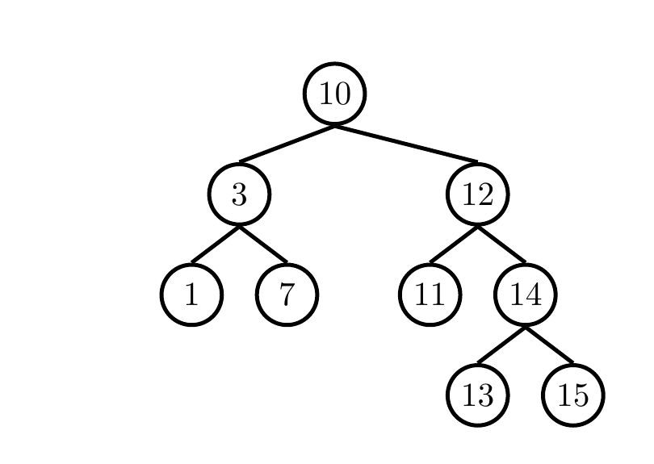
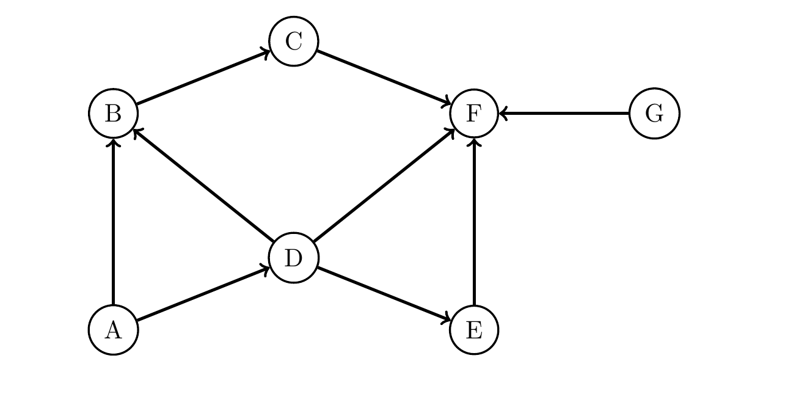
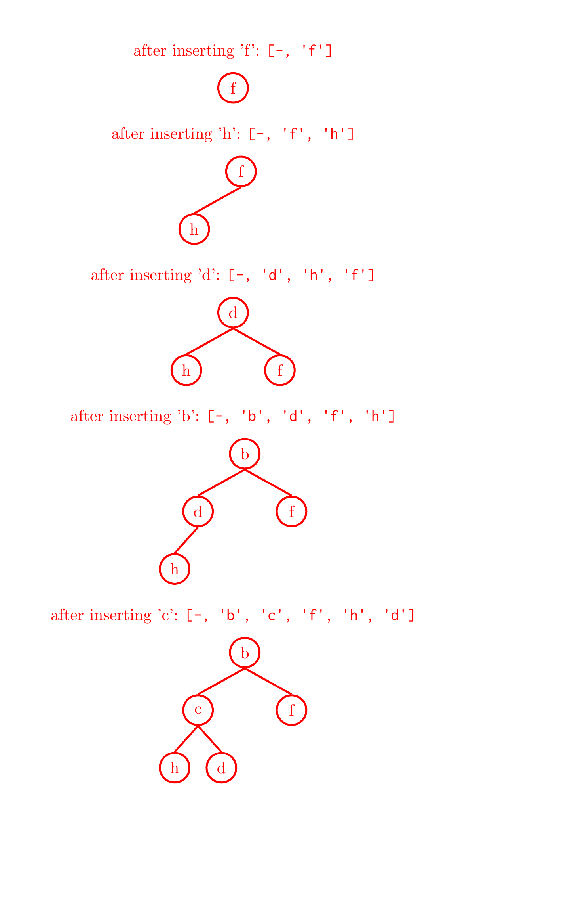
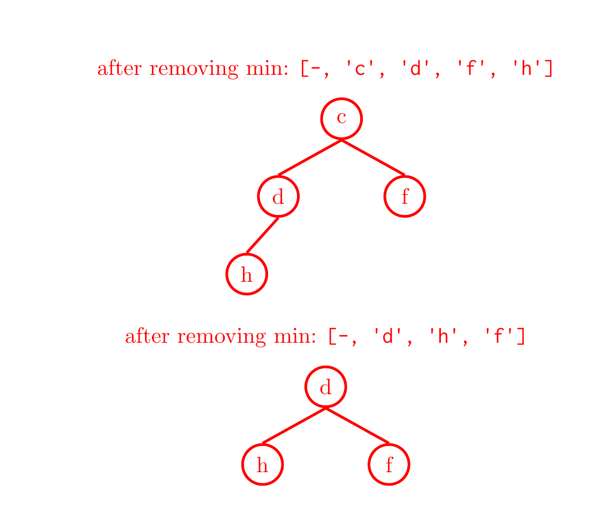
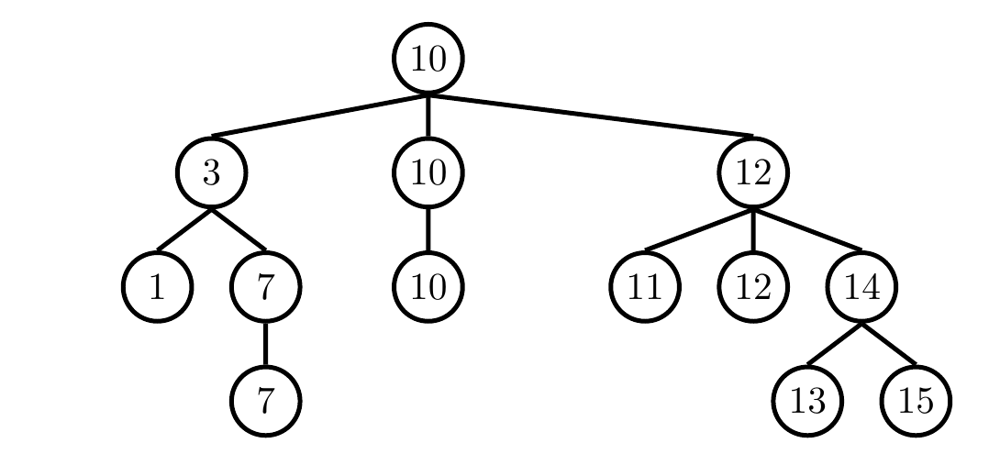

# Discussion 08 — Graphs, Heaps / 图与堆

> UC Berkeley CS 61B, Spring 2024
>
> Discussion date: March 11, 2024

本页保留题号、官方资料、图示与导航。与代码、操作序列、数据表示、代码追踪或复杂度分析有关的完整英文题目、中文翻译和独立答案，已迁移到对应的 IntelliJ-ready Java 文件；Java 文件是这些题目的权威版本。

## Regular

### Question 1 — Trees, Graphs, and Traversals, Oh My! / 树、图与遍历

- [Question Java — Dis08RegularQ1GraphRepresentationsAndTraversals](code/questions/Dis08RegularQ1GraphRepresentationsAndTraversals.java)
- [Solution Java — Dis08RegularQ1GraphRepresentationsAndTraversalsSolution](code/solutions/Dis08RegularQ1GraphRepresentationsAndTraversalsSolution.java)

#### 1a — BST traversals / BST 遍历

写出前序、中序、后序和层序（BFS）遍历。完整双语题目和答案见上方 Java 文件；树形图继续保留在此。

#### 1b — Adjacency matrix and list / 邻接矩阵与邻接表

把有向图表示为邻接矩阵和邻接表，并分析改成无向图后的区别。Question Java 包含作为输入数据的边集合，但不包含最终矩阵或邻接表答案。

#### 1c — DFS and BFS orders / DFS 与 BFS 顺序

从 A 出发，按字母序打破平局，求 DFS 前序、DFS 后序和 BFS 顺序；Java 文件同时区分是否对不可达顶点重新启动遍历。

### Question 2 — Absolutely Valuable Heaps / 绝对有价值的堆

- [Question Java — Dis08RegularQ2MinHeapOperations](code/questions/Dis08RegularQ2MinHeapOperations.java)
- [Solution Java — Dis08RegularQ2MinHeapOperationsSolution](code/solutions/Dis08RegularQ2MinHeapOperationsSolution.java)

#### 2a — Min-heap operation trace / 最小堆操作追踪

依次插入 `f, h, d, b, c`，再执行两次 `removeMin`，画出每一步的堆和数组表示。Question Java 提供题目假设所需的最小黑盒堆，但不预先输出最终状态。

#### 2b — Mimic a max-heap / 模拟最大堆

把整数 `MinHeap` 当作黑盒，设计支持常数时间取得最大值和 `Theta(log n)` 插入的最大堆包装器。完整限制、提示、官方答案与 Java `int` 边界补充分析见对应 Java 文件。

### Question 3 — Trinary Search Tree / 三叉搜索树

- [Question Java — Dis08RegularQ3TrinarySearchTree](code/questions/Dis08RegularQ3TrinarySearchTree.java)
- [Solution Java — Dis08RegularQ3TrinarySearchTreeSolution](code/solutions/Dis08RegularQ3TrinarySearchTreeSolution.java)

设计按降序打印 TST 全部元素的遍历。完整双语题目、可编译结点定义和独立答案实现见 Java 文件；示例图继续保留在此。

## Exam Prep

### Question 1 — Graph Conceptuals / 图的概念题

- [Question Java — Dis08ExamPrepQ1GraphConceptuals](code/questions/Dis08ExamPrepQ1GraphConceptuals.java)
- [Solution Java — Dis08ExamPrepQ1GraphConceptualsSolution](code/solutions/Dis08ExamPrepQ1GraphConceptualsSolution.java)

#### 1a — True/False graph properties / 图性质判断

判断树的边数条件、无向图 DFS 查看边的次数，以及 BFS fringe 的距离差性质。概念作答区位于 Question Java 注释中。

#### 1b — Undirected cycle detection / 无向图判环

设计无向图判环算法并分析最坏复杂度。Solution Java 原样保留官方 `Theta(V)`，并在 `Supplemental analysis / 补充分析（非官方答案）` 中说明一般邻接表实现的 `Theta(V + E)`。

### Question 2 — Fill in the Blanks / 填空题

- [Question Java — Dis08ExamPrepQ2MinHeapAnalysis](code/questions/Dis08ExamPrepQ2MinHeapAnalysis.java)
- [Solution Java — Dis08ExamPrepQ2MinHeapAnalysisSolution](code/solutions/Dis08ExamPrepQ2MinHeapAnalysisSolution.java)

填写最小堆操作复杂度、可能产生有序结果的遍历、第四小元素的位置数，以及满完全二叉堆指定层结点的必然大小关系。官方题面中 `N` 同时用于元素数和层数的冲突，在 Solution Java 中按原文保留并另作补充说明。

### Question 3 — Heap Mystery / 堆之谜

- [Question Java — Dis08ExamPrepQ3HeapMystery](code/questions/Dis08ExamPrepQ3HeapMystery.java)
- [Solution Java — Dis08ExamPrepQ3HeapMysterySolution](code/solutions/Dis08ExamPrepQ3HeapMysterySolution.java)

#### 3a — Infer the operation sequence / 逆推操作序列

由初始数组 `[-, A, B, C, D, E, F, G]` 和最终数组 `[-, A, E, B, D, X, F, G]` 逆推四个 `removeMin`/`insert` 操作。

#### 3b — Infer required comparisons / 推断必然比较关系

用 `>`, `<` 或 `?` 判断 `X` 与 `D/C`、`B` 与 `C`、`G` 与 `X` 的关系。官方“根位于 index 0”与数组中的前导 `-` 不一致；Solution Java 保留原文并把提醒放在非官方补充分析中。

## 完整性检查

- Regular：Question 1（1a–1c）、Question 2（2a–2b）、Question 3 均链接到一对 Question/Solution Java 文件。
- Exam Prep：Question 1（1a–1b）、Question 2、Question 3（3a–3b）均链接到一对 Question/Solution Java 文件。
- 图示保留：BST、有向图、TST，以及两张官方堆状态图仍位于 `assets/`，没有转成失真的 ASCII 图。
- Java 边界：Question 文件不含官方答案；Solution 文件独立编译，并明确分隔官方英文、中文解释和非官方修正。
- IntelliJ：`code/questions/` 与 `code/solutions/` 使用仓库已有的 `questions`、`solutions` package 约定。如 IDEA 未自动识别，可将 `code` 目录一次性标记为 Sources Root。

## 官方资料

- [Regular PDF](https://sp24.datastructur.es/assets/discussions/regular08.pdf)
- [Regular Solutions PDF](https://sp24.datastructur.es/assets/discussions/regular08sol.pdf)
- [Exam-Level PDF](https://sp24.datastructur.es/assets/discussions/examlevel08.pdf)
- [Exam-Level Solutions PDF](https://sp24.datastructur.es/assets/discussions/examlevel08sol.pdf)
