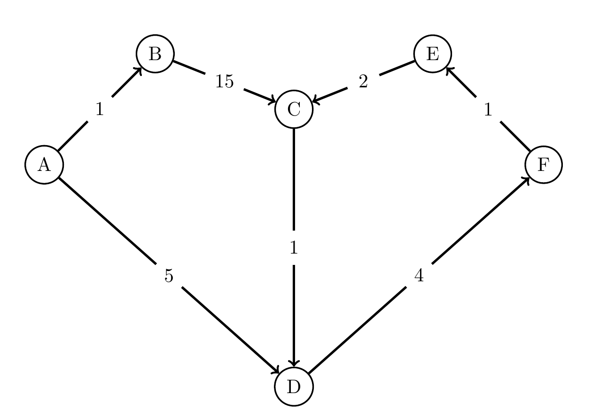
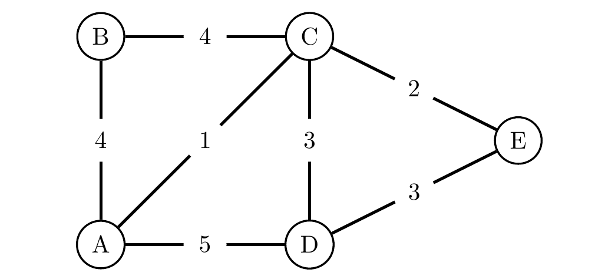
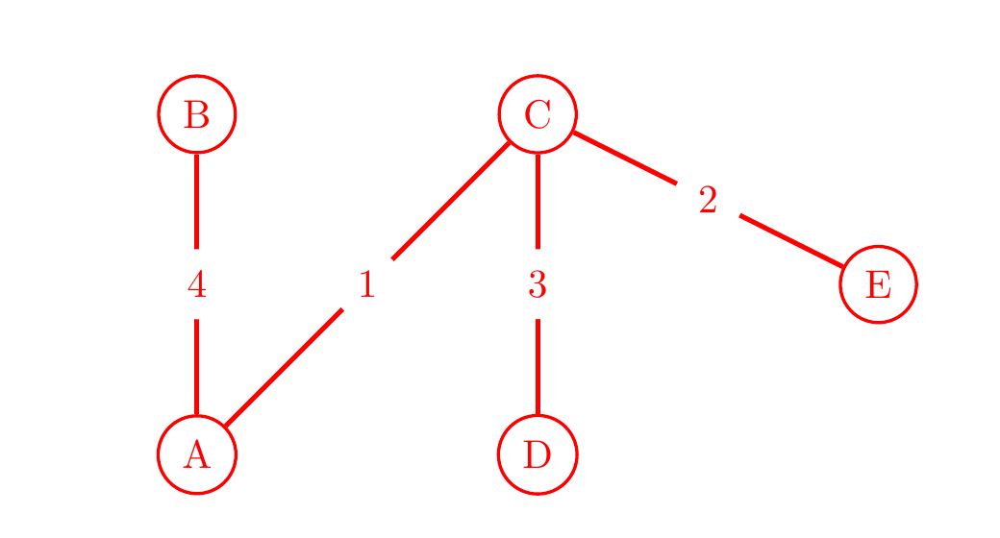
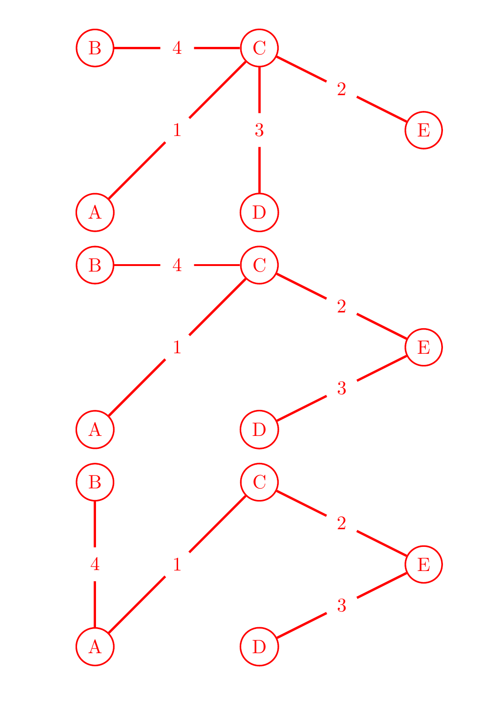
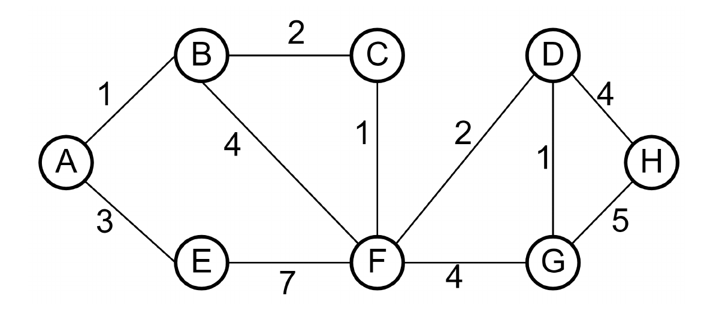
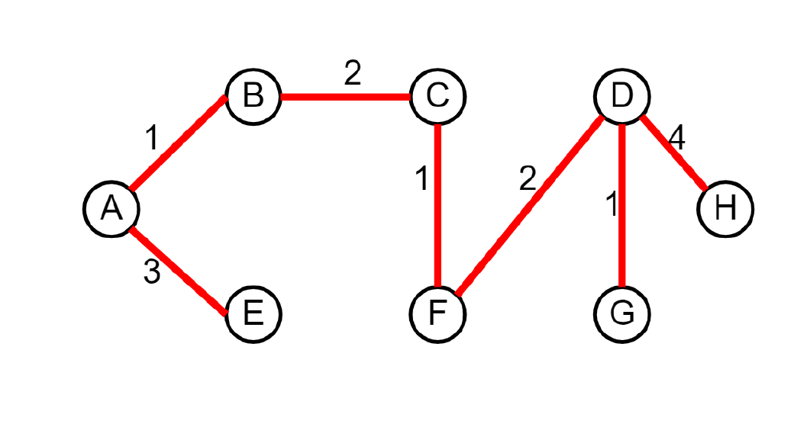
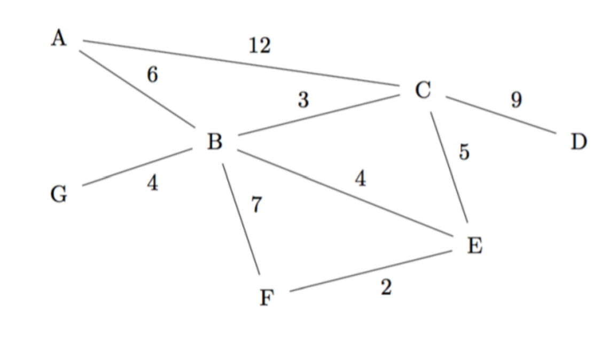

# Discussion 09 — Shortest Paths, MSTs / 最短路径与最小生成树

> UC Berkeley CS 61B, Spring 2024
> Discussion date: March 18, 2024

本页保留题目结构、官方资料链接和必须依赖图形的内容。代码追踪、Java 数据、
算法实现及文字答案的权威版本已迁移到 `code/questions/` 与 `code/solutions/`；
Markdown 不再维护一份容易与 Java 漂移的完整代码/答案副本。

## Regular

### Question 1 — The Shortest Path To Your Heart / 通往你心中的最短路径

- [Question Java：Dis09RegularQ1ShortestPaths](code/questions/Dis09RegularQ1ShortestPaths.java)
- [Solution Java：Dis09RegularQ1ShortestPathsSolution](code/solutions/Dis09RegularQ1ShortestPathsSolution.java)

题目要求在下图上追踪 Dijkstra 与 A*，并分析启发式的可采纳性和一致性。英文
原题、中文翻译、官方伪代码、TODO 与完整官方答案均在上述 Java 文件中。

#### 1a

运行 Dijkstra，填写 `DistTo`、`EdgeTo` 和优先队列轨迹。答案 Java 文件保留
官方完整队列轨迹。

#### 1b

使用官方边权和启发值，从 A 开始、以 F 为目标追踪 A*。

#### 1c

判断 1b 的启发式是否良好，并给出使结论改变的修改。

### Question 2 — Minimalist Moles / 极简鼹鼠隧道

- [Question Java：Dis09RegularQ2MinimumSpanningTrees](code/questions/Dis09RegularQ2MinimumSpanningTrees.java)
- [Solution Java：Dis09RegularQ2MinimumSpanningTreesSolution](code/solutions/Dis09RegularQ2MinimumSpanningTreesSolution.java)

题目图和官方图形答案继续保留在 Markdown；边列表、Kruskal/Prim 操作序列、
英文原题、中文翻译与官方文字答案在 Java 文件中。

#### 2a

分别按指定平局规则运行 Kruskal 与从 A 开始的 Prim。

#### 2b

比较 2a 的两棵树，并讨论改变平局规则后的结果。

### Question 3 — Sticky Flights / 蜂蜜航班

- [Question Java：Dis09RegularQ3StickyFlights](code/questions/Dis09RegularQ3StickyFlights.java)
- [Solution Java：Dis09RegularQ3StickyFlightsSolution](code/solutions/Dis09RegularQ3StickyFlightsSolution.java)

将机场停留时间转换为图代价，再用最短路径算法求最少总耗时。Question 文件
提供不泄露答案的 `Flight`/`Route` 编译脚手架；Solution 文件实现一种官方允许
的建模并包含确定性 smoke test。

# Exam Prep

### Question 1 — Dijkstra’s, A* / Dijkstra 与 A*

- [Question Java：Dis09ExamPrepQ1DijkstraAStar](code/questions/Dis09ExamPrepQ1DijkstraAStar.java)
- [Solution Java：Dis09ExamPrepQ1DijkstraAStarSolution](code/solutions/Dis09ExamPrepQ1DijkstraAStarSolution.java)

#### 1a

从 A 开始运行 Dijkstra，平局按字母序处理，移除 G 时停止，并画出 SPT。

#### 1b

从 A 到 G 运行 A*，记录 `(distance, priority)`，并判断启发式是否可采纳。

### Question 2 — Conceptual Shortest Paths / 最短路径概念题

- [Question Java：Dis09ExamPrepQ2ConceptualShortestPaths](code/questions/Dis09ExamPrepQ2ConceptualShortestPaths.java)
- [Solution Java：Dis09ExamPrepQ2ConceptualShortestPathsSolution](code/solutions/Dis09ExamPrepQ2ConceptualShortestPathsSolution.java)

#### 2a

等正边权图中，BFS 是否返回最短路径。

#### 2b

互异边权是否保证任意两点之间的最短路径唯一。

#### 2c

所有边权同时加上正常数是否保持最短路径。

#### 2d

所有边权同时乘以正常数是否保持最短路径。

### Question 3 — Shortest Paths Algorithm Design / 最短路径算法设计

- [Question Java：Dis09ExamPrepQ3ShortestPathsDesign](code/questions/Dis09ExamPrepQ3ShortestPathsDesign.java)
- [Solution Java：Dis09ExamPrepQ3ShortestPathsDesignSolution](code/solutions/Dis09ExamPrepQ3ShortestPathsDesignSolution.java)

在加权有向铁路图中，用 $O((V+E)\log V)$ 算法求蒙德城市集合到枫丹城市集合
的最短距离。

#### 3a

$|M|=1$，$|F|>1$。

#### 3b

$|M|>1$，$|F|=1$。

#### 3c

$|M|>1$，$|F|>1$。

### Question 4 — Introduction to MSTs / 最小生成树入门

- [Question Java：Dis09ExamPrepQ4MinimumSpanningTrees](code/questions/Dis09ExamPrepQ4MinimumSpanningTrees.java)
- [Solution Java：Dis09ExamPrepQ4MinimumSpanningTreesSolution](code/solutions/Dis09ExamPrepQ4MinimumSpanningTreesSolution.java)

#### 4a

列出 Prim 与 Kruskal 的加边顺序。

#### 4b

判断：把唯一最小边的权重加 1 是否必然改变 MST 总权重。

#### 4c

判断：“一棵 MST 内的边权唯一”是否足以推出 MST 唯一。Solution 文件保留
官方答案，并把英文题意的逻辑缺口放在明确标注的非官方补充分析中。

#### 4d

判断 MST 中的两点路径是否必然等于原图中的两点最短路径。

## 完整性检查

- Regular：Question 1（1a–1c）、Question 2（2a–2b）、Question 3 均有一对
  Question/Solution Java 文件。
- Exam Prep：Question 1（1a–1b）、Question 2（2a–2d）、Question 3
  （3a–3c）、Question 4（4a–4d）均有一对 Question/Solution Java 文件。
- 7 张官方图继续保留在 `assets/` 并由本页引用；图形没有被强行转换为
  Java 或 ASCII 图。
- Question 文件不含官方结论或预先计算的结果；Solution 文件保留官方英文，
  中文解释与非官方补充分析明确分区。
- 当前官方 Regular Solution PDF 的 Dijkstra 队列在
  `changePriority(F, 9)` 后没有重复 `F`；Java 权威版本按 PDF 保留为
  `{F:9, C:16, E:inf}`。

## 官方资料

- [Regular PDF](https://sp24.datastructur.es/assets/discussions/regular09.pdf)
- [Regular Solutions PDF](https://sp24.datastructur.es/assets/discussions/regular09sol.pdf)
- [Exam Prep PDF](https://sp24.datastructur.es/assets/discussions/examlevel09.pdf)
- [Exam Prep Solutions PDF](https://sp24.datastructur.es/assets/discussions/examlevel09sol.pdf)
