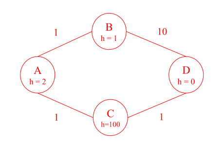
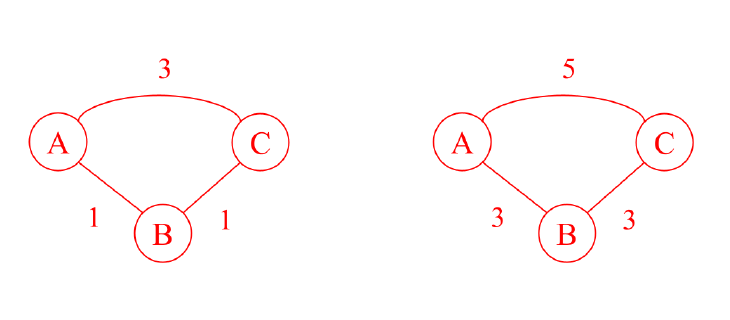
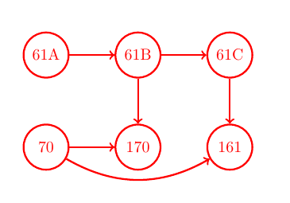
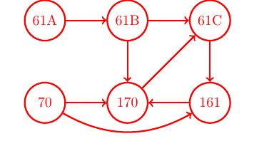
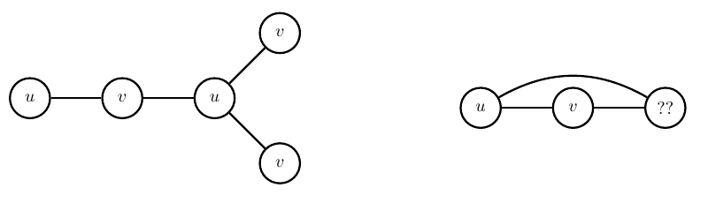
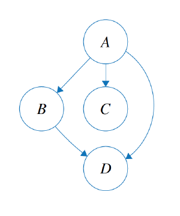
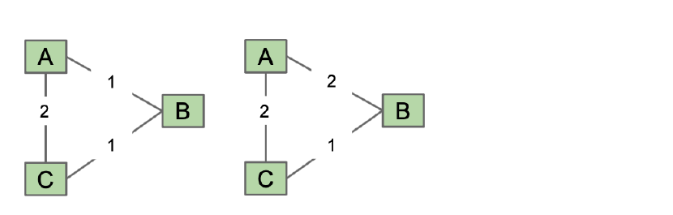
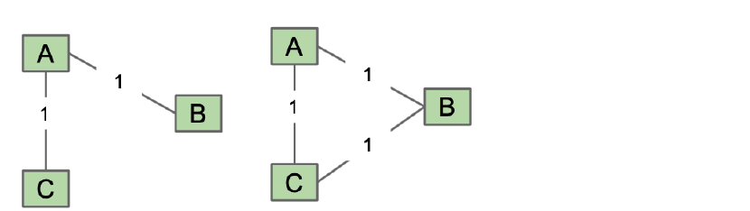
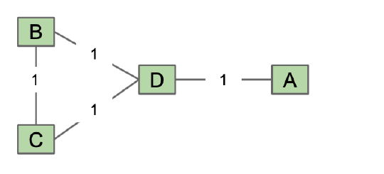
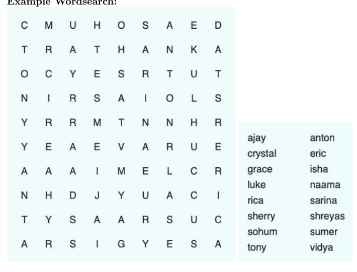

# Discussion 10 — Graphs II, Tries / 图（二）与字典树

> UC Berkeley CS 61B, Spring 2024
>
> Discussion date: April 1, 2024

本页保留题号、主题、官方图示与资料入口。代码编写、代码追踪、数据结构和
基于代码的复杂度分析题，统一以链接的 Java Question/Solution 文件为权威版本；
Java 文件中保留英文原题、独立中文翻译、作答区、官方答案及补充分析分区。

## Regular

### Question 1 — Longest Prefix / 最长前缀

补全 Trie 的 `longestPrefixOf`，区分“完整键”与“某个键的前缀”。

- [Question Java](code/questions/Dis10RegularQ1LongestPrefix.java)
- [Solution Java](code/solutions/Dis10RegularQ1LongestPrefixSolution.java)

### Question 2 — A Tree Takes on Graphs / 树来挑战图

判断三条图论陈述，并在陈述为假时给出反例。

- [Question Java](code/questions/Dis10RegularQ2ATreeTakesOnGraphs.java)
- [Solution Java](code/solutions/Dis10RegularQ2ATreeTakesOnGraphsSolution.java)

#### 2a — Equal edge weights and multiple MSTs / 相同边权与多棵 MST

判断所有边权相同时是否一定存在多棵 MST；文字题与可检查反例位于 Java 文件。

#### 2b — A* heuristics / A* 启发式

判断任意启发式是否都能保证 A* 找到正确最短路。

#### 2c — Adding a constant to every edge / 每条边加同一常数

判断给每条边加常数后 Dijkstra 的最短路径树是否保持不变。

### Question 3 — Class Enrollment / 课程选课

把先修关系建模为有向图，判断新增约束是否成环，并追踪 DFS 拓扑排序。

- [Question Java](code/questions/Dis10RegularQ3ClassEnrollment.java)
- [Solution Java](code/solutions/Dis10RegularQ3ClassEnrollmentSolution.java)

#### 3a — Prerequisite graph / 先修课程图

#### 3b — Cycle after new prerequisites / 新增先修关系后的环

#### 3c — Topological sort / 拓扑排序

按题目规定的平局顺序追踪 DFS 后序并反转；完整题干与两组官方顺序在 Java 文件中。

### Question 4 — Graph Algorithm Design / 图算法设计

设计二分图判断、诊断迭代 DFS 的标记时机，并在有向图中寻找最短环。

- [Question Java](code/questions/Dis10RegularQ4GraphAlgorithmDesign.java)
- [Solution Java](code/solutions/Dis10RegularQ4GraphAlgorithmDesignSolution.java)

#### 4a — Bipartite graph / 二分图

#### 4b — Buggy DFS / 错误 DFS

#### 4c — Shortest directed cycle / 最短有向环

Extra：设计满足 $O(EV)$ 时间与 $O(E)$ 空间界的算法；完整分析与实现位于 Java 文件。

## Exam Prep / Exam-Level

### Question 1 — Multiple MSTs / 多棵最小生成树

分析重复边权何时产生多棵 MST、单环图的生成树数量，并用小偏移稳定打破边权平局。

- [Question Java](code/questions/Dis10ExamPrepQ1MultipleMSTs.java)
- [Solution Java](code/solutions/Dis10ExamPrepQ1MultipleMSTsSolution.java)

#### 1a

##### 1 — Some identical edge weights / 部分边权相同

##### 2 — All identical edge weights / 全部边权相同

#### 1b — Minimum and maximum MST counts / MST 数量上下界

连通无向图有 $N$ 个顶点和 $N$ 条等权边；完整推导位于 Java 文件。

#### 1c — Make Prim and Kruskal agree / 使 Prim 与 Kruskal 一致

官方附加练习图展示两个算法可选择不同 MST 的情形。

### Question 2 — Topological Sorting for Cats / 猫咪拓扑排序

从 DFS 拓扑排序、DAG 源点/汇点证明，逐步实现入度统计、Kahn 算法与环检测。

- [Question Java](code/questions/Dis10ExamPrepQ2TopologicalSortingForCats.java)
- [Solution Java](code/solutions/Dis10ExamPrepQ2TopologicalSortingForCatsSolution.java)

#### 2a — DFS topological sort / DFS 拓扑排序

用自然语言描述已知 DFS 方法，并给出复杂度。

#### 2b

##### 1 — Sources and sinks in a DAG / DAG 的源点与汇点

证明每个 DAG 至少各有一个源点和汇点。

##### 2 — `computeInDegrees` and `findAllSourceNodes`

在可编译的最小 `Graph` 脚手架上完成两个辅助方法。

##### 3 — `topologicalSort`

实现 Kahn 算法。官方 Solutions PDF 漏写 `return sorted;`；Java Solution 原样记录这一
官方缺陷，并只在“补充分析/可编译实现”中恢复必要的返回语句。

##### 4 — Cycle detection / 环检测

利用队列提前耗尽和仍未移除的顶点检测有向环。

### Question 3 — A Wordsearch / 单词搜索

使用 Trie 在八个方向搜索单词，并推导 $O(N^3)$ 时间复杂度。

- [Question Java](code/questions/Dis10ExamPrepQ3Wordsearch.java)
- [Solution Java](code/solutions/Dis10ExamPrepQ3WordsearchSolution.java)

## 完整性检查

- Regular：Question 1；Question 2（2a-2c）；Question 3（3a-3c）；Question 4（4a-4c，含 Extra）。
- Exam Prep：Question 1（1a 的第 1、2 小问，1b、1c）；Question 2（2a、2b 的第 1-4 小问）；Question 3。
- 七个顶层 Question 各有独立 Question/Solution Java 文件；英文原题、中文翻译和官方答案分区位于对应 Java 文件。
- 十张官方图继续保留在 `assets/`，没有转换为失真的 ASCII 图；Java 中的边、方格和操作序列仅作为可检查数据。
- 非官方编译脚手架均在 Java 中明确标注，不依赖 Maven、Gradle、JUnit、`.idea` 或 `.iml`。

## 官方资料

- [Regular PDF](https://sp24.datastructur.es/assets/discussions/regular10.pdf)
- [Regular Solutions PDF](https://sp24.datastructur.es/assets/discussions/regular10sol.pdf)
- [Exam-Level PDF](https://sp24.datastructur.es/assets/discussions/examlevel10.pdf)
- [Exam-Level Solutions PDF](https://sp24.datastructur.es/assets/discussions/examlevel10sol.pdf)
