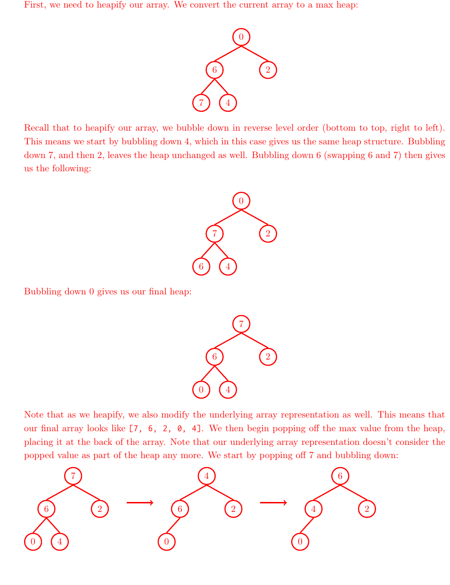
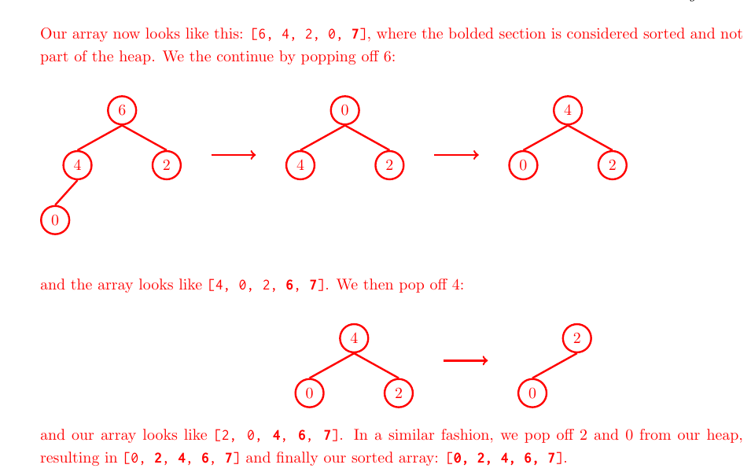

# Discussion 11 — Sorting / 排序

> UC Berkeley CS 61B, Spring 2024
> Discussion date: April 8, 2024

本页保留官方题号、资料入口和必须依赖图形的内容。代码题、代码追踪题与基于代码的复杂度分析题，均以 `code/questions/` 和 `code/solutions/` 中的 Java 文件为权威版本。

## Regular

### Question 1 — All Sorts Of Sorts / 各种各样的排序

对 `0, 4, 2, 7, 6, 1, 3, 5` 分别追踪：

- 1a Insertion sort / 插入排序
- 1b Selection sort / 选择排序
- 1c Merge sort / 归并排序
- 1d 对 `0, 6, 2, 7, 4` 执行 heapsort / 堆排序，并画出每一步的堆和数组

[打开 Question Java](code/questions/Dis11RegularQ1SortingTraces.java) · [打开 Solution Java](code/solutions/Dis11RegularQ1SortingTracesSolution.java)

#### 1d 官方图示（继续保留在 Markdown/assets）

Java 文件保存可检查的底层数组状态；树形堆的形状以官方图为准，不转换成容易失真的 ASCII 图。

### Question 2 — Crystal Has Been Waiting For This / Crystal 等这一刻很久了

- 2a 实现按身高比较 `TA` 的 `TAComparator`
- 2b 判断给定 TA 列表中快速排序的最好/最差枢轴
- 2c 用稳定性保证 Jasmine 与 Austin 的原始相对顺序
- 2d 已排序队列新增 Elisa 与 Wilson 后，选择额外工作最少的排序并分析复杂度

[打开 Question Java](code/questions/Dis11RegularQ2TAComparator.java) · [打开 Solution Java](code/solutions/Dis11RegularQ2TAComparatorSolution.java)

> **补充分析（非官方答案）：** Solutions PDF 把 `height` 声明为 `private`，却让另一个 `public class TAComparator` 直接访问它；若二者是独立顶层类，该代码不能编译。PDF 给出的 `o1.height - o2.height` 还可能发生整数溢出。Java Solution 保留官方内容，并将可编译脚手架与非官方修正明确分区。

### Question 3 — Zero One Two-Step / 零一二步

- 3a 在不创建新数组的条件下，在线性时间内原地排序只含 `0`、`1`、`2` 的数组
- 3b 解释该线性算法不能推广到任意可比较值域的原因
- 3c 解释“原地排序”及其价值

[打开 Question Java](code/questions/Dis11RegularQ3ZeroOneTwoStep.java) · [打开 Solution Java](code/solutions/Dis11RegularQ3ZeroOneTwoStepSolution.java)

> **补充分析（非官方答案）：** Solutions PDF 在 `specialSort` 的 `while` 结束后直接声明 `swap`，缺少结束 `specialSort` 的 `}`。Solution Java 保留此官方缺陷说明，并在实际可编译实现中补上必需的右花括号。

## Exam Prep

### Question 1 — Identifying Sorts / 识别排序算法

根据四组数组中间状态，分别从 insertion sort、selection sort、mergesort、quicksort（首元素为枢轴）和 heapsort 中识别算法；归并排序拆分奇数长度数组时，较大的一半在右侧。

[打开 Question Java](code/questions/Dis11ExamPrepQ1IdentifyingSorts.java) · [打开 Solution Java](code/solutions/Dis11ExamPrepQ1IdentifyingSortsSolution.java)

### Question 2 — Conceptual Sorts / 排序概念

- 2a 插入排序较快时可对输入作出什么推断
- 2b 给出五元素的插入排序最坏输入
- 2c 判断堆排序是否稳定，并解释或给反例
- 2d 比较链表上的归并排序与快速排序：运行时间、稳定性、内存效率
- 2e 使用 A–E、N 答案库回答复杂度下界、最坏保证、重复比较和最好时间四项

[打开 Question Java](code/questions/Dis11ExamPrepQ2ConceptualSorts.java) · [打开 Solution Java](code/solutions/Dis11ExamPrepQ2ConceptualSortsSolution.java)

> **补充分析（非官方答案）：** 官方 2e(1) 关于“相等元素堆可使 heapsort 线性”的解释依赖遇到相等父子时立即停止下沉的具体实现。Java Solution 原样保留官方选择，并单独标注这一适用条件。

### Question 3 — Bears and Beds / 熊与床

在只允许 Bear–Bed 交叉比较的前提下，将尺寸唯一但顺序不同的熊与床逐一匹配；要求平均运行时间为 `O(N log N)`。

[打开 Question Java](code/questions/Dis11ExamPrepQ3BearsAndBeds.java) · [打开 Solution Java](code/solutions/Dis11ExamPrepQ3BearsAndBedsSolution.java)

官方 Solutions PDF 还提供了[视频讲解](https://youtu.be/EF3_vcXADfc)。

## 完整性检查

- Regular：Question 1–3；保留 1a–1d、2a–2d、3a–3c。
- Exam Prep：Question 1–3；保留 1a–1d、2a–2e 与 Bears and Beds。
- 六个顶层 Question 均有独立、可编译的 Question/Solution Java 文件。
- Q1d 的两张官方堆排序图继续保留在 `assets/`，其余可代码化内容以 Java 为权威版本。
- 官方答案与补充分析明确分区；私有字段、减法溢出、缺失右花括号和 heapsort 实现条件未被静默改写。

## IntelliJ

若 IntelliJ 尚未识别 Java 目录，可分别右键 `code/questions` 与 `code/solutions`，选择 **Mark Directory as → Sources Root**。这些文件不依赖 `.idea`、`.iml`、Maven、Gradle、JUnit 或第三方库。

## 官方资料

- [Regular PDF](https://sp24.datastructur.es/assets/discussions/regular11.pdf)
- [Regular Solutions PDF](https://sp24.datastructur.es/assets/discussions/regular11sol.pdf)
- [Exam Prep PDF](https://sp24.datastructur.es/assets/discussions/examlevel11.pdf)
- [Exam Prep Solutions PDF](https://sp24.datastructur.es/assets/discussions/examlevel11sol.pdf)