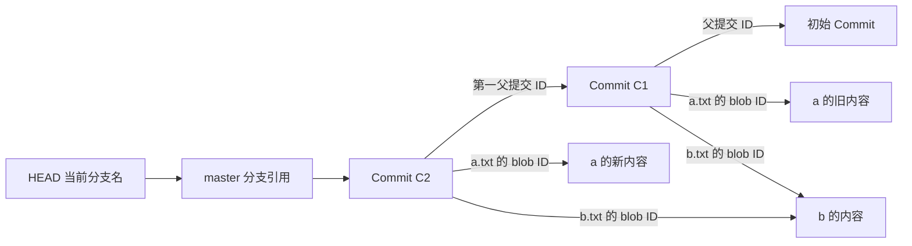

# Gitlet 数据模型与持久化

先回答“下一次 Java 启动时，我从哪里恢复状态”，再开始写命令。一次命令结束后，内存中的 Map、对象和静态变量都不能替你记住历史。[官方内部结构说明](https://sp21.datastructur.es/materials/proj/proj2/proj2#internal-structures)

## 五种核心数据

| 数据 | 表示什么 | 设计时要回答的问题 |
| --- | --- | --- |
| 工作目录 working directory | 用户现在看到并编辑的文件 | 这个文件与 HEAD 或暂存版本是否相同？ |
| Blob | 一份文件内容 | 如何按内容标识存储和复用？ |
| Commit | 某次提交的完整文件映射与历史信息 | 记录哪些文件？每个文件指向哪个 blob？ |
| Stage | 下次提交要加入和移除的文件 | 如何跨进程保留 add 时的版本？ |
| Branch 与 HEAD | 分支名指向提交，HEAD 确定当前分支 | commit、checkout、reset 各自移动谁？ |

Commit 中保存文件名到 blob ID 的映射。文件名属于快照的路径信息，blob 负责内容。两个提交可以同时引用同一 blob，因此未改变的内容不必重复保存。

图表示逻辑关系。磁盘上的关系可用 ID 字符串表达，不要求你把父 Commit 对象直接作为字段序列化。

## 暂存必须记住内容

用一个小例子检查设计：你把 `a.txt` 写成版本 A，运行 add，随后把工作文件改成版本 B，再运行 commit。新提交需要保存暂存的 A。如果 Stage 只存文件名，而 commit 时重新读取工作文件，就会错误保存 B。

建议你在纸上列出下表，再决定 Stage 用什么字段：

| 时刻 | 工作文件 | HEAD 快照 | 暂存增加 |
| --- | --- | --- | --- |
| 初始 | A | 未追踪 | 空 |
| add 后 | A | 未追踪 | A 的内容引用 |
| 再编辑后 | B | 未追踪 | 仍是 A 的内容引用 |
| commit 后 | B | A | 空 |

这张表是自测案例。写两个独立 Java 启动的测试验证它，不要只在同一个对象里调用方法。

## 推荐的职责划分

以下是可选设计，具体类名与磁盘布局可以调整。官方提供的 [Main](../proj2/gitlet/Main.java)、[Repository](../proj2/gitlet/Repository.java)、[Commit](../proj2/gitlet/Commit.java) 是起点。

| 类或组件 | 建议职责 |
| --- | --- |
| Main | 解析命令、参数数量与形式，然后分派 |
| Repository | 协调命令的校验、读取、计算和持久化 |
| Commit | 保存消息、时间、父 ID、文件到 blob ID 的映射 |
| Stage | 表达暂存增加与暂存移除 |
| 对象存储辅助组件 | 按 ID 存取 commit 和 blob，避免重复存储 |
| 分支辅助组件 | 保存当前分支名和各分支引用 |

`Utils.java` 已提供文件读写、序列化、SHA-1、路径拼接和受限删除工具。先读它的 Javadoc，避免自己重复编写同样的文件处理逻辑。[本地 Utils](../proj2/gitlet/Utils.java)

## 一种可选磁盘布局

| 路径 | 内容 |
| --- | --- |
| `.gitlet/commits/<commit ID>` | 单个 Commit 的持久化内容 |
| `.gitlet/blobs/<blob ID>` | 单份文件字节 |
| `.gitlet/refs/heads/<branch>` | 对应分支的 commit ID |
| `.gitlet/HEAD` | 当前分支名 |
| `.gitlet/stage` | 暂存增加与暂存移除 |

这是示例，不是规范指定布局。若把所有分支放一个 Map 文件，分析每次读写是否随分支总数增长，尤其是要求常量时间的命令。若未来做 remotes，分支名中的 `/` 还需要合理映射到存储路径。

## 序列化的关键选择

Java 对象序列化会继续保存对象字段引用到的对象。若 Commit 持有父 Commit，再持有它的父 Commit，保存一个新提交可能连整段历史一起写出。因此优先用父提交 ID 和 blob ID 表达关系；按需要从独立文件读取。运行时缓存可以帮助减少重复读取，但不要无意把缓存也写入存储。[官方序列化说明](https://sp21.datastructur.es/materials/proj/proj2/proj2#serialization-details)

`Serializable` 不会保存静态字段。路径常量适合在进程启动时计算，真实的分支名、暂存状态和提交信息必须从磁盘恢复。若使用 `transient` 字段，反序列化后应允许它为空或重新构建。[Java Serializable](https://docs.oracle.com/en/java/javase/17/docs/api/java.base/java/io/Serializable.html)

## 内容标识与不可变性

Blob 的 ID 可以由文件字节计算。Commit 的 ID 则要反映消息、时间、父 ID 和快照映射。选定表示后，明确哪些字段参与哈希、键如何排序、什么时候确定 ID。

初始提交的时间用同一个 epoch 数值表示，日期的本地时区格式留到 log 输出时再处理。不要把当前工作目录、创建时的现在时间或本地显示日期混入初始提交的内容，否则两个仓库的初始 ID 可能不同。Commit 与 blob 的存储命名空间也要区分，例如使用上面示例中的独立子目录。

建议把 Commit 的快照复制成独立映射再修改。若直接拿父 Commit 的 Map 修改，新提交会改变旧历史。已经保存的 Commit 和 blob 都应当作为不可变历史看待。

TreeMap 可以提供稳定键顺序，但稳定 ID 还要求字段内容和序列化过程一致；仅换成 TreeMap 不会自动解决所有问题。不要先把“自身 ID”放进对象再对它求自身 ID，造成循环定义。[官方 Things to Avoid](https://sp21.datastructur.es/materials/proj/proj2/proj2#i-things-to-avoid)

## 每条写命令的处理顺序

建议把处理拆成三部分：读取状态并验证所有失败条件，计算要做的变化，最后执行必要的写入。特别是恢复文件、切换分支、reset 和 merge，先查完会被覆盖的工作文件，再开始改变任何文件。

这个组织方式能减少“命令失败，但已经删掉部分文件”的错误。你仍要自己确认每个命令更新工作目录、分支引用、Stage 和对象存储中的哪几项。

## 编码前自问

- [ ] 运行 add 后退出，下一次进程能恢复正确的暂存内容吗？
- [ ] 新 Commit 会不会修改旧 Commit 的文件映射？
- [ ] 保存一个 Commit 会不会顺带保存全部祖先和文件内容？
- [ ] 当前分支名与当前提交 ID 是不是被混成一个概念？
- [ ] 两个分支指向同一提交时，切换后的新提交只移动当前分支吗？
- [ ] 初始化后的空历史、空 Stage、空文件内容各怎么表示？
- [ ] 每次命令失败后，磁盘状态和工作文件是否保持原样？

若你还不能解释跨进程的状态流转，先完成 `lab6` 的故事文本和 Dog 对象练习，再回到 Gitlet。[Lab 6 官方说明](https://sp21.datastructur.es/materials/lab/lab6/lab6)
