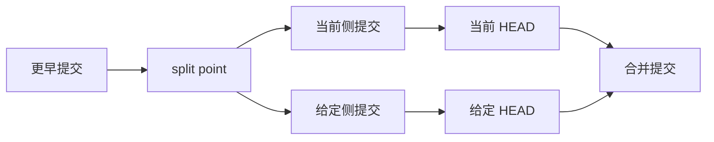

# Gitlet Merge 推理与检查

合并需要同时理解提交图和文件快照。先在纸上做推演，确保每一类状态都明确，再把决定落实成代码。[官方 merge 规范](https://sp21.datastructur.es/materials/proj/proj2/proj2#merge)

## 三个提交与文件版本

- S 是当前分支和给定分支的 split point。
- C 是当前分支 HEAD。
- G 是要合入的给定分支 HEAD。

比较某个文件时，S、C、G 表示对应快照中的 blob ID，或“没有这个文件”。“没有文件”和“文件存在但内容为空”必须是不同状态。

图中的箭头表示从旧到新的历史方向；真实 Commit 中保存的是从新提交指向父提交的 ID。M 的第一父为 C，第二父为 G。

## 先处理不能合并和特殊情况

按原文核对 Stage 非空、给定分支不存在、与自身合并，以及会覆盖或删除未追踪工作文件的失败条件。不要在找到第一个可处理文件后就开始改写工作目录。

若 G 已经是 C 的祖先，这次无需合并。若 C 是 G 的祖先，则走 fast-forward 特殊情况，跳过普通双亲提交。Spring 2021 原文将后者的效果写作 checkout 给定分支；实现时要专门核对文件、分支引用和当前分支选择，不能仅凭真实 Git 的记忆代替原文。这里没有实测当年的 staff 实现。[特殊情况所在段落](https://sp21.datastructur.es/materials/proj/proj2/proj2#merge)

两个不同名字的分支也可能指向同一个 Commit。此时 split point 同时等于 C 和 G，按原文先处理“给定分支已是祖先”的情况，不再进入 fast-forward。

## 找 split point 的正确问题

普通提交只有一个父，merge 提交有两个父，所以历史是有向无环图。找祖先要沿所有父链接考虑，并用 visited 集合避免重复处理。

官方定义要找的是 latest common ancestor：它是两侧共同祖先，而且不能还是另一个共同祖先的祖先。单纯选“离当前 HEAD 最近”或“ID 最小”的共同节点不能证明满足定义。设计文档应说明候选怎么产生、怎么排除更老的共同祖先，以及存在多个有效候选时采用什么策略。

给自己画一个已经合并过其他分支的图。如果只看第一父仍能“找到”某个祖先，检查它是否遗漏了通过第二父才可到达的更新共同祖先。log 忽略第二父，不代表 merge 也可以忽略。

## 逐文件决策

下表是用于自测的三方比较归纳。用 S、C、G 所有文件名的并集考虑候选文件；每次判断同时考虑内容引用和缺失状态。

| 情形 | 示例 | 合并后需要检查的结果 |
| --- | --- | --- |
| 两侧都没改变 | S=V0，C=V0，G=V0 | 保持当前版本 |
| 仅给定侧改变 | S=V0，C=V0，G=V1 | 使用 G 的版本并暂存 |
| 仅当前侧改变 | S=V0，C=V1，G=V0 | 保持 C |
| 两侧改变成同样内容 | S=V0，C=V1，G=V1 | 保持共同的新版本 |
| 两侧都删除 | S=V0，C=缺失，G=缺失 | 继续不追踪；同名工作文件若存在不要因此删除 |
| 仅当前侧新增 | S=缺失，C=V0，G=缺失 | 保持 C |
| 仅给定侧新增 | S=缺失，C=缺失，G=V0 | 使用 G 并暂存 |
| 给定侧删除 当前侧未改 | S=V0，C=V0，G=缺失 | 移除并不再追踪 |
| 当前侧删除 给定侧未改 | S=V0，C=缺失，G=V0 | 保持缺失 |
| 两侧修改不同 | S=V0，C=V1，G=V2 | 生成冲突内容并暂存 |
| 当前修改 给定删除 | S=V0，C=V1，G=缺失 | 冲突，给定内容部分为空 |
| 当前删除 给定修改 | S=V0，C=缺失，G=V1 | 冲突，当前内容部分为空 |
| 两侧独立新增同样内容 | S=缺失，C=V0，G=V0 | 保持内容，无冲突 |
| 两侧独立新增不同内容 | S=缺失，C=V0，G=V1 | 冲突 |

表里的 V0、V1、V2 是互不相同的内容版本，不是字面文件内容；C 始终表示当前侧。用它生成自己的测试，避免把“修改”“删除”“新增”只作为散乱 if 分支记忆。

## 冲突文件的字节边界

冲突内容由开头标记、当前侧内容、分隔标记、给定侧内容和结束标记连接而成。按官方模板核对标记数量、换行和空分支的处理。若原文件结尾没有换行，不要擅自补一个换行再连接分隔标记。[官方冲突格式](https://sp21.datastructur.es/materials/proj/proj2/proj2#merge)

Gitlet 的普通冲突合并会保存包含冲突标记的合并结果；你再另做一次提交解决内容。不要照真实 Git 的习惯把项目改成“先禁止提交，等待用户解决”。

## 合并提交与边界

普通合并要记录两条父链接，并按原文生成合并消息。log 沿第一父遍历，但显示 merge 的双亲摘要；global-log 仍然能展示所有对象。

Spring 2021 规范还明确提到：若 merge 导致通常 commit 的“没有变化”错误，应沿用正常 commit 错误。不要为了永远制造双亲提交而忽略这条版本要求。两个祖先特殊情况则在普通提交之前结束。

## 完成前检查

- [ ] 所有失败条件在改文件前完成检查。
- [ ] 当前侧和给定侧不相互颠倒。
- [ ] 历史包含双亲提交时，祖先查找仍正确。
- [ ] 分清最新共同祖先与按距离猜一个共同祖先。
- [ ] 文件缺失与空内容不混淆。
- [ ] 同样改变不产生冲突，修改对删除会产生冲突。
- [ ] 两侧都移除的文件，不误删后来同名出现的工作文件。
- [ ] 没有末尾换行的文件按原文直接连接。
- [ ] 冲突文件被暂存，普通合并提交包含正确双亲顺序。
- [ ] 验证祖先与 fast-forward 的输出和最终引用状态。
- [ ] 单文件场景通过后，再测试一次合并同时含新增、移除、冲突和保持不变的多个文件。
