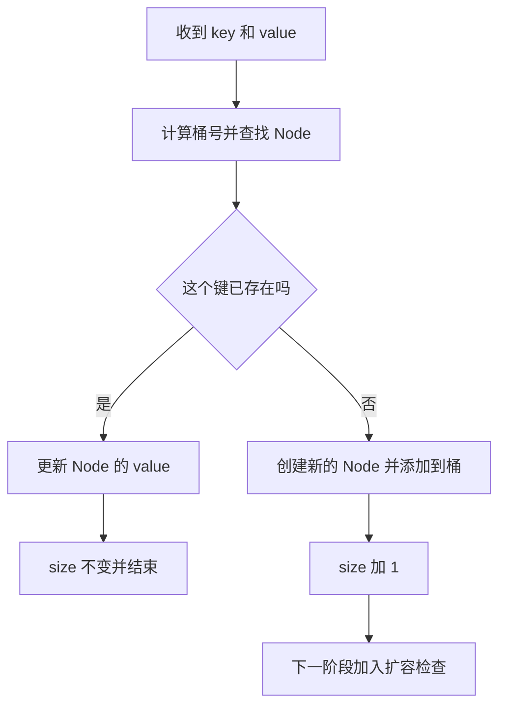

# CS61B Spring 2024 Lab 08 学习路线

Lab 08 要完成一个能按键存取值的哈希表 `MyHashMap<K, V>`，再用实验比较它和其他 Map 的速度。实现的主线是：**根据键找到一个桶，在桶里找到对应的键值对；桶太拥挤时，增加桶数并重新分配所有键值对。**

先把这条主线做通，再处理换桶实验。阅读原文时，可以把多态、工厂方法和性能比较分别放回下面对应的阶段。

## 先看完成路线

| 阶段 | 你要解决的问题 | 完成标志 |
| --- | --- | --- |
| 1 理解结构 | 数组、桶、Node 各存什么 | 能画出两个键落到同一桶的情形 |
| 2 初始化 | 空 Map 怎么建立 | 三个构造方法正确，初始 size 为 0 |
| 3 查找和插入 | 怎样区分新键与旧键 | 能插入、查找、更新；更新不增加 size |
| 4 扩容和清空 | 桶不够用时怎么办 | 扩容后所有值仍能取到，clear 后可重新插入 |
| 5 正确性检查 | 换一种桶还成立吗 | 必做的普通测试和五种桶的测试通过 |
| 6 性能实验 | 快在哪里，换桶有什么影响 | 三个速度程序的实测和解释写入 results.txt |

**你现在可以从阶段 1 开始。阶段 3 做到能存取之后，再回头跑相关测试；不要一开始就跑速度程序。**

## 阶段 1 理解数组 桶和键值对

先打开 [MyHashMap.java](src/hashmap/MyHashMap.java) 和 [Map61B.java](src/hashmap/Map61B.java)。接口规定外部行为，内部结构由你设计。

### 一次插入究竟存在哪里

假设有 4 个桶，教学用键 A、B、C 的 hashCode 分别是 1、5、2。这里人为指定哈希值，便于看清过程；并非这些字符串的实际 hashCode。

| 数组位置 | 这个位置上的桶 | 原因 |
| --- | --- | --- |
| 0 | 空集合 | 暂时没有键落到这里 |
| 1 | Node(A, 10)、Node(B, 20) | 1 和 5 对 4 取模，都得到 1 |
| 2 | Node(C, 30) | 2 对 4 取模得到 2 |
| 3 | 空集合 | 暂时没有键落到这里 |

两个不同键落到同一个桶叫**冲突**。这不是错误。桶是一个集合，可以容纳多个 `Node`；查找时再逐个比较其中的键。这就是本实验的 separate chaining，通常称为分离链接法。

此时有 3 个不同的键值对，所以 `size = 3`；有 4 个桶，所以容量是 4。**size 和数组长度不是一个量。**

### 读懂 Collection Node 数组

现有字段是：

```java
private Collection<Node>[] buckets;
```

从外到内理解它：

| 层次 | 含义 | 你会对它做什么 |
| --- | --- | --- |
| `buckets` | 一个数组，长度就是桶数 | 按下标访问某个桶 |
| `buckets[i]` | 一个装着 Node 的集合 | 添加 Node，遍历 Node |
| `Node` | 一个键值对，有 key 和 value | 比较 key，读取或更新 value |

`Collection` 只是桶的共同接口。桶实际可以是 `LinkedList<Node>`，也可以是 `ArrayList<Node>` 等集合。写查找逻辑时，只要逐个遍历 Node 就够了，不需要按下标访问集合。

**为什么不直接写成 LinkedList 数组？** 因为后面的实验要更换桶的实现。如果 Map 的算法只依赖 `Collection` 的操作，更换桶以后，查找、插入、扩容的逻辑都可以继续使用。[换桶测试](tests/hashmap/TestMyHashMapBuckets.java)就是检查这件事。

**停下来检查：** `get(B)` 应先算出桶号 1，再检查桶 1 里的 Node；它不需要扫描桶 0、2、3。

## 阶段 2 建立一个真正可用的空 Map

### 先确定要记住的状态

你至少要能得到下面三个量。字段名称可以自己定，不必照搬。

| 状态 | 意义 | 随操作怎样变化 |
| --- | --- | --- |
| 桶数组 | 存放全部桶 | 扩容或清空时可能更换 |
| 键值对数量 N | 当前不同键的数量 | 新键插入加 1；旧键更新不变；clear 归零 |
| 最大装载因子 | 允许的 N / M 阈值 | 来自构造参数，扩容时不变 |

桶数 M 可以直接从 `buckets.length` 得到。不要多维护一个容量字段，除非你能保证它一直和数组长度一致。

只用一个**实例字段**保存桶数组，这是本地扩容测试的反射检查所要求的。扩容时用局部变量保存旧数组没有问题；也不妨碍你增加 size、阈值等普通字段。见 [TestMyHashMap.java](tests/hashmap/TestMyHashMap.java) 的 `sizeOfBackingArray`。

### 三个构造方法分别负责什么

[本地 testResize](tests/hashmap/TestMyHashMap.java)使用的参数组合是：

| 调用 | 初始桶数 | 最大装载因子 |
| --- | --- | --- |
| `new MyHashMap<>()` | 16 | 0.75 |
| `new MyHashMap<>(32)` | 32 | 0.75 |
| `new MyHashMap<>(64, 0.5)` | 64 | 0.5 |

可以让参数少的构造方法调用参数最完整的构造方法，把初始化逻辑集中在一处。初始化完成时，N 应是 0。

### 为什么 new 出数组还不够

```java
new Collection[initialCapacity]
```

只会创建数组。数组的每个位置最初都是 `null`，它不会替你创建每个桶。你可以在初始化时逐个建立空桶，也可以在第一次用到某个桶时再建立；后一种方式要求所有读取和遍历都正确处理空位置。

第一次实现时，逐个初始化全部桶更容易检查。Java 不允许直接创建 `new Collection<Node>[initialCapacity]` 这样的泛型数组；使用上面的原始类型数组赋给字段时可能出现 unchecked 警告。可参考[官方 FAQ 的泛型数组说明](https://sp24.datastructur.es/labs/lab08/faq/#im-getting-a-generic-array-creation-error)。

这里采用 `new Collection[initialCapacity]`。FAQ 还列出了 `(Collection<Node>[]) new Object[size]`，但这段写法会在运行时抛出 `ClassCastException`：实际创建的是 Object 数组，不能强转成 Collection 数组。不要照搬这一处 FAQ 写法。

### createBucket 是创建桶的统一入口

现有的 `createBucket()` 应返回一个新的空集合。你可以选一种桶作为默认实现，例如 `LinkedList`。

需要创建桶的地方都调用 `createBucket()`：包括初始建桶、扩容建桶，以及选择重建数组来 clear 时的建桶。具体集合的 `new` 放在这个方法内部。

这是因为 [MyHashMapFactory.java](tests/hashmap/MyHashMapFactory.java)会创建子类并重写 `createBucket()`。如果构造方法里直接创建 `LinkedList`，子类就无法把那里的桶替换成 `HashSet`；普通测试可能通过，换桶测试却失去作用。

**这一阶段完成标志：** 能创建三个构造参数版本的空 Map；每个可用桶都为空；`size()` 返回 0。

## 阶段 3 先把查找和插入做通

### 所有按键操作共用一个找 Node 的思路

把查找分成两个动作：

1. 根据 `key.hashCode()` 和当前桶数，计算桶下标。
2. 遍历这个桶，对每个 Node 的 key 做 `.equals()` 比较，找到就返回这个 Node，全部检查完仍没找到就返回空结果。

你可以把它整理成一个私有辅助方法，例如 `findNode(key)`。这是组织代码的建议，不是接口规定的新方法。

桶号可以用下面这个小片段计算：

```java
Math.floorMod(key.hashCode(), buckets.length)
```

hashCode 可以是负数。假设它是 -5，桶数是 4，Java 的 `-5 % 4` 为 -1，不能作为数组下标；`floorMod(-5, 4)` 则为 3。也别简单依赖 `Math.abs(hashCode)`，因为 `Integer.MIN_VALUE` 的绝对值仍会溢出为负数。

哈希值只负责缩小搜索范围，**判断同一个键仍然靠 equals**。不要把 hashCode 相同当成键相同，也不要用 `==` 代替键的内容比较。对于行为正常的键，相等的键应有相同 hashCode；键放入 Map 后，也应避免修改影响 equals 或 hashCode 的内容。

### get 和 containsKey 如何分工

| 查找结果 | get 返回什么 | containsKey 返回什么 |
| --- | --- | --- |
| 没找到 Node | null | false |
| 找到 Node，value 是 7 | 7 | true |
| 找到 Node，value 是 null | null | true |

因此，`containsKey` 不能写成 `get(key) != null`。它要判断**Node 是否存在**。[本地 containsKey 测试](tests/hashmap/TestMyHashMap.java)明确检查了值为 null 的情况。

### put 必须先区分更新和新增

可以按这个顺序思考，先暂时把扩容放到下一阶段：



更新旧键时，不增加 Node，也不增加 size。这也是为什么不应该一进 put 就先执行 `size++`。

在同一个桶里，你应完整检查所有候选键。检查第一个 Node 没匹配，就直接判定不存在，会在冲突时漏掉后面的键。

### 用一个短操作序列检查自己

假设还没有触发扩容：

| 操作 | 之后的 size | 应观察到的结果 |
| --- | --- | --- |
| 创建空 Map | 0 | get(A) 为 null |
| put(A, 10) | 1 | get(A) 为 10 |
| put(B, 20)，B 与 A 落在同桶 | 2 | A、B 都能取到 |
| put(A, 99) | 2 | get(A) 为 99，B 不受影响 |
| put(C, null) | 3 | get(C) 为 null，但 containsKey(C) 为 true |

这里 A、B、C 仍是教学用键。你可以用自己写的临时检查或调试器观察，不必把它们当成现成字符串哈希值。

**这一阶段完成标志：** 不涉及扩容的小规模操作正确，重复插入同一键只覆盖值。可以先单独运行 `testContainsKey`、`testGet`、`testPut`、`testFunctionality`。`testSize` 会插入 456 个不同键，`testClear` 会插入 455 个；它们不是只检查一个小操作的测试。阶段 4 完成后，再运行整个普通测试类，包括明确检查扩容的 `testResize`。

这些测试互相依赖，某个测试名不等于只有同名方法会出错。若方法声明还没有补齐，应先补齐接口和 Iterable 要求的方法签名，暂未实现的操作可先抛出 `UnsupportedOperationException`，以便编译和逐项实现。

## 阶段 4 加入扩容和清空

### 先正确计算装载因子

N 是不同键的数量，M 是桶数：

```text
当前装载因子 = N / M
```

计算时需要浮点除法。例如 N = 3、M = 4 时，应得到 0.75。若两个整数直接相除，Java 会得到 0；这会让扩容判断滞后。[官方 FAQ](https://sp24.datastructur.es/labs/lab08/faq/#im-running-into-issues-with-resizing-and-getting-expected-to-be-greater-than-this-value-but-was-this-value)专门指出了这个问题。

以最大阈值 0.75、4 个桶为例，第 3 个不同键插入后仍可保留 4 个桶；第 4 个不同键插入后比例为 1.0，超过阈值，应扩容。按两倍增长时，4 个桶变成 8 个桶，装载因子降为 0.5。更新已有键不增加 N。

若用户设置了特别小的正阈值，检查扩容后的容量是否足以容纳当前 N；必要时继续按倍数增长。

### 为什么扩容必须重新计算每个键的桶号

回到 hashCode 为 1 和 5 的 A、B：

| 键 | hashCode | 4 个桶时的下标 | 8 个桶时的下标 |
| --- | --- | --- | --- |
| A | 1 | 1 | 1 |
| B | 5 | 1 | 5 |

扩容前它们挤在桶 1；扩容后 B 应进入桶 5。若只把旧桶整体复制到新数组的相同下标，后续 get(B) 会去桶 5 查找，结果却找不到。

**重新分桶时，键的 hashCode 通常没变，改变的是用于取模的桶数。**

### 扩容按什么顺序写

1. 用局部变量保留旧桶数组。
2. 创建更大的新数组，并用 `createBucket()` 建立新桶。
3. 遍历旧数组中的每个桶，再遍历其中每个 Node。
4. 使用新桶数计算这个 Node 的位置，把它放入新桶。若此时字段 `buckets` 还指向旧数组，计算时应使用 `newBuckets.length`，不能误用旧的 `buckets.length`。
5. 让 Map 使用新的桶数组；保持原来的键值对数量。

这是搬家，不是用户又插入了一遍键。迁移时不要无条件再次给 size 加 1。如果选择复用 put，就必须先把计数正确重置，并处理它内部的扩容逻辑；第一次实现时，直接迁移 Node 的思路更容易保证计数不变。

只保存一个实例桶数组字段，并不意味着不能用局部变量 `oldBuckets`、`newBuckets`。

### 为什么容量要按倍数增长

每次扩容都要重新处理已有元素。如果容量每次只加一个桶，大量插入会反复搬迁。按倍数增长时，搬迁规模大致是 16、32、64、128……，累计规模与最终元素量同阶。

因此，一次触发扩容的 put 可以耗时 O(N)，但在哈希分布良好、负载受控时，连续许多次插入的平均每次成本可保持常数级。这就是摊还分析。它不保证每一次 put 都立即完成，也不保证所有键挤在一个桶时仍然常数时间。

### clear 应清掉什么

clear 之后必须满足：size 为 0，旧键都不存在，再 put 新键仍可正常工作。

只把计数设为 0 会留下旧 Node；只清桶却忘了归零会留下错误的数量。你可以清空各桶，也可以重建空桶数组。若重建，仍通过 `createBucket()` 建桶。接口没有规定 clear 必须缩回 16 个桶。

前面讲的平均常数时间主要针对 get、containsKey 和 put。clear 一次移除全部映射，成本取决于实现：遍历桶并清理内容通常需要 O(M + N)，重建并逐个初始化桶通常需要 O(M)。不要由单键操作的复杂度推断清空整个 Map 也必定是 O(1)。

**这一阶段完成标志：** 连续插入触发多次扩容后，旧值都能取到，size 正确；clear 后旧值消失，新插入正常。

## 阶段 5 按依赖顺序检查测试

### 先跑普通测试 再跑换桶测试

在 IntelliJ 中依次运行：

1. [TestMyHashMap.java](tests/hashmap/TestMyHashMap.java)：基础行为、扩容和边界情况。
2. [TestMyHashMapBuckets.java](tests/hashmap/TestMyHashMapBuckets.java)：把桶分别换成 LinkedList、ArrayList、HashSet、Stack、ArrayDeque，再检查相同的行为。
3. [TestMyHashMapExtra.java](tests/hashmap/TestMyHashMapExtra.java)：实现可选方法后，运行对应测试。它只检查 remove 和 keySet，没有直接检查 iterator；若只实现了 remove，可先单独运行两个 remove 测试。

| 失败表现 | 优先检查 |
| --- | --- |
| 同一键更新后 size 变大 | 是否把更新走成了新增 |
| 有键且值为 null，却说键不存在 | 是否用 get 的返回值判断键存在 |
| 冲突时取不到某个值 | 是否遍历完目标桶，是否正确使用 equals |
| 普通测试过，换桶测试失败 | 是否绕过 createBucket，或使用 List 专有方法 |
| 扩容测试说数组长度仍然相同 | 是否发生整数除法，是否替换了实际桶数组 |
| 扩容后旧值丢失 | 是否按新桶数重新分配了每个 Node |
| 扩容后 size 翻倍 | 搬迁旧 Node 时是否重复计数 |
| clear 后还能查到旧键 | 是否只清了计数，没清实际内容 |

### Bee 边界测试为什么看起来反常

本地测试中的 Bee 让所有键的 hashCode 都等于 -61，所以它们落到同一个桶。它的 equals 用两个数的差小于 61 判断相等，这个规则甚至不满足通常的传递性。

例如 Bee(1) 与 Bee(2) 相等，Bee(2) 与 Bee(62) 相等，但 Bee(1) 与 Bee(62) 不相等。因此别仅凭数值不同就断定要保存多个键，也别把这些人为规则当成正常键的设计方式。测试是在制造难处理的冲突，逐步与 Java HashMap 对照。

卡住时，在每次 put 之后观察两边的 size 和 get，定位首次分歧；同时检查遍历顺序、找到匹配后是否结束，以及更新时保留的是哪个 Node。不要修改测试来迎合自己的结果。参见[官方 FAQ 的边界测试提示](https://sp24.datastructur.es/labs/lab08/faq/#failing-edge-cases)。

### 必做与可选的方法范围

本地接口中必做的是 `put`、`get`、`containsKey`、`size`、`clear`，以及三个构造方法和支持它们的桶初始化、扩容逻辑。

本地类约定不会插入 null 键；这和允许 null 值是两回事。删除后不要求缩容。精力先放在有效键的查找、插入和扩容上。

`remove(K key)`、`keySet()`、`iterator()` 是可选的。不实现时，方法体应抛出 `UnsupportedOperationException`；返回 null 或空集合会把“尚不支持”伪装成一个正常结果。`iterator()` 来自 `Map61B` 继承的 `Iterable`，所以即便接口文件里没有逐行列出它，类仍要提供这个方法。

原文还提到可选的 `remove(K key, V value)` 重载，但当前本地 `Map61B` 没有声明它，也没有对应本地测试。它不阻碍必做部分完成。

若选做 `remove(K key)`，键存在时删除对应 Node、减少 size，并返回被删除的值；键不存在时返回 null，size 不变。官方还给出一个额外挑战：实现 keySet 和 iterator 时，不额外维护一个保存全部键的实例字段。这个挑战与“桶数组只保存为一个实例字段”的测试约束是两件事。见[官方可选练习](https://sp24.datastructur.es/labs/lab08/#optional-exercises)。

## 阶段 6 做性能实验并解释结果

### 三个程序各回答一个问题

以下输入流程按当前仓库里的程序整理。

| 程序 | 运行时输入 | 比较对象 | 要回答的问题 |
| --- | --- | --- | --- |
| [InsertRandomSpeedTest](tests/speed/InsertRandomSpeedTest.java) | 先输入字符串长度 L，再分别输入三个 Map 的插入次数 N | ULLMap、MyHashMap、Java HashMap | N 增大后，耗时分别怎样增长 |
| [InsertInOrderSpeedTest](tests/speed/InsertInOrderSpeedTest.java) | 分别输入三个 Map 的 N | 同上，使用 nextString 生成的字符串序列 | 在课程意图的有序输入下，表现与普通 BST 有什么区别 |
| [BucketsSpeedTest](tests/speed/BucketsSpeedTest.java) | 先输入 L，每轮输入一个公共 N | 五种桶实现的 MyHashMap | 换桶后，是增长趋势变了，还是常数开销变了 |

**课程网页与本地程序有一个输入差异：** 网页把随机测试描述为长度 10 的字符串；本地程序会询问 L。按屏幕提示操作即可，设 `L = 10` 就方便统一比较。性能数据写入 [src/results.txt](src/results.txt)。

**有序输入还有一个本地边界：** [StringUtils.nextString](tests/speed/StringUtils.java)在固定长度内递增，但遇到全 z 时会增加长度，例如 `zzz` 变为 `aaaa`。按照 Java 字符串字典序，aaaa 比 zzz 小，所以整个序列并非始终严格递增。本地速度程序从 cat 开始，先生成 cat 的下一个字符串；第 16,205 次插入首次跨过这个边界。下面建议的最多 10,000 次仍处于第一段递增序列。使用更大的 N 时，记录这个输入特征，不要把整段数据描述为严格有序，也无需修改课程提供的生成器。

### 怎样取得可比较的数据

先固定 `L = 10`，让每个 Map 使用相同的 N。可从 1,000、5,000、10,000 三档起步；这是实验起点，不是课程规定的数据点数量。某档输出全是 0.00 秒时，适当增加 N；慢到不方便继续时，先减小 N。

第一轮可以用来熟悉输入和预热，之后再记录重复运行的数据。如果重复三次，可以记录中位数。ULLMap 很慢或栈溢出时如实记录；若给它用了更小的 N，要标清输入，不能直接拿耗时与其他 Map 的大 N 结果比较。

这里 Stopwatch 包含生成字符串和执行 put 的时间。随机程序也没有为每个 Map 重置随机种子，各自得到的是同分布但不完全相同的输入。因此它是课程用的粗略比较，不是精确测量单次 put 的工具。不要把一次细小的耗时差异直接解释为某种桶一定更好。

实验输入的 N 表示执行 put 的次数；前面装载因子中的 N 表示不同键值对的数量。随机生成的键可能重复，因此两者不一定相等。程序每次打印耗时后会询问是否继续：回答 y 继续下一轮，回答 n 或 no 结束。

课程希望有序插入时 MyHashMap 的耗时与 Java HashMap 大致处在同一数量级，例如相差约 10 倍以内。这是粗略比较目标，不是本地测试里的独立性能断言。若差距很大，先复查扩容方式、桶内搜索和重复工作，再用相同 N 重复测量；耗时打印为 0.00 秒时不要计算比值。参见[官方速度实验说明](https://sp24.datastructur.es/labs/lab08/#speed-testing)。

### 先有理论预测 再和实测对照

[ULLMap](src/hashmap/ULLMap.java)在一条链表中搜索。连续插入不同的新键时，每次需检查已有键，累计比较量近似 0 + 1 + 2 + … + (N - 1)，所以总量是 O(N²)。短字符串造成大量重复键时，这个“不同新键”的条件就不成立。

MyHashMap 将查找限制在一个桶内。哈希分布良好且按倍数扩容时，平均桶大小受控；忽略键本身的哈希和比较成本，N 次插入的预期总成本为 O(N)。Java HashMap 可以有更好的常数开销，也有更复杂的实现，实际秒数要以运行结果为准。

有序输入容易让未平衡的普通 BST 变成长链；HashMap 的位置由 hashCode 决定，不直接按大小排列，所以不会仅仅因为键递增就形成 BST 那种长链。若需要排序遍历、范围查询或前驱后继，则树结构仍有作用。这里要区分 Lab 06 的普通 BSTMap 与保持平衡的 TreeMap。

### HashSet 做桶为什么不自动获得更快查找

你存进桶里的是 Node，而查询时手里有的是 key；现有算法仍然逐个读取 `node.key` 做 equals 比较。把桶换成 HashSet，不会自动把这段循环改成按 key 查询，也不能直接认为 `bucket.contains(key)` 就能找到存着它的 Node。

在平均桶大小已经为常数时，把桶内查询再优化成常数时间，并不会把整体平均 O(1) 改成更低的渐近复杂度。它可能影响实际常数；在严重冲突导致桶很大时，也可能改善桶内搜索，但还要设计独立有效的内部哈希与比较方式。本实验的这个问题只需要讨论，无需为了回答而改写桶内表示。

### results.txt 可以按这个提纲记录

下面是记录提纲，空格处需要填写真实测量。

```text
运行环境：JDK ____；默认桶 ____；默认容量 ____；阈值 ____

随机插入：L = ____；重复次数 ____；记录方式 ____
N        ULLMap(s)        MyHashMap(s)        Java HashMap(s)
____     ____            ____               ____
____     ____            ____               ____
____     ____            ____               ____
观察：N 增大时，各实现的耗时变化是 ____。
解释：这与桶内查找、扩容和链表扫描的关系是 ____。

有序插入：
N        ULLMap(s)        MyHashMap(s)        Java HashMap(s)
____     ____            ____               ____
____     ____            ____               ____
观察：与随机插入比较，____。
讨论：什么需求适合 HashMap，什么需求仍适合树结构？____

不同桶：L = ____
N        ArrayList   LinkedList   HashSet   Stack   ArrayDeque
____     ____        ____         ____      ____    ____
____     ____        ____         ____      ____    ____
观察：桶类型主要影响了 ____。
讨论：如果 HashSet 桶能按 key 常数时间查找，整体渐近复杂度会怎样？____
```

## 完成检查与提交范围

- [ ] 三个构造方法、五个必做 Map 方法和 createBucket 已完成。
- [ ] 新增键、更新键、冲突、null 值和负哈希值都能正确处理。
- [ ] 按倍数扩容，重新分桶时不重复计数。
- [ ] clear 后旧键消失，仍能插入新键。
- [ ] TestMyHashMap 和五种桶的 TestMyHashMapBuckets 通过。
- [ ] 未实现的可选方法抛出 UnsupportedOperationException。
- [ ] 三类速度实验的实测和讨论已写入 src/results.txt。

按[官方评分说明](https://sp24.datastructur.es/labs/lab08/#deliverables-and-scoring)，Lab 08 总计 5 分，分为 11 个等权项目，每项 5/11 分：generics、clear、containsKey、get、size、put、functionality、resizing、edge cases、五种桶的整体测试，以及 results.txt。可选练习不计分。

results.txt 由 Gradescope 的隐藏检查验证，本地测试不会检查它。课程没有规定记录格式或数据点数量，但需要写观察和讨论。因此，普通测试通过还不代表全部交付完成；上面的多档数据和记录模板是帮助你完成实验的建议。

按[官方提交说明](https://sp24.datastructur.es/labs/lab08/#submission)，完成后先 add、commit、push Lab 08 代码和实验记录，再到 Gradescope 提交。这是课程流程，实际操作前要检查暂存范围。

按[原文实现限制](https://sp24.datastructur.es/labs/lab08/#implementation-requirements)，可用库为桶集合类、Collection、Iterator、Set 和 HashSet。桶操作只依赖 Collection 接口；不要拿 Java HashMap 代替自己实现。

进一步回查时，先看 [Map61B 的行为约定](src/hashmap/Map61B.java)、[普通测试](tests/hashmap/TestMyHashMap.java)和[换桶工厂](tests/hashmap/MyHashMapFactory.java)，再看[课程原文](https://sp24.datastructur.es/labs/lab08/)与 [FAQ](https://sp24.datastructur.es/labs/lab08/faq/)。这些材料分别回答“方法应该做什么”“哪些行为会被检查”“怎样替换桶”和“实验要求是什么”。
