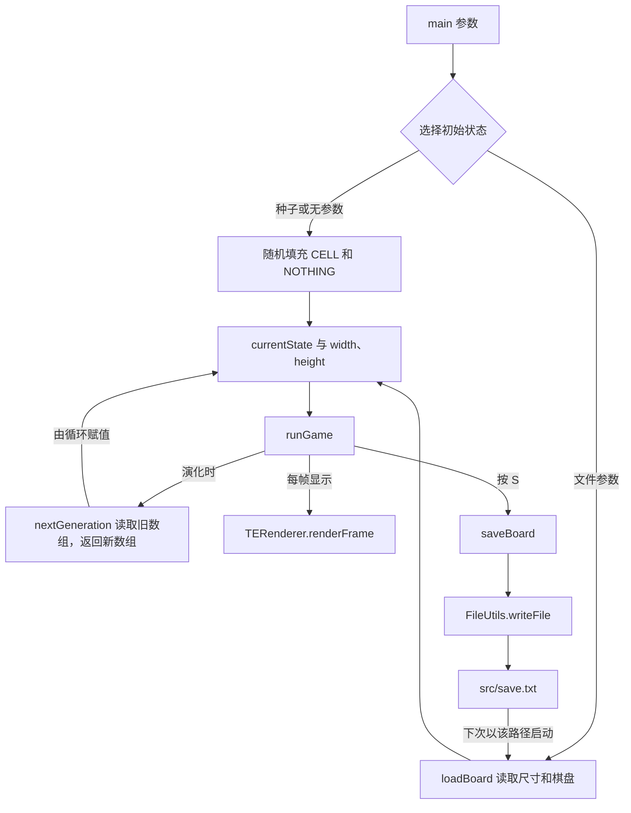

# Lab 09：康威生命游戏中文学习指南

适用版本：**CS61B Spring 2024**。核对及审计修订日期：2026-10-13。对应目录：`E:\cs61b\skeleton-sp24\lab09`。

这次要完成的是一个会自己演化的棋盘：每个格子只有“活”和“死”两种状态，程序根据上一代的邻居情况算出下一代。用户可以观看演化、暂停、用鼠标切换格子，然后保存退出；重新启动时可以从文件恢复棋盘。你要补上的是**演化、保存、读取**，窗口、随机初始化和交互循环已经提供。

阅读方法：先完成阶段 0、1，确认数组与屏幕的对应关系；接着把阶段 2 的演化做成最小可用功能；再按阶段 3、4 打通保存与读取；最后用阶段 5、6 验证连接和交付。每阶段末尾的检查框可以直接用来记录进度。本指南提供推演和实现方向，不给出三个 TODO 方法的完整答案。

## 0. 材料核对、任务边界与总路线

### 0.1 本指南依据什么

已阅读 Spring 2024 的 [Lab 09 官方说明](https://sp24.datastructur.es/labs/lab09/)、[对应 FAQ](https://sp24.datastructur.es/labs/lab09/faq/)，以及其预习关联的 [Project 3 说明](https://sp24.datastructur.es/projects/proj3/)中的整体结构、3A 世界生成、图块表示与保存设计相关内容。Java 随机数概念另核对了 [Oracle 的 Random API](https://docs.oracle.com/javase/8/docs/api/java/util/Random.html)。

官方预习还链接了一段旧学期的 Project 3 入门视频；本次尝试访问该视频未取得可核对的内容，因此不将视频内容作为事实依据。你可以从 [Lab 09 的 Pre-Lab](https://sp24.datastructur.es/labs/lab09/#pre-lab)进入观看。它是官方指定的背景材料，但其中 API 仍应与当前骨架对照。

本地依据是下列实际文件，已完整阅读代码及注释、四个测试，并读取四份模式文件和两份测试文本检查格式：

| 文件 | 当前作用 | 本次如何使用 |
| --- | --- | --- |
| [GameOfLife.java](E:/cs61b/skeleton-sp24/lab09/src/gameoflife/GameOfLife.java) | 游戏状态、构造方法、演化与持久化入口、运行循环 | 判断要实现的方法和调用关系 |
| [BoringWorldDemo.java](E:/cs61b/skeleton-sp24/lab09/src/gameoflife/BoringWorldDemo.java) | 固定矩形世界演示 | 认识坐标、数组、渲染 |
| [RandomWorldDemo.java](E:/cs61b/skeleton-sp24/lab09/src/gameoflife/RandomWorldDemo.java) | 带固定种子的随机世界演示 | 认识 Random、switch 和方法分工 |
| [TERenderer.java](E:/cs61b/skeleton-sp24/lab09/src/tileengine/TERenderer.java) | 初始化窗口，绘制整个数组 | 判断图形输出和非空约定 |
| [TETile.java](E:/cs61b/skeleton-sp24/lab09/src/tileengine/TETile.java) | 单个图块的表示，文本展示与复制工具 | 判断图块属性、调试输出和复制语义 |
| [Tileset.java](E:/cs61b/skeleton-sp24/lab09/src/tileengine/Tileset.java) | 可复用的图块常量 | 判断活、死状态的实际对象 |
| [FileUtils.java](E:/cs61b/skeleton-sp24/lab09/src/utils/FileUtils.java) | 字符串与文件之间的读写 | 判断文件路径、换行与异常 |
| [GameOfLifeTests.java](E:/cs61b/skeleton-sp24/lab09/tests/GameOfLifeTests.java) | 四项 JUnit 4 测试及数据完整性检查 | 判断本地覆盖及遗漏 |
| [saveTest.txt](E:/cs61b/skeleton-sp24/lab09/tests/testFiles/saveTest.txt)、[loadTest.txt](E:/cs61b/skeleton-sp24/lab09/tests/testFiles/loadTest.txt) | 保存与读取的标准文本 | 判断精确格式 |
| [blank.txt](E:/cs61b/skeleton-sp24/lab09/patterns/blank.txt)、[glidergun.txt](E:/cs61b/skeleton-sp24/lab09/patterns/glidergun.txt)、[hammerhead.txt](E:/cs61b/skeleton-sp24/lab09/patterns/hammerhead.txt)、[pentadecathlon.txt](E:/cs61b/skeleton-sp24/lab09/patterns/pentadecathlon.txt) | 可读取的初始状态 | 用于之后的图形运行 |
| [lab09.iml](E:/cs61b/skeleton-sp24/lab09/lab09.iml) | IntelliJ 模块、源码与测试目录、库引用 | 判断运行配置 |
| [中文提示.md](E:/cs61b/skeleton-sp24/lab09/中文提示.md) | 仓库中已有的简短提示 | 对照现有说明，保留原文 |

**证据范围：**本次整理没有运行游戏、JUnit 或正式评测，没有写入 `src/save.txt`。下文的预期结果来自规则推演与代码阅读，不是你当前实现已经通过的结果。当前三个核心方法仍有 TODO：`nextGeneration`、`loadBoard` 返回 `null`，无参 `saveBoard` 没有写出文件。

### 0.2 Lab 9 与后续任务的关系

官方将 Lab 9 分成“认识图块引擎”和“实现生命游戏”两部分。前一部分为后一部分提供二维数组、图块和渲染的基础；后一部分练习从旧状态算新状态，以及让状态留在磁盘上。[来源：Lab 09](https://sp24.datastructur.es/labs/lab09/)

它也为后续 BYOW 的世界表示与恢复状态做准备。Project 3 的世界生成、角色移动、设计文档及演示属于另一项任务；这里不把这些交付物加入 Lab 9。Lab 10 是之后的交互练习，也不需要先完成才能实现本实验。[来源：Project 3](https://sp24.datastructur.es/projects/proj3/)

### 0.3 要求的身份要分清

| 身份 | 在本实验里是什么意思 |
| --- | --- |
| **官方必做** | 完成三个核心方法；遵守有限棋盘规则、保存格式及指定路径；使用 FileUtils；保留受保护的入口和数据；提交前完成本地测试。对应细节由下文的本地接口展开 |
| **本地接口与测试约定** | 方法名称、参数、字段、数组方向、辅助入口转换，以及当前四个测试的实际断言 |
| **本指南建议** | 实现顺序、邻居计数辅助方法、StringBuilder、非对称例子、分层排查和额外自测 |
| **可自行选择** | 局部变量命名、是否抽取辅助方法、字符串构建的组织方式；不能改变既定行为 |
| **可选练习** | 自建模式、增加自测、思考后续项目的保存设计；没有核对到本实验额外计分的扩展项 |

“建议写一个邻居计数方法”不是官方要求的固定方法名；“保存到 `src/save.txt`”则是现有程序和测试共同依赖的约定。[官方保存约定](https://sp24.datastructur.es/labs/lab09/#saveboard)

各阶段的“完成检查”用于跟踪这份学习路线，包含课程要求和本指南建议的验证步骤；额外自测、记录表及完整窗口操作流程不应解释成新的官方评分项。最终清单会把两类检查分别列出。

### 0.4 先理解输入、输出和连接点

| 谁使用它 | 输入 | 输出或状态变化 |
| --- | --- | --- |
| `main` 的随机模式 | 可选的一个 long 种子参数 | 建立默认 50×50 棋盘，进入窗口循环 |
| `main` 的文件模式 | 两个参数：`-l`、文件路径 | 从文件建立棋盘，按读取尺寸初始化窗口 |
| `runGame` | 当前棋盘、时间和鼠标键盘输入 | 定期演化、切换格子、暂停，按 S 保存并退出 |
| `nextGeneration(tiles)` | 一代棋盘数组 | 返回独立的下一代数组；调用者决定何时替换当前状态 |
| `saveBoard()` | 对象已有的 `currentState`、`width`、`height` | 将棋盘快照写入 `SAVE_FILE` 指定的文件 |
| `loadBoard(filename)` | 规定格式的文本文件 | 返回内部坐标形式的棋盘，更新对象的尺寸和载入状态 |
| 测试构造方法 | 种子、文件名，或方便阅读的数组，另带 boolean 参数 | 建立没有窗口的对象，便于自动测试 |

下面是按当前骨架画出的连接图：



保存文件装的是**当时的棋盘快照**，不是随机种子或所有鼠标操作。读取后可以继续演化，因为本实验的下一代只依赖棋盘；不需要另保存帧计时器或已经经过的代数。

### 0.5 总路线表

| 阶段 | 解决的问题 | 先看哪里 | 完成标志 |
| --- | --- | --- | --- |
| 0：建立任务地图 | 哪里要补，哪里已经提供，如何运行 | 本节、GameOfLife 字段与 main、lab09.iml | 能解释随机、文件、测试输入入口和三个核心方法 |
| 1：认识棋盘表示 | 数组如何变成屏幕，随机初始化如何复现 | 两个 Demo、tileengine、构造方法 | 能把 `(x,y)`、视觉行、文件行准确对应 |
| 2：实现一代演化 | 每个格子如何同时更新 | `nextGeneration`、`fillWithNothing` | 小棋盘推演一致，两项演化测试通过，输入不被改写 |
| 3：保存快照 | 内部数组怎样写成固定格式 | 无参 `saveBoard`、`saveTest.txt`、FileUtils | 文件方向、尺寸、内容、末尾换行准确，`onlySave` 通过 |
| 4：恢复状态 | 文件怎样重建数组和对象状态 | `loadBoard`、文件构造方法 | `onlyLoad` 通过，非对称文件方向正确，对象状态一致 |
| 5：连接并运行 | 演化、保存、读取是否协作 | FAQ、四个测试、`main`、`runGame` | 保存→读取→再保存一致；窗口暂停、编辑、保存、恢复可观察 |
| 6：核对交付 | 哪些算必做，哪些尚未验证 | 最终清单 | 实现和本地验证齐全；正式成绩以实际评测记录为准 |

### 0.6 先处理材料中的具体差异

这些差异影响读代码的方法，不要求你改动骨架来“修正文案”。

| 官方文字或本地注释 | 本地实际情况 | 实现时的影响 |
| --- | --- | --- |
| 官方 `saveBoard` 说明称尺寸行代码已提供 | 当前无参 `saveBoard` 的尺寸行仍是 TODO | 需要自己构建第一行，不能只写棋盘主体 |
| 官方文字写作 `TETiles[][]`、`newGen` | 实际类型是 `TETile[][]`，已有局部变量叫 `nextGen` | 以 Java 文件中的有效名称为准 |
| 本地 `loadBoard` TODO 提到已有 `builder` | 方法里并没有声明该变量 | 不必寻找缺失对象；读取可以直接处理字符串，构建字符串的工具按需要自建 |
| 官方介绍未填充格子的渲染错误为 NullPointerException | 本地 `TERenderer.renderFrame` 主动抛出 IllegalArgumentException，消息含坐标 | 非空要求一样；排查按实际异常与位置进行 |
| `GameOfLife.randomTile` 英文注释说上界 3 | 实际调用是 `random.nextInt(2)` | 生命游戏初始化只有两个选项；不要照注释改成三种 |
| 官方概括称不需要自行转置或翻转 | 测试数组入口确实已调用 `transpose`、`flip`；文件方法仍由你处理行号与 y 的映射 | 不要把整个棋盘再转换一遍；仍必须处理“文本首行是最上面一行” |
| 官方说明要求读取时设置宽高；FAQ 还强调更新对象棋盘 | 文件构造方法会把返回值赋给 `currentState`，但直接调用 `loadBoard` 时没有外层构造方法帮忙 | 让读取方法自身更新棋盘和尺寸，同时返回它，才能支持 FAQ 的直接加载链路 |

前几项可由 [官方实现与持久化说明](https://sp24.datastructur.es/labs/lab09/#implementation)和本地对应文件对照确认；最后一项以 [官方 FAQ](https://sp24.datastructur.es/labs/lab09/faq/)进一步明确的对象状态要求为依据。原有本地中文注释不改变 Java 执行行为。

## 1. 阶段一：先把“棋盘”理解成确定的对象与坐标

本阶段解决后面所有循环的共同前提：到底在读哪个格子、写哪个格子。先理解这里，再实现规则；否则算法可能是对的，画面和保存文件却旋转了。

### 1.1 从 BoringWorldDemo 看一次完整显示

先打开 `BoringWorldDemo.main`，按三个动作阅读：

1. 创建 `TERenderer`，调用 `initialize(60, 30)`。数字是格子数，不是像素数；本地每格 16 像素，所以画布是 960×480 像素。
2. 创建 `new TETile[60][30]`，把每个位置填为 `Tileset.NOTHING`，再用 WALL 覆盖一个矩形。
3. `renderFrame(world)` 遍历数组，调用每个图块的 `draw`，最后显示这一帧。

矩形循环的范围是 `20 ≤ x < 35`、`5 ≤ y < 10`。所以它占 15 列、5 行，左下角是 `(20,5)`，右上角是 `(34,9)`。如果把上限也当成包含，就会错误地算成 16×6。

**为什么先填 NOTHING？** `new TETile[width][height]` 只创建数组，元素最初都是 `null`。NOTHING 是一个真实的“空地”图块，`null` 是缺少对象；渲染器会拒绝后者。这也解释了为什么骨架先用 `fillWithNothing(nextGen)` 填满下一代。

**为什么改数组后还要 renderFrame？** 数组是数据，窗口是一次绘制的结果。给 `world[x][y]` 换一个对象，不会自动刷新画面；渲染入口负责把最新数据画出来。

官方的图块尝试可以这样做：以后你在练习代码时，把矩形改成已有的 GRASS 或 WATER，再改矩形范围，预测外观后运行观察。它是认识引擎的练习，不是三个核心 TODO 中的另一个算法任务。本次文档整理没有改动 Demo。

### 1.2 TETile、Tileset、TERenderer 分别负责什么

| 名称 | 当前项目中代表什么 | 谁使用它 | 一次操作的含义 |
| --- | --- | --- | --- |
| `TETile` | 一个图块对象，保存字符、颜色、描述、可选图片路径 | 棋盘数组、渲染器、测试 | 显示一个格子的外观；`description()` 供测试比较 |
| `Tileset` | 一组已经创建好的 `public static final TETile` 常量 | Demo 与 GameOfLife | 为数组元素选用同一个 CELL 或 NOTHING 对象 |
| `TETile[][]` | 棋盘上的二维位置与图块引用 | 演化、保存、读取、渲染 | 第一层选 x 列，第二层选该列里的 y 位置 |
| `TERenderer` | 窗口和绘制服务 | Demo、普通构造方法、runGame | 只把数组画出来，不决定生命规则 |

`TETile` 的本地字段是 `private final`。将格子复活的含义是把**数组元素引用**换成 `Tileset.CELL`，不是改变某个图块的字符或颜色。许多格子可以共享同一个常量图块：它们的坐标来自数组下标，不储存在图块里。共享不可变对象不会让所有格子一起复活。

本地 `character` 字段的注释还明确提醒不要改名，否则会影响正式评测。三个核心 TODO 都可以在 GameOfLife 中完成，不需要为实现生死转换修改图块字段或渲染器。

本实验棋盘只使用 CELL 和 NOTHING；Demo 中的 WALL、FLOWER 是图块引擎示例，不是生命游戏的第三、第四种细胞。骨架的 `runGame` 本身也用 `currTile == Tileset.CELL` 判断活格子。读取文件时应恢复这两个常量，避免自己新建一个“外观一样但不是同一个引用”的 CELL。

### 1.3 内部数组的第一层是列

对内部棋盘 `world`：

| 表达式 | 解释 |
| --- | --- |
| `world.length` | 宽度，即 x 的位置数 |
| `world[0].length` | 高度，即每一列中的 y 位置数 |
| `world[x][y]` | 从左下角向右 x 格、向上 y 格的位置 |
| `world[0][0]` | 左下角 |
| `world[width - 1][height - 1]` | 右上角 |

以下为**人为设定的 3×2 棋盘**。表的展示顺序从上到下，内部 y 却从下到上增加：

| 屏幕行 | x=0 | x=1 | x=2 |
| --- | --- | --- | --- |
| 上面：y=1 | 活 `(0,1)` | 死 `(1,1)` | 死 `(2,1)` |
| 下面：y=0 | 死 `(0,0)` | 活 `(1,0)` | 活 `(2,0)` |

因此 `world[0]` 是第一列的“下、上”两个元素，不是屏幕最上面一整行。保存一条屏幕行时，必须固定 y，再走遍 x。

### 1.4 为什么测试里的花括号看起来又是一行一行

先看 `GameOfLife(TETile[][] tiles, boolean test)`：它执行转置，再沿上下方向翻转，最后设置 `width = tiles[0].length`、`height = tiles.length`。**这个辅助入口接收的是按视觉行写的输入**，方便你从花括号直接看图。

三个带 `boolean test` 的构造方法在当前代码里都没有读取这个参数的值；无窗口行为来自你选择了这个重载，而不是内部执行了 `if (test)`。照提供的测试传 `true` 即可，不要期待传 `false` 会自动开启渲染。

设辅助输入叫 `rows`，`rows[r][c]` 表示“自上而下第 r 行、自左而右第 c 列”。构造后内部状态的关系为：

```text
currentState[c][height - 1 - r] 对应 rows[r][c]
```

这是一条坐标对应关系，不是要你再复制一份转换方法。`saveBoard(TETile[][] tiles)` 这个有参数的辅助方法也做同样的转换，然后调用无参保存方法。

把两种入口放在一起记：

| 使用位置 | 输入表示 | 已有转换 | 你应该做什么 |
| --- | --- | --- | --- |
| 数组测试构造方法 | 方便阅读的视觉行数组 | `transpose` + `flip` | 构造后通过 `returnCurrentState()` 查看内部棋盘 |
| 有参数 `saveBoard(tiles)` | 同样的视觉行数组 | `transpose` + `flip` | 不重复转换 |
| `nextGeneration(tiles)` | 要演化的实际数组 | **没有**自动转换 | 直接读取传入数组，以它为旧状态 |
| 无参 `saveBoard()` | 对象内部的 `[x][y]` 棋盘 | 没有预先变成文件行 | 按视觉上的上到下逐行输出 |
| `loadBoard(filename)` | 文本的上到下各行 | 由你按下标映射 | 直接建立内部 `[x][y]` 数组 |

**提供的演化测试有一个特殊之处：**先把 `testInput` 交给构造方法，又直接把原始 `testInput` 交给 `nextGeneration`。这时方法收到的是原数组，不是构造后内部的 `currentState`。测试用的是正方形，并按直接数组结果比较，因此不要在 `nextGeneration` 中偷偷改成读取 `currentState`，也不要额外调用转置或翻转。

自写演化测试时遵守官方的正方形提示。若想测试游戏实际内部方向，推荐用正方形视觉输入构造对象，再把 `returnCurrentState()` 的结果交给演化方法；期望结果也要表示成相同内部方向。矩形方向测试优先放在保存和读取阶段。[官方测试提示](https://sp24.datastructur.es/labs/lab09/#testing-and-running-the-game)

**正方形限制针对这套演化自测的使用方式。**数组构造方法和有参保存辅助方法本身支持矩形：例如现有 `onlySave` 就用四条视觉行、每行三个格子，构造宽 3、高 4 的对象。不要把官方对 `nextGeneration` 自写测试的提示扩大成“整个 Lab 只能用正方形”。

### 1.5 RandomWorldDemo 的用途：让“随机”可复现

阅读 `RandomWorldDemo` 的分工：`main` 负责建立窗口与棋盘；`fillWithRandomTiles` 遍历位置；`randomTile` 根据随机整数选图块。它把大动作拆成小动作，之后可以单独理解每一层。

种子是 `new Random(SEED)` 的输入；`nextInt(3)` 中的 3 是上界，表示可能结果为 0、1、2。这两个数的作用完全不同。Demo 的三个结果对应 WALL、FLOWER、NOTHING；GameOfLife 的 `nextInt(2)` 对应 CELL、NOTHING。

用一个不指定具体数值的推演说明确定性：

| 操作 | 发生的事 |
| --- | --- |
| 创建 Random A，种子为 42，连续调用三次 `nextInt(2)` | 得到序列 `a,b,c` |
| 创建全新的 Random B，同样用种子 42，调用同样三次 | 得到同样的 `a,b,c` |
| 对 A 再调用一次 | 接着得到第 4 项，不会重新从 a 开始 |
| 某次循环中额外消耗一个随机数 | 此后给格子的随机数会错位，即使初始种子一样 |

这是 Java Random 的约定；复现还要求调用顺序和方式一致。[Oracle Random API](https://docs.oracle.com/javase/8/docs/api/java/util/Random.html)

对本实验的用途是：先用固定种子得到同一个初始棋盘，方便排查。**演化方法本身不需要随机数**；初始棋盘一旦确定，后续各代由规则决定。

### 阶段一的完成检查

- [ ] 能解释 60×30 Demo 的矩形范围、宽高和左下角位置。
- [ ] 能指出 null 与 NOTHING 的区别，知道刷新画面的入口。
- [ ] 能解释图块对象不可变，但数组里的引用可以替换。
- [ ] 能区分内部 `[x][y]` 数组、测试视觉行数组和文本行。
- [ ] 知道种子、`nextInt` 上界、随机调用顺序分别影响什么。
- [ ] 后续自己运行两个 Demo 时，观察结果与预测对应。本次未运行。

## 2. 阶段二：完成最小可用行为——从旧棋盘算出下一代

本阶段只解决“一代演化”，不依赖文件读取。先做它就能用已有随机构造方法运行生命游戏，也能执行提供的两项演化测试。

先看 `nextGeneration(TETile[][] tiles)`。骨架已经创建与对象尺寸一致的 `nextGen` 并全部填为 NOTHING。你要在剩余 TODO 中完成计数、决定哪些位置变成 CELL，最后返回这个数组。

这里还有一个调用前提：**传入的旧棋盘尺寸必须与当前对象的 `width`、`height` 一致**，因为骨架按对象字段分配新棋盘。做 5×5 例子时，应通过对应的 5×5 数组测试构造方法建立对象，再使用它的内部棋盘；不要先建默认 50×50 的随机对象，再直接把 5×5 数组传给它。后者会造成新旧尺寸不一致，不属于本实验要求你额外兼容的调用。

### 2.1 八邻居是什么，边界怎样判断

一个位置 `(x,y)` 的候选邻居是：横向偏移 `dx ∈ {-1,0,1}`，纵向偏移 `dy ∈ {-1,0,1}`，但排除 `(dx,dy)=(0,0)`。三乘三共有九个位置，去掉自己，剩八个。

| dy / dx | -1 | 0 | +1 |
| --- | --- | --- | --- |
| +1 | 左上 | 正上 | 右上 |
| 0 | 正左 | **自己，不计入** | 正右 |
| -1 | 左下 | 正下 | 右下 |

对候选坐标 `(nx,ny)`，先检查 `0 ≤ nx < width` 且 `0 ≤ ny < height`，符合后才能读 `tiles[nx][ny]`。不符合的候选当作死细胞，贡献 0；**不会从左边穿到右边，也不会从上边穿到下边**。

例：人为设定 3×3 棋盘，左下角 `(0,0)` 只可能有 `(1,0)`、`(0,1)`、`(1,1)` 三个棋盘内邻居。若三者都活，左下角的邻居数为 3；其余五个候选不访问数组。即使右上角也活，它也不是左下角邻居。

不要因为 `runGame` 的鼠标读取用了 `% width`、`% height`，就把演化也写成取模。那个表达式属于鼠标处理，不是细胞邻接规则。

### 2.2 把四条规则变成可以检查的判断表

先数邻居，再根据该格子的**旧状态**决策：

| 旧状态 | 活邻居数 | 下一代 | 实际操作 |
| --- | --- | --- | --- |
| CELL | 0 或 1 | NOTHING | 保留预先填好的 NOTHING |
| CELL | 2 或 3 | CELL | 将新数组该格子设为 CELL |
| CELL | 4～8 | NOTHING | 保留预先填好的 NOTHING |
| NOTHING | 恰好 3 | CELL | 将新数组该格子设为 CELL |
| NOTHING | 其余数量 | NOTHING | 保留预先填好的 NOTHING |

最容易混淆的是：**活细胞有 2 个邻居可以活；死细胞有 2 个邻居不能出生。**条件必须考虑旧状态。规则也不包括自己：把自己数进去，会让一串相邻活细胞的计数全部偏大。

表里的死亡结果始终是 NOTHING 对象，不是 `null`；无需让某个格子“没有对象”。

### 2.3 “同时更新”为什么需要两个数组

假设旧棋盘是一条横着的三个活细胞。左端在这一代应该死亡，但它仍是中间格子计算这一代时的旧邻居。如果先改掉左端，再计算中间，中间会看见一个本不该消失的邻居已经消失，结果依赖遍历顺序。

推荐把方法组织为三个小动作：

1. 遍历每个 `(x,y)`。
2. 只从参数 `tiles` 读取旧状态与邻居，得出该格子的下一状态。
3. 只向 `nextGen[x][y]` 写结果。全部位置决定完后，返回 `nextGen`。

`runGame` 已经有 `currentState = nextGeneration(currentState)`，所以不需要在方法内部再改当前棋盘字段。这里的职责是“计算并返回”。与下一节读取文件的“重建对象状态”不同。

`nextGen = tiles` 只是起两个名字指向同一数组，并不能隔离新旧状态。`tiles.clone()` 也只是复制最外层，内层列数组还共享；对内层元素赋值仍可能改动旧状态。骨架已提供新数组，直接利用它最清楚。共享 CELL 常量是安全的，共享可被赋值的列数组则不是。

### 2.4 手动推演：横线变竖线，再变横线

下面是**人为设定的 5×5 棋盘**，只讨论内部坐标。初始活位置为 `(1,2)`、`(2,2)`、`(3,2)`；其余全死。

| 自上而下的 y | 旧一代，按 x=0→4 | 下一代，按 x=0→4 |
| --- | --- | --- |
| 4 | 00000 | 00000 |
| 3 | 00000 | 00100 |
| 2 | 01110 | 00100 |
| 1 | 00000 | 00100 |
| 0 | 00000 | 00000 |

决定关键位置的过程：

| 位置 | 旧状态 | 从旧棋盘找到的活邻居 | 数量 | 结果 |
| --- | --- | --- | --- | --- |
| `(1,2)` 左端 | 活 | `(2,2)` | 1 | 死 |
| `(2,2)` 中间 | 活 | `(1,2)`、`(3,2)` | 2 | 活 |
| `(3,2)` 右端 | 活 | `(2,2)` | 1 | 死 |
| `(2,3)` 上方 | 死 | `(1,2)`、`(2,2)`、`(3,2)` | 3 | 活 |
| `(2,1)` 下方 | 死 | 同样三个旧活格 | 3 | 活 |
| `(1,3)` 斜上方 | 死 | `(1,2)`、`(2,2)` | 2 | 仍死 |

再以返回的竖线为旧棋盘演化一次，会回到横线。这个例子能同时检查死亡、存活、出生、斜邻居和两代连接。它在棋盘中间，不检查边界；边界还要用上一节的角落例子。

### 2.5 建议的实现与验证顺序

先决定计数的组织方式。如果把计数抽成私有辅助方法，它接收旧棋盘与一个位置，返回 0～8 的整数；它只负责邻居，不修改棋盘。这样可以逐格用断点核对计数。方法名和是否抽取都可自行决定。

接着写遍历和判断，不要在每个分支都新建图块。最后返回 `nextGen`，检查没有误返回 `null`。一代预期时间与格子数成正比：每格最多检查八个邻居，时间为 `O(width × height)`，额外数组空间也是这个量级。这是算法分析，**不是官方性能计分实验，也不是实测耗时**。

| 适合此时做的检查 | 预期用途 |
| --- | --- |
| 全死正方形棋盘 | 没有邻居时不会凭空出生 |
| 正方形棋盘中一个孤立活格 | 少于两个邻居会死亡 |
| 中间 2×2 活块，外面留死格 | 活块保持不变；外面没有误出生 |
| 上面的横线→竖线→横线 | 同步更新和多代连接 |
| 正方形边缘与角落 | 越界贡献 0，没有环绕 |
| 保存输入数组的副本，再演化后比较 | 原输入各格保持不变 |
| 演化返回数组的尺寸与所有元素 | 尺寸正确、无 null |

提供的 `oneGeneration` 检查 3×3 输入中的两个相邻活格演化成全死，另检查尺寸不变。`multipleGenerations` 用一个 4×4 输入连续演化三代并比较结果。它们没有覆盖所有计数、所有边界和输入不变性，所以补充小例子有价值。

此时可以单独运行这两个测试，**不需要等保存和读取完成**。它们仍会先检查六份数据文件；若数据检查失败，算法断言根本还没执行。

### 阶段二的完成检查

- [ ] 只统计八邻居；自己不计入，边界外不读取也不环绕。
- [ ] 能区分活格的“2 或 3”与死格的“恰好 3”。
- [ ] 读取参数 `tiles`，把结果写到独立的 `nextGen`，返回该数组。
- [ ] 输入数组没有被演化过程改写。
- [ ] 全死、孤立活格、活块、振荡和边界例子的结果与推演一致。
- [ ] 实际运行 `oneGeneration`、`multipleGenerations` 后记录结果。

## 3. 阶段三：把当前棋盘保存成一个明确的快照

演化让数据留在内存，保存让数据跨越程序结束。保存不需要等读取完成：可以先用已经构造好的棋盘检查它写出的文本。

先看字段 `SAVE_FILE = "src/save.txt"`、无参 `saveBoard()`、`FileUtils.writeFile`，再打开 `saveTest.txt`。有参 `saveBoard(tiles)` 是测试辅助入口，核心实现放在无参方法里。

### 3.1 文件装什么，不装什么

当前格式的约定由骨架 TODO、标准保存文本和 `onlySave` 共同固定：

| 位置 | 内容 | 检查条件 |
| --- | --- | --- |
| 第 1 行 | `width height` | 宽在前、高在后，一个空格，末尾 `\n` |
| 后续每行 | 一条视觉上的水平行 | 正好 width 个字符，只有 0 和 1 |
| 行的次序 | 棋盘最上面一行到最下面一行 | 共 height 行 |
| 每行的字符次序 | 从左到右 | x 从 0 到 width-1 |
| 0 | `Tileset.NOTHING` | 不写空格图块字符 |
| 1 | `Tileset.CELL` | 不写实心方块字符 |
| 文件结尾 | 最后一条棋盘行后也有 `\n` | 不遗漏最后换行，不另加空白行 |

`TETile.toString(world)` 有相同的视觉打印方向，可帮助你阅读“外层走 y、内层走 x”的结构。但它输出的是图块字符，CELL 是实心方块，NOTHING 是空格，**不是这里要求的 0/1，也不包含尺寸行**，不能把它的输出直接当保存格式。

### 3.2 用 3×2 非对称例子确认循环方向

继续使用阶段一的人为 3×2 棋盘：上行活死死，下行死活活。保存后应为：

```text
3 2
100
011
```

这里代码块表达内容；实际写出的字符串末尾还有换行，整体可以记为 `3 2\n100\n011\n`。

| 写出步骤 | 从哪里读取 | 得到什么 |
| --- | --- | --- |
| 尺寸行 | 对象 width=3、height=2 | `3 2\n` |
| 第一条棋盘行 | 固定 y=1，读取 x=0、1、2 | `100\n` |
| 第二条棋盘行 | 固定 y=0，读取 x=0、1、2 | `011\n` |
| 一次文件写入 | 全部拼好的字符串 | 覆盖 `src/save.txt` |

若 y 从 0 往上输出，得到的文件会把上下颠倒。若外层遍历 x，输出的是列，会变成三行两字符。这就是选择**矩形且不对称**的例子的理由：正方形或全死棋盘很容易掩盖错误。

本地 `onlySave` 的输入则是四条视觉行、每行三个格子。数组测试构造方法已把它转换为宽 3、高 4 的内部棋盘，所以标准文件是：

```text
3 4
010
011
100
010
```

不能看到外层数组长度为 4 就写 `4 3`；那是辅助入口的视觉行数量，构造后的 width 已经是 3。

### 3.3 FileUtils 帮你完成哪部分

`writeFile(filename, contents)` 接收两个字符串：目的路径与完整文件内容。它会先去掉 `\r`，再用 `Files.writeString` 写入；当前调用没有指定追加选项，因此文件不存在时创建文件，存在时清空旧内容再写入。如果逐行调用且每次只传当前行，就会覆盖前面各行，最后只剩末行。[Java Files.writeString 的默认行为](https://docs.oracle.com/en/java/javase/25/docs/api/java.base/java/nio/file/Files.html#writeString(java.nio.file.Path,java.lang.CharSequence,java.nio.file.OpenOption...))

推荐先在内存中构建完整字符串，最后调用一次写文件。`StringBuilder` 是一种合适的选择：按顺序追加尺寸、0/1 和 `\n`，最后取完整字符串。它只是代码组织建议，课程没有要求某个固定局部变量名。

本地工具把 IOException 包装为 RuntimeException。**读取**一个不存在的文件会失败；**写入**可以创建文件，但不会替你创建缺失的父目录。父目录不存在或访问权限不足等 IO 问题会沿调用链报告出来，不是“棋盘规则错误”。`fileExists` 可以用来调试路径，但无需为本实验新增菜单或缺档恢复流程。

**相对路径的基准是运行工作目录。**如果工作目录是仓库根，`src/save.txt` 就会指向错误的目录；本实验应以 `E:\cs61b\skeleton-sp24\lab09` 为工作目录。固定路径不要改成你的个人绝对路径，这会破坏其他机器上的约定。

### 阶段三的完成检查

- [ ] 无参保存读取 `currentState`，不是重新生成随机棋盘。
- [ ] 尺寸写成“宽 高”，数据按上到下、左到右输出。
- [ ] 文本使用 0/1，尺寸行与每条棋盘行均以 `\n` 结束。
- [ ] 使用 FileUtils 写入固定的 `src/save.txt`，完整内容一次写出。
- [ ] `onlySave` 的生成文件与 `saveTest.txt` 一致；该测试会去掉 `\r` 后比较，但其他内容仍需精确匹配。
- [ ] 不修改标准测试文本来迁就实现结果。

## 4. 阶段四：从文本恢复棋盘，并让对象状态一致

保存格式确定后，读取就是逆向映射。先看 `loadBoard(String filename)` 的 TODO 顺序，再看两个文件构造方法：它们先调用读取方法，再使用读取结果。普通文件构造方法还马上调用 `ter.initialize(width, height)`，因此宽高必须在读取时就准备好。

### 4.1 按数据依赖分成五步

1. **读文件字符串。**调用提供的 `FileUtils.readFile(filename)`；它会去掉 Windows 风格换行里的 `\r`。
2. **拆出尺寸和数据行。**尺寸行的两个数字要解析为整数，并赋给对象字段 `width`、`height`，避免声明两个同名局部变量后把字段留在旧值。
3. **创建内部棋盘。**尺寸已知后才能建立 `[width][height]` 数组，不能依赖原对象默认的 50×50。
4. **把每行字符映射到内部坐标。**第 r 条棋盘数据行（r 从 0 开始，不包含尺寸行）属于 `y = height - 1 - r`；该行第 x 个字符属于横向位置 x。
5. **更新并返回状态。**将恢复好的棋盘作为对象的 `currentState`，返回同一个棋盘，使直接调用读取和通过文件构造方法读取都保持一致。[对象状态要求：官方 FAQ](https://sp24.datastructur.es/labs/lab09/faq/)

第五步要与演化方法区分：`nextGeneration` 是计算参数的结果，由 `runGame` 接收；`loadBoard` 则建立被加载的游戏状态，FAQ 明确提醒对象的棋盘和尺寸都应更新。

### 4.2 具体映射，防止行号混入 y

仍用人为的文件：

```text
3 2
100
011
```

如果按 `\n` 拆成 `lines`，`lines[0]` 是尺寸行，`lines[1]` 才是棋盘最上面的行。

| 文本内容 | 数据行 r | 内部 y | 恢复的活位置 |
| --- | --- | --- | --- |
| `100` | 0 | 2-1-0=1 | `(0,1)` |
| `011` | 1 | 2-1-1=0 | `(1,0)`、`(2,0)` |

因此要同时记住两个不同偏移：`lines[r+1]` 用于跳过尺寸行，`height-1-r` 用于恢复上下方向。不能把 r 直接当 y，也不能把包含尺寸行的文件下标直接用于 `charAt`。

可以只用一条表达式理解关系，不把它扩展成整份实现：

```java
int y = height - 1 - r; // r 是棋盘数据行号，首条数据行 r=0
```

逐个字符将 `'0'` 转为 NOTHING、`'1'` 转为 CELL，保证所有位置都有真实图块。不要把字符 `'1'` 和整数 1 当成同一个值。

### 4.3 哪些边界需要考虑，哪些不用扩展

本实验允许按既定格式读取合法文件。当前必做范围没有要求你设计损坏文件的修复机制、支持任意分隔符、为不存在的存档创建随机世界，或兼容其他格式。先确保规定格式完整正确。

保存文件应有结尾换行；Java 普通 `split("\n")` 会丢弃末尾空字符串，因此**读取时按已解析的 height 处理数据行**，不要用“拆出来多少项”重新猜高度。若自己选择保留末尾空项的 split 形式，也不应把它当成额外棋盘行。[Java String.split 的末尾空项规则](https://docs.oracle.com/en/java/javase/25/docs/api/java.base/java/lang/String.html#split(java.lang.String))

`FileUtils.readFile` 已处理 `\r`，不要让行末 `\r` 被当成细胞。现有 FAQ 提到 Windows 兼容更新；当前本地 FileUtils 和保存测试中都已经有去除 `\r` 的逻辑，不需要为文档整理再拉取或替换代码。[Windows 问题说明](https://sp24.datastructur.es/labs/lab09/faq/)

### 4.4 测试“读取结果”与“对象状态”是两回事

本地 `onlyLoad` 先创建一个随机种子对象，再直接读取 `loadTest.txt`。该文件是 3×3 全死；测试只对返回数组中的图块描述进行比较。

它能发现一些内容恢复错误，但全死棋盘的转置或上下颠倒看起来完全相同。其 `checkState` 按返回数组尺寸遍历，也没有独立断言尺寸与预期完全一致。因此增加以下检查更有针对性：

| 检查 | 发现什么问题 |
| --- | --- |
| 返回数组第一层长度等于文件 width，内层长度等于 height | 宽高对调、误用默认尺寸 |
| 读取上面的非对称 3×2 文件并核对三个活位置 | 上下翻转和行列混淆 |
| 读文件后比较 `returnCurrentState()` 与返回结果 | 只返回新数组，未更新对象状态 |
| 在一个默认 50×50 对象中读取较小棋盘，再调用无参保存 | 字段 width/height 未更新，或保存仍使用旧棋盘 |
| 从文件构造对象，再无窗口检查状态 | 构造链与直接调用读取都可用 |

自建文件放到独立的练习位置，例如 `lab09/practice/非对称棋盘.txt`；这是你以后可选的自测数据位置，本次没有新增该目录或文件。不要改 `patterns` 或 `tests/testFiles`。

### 阶段四的完成检查

- [ ] 使用 FileUtils 读入字符串，正确解析首行“宽 高”。
- [ ] 更新的是对象字段，而不只是同名局部变量。
- [ ] 数组尺寸是 `[width][height]`，每个位置是 CELL 或 NOTHING。
- [ ] 文件首条数据行写到最大 y，末条写到 y=0。
- [ ] 对象 `currentState` 与返回棋盘一致，直接读取后能无参保存。
- [ ] 实际运行 `onlyLoad` 并记录结果，再用非对称矩形补充方向检查。

## 5. 阶段五：把演化、文件与窗口连接起来验证

三个方法各自正确仍可能在连接处失败：测试辅助输入被重复转换、文件尺寸正确但字段没有更新，或两个相反的方向错误在一次往返中互相抵消。本阶段按从无窗口到有窗口的顺序检查。

### 5.1 先读清四个本地测试的证据边界

| 测试名称 | 主要行为 | 依赖什么 | 不能单凭它确认什么 |
| --- | --- | --- | --- |
| `oneGeneration` | 3×3 两活格下一代全死；尺寸不变 | 数组构造辅助、演化 | 全部规则分支、全部边界、输入不变 |
| `multipleGenerations` | 4×4 指定输入连续三代的数组结果 | 演化 | 矩形方向、文件、图形交互 |
| `onlySave` | 四条视觉行、每行三个格子的输入，保存为宽 3、高 4 的标准文本 | 数组构造辅助、无参保存 | 从文件加载后再保存、演化后的保存 |
| `onlyLoad` | 读取 3×3 全死文件，比较返回数组图块描述 | 随机测试构造、读取 | 非对称方向、精确尺寸和对象字段更新 |

四项都先调用 `checkIfPatternFilesAreModified`。它读取六份文件，用拼接行后的 Java 字符串哈希余数检查数据。格式错误消息、缺文件消息或完整性检查失败，应先查路径或文件变化，不能据此判断演化算法。

这项保护不是逐字节比较：它按行读取，忽略行分隔符的具体形式，并把字符串哈希再取余。因此检查匹配只能说明符合它的检查条件，不能证明文件的每个字节都与原版相同。课程要求仍是不修改这些数据，不能以“哈希还匹配”为理由改写它们。

本次按测试代码的算法做了**独立静态复算**，六份数据均与硬编码余数匹配。四份模式文件的首行都是 `50 50`，都有 50 条数据行，每条 50 个 0/1 字符；活格计数分别为 blank 0、glidergun 36、hammerhead 76、pentadecathlon 18。这只确认当前数据满足所检查的结构与完整性条件，**不代表 JUnit 或游戏已经运行通过**。

### 5.2 不靠窗口先验证保存→读取→再保存

官方 FAQ 对保存/读取相关的正式测试失败，建议做一次保存、读取、再保存，并人工查看输出。[FAQ 排查建议](https://sp24.datastructur.es/labs/lab09/faq/)

推荐用独立自测，而不是改现有测试来获得绿色结果。顺序如下：

1. 用阶段三的非对称视觉行数组建立无窗口对象 A，调用无参 `saveBoard()`。
2. 人工打开 `src/save.txt`，先确认它本身是 `3 2\n100\n011\n`。将这份文本记作 F1。
3. 新建无窗口对象 B，例如使用带种子的测试构造方法，在 B 上直接调用 `loadBoard("src/save.txt")`。
4. 验证返回棋盘及 B 的 `returnCurrentState()`，维度和三个活位置均与预期一致。
5. 不给 B 传数组，直接执行 `B.saveBoard()`，得到 F2。
6. 比较 F1、F2，同时确认它们都与独立预期一致。

第 5 步是为了检验对象是否真正恢复了；改成有参 `saveBoard(loaded)` 会经过视觉行转换，而且重新设置对象状态，可能掩盖 `loadBoard` 的字段遗漏。

也不能只验证 F1=F2：如果保存倒着写、读取也倒着读，往返可能一致，却无法正确使用官方模式。因此“与独立预期一致”和“往返一致”都要检查。

### 5.3 再验证演化与持久化的连接

这里的演化部分使用**正方形**棋盘，遵守官方对 `nextGeneration` 自写测试的提示；保存、读取和数组辅助入口仍可以处理矩形。选阶段二的 5×5 横线例子，用匹配尺寸的对象先得到一代竖线，再检查保存和恢复。

由于无参保存使用对象状态，而 `nextGeneration` 只返回数组，如果你在独立自测中要用有参 `saveBoard` 保存演化结果，需要先把内部 `[x][y]` 结果表示成它接收的视觉行数组。不要原样把内部数组交给这个辅助方法。另一条更贴近程序的路径是下面的窗口检查：`runGame` 已负责把每代返回结果赋给 `currentState`，按 S 会保存它。

检查的目标是“加载后的棋盘与保存时相同，并能继续按规则算下一代”。本指南没有要求新增 setter 或修改已有辅助入口。

### 5.4 IntelliJ 的实际运行配置

本地模块把 `src` 标为源码目录、`tests` 标为测试目录；库指向 `E:\cs61b\library-sp24`，其中当前存在 `algs4.jar`、JUnit 4、`truth-1.1.3.jar` 及其依赖的 Guava 等课程库。当前项目的 IntelliJ 配置记录的是 `openjdk-25`，但这只是配置文本，不能证明该 JDK 在本机运行时已经可用。本次 shell 没有找到 PATH 中的 `java` 或 `javac`，也没有因此修改 IDE 或环境。

以后在 IntelliJ 执行时：

| 配置项 | 建议值 |
| --- | --- |
| 游戏 Main class | `gameoflife.GameOfLife` |
| 使用模块 | `lab09` |
| Working directory | `E:\cs61b\skeleton-sp24\lab09` |
| 随机模式 Program arguments | 留空，或只填一个种子，例如 `1234567` |
| 读取现有模式 | `-l patterns/hammerhead.txt` |
| 恢复最近保存 | `-l src/save.txt` |
| 单元测试 | 从 GameOfLifeTests 类或单个测试方法创建 JUnit 配置，同样使用 lab09 工作目录 |

`-l` 是**程序参数**，不要放到 VM options。`main` 以两个参数进入文件分支，并要求第一个恰好是 `-l`；它没有实现命令行帮助菜单。一个参数走种子分支，不能只传文件名。不要为本实验改 `main` 去兼容其他输入。

`lab09.iml` 还引用了 `proj3`、`lab10` 模块，但核心三个方法的逻辑不需要先完成这两项。若 IDE 报错发生在其他模块，先确认运行目标与构建范围，不要把相关项目的 TODO 当作 Lab 9 的新增要求。具体构建问题需根据实际错误排查。

### 5.5 按骨架实际操作，观察而不是猜测

完成核心方法后，可先用 `-l patterns/blank.txt` 启动，空白棋盘不会立即产生复杂变化：

1. 点击运行，确认 50×50 空白世界出现。
2. 让游戏窗口获得焦点，启动后先等超过 0.5 秒，再短按空格暂停并松开。骨架只在距离上次暂停切换超过 500 毫秒时接受切换；后续两次切换也要留足间隔，长按可能多次切换。
3. 在棋盘内部短点击格子，观察死→活、活→死。两次点击间隔超过 250 毫秒，避免长按反复切换；不要在边框外测试鼠标行为。
4. 在中间画一个三活格横线，松开按键和鼠标，再按空格继续，观察它在横线与竖线之间交替。
5. 再暂停，记下当前的非对称状态或具体活位置。
6. 按 S，骨架会调用保存，然后 `System.exit(0)`，窗口进程退出。这是**保存并退出**，没有另一个“保存但继续”功能。
7. 打开 `src/save.txt` 检查尺寸和方向。
8. 重新以 `-l src/save.txt` 启动，确认恢复的格子位置一致，再观察继续演化。

重新启动后骨架默认立即运行，每超过约 250 毫秒可能演化一次。若需要精确确认恢复瞬间，不要等几秒后拿画面与存档比较；先用无窗口读取检查。图形检查主要确认用户路径和渲染是否协作。

再分别加载 glidergun、hammerhead、pentadecathlon，观察没有空格子对象、没有明显旋转或上下颠倒、没有越界异常。不要仅用复杂动画“看起来在动”代替对小例子的逐格验证。

### 5.6 失败表现 → 优先检查方向

| 失败表现 | 优先检查 |
| --- | --- |
| 编译找不到 StdDraw、JUnit、Truth | 模块、课程库、SDK、测试目录设置；这是运行环境，不是细胞规则 |
| 报模式文件已修改，或 File does not exist | 工作目录是否 lab09；六份只读测试数据是否改变 |
| nextState 是 null，比较或渲染随即失败 | 核心方法是否仍返回骨架的 null |
| 行进到边缘出现数组越界 | 候选邻居是否先检查范围，是否错误使用包含上界的条件 |
| 死细胞有两个邻居也复活 | 是否混淆生存规则与出生规则 |
| 活细胞计数普遍多 1 | 是否把自己纳入邻居 |
| 一次演化随遍历顺序变化 | 是否原地写入旧数组或共享列数组 |
| 自写小棋盘测试出现尺寸错误或越界 | 传入棋盘尺寸是否与对象字段一致；不要在默认 50×50 对象上直接传 5×5 棋盘 |
| 提供的演化测试失败，但窗口某些例子正常 | 是否忽略参数 tiles 而读取 currentState；是否重复转换测试输入 |
| 文件只有最后一行 | 是否每写一行都调用覆盖式 writeFile |
| onlySave 内容接近但失败 | 宽高、行列、0/1、空格、每行及最后换行 |
| 保存/加载棋盘上下颠倒或转了方向 | 外层是否遍历 y；数据行 r 是否映射到 height-1-r；是否重复 transpose/flip |
| onlyLoad 通过，真实模式加载错误 | 全死例子掩盖了方向错误；检查非对称输入及准确尺寸 |
| 直接读取后再次保存仍是旧随机棋盘 | loadBoard 是否更新 currentState |
| 返回的读取数组正确，但后续演化或保存越界 | width/height 是否仍是旧值，是否被同名局部变量遮蔽 |
| 渲染提示 Tile at position ... is null | 数组分配后是否填满；读取每个字符是否都恢复图块 |
| 按 S 退出了但找不到文件 | 在哪个工作目录查找；写文件前是否出错；不要改固定路径绕开问题 |
| 重载后画面与存档有差异 | 区分读取方向错误与运行已演化数代；用无窗口检查加载瞬间 |
| 窗口边缘鼠标操作报错 | runGame 的既有坐标处理；先用棋盘内部操作验证核心方法，不擅改受保护循环 |

### 阶段五的完成检查

- [ ] 四项原有测试实际运行，结果与失败信息有记录。
- [ ] 非对称保存文本与独立预期一致，加载状态与文件一致。
- [ ] 保存→直接读取→无参再保存的文本一致，对象尺寸和状态一致。
- [ ] 运行配置工作目录正确，`-l` 与种子参数分别按 main 的约定使用。
- [ ] 自己实际观察暂停、点击、演化、S 保存退出、重新读取。
- [ ] 明确本地测试、无窗口自测、窗口观察各自确认的范围。

## 6. 阶段六：核对交付与最终完成清单

本阶段把代码行为、实验练习和正式评测分开。官方要求提交前通过提供的本地测试；本地测试通过并不保证正式评测满分，保存和读取会被正式检查，实际 Gradescope 分数才是最终成绩。[官方测试与提交说明](https://sp24.datastructur.es/labs/lab09/#submission)

### 6.1 本实验的实际交付物

| 项目 | 本实验是否要求 | 处理方式 |
| --- | --- | --- |
| 三个核心方法 | 必做 | `nextGeneration`、无参 `saveBoard`、`loadBoard` 的行为都要完成 |
| 规定文件格式和路径 | 必做 | 使用既定 0/1 文本及 `src/save.txt`，保留 SAVE_FILE |
| 提供的模式和测试数据 | 必须保留 | 不增删替换内容，不通过改期望答案消除失败 |
| 本地测试 | 提交前要求 | 四项提供的测试都应实际执行并通过；针对性额外自测属于本指南建议 |
| 图块 Demo 学习与参数尝试 | 官方学习环节 | 理解已有引擎，可自行观察图块和区域变化 |
| 正式 Lab 9 提交 | 官方提交环节 | 学习完成后按课程平台流程提交，核对实际评测结果；本次不代办 |
| 性能实验数据、speedTestResults.txt | 未列为本实验要求 | 不把 Lab 6/8 的计时任务移入这里 |
| 设计文档、伙伴反思、BYOW 演示表 | 未列为 Lab 9 交付物 | 属于其他任务的要求，不新增本实验文档负担 |
| 分阶段评分提交、额外挑战分 | 当前 Lab 9 页面未列出 | 不编造检查点或计分规则 |
| 新建模式、自测记录 | 可选 | 独立保存，不覆盖官方数据 |

现有 `src/save.txt` 是游戏写出的结果位置，不需要往里预填一份答案。以后运行保存测试或按 S 都会覆盖它；若里面已有你想保留的记录，先另存副本。**本次整理未运行这些写入操作，也未改动这个文件。**

官方预习中的拉取骨架、旧视频、Project 3 预览用于准备课程材料；当前 lab09 文件已经在仓库中，整理指南不需要为此进行 pull。后续你若选择正式提交代码，Git 提交、推送和平台评测仍是你另行执行的交付动作；本次没有执行任何一个。

### 6.2 不编造结果的检查记录提纲

下面是可选的个人记录，不是新增提交表，也不是性能报告：

| 日期与检查对象 | 使用的输入与配置 | 预期 | 实际观察／失败消息 | 下一步 |
| --- | --- | --- | --- | --- |
| 待填：一代／多代测试 | 正方形小棋盘、无窗口构造 | 对应规则与指定数组 | 待实际执行填写 | 待填 |
| 待填：保存 | 非对称 3×2 自测，工作目录 lab09 | `3 2\n100\n011\n` | 待填 | 待填 |
| 待填：读取并再保存 | 同一文件，直接 loadBoard、无参 saveBoard | 恢复三个活位置，文本一致 | 待填 | 待填 |
| 待填：窗口路径 | blank 模式、暂停编辑、S 保存退出、-l 恢复 | 状态相符，能继续演化 | 待填 | 待填 |
| 待填：正式评测 | 记录实际提交版本及平台结果 | 以平台报告为准 | 待填 | 待填 |

可比较的功能检查应使用同一个已知输入、相同坐标表示和同一工作目录。随机路径要固定种子；保存/读取要先独立核对文本，不能只做一个没有参考的往返。

### 6.3 完成清单：课程要求与建议检查分别记录

以下先列课程材料及本地接口对应的学习、实现和提交要求，再列本指南建议的额外验证。推荐自测帮助你发现遗漏，但没有核对到它们是另行提交或计分的项目。

**材料与结构**

- [ ] 对照的是 Spring 2024 Lab 09 与当前 lab09 文件。
- [ ] 读懂两个 Demo 和 GameOfLife 的字段、构造入口、核心调用关系。
- [ ] 内部棋盘只有 CELL/NOTHING，格子非 null。
- [ ] 构造方法、受保护的 runGame/main 和 SAVE_FILE 保持既定约定。
- [ ] 模式文件与测试文本保持原有内容。

**演化**

- [ ] 八邻居、排除自己、边界外为死、不环绕。
- [ ] 生存与出生条件分别正确。
- [ ] 新旧数组隔离，参数输入保持不变，下一代无 null、尺寸不变。
- [ ] 返回下一代，供调用者更新 currentState。
- [ ] 两项提供的演化测试已实际执行并通过。

**保存和读取**

- [ ] FileUtils 参与读写，保存目标是 `src/save.txt`。
- [ ] 保存首行宽高顺序、空格、0/1、行数、行长及末尾换行准确。
- [ ] 文件与棋盘的上下左右一致；没有重复转置翻转。
- [ ] 读取更新 width、height 和 currentState，并返回对应棋盘。
- [ ] 提供的保存和读取测试已实际执行并通过。

**连接与交付**

- [ ] 四项原有测试均已实际执行并通过，不以静态阅读代替。
- [ ] 运行配置使用 lab09 工作目录，游戏参数与 main 匹配。
- [ ] 正式提交时核对实际平台结果，不能把本地四项测试解释为满分保证。
- [ ] 没有遗漏本实验明确交付物，也没有把 BYOW 的设计文档等误加入 Lab 9。

**本指南建议的验证——不是新增官方交付物**

- [ ] 用全死、孤立活格、角落、活块及振荡器补充检查规则，并确认输入没有被改写。
- [ ] 用非对称矩形核对保存文本、加载位置及精确尺寸。
- [ ] 直接读取后无参再保存，核对对象状态与往返文本。
- [ ] 实际观察暂停、编辑、演化、保存退出、重启读取的完整用户路径。

**可选扩展练习**

- [ ] 增加保持输入不变、角落、活块和振荡器等小测试。
- [ ] 在独立目录建立自己的模式文件。
- [ ] 对比后续世界引擎的恢复需求：保存棋盘快照和保存可重建信息各需要哪些数据。

### 6.4 后续设计思考：为什么不能只保存一个种子

Lab 9 当前保存整个棋盘是明确约定，不能为了“优化”改成只写种子。一个种子可以重建初始随机棋盘，但用户可能已经点过格子，游戏也可能演化了许多代；只有种子无法恢复保存瞬间。

人为例子：两次都用种子 42 开始，一次立即保存，另一次先把 `(2,2)` 切换后保存。种子相同，保存时的状态不同。任何替代保存设计都要留足区别这两种状态的信息。

这条思考为 BYOW 的持久化设计做准备：若尝试用种子与操作历史重建世界，还要保证重放完整且确定，不能漏掉会改变状态的信息。它是概念上的延伸；本 Lab 的实现仍按本地固定快照格式完成。

## 7. 本指南交付时已核对的内容

已将官方任务映射到三个核心方法与学习、测试、交付阶段；核对了本地字段、参数、构造方法、转换辅助方法、文件工具、两个 Demo、渲染器、图块、四个测试及六份数据。材料中的命名、已提供代码、异常类型和注释差异已列在 0.6。

| 官方材料中的任务／限制 | 本指南对应位置 |
| --- | --- |
| 预习、旧视频与 Project 3 背景 | 0.1、0.2、6.1；视频内容未取得，已明确标注 |
| Boring World、图块尝试与坐标方向 | 1.1～1.3 |
| Random World、种子、switch、方法分工 | 1.5 |
| 构造方法保持原样，测试不渲染 | 0.3、1.4、5.4、最终清单 |
| 有限边界、CELL/NOTHING 与下一代规则 | 1.2、2.1～2.5 |
| 使用 FileUtils、保存尺寸与 0/1、正确方向和逐行换行、固定保存路径 | 3.1～3.3 |
| 读取格式、建立棋盘、更新尺寸及 FAQ 的对象状态提醒 | 4.1～4.4 |
| 数据不修改、提供的测试、文件运行参数、正方形自写演化测试提示 | 1.4、5.1、5.4～5.5 |
| FAQ 的 Windows 换行与保存→读取→保存排查 | 4.3、5.2 |
| 为后续项目思考持久化设计 | 6.4 |
| 三个实现方法、提交前测试、正式评分边界 | 0.5、6.1～6.3 |

实现路线按依赖组织：坐标与图块→无文件依赖的演化→固定保存格式→读取及对象一致性→无窗口连接检查→图形运行→正式交付。小例子分别覆盖同步演化、角落边界、数组入口转换、矩形保存和恢复，不把一种表示混用于全部场景。

**当前未验证项仍包括：你实现后的 JUnit 结果、真实窗口表现及正式评测成绩。**本次只编写、审计和更新这份指南；没有完成 TODO，没有改代码、测试或记录，没有 commit、push 或提交评测。

### 7.1 本轮审计修订与复核范围

本轮重新通读全文，并对照官方说明、FAQ 与本地所有相关源码、测试及六份数据核对。已修正联合检查一节误称“辅助入口有矩形限制”的表述，把最终清单中的建议自测与课程要求分开，补充演化参数尺寸与对象字段必须一致的调用前提，并澄清 NOTHING 与 null、文件创建与覆盖行为及测试哈希保护的边界。

另用独立的二进制棋盘复算核对 5×5 横线与竖线两代往返、2×2 活块稳定性、3×2 非对称棋盘映射，以及提供的 4×4 多代测试的三份期望数组；这些结果与指南及测试数据相符。六份数据的哈希余数、尺寸与模式活格数也已重新复算。这些复核验证的是讲解与数据，不是执行学生 Java 实现或正式评测。
