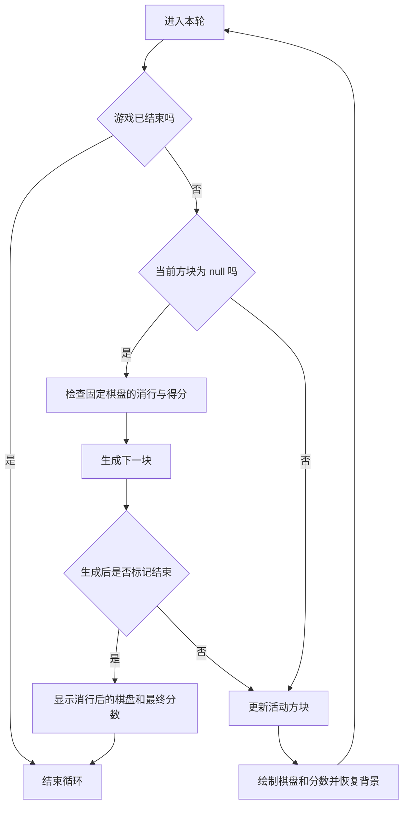

# CS61B Spring 2024 Lab 10 俄罗斯方块中文学习指南

你要把现有骨架接成一个可以玩的俄罗斯方块游戏：方块从窗口上方出现，按时间自动下落；玩家用五个按键移动或旋转；方块落到底部或已有方块上时固定，填满的横行消失，上方各行整体下移，分数随之增加，再生成下一块，直到游戏结束。

玩家从 `Tetris.main` 启动游戏，在绘图窗口中输入按键，看到棋盘和持续显示的分数。程序的另一种使用方式是测试直接调用 `clearLines(tiles)`，检查传入棋盘的变化和 `getScore()` 返回的分数。因此，**游戏画面与消行计算要分别检查**：窗口能玩，不能证明外部传入棋盘的消行正确；消行测试正确，也不能证明按键和画面正确。

主要输入是 `a/s/d/q/w` 和计时器产生的下落动作；可选命令行参数是一个 `long` 类型随机种子。输出是更新后的游戏画面、累积得分，以及 `clearLines` 对参数数组的原地修改。Lab 10 不要求生成数据文件或保存游戏进度。

已有的 `Movement` 负责移动、旋转、碰撞和落地固定，`Tetromino` 负责形状与坐标，`BagRandomizer` 负责选下一种方块，图块引擎负责绘图。你需要完成的五个方法都在 [Tetris.java](E:/cs61b/skeleton-sp24/lab10/src/tetris/Tetris.java) 中：`updateBoard`、`incrementScore`、`clearLines`、`runGame`、`renderScore`。学习顺序按这些方法之间的依赖安排，不必照原文顺序逐个填写。

官方实现范围是 `Tetris.java`，其余三个 `tetris` 辅助类直接使用。本地还用注释 `Everything below here you don't need to touch` 标出已提供的基础设施；阅读它们是为了正确调用，本次任务无需改写这部分代码或图块渲染器。[官方辅助类说明](https://sp24.datastructur.es/labs/lab10/#tetris)

## 总路线

| 阶段 | 要解决的问题 | 先看的文件和方法 | 完成标志 |
| --- | --- | --- | --- |
| 1 理解状态 | 活动方块、固定方块和画面各存在哪里 | `Tetris` 字段、`renderBoard`、`Movement`、`Tetromino.draw` | 能推演一次下落前后的 `board`、`auxiliary` 和当前方块 |
| 2 打通最小循环 | 怎样让方块出现、自动下落、固定并换下一块 | `main`、构造方法、`runGame`、`spawnPiece`、`updateBoard` 已有部分 | 不按键也能连续落下多块，叠起来且不穿透 |
| 3 加入交互 | 怎样把一次按键交给已有移动工具 | `updateBoard`、`Movement` 的五个入口、`StdDraw` | 五种按键正确，其他键不触发额外动作 |
| 4 完成消行与计分 | 怎样删除整行并保持剩余行的顺序 | `incrementScore`、`clearLines`、`fillAux` | 连续与不连续满行均被清除，参数棋盘和分数正确 |
| 5 完成显示 | 怎样让分数和棋盘一起持续显示 | `renderScore`、`renderBoard`、`TERenderer.resetFont` | 分数位于指定位置，更新正确，棋盘未被文字绘制清空 |
| 6 综合检查与交付 | 怎样确认算法、游戏交互和课程验收分别完成 | 消行检查矩阵、`main`、`magic_word.txt` | 完成本地检查；有课程权限时完成 checkoff 和 Gradescope 要求 |

阶段 2 允许你先搭建 `runGame` 的基本结构，随后在阶段 4 回来接入消行与计分。这样每一步都有能观察的结果。这个顺序是实现建议；五个方法的最终行为仍按官方要求完成。

## 版本依据与当前文件

本指南核对日期为 2026 年 10 月 13 日，目标版本是 **Spring 2024**。以下三类信息要分清：

- **官方要求**决定功能、计分、演示和提交条件，来自 [Lab 10 说明](https://sp24.datastructur.es/labs/lab10/) 与 [Lab 10 FAQ](https://sp24.datastructur.es/labs/lab10/faq/)。
- **本地代码行为**决定辅助方法实际如何配合。当前九个 Java 文件与 [官方 Spring 2024 骨架目录](https://github.com/Berkeley-CS61B/skeleton-sp24/tree/main/lab10/src) 比较，去掉注释和空白后代码一致。本地部分文件增加了中文注释。
- **实现建议和教学示例**帮助你组织工作，不额外增加课程要求。下文的缩小棋盘和人为指定状态都属于教学示例。

### 文件各自负责什么

| 本地文件 | 作用 | 本次实现时怎样使用 |
| --- | --- | --- |
| [Tetris.java](E:/cs61b/skeleton-sp24/lab10/src/tetris/Tetris.java) | 保存游戏状态，组合输入、移动、消行、得分和渲染 | 完成五个目标方法；阅读已有辅助方法 |
| [Movement.java](E:/cs61b/skeleton-sp24/lab10/src/tetris/Movement.java) | 检查目标位置，移动、旋转，向下受阻时固定方块 | 调用已有方法，不重写碰撞算法 |
| [Tetromino.java](E:/cs61b/skeleton-sp24/lab10/src/tetris/Tetromino.java) | 七种方块的布尔形状、颜色、位置和绘制 | 理解坐标、`draw` 和 `reset` |
| [BagRandomizer.java](E:/cs61b/skeleton-sp24/lab10/src/tetris/BagRandomizer.java) | 从一袋形状编号中随机抽取并删除，空袋再补满 | 已由 `spawnPiece` 使用，无须新增随机器 |
| [TERenderer.java](E:/cs61b/skeleton-sp24/lab10/src/tileengine/TERenderer.java) | 初始化窗口，将图块数组画到画布 | 理解 `drawTiles`、`renderFrame` 和字体恢复的区别 |
| [TETile.java](E:/cs61b/skeleton-sp24/lab10/src/tileengine/TETile.java) | 表示单个格子的字符、颜色等信息 | 理解空格、图块绘制；可用 `toString` 辅助检查 |
| [Tileset.java](E:/cs61b/skeleton-sp24/lab10/src/tileengine/Tileset.java) | 提供共享图块常量 | 用 `Tileset.NOTHING` 表示空格 |
| [RandomUtils.java](E:/cs61b/skeleton-sp24/lab10/src/utils/RandomUtils.java) | 随机数工具，图块颜色工具间接使用 | 本次无需新增调用 |
| [FileUtils.java](E:/cs61b/skeleton-sp24/lab10/src/utils/FileUtils.java) | 文件读写工具 | 本次五个方法不需要读写文件 |
| [magic_word.txt](E:/cs61b/skeleton-sp24/lab10/src/magic_word.txt) | 保存正式验收给出的口令 | 当前为空；验收后按课程要求填写 |
| [lab10.iml](E:/cs61b/skeleton-sp24/lab10/lab10.iml) | IntelliJ 模块和课程库配置 | 运行前检查依赖配置 |
| [中文提示.md](E:/cs61b/skeleton-sp24/lab10/中文提示.md) | 仓库已有的简短提示 | 保留原文件；其中不精确的行为以下文核对为准 |

本地没有 `tests` 目录或随附测试类，没有实验数据和设计文档模板。不能凭空把其他 Lab 的速度实验、`results.txt` 或 Project 3 的设计文档列为 Lab 10 交付物。

### 几处需要按实际代码理解的差异

| 说明或提示容易让人形成的理解 | 当前代码实际行为 | 对实现的影响 |
| --- | --- | --- |
| 已有中文提示说移动不合法时方块固定；`Movement.tryMove` 的文字注释也较宽泛 | `tryMove` 只在失败且 `deltaY < 0` 时固定；左右受阻只是保持位置 | 左右碰墙后仍能控制该方块，不能自行把它设成 `null` |
| 官方概述说堆到顶部结束；中文提示概括成出生位置无法放置 | `spawnPiece()` 具体检查 `board[4][19] != Tileset.NOTHING`，并没有检查整个出生形状是否可放置 | 按已有结束判据组织循环；不另外设计通用出生碰撞检查 |
| 看到 `renderBoard` 名字，以为它只画画 | 它显示棋盘和分数后，还把 `board` 恢复为固定方块的快照，或填成空棋盘 | 不能随意重复调用它；要理解每次调用前后的数组内容 |
| 认为 `reset()` 会恢复方块的全部初始状态 | 它只把位置设回 `(3,20)`，不恢复已经旋转的 `shape` | 同一枚举形状再次抽到时可能保留方向；这不是要求你补做的 TODO |
| 随机器注释容易被读成绝不会连续出现同种形状 | 一袋内不重复，但两袋交界处仍可能抽到同种形状 | 不要把这种相邻重复当成你主循环的错误 |

这些行为在当前官方骨架中也存在。具体实现要依据代码的条件分支，不能把概述扩展成另一个版本的俄罗斯方块规则。

Lab 10 为 Project 3 的交互阶段练习输入、状态更新和渲染组合，不要求你先完成 Project 3 的世界生成，也不要求在本 Lab 实现 BYOW 的菜单、存档或角色系统。阶段 6 会说明怎样解释可迁移的设计思想。[官方任务背景](https://sp24.datastructur.es/labs/lab10/#introduction)

## 阶段 1 理解活动方块与两份棋盘

这一阶段先不填写复杂方法。先解决“移动一个方块时，为什么旧位置不会残留，为什么碰撞检查不会撞上自己”。后面的主循环、输入和消行都依赖这个关系。

先读 `Tetris` 的字段、`fillBoard`、`fillAux`、`auxToBoard`、`renderBoard`，再读 `Movement.canMove`、`dropDown` 和 `Tetromino.draw`。

### 坐标与数组不是通常的行列写法

`TETile[][] board` 是一个二维数组，但访问方式是 **`board[x][y]`**：第一层是列，第二层是该列中的高度。左下角是 `(0,0)`，向右 `x` 增大，向上 `y` 增大。实际棋盘为 10 列、25 行：`x` 是 0～9，`y` 是 0～24；窗口显示 20 行，`y` 是 0～19。上面 5 行留给新方块生成。

| 操作 | 坐标变化 | 在本 Lab 的意思 |
| --- | --- | --- |
| 向左一格 | `x - 1` | 交给 `tryMove(-1, 0)` |
| 向右一格 | `x + 1` | 交给 `tryMove(1, 0)` |
| 向下一格 | `y - 1` | 交给 `dropDown()` |
| 遍历第 `y` 行 | 访问所有 `board[x][y]` | 消行时必须横向检查全部列 |
| 删除一行后下移 | 原来高度 `r + 1` 的内容写到 `r` | 各列中的对应格子一起移动 |

Java 的 `board[y]` 在这里是一整列，不是横行。因此，“删除第 y 行”不能简单替换 `board[y]`。要移动每一个 `x` 对应的单元格。

数组中的空格是 `Tileset.NOTHING`，不是 Java 的 `null`。渲染器遇到空引用会抛出异常；`null` 在当前游戏中的重要用途，是表示“没有活动方块”。不要混淆这两种空。

### 一个 Tetromino 怎样变成棋盘上的四格

`Tetromino` 是枚举，`I/J/L/O/S/T/Z` 是七个实例。每个实例保存：

- `shape[tx][ty]`：方块局部格子是否占用，`true` 才需要画。
- `pos`：形状包围数组的左下角锚点，是一个 `Point`，有 `x/y`。
- `width/height`：供绘制和移动遍历使用的数组范围。
- 私有 `tile`：这个形状的颜色图块。

源码中书写形状时用的是从上到下的行列表示；构造方法通过 `ijToXY` 转成从左下角开始的 `shape[x][y]`。读数组字面量时不要直接把第一层当作游戏里的 x 坐标。

以现有 `O` 方块为例，局部占用位置是 `(0,0)、(1,0)、(0,1)、(1,1)`。人为设 `pos=(3,5)`，`Tetromino.draw` 将它们写到：

| 局部坐标 | 加上位置后的全局坐标 |
| --- | --- |
| `(0,0)` | `(3,5)` |
| `(1,0)` | `(4,5)` |
| `(0,1)` | `(3,6)` |
| `(1,1)` | `(4,6)` |

短表达式足以说明这层关系：`全局 x = pos.x + tx`，`全局 y = pos.y + ty`。`draw` 只写 `true` 的格子，不擦除旧方块，也不检查边界。边界与占用检查应由已有 `Movement` 完成，不能靠捕获数组越界异常来处理非法移动。

### board 与 auxiliary 的分工

| 状态 | 存什么 | 谁使用它 |
| --- | --- | --- |
| `currentTetromino` | 正在控制的方块的形状和位置，或 `null` | `updateBoard` 与 `Movement` |
| `auxiliary` | 已经固定的方块快照 | 旋转碰撞检查；恢复下一次更新的背景 |
| `board` | 本次处理和绘制使用的数组 | 平移碰撞检查、方块绘制、消行、渲染 |
| `auxFilled` | 是否已有方块通过落地固定流程加入快照 | `renderBoard` 决定怎样恢复背景 |

**`board` 的含义会随一次循环的位置变化。** 更新前，它只含固定方块；绘制活动方块后，它含固定方块和活动方块；显示完成后，`renderBoard` 又把它恢复为固定方块背景。`auxiliary` 在活动方块正常移动时不变，落地和消行时才更新。

`fillAux()` 的方向是 **`board → auxiliary`**；`auxToBoard()` 的方向是 **`auxiliary → board`**。这不是让两个二维数组共享同一个外层数组，骨架逐列复制数组中的图块引用。图块本身不可变，复制引用就足够保存格子内容。

下面是人为设置的 `O` 方块下落例子。固定方块集合记为 F，活动方块在 `(3,5)` 时占用的四格记为 A5，下落后在 `(3,4)` 的四格记为 A4。

| 时刻 | 执行内容 | `board` | `auxiliary` | 当前方块 |
| --- | --- | --- | --- | --- |
| 更新开始 | 上次渲染已经恢复背景 | F | F | O，位置 `(3,5)` |
| 检查下落 | `canMove(0,-1)` 检查 A4 是否越界或撞到 F | F | F | 尚未变化 |
| 下落成功 | 位置变成 `(3,4)` | F | F | O，位置 `(3,4)` |
| 写入活动块 | `Tetromino.draw` | F 加 A4 | F | 同上 |
| 显示 | `renderBoard` 绘图并显示 | 先显示 F 加 A4，再恢复成 F | F | 同上 |

因此下一次 `canMove` 不会把活动方块自己的旧格子当成障碍。如果在显示前连续调用两次 `updateBoard`，第一次写入的活动块可能还在 `board` 中，第二次碰撞检查就可能“撞到自己”。这也是阶段 3 建议每次更新只处理一个按键的原因。

若向下目标位置被占用，`dropDown()` 会在原位置把活动方块写进 `board`，调用 `fillAux()`，设 `auxFilled=true`，最后把 `currentTetromino` 设为 `null`。此时两份棋盘都包含刚固定的方块，下一轮可以消行并生成新块。

**这一阶段完成时：**你能口头解释 `board` 在更新前、显示前和显示后分别含什么；能说出两个复制方法的方向；能推演 O 方块的一次成功下落和一次向下受阻。尚不需要游戏窗口能正常运行。

## 阶段 2 打通生成下落固定和换块

这一阶段先让已有自动下落机制连续运转，暂时不依赖玩家按键。它把阶段 1 的状态关系变成最小可运行行为，随后才能有效检查交互。

先看 `main`、两个构造方法、`spawnPiece`、`updateBoard` 开头已有的计时分支，然后填 `runGame` 的基本流程。

### 启动时发生什么

`main` 读取可选的种子参数，创建 `new Tetris(seed)`，然后调用 `runGame()`。带种子的构造方法初始化 10×20 的窗口、10×25 的两份数组、随机源和移动工具。两份数组开始都填着 `Tileset.NOTHING`，`currentTetromino` 初始为 `null`，分数是 0，结束标记是 false。

无参数构造方法 `new Tetris()` 同样建立数组和移动工具，但**不调用 `ter.initialize`**。它适合后面只检查 `clearLines` 的自测；实际运行图形游戏沿用 `main` 的带种子构造路径。

IntelliJ 中运行 `tetris.Tetris.main`，不要运行 `Movement` 或图块类。若希望下一次启动的抽袋顺序便于对照，可在运行配置的 Program arguments 填 `12345`。这是一个参数，不是把 `12345` 输入到游戏窗口。没有参数时 `main` 自动选种子。相同种子只方便比较随机抽取过程；实时下落仍取决于时间，且枚举形状会保留旋转状态，不应据此声称全部游戏状态必定可重放。

### 先给循环安排清楚的状态入口

建议保持“每次更新活动方块后，配套渲染一次并恢复背景”的基本结构。消行发生在没有活动方块时；即使紧接着判定结束，也应显示消行后的棋盘与分数。以下是流程关系，不是可直接替换 TODO 的完整代码：

`runGame()` 中已有 `resetActionTimer()`，它建立自动下落的时间起点。`updateBoard()` 已写好：当距上次计时重置 **大于 1000 毫秒**，调用 `movement.dropDown()`，重置计时，画当前局部引用 `t`，然后返回。无需重新发明重力算法，也不要删掉它后只剩按键移动。

按下面顺序落实：

1. 让游戏在结束标记为 false 时持续执行；不要运行一遍就退出。
2. 进入本轮时，若当前方块为 `null`，先处理固定棋盘的消行，再 `spawnPiece()`。第一轮空棋盘也不会消掉任何行。
3. 生成后再检查结束标记。当前 `spawnPiece()` 即使设置结束标记，仍继续选形状和重置位置；若已结束，显示当前固定棋盘和最终分数，再退出，不再更新或绘制这个新活动方块。显示可以沿用 `renderBoard()`；绘图调用应留在 `runGame`，不能移进 `clearLines`。
4. 有活动方块时调用 `updateBoard()`，随后调用 `renderBoard()`，把本轮画面显示出来，同时准备下一轮背景。
5. 阶段 4 完成后确认消行位置已接入，且 `clearLines` 传入的是实际游戏棋盘 `board`。普通路径在后面的 `renderBoard()` 中显示消行结果；结束路径也要有一次显示，避免最后一次清理后直接退出，让窗口保留旧棋盘或旧分数。

阶段 2 的基本循环接通时，空的 `clearLines` 和 `renderScore` 还不能实现对应功能，所以此时只验证下落、固定与换块。不要把这个阶段标记成完整游戏完成。

### 为什么要先消行再生成

`currentTetromino == null` 有两个来源：刚启动还没生成第一块；上一块向下受阻后已经固定。后者的固定方块可能刚好填满行。若先生成并把新块写入，再消行，就把活动方块与固定棋盘混在一次清理中。若先检测结束而不处理刚填满的行，也可能在本来可以清除的堆积上结束游戏。

已有 `updateBoard` 的局部变量 `t` 是开始更新时拿到的对象引用。`dropDown()` 把字段 `currentTetromino` 设成 `null`，并不让局部引用 `t` 自动变成 `null`。因此本轮仍可以画出刚固定的块；下一轮再根据字段的 `null` 生成新块。这是 Java 引用赋值在本 Lab 的实际用途。

### 这一阶段怎样检查

- 刚启动的一小段时间可能只有黑色窗口：新块锚点在 `(3,20)`，位于可见区域上方。根据形状，经过若干次自动下落才会进入画面。持续空白时再排查生成和循环。
- 不按任何键，观察方块是否按计时下落。短时间让循环暂停可作为调试手段，但不是自动下落计时器的替代。
- 第一块落到底部后，应固定，随后出现下一块。底部不能无限向下穿透。
- 第二块落到第一块上时也应固定；在调试器中看 `currentTetromino` 如何从对象变成 `null`，然后变成下一种方块。
- 人工检查结束条件时，在没有活动方块、即将执行消行与生成的循环入口暂停。将 `getBoard()[4][19]` 设为一个非空图块，保持该行其他格子为空，随后用 `fillAux()` 同步快照，并用 `setAuxTrue()` 标记已有固定内容。这样下一次生成会检查该位置，后续渲染也不会把人为设置的图块清掉。若当前仍有活动方块，优先等正常落地后再构造此场景。不要只改一份背景后继续任意运行，也不要把调试状态当成提交数据。

**完成标志：**多块连续自动下落和堆叠，循环既不会只走一次，也不会在结束标记已经为 true 后继续更新。消行和分数显示留待后续阶段验证。

## 阶段 3 把按键接到已有移动方法

现在已有一个能持续更新和显示的循环，本阶段只负责把输入转换成一次状态变化。先打开 `updateBoard` 的 TODO 和 `Movement` 各个入口。

### 输入读取和动作执行是两件事

`StdDraw.hasNextKeyTyped()` 告诉你是否有尚未处理的字符，`nextKeyTyped()` 取出一个字符并消费它。应先确认有字符，再读取；没有字符时直接读取会抛出 `NoSuchElementException`。这些都是静态方法，沿用源码导入的 `edu.princeton.cs.algs4.StdDraw`。

官方说明链接的是 [Princeton StdDraw API](https://introcs.cs.princeton.edu/java/stdlib/javadoc/StdDraw.html)；该 Javadoc 本次访问失败，相关行为另以 [Princeton 官方 algs4 StdDraw 源码及说明](https://algs4.cs.princeton.edu/code/edu/princeton/cs/algs4/StdDraw.java.html) 核对，并检查了本地 `algs4.jar` 中的方法签名。不要因为另一份文档里的类没有包名，就改成本 Lab 不同的导入。

| 读取到的字符 | 要调用的已有方法 | 要产生的效果 |
| --- | --- | --- |
| `a` | `movement.tryMove(-1, 0)` | 尝试左移一格 |
| `s` | `movement.dropDown()` | 尝试下移一格，向下受阻时固定 |
| `d` | `movement.tryMove(1, 0)` | 尝试右移一格 |
| `q` | `movement.rotateLeft()` | 尝试逆时针旋转 90 度 |
| `w` | `movement.rotateRight()` | 尝试顺时针旋转 90 度 |
| 其他字符 | 不调用上述动作 | 不因这个字符额外移动或旋转 |

上述五个小写字符及其他键无动作的要求来自 [官方 updateBoard 与 checkoff 条件](https://sp24.datastructur.es/labs/lab10/#updateboard)。不需要给空格、方向键、大写字母增加动作；尤其不能把默认分支设成向下移动。

建议按左、右、下、旋转的顺序接线，每接一个就试一个。调用已有方法后，保留骨架末尾的 `Tetromino.draw(t, board, t.pos.x, t.pos.y)`，它把更新后的对象画入数组。坐标和旋转判断由 `Movement` 维护，不要同时在 `updateBoard` 自己加减 `pos`，否则一个按键可能移动两次。

### 每次更新只处理一个字符更容易保持棋盘关系

骨架的自动下落分支优先执行：到时间后这次更新下落并返回，按键可以留到之后的更新处理。不要为了“及时读完按键”在同一份未恢复的 `board` 上连续执行多个更新。

建议一次 `updateBoard` 最多读取一个字符，然后由主循环渲染并恢复背景。尤其连续处理多个 `s` 时，第一个动作可能已经让字段变成 `null`，继续对字段调用移动方法会触发空指针。这个处理节奏是实现建议，目的是满足阶段 1 的背景状态约定。

### 比较三种受阻情况

以下均为人为设定的局部状态，其他目标格子为空：

| 操作前状态 | 输入 | 判断过程 | 操作后状态 |
| --- | --- | --- | --- |
| O 的锚点 `(0,4)`，最左格在 x=0 | `a` | 目标含 x=-1，`canMove` 失败，且不是向下移动 | 位置仍 `(0,4)`，仍是活动方块，分数不变 |
| O 的锚点 `(3,0)`，最底格在 y=0 | `s` | 目标含 y=-1，无法下落 | 四格固定，快照更新，字段设成 `null` |
| 任意方块旋转后的一个 `true` 格子会进入固定块 | `q` 或 `w` | `canRotate` 检查 `auxiliary` 时失败 | `shape` 保持原方向，仍是活动方块 |

左右受阻和旋转受阻都不生成新块。向下受阻才进入落地流程。旋转还没有墙踢等高级规则，不能用完整版俄罗斯方块的操作习惯评判本 Lab 的骨架。

### 这一阶段怎样检查

依次试五个键，左右每次一格，`s` 下移一格，`q/w` 方向相反。对不受阻的形状，左旋一次再右旋一次应恢复此前形状；O 的视觉变化不明显，检查旋转可选 T 或 L。

把方块移到墙边，继续按同方向，再试反方向；它应仍能反向移动。把方块放到固定块上，按 `s`，下一轮应出现新块。按 `h` 等无关按键，应不触发额外动作。

**检查无关按键时要排除自动下落的影响。** 即使 `h` 不做任何事，计时器仍可能在此时让方块下落。仅仅观察不足一秒还不够：观察开始时可能已经接近计时阈值。可在一次自动下落、计时刚重置后输入 `h`，并确保比较发生在下一次下落前；更直接的办法是在调试器中查看该次 `updateBoard` 的按键分支，确认没有调用移动或旋转方法。调试暂停期间系统时间仍继续推进，恢复执行后可能立即进入自动下落分支。

**完成标志：**上述动作与受阻行为一致，旧位置没有留下活动块残影，没有连续输入后的空指针。此时再开始完成消行，不必等分数文字做好。

## 阶段 4 让完整横行消失并累计得分

本阶段完成独立可检查的棋盘算法，再把它接回游戏。先实现 `incrementScore` 的简单规则，随后实现 `clearLines`，最后检查固定快照是否同步。

### 分数取决于本次一起清除的行数

| 一次 `clearLines` 消除的行数 | 本次应增加的分数 |
| --- | --- |
| 0 | 0 |
| 1 | 100 |
| 2 | 300 |
| 3 | 500 |
| 4 | 800 |

1～4 行规则来自 [官方 incrementScore](https://sp24.datastructur.es/labs/lab10/#incrementscore)。0 行意味着没有消除，原分数应保持不变。用分支或其他简单映射均可，具体写法由你选择。

人为设当前分数为 200：一次清两行后应是 `200 + 300 = 500`。如果每发现一行就立即按 100 加分，两行就会错误地只加 200。一次清两行，与分两次各清一行，是不同计分事件。`incrementScore` 是累加现有 `score`，不是用本次奖励覆盖总分。

正常一次四格方块落地最多补满四行。官方没有在本 Lab 给出任意人工棋盘一次清五行以上的奖励规则；不要把自行制定的奖励或报错策略说成官方要求。先保证已明确的 0～4 行行为。

### clearLines 的契约

方法声明是 `public void clearLines(TETile[][] tiles)`。它接收一个棋盘，**原地修改该数组，统计这次清除的总行数，再更新当前游戏对象的分数**。它不返回新棋盘。

所有找满行、移行、清空顶部的读写都要针对参数 `tiles`。只在本地建立一个新数组、把局部变量 `tiles` 指向它，而不修改调用者持有的原数组，调用者也看不到预期结果。

`tiles` 和对象字段 `board` 在正常游戏中可以是同一个数组，但测试可以传入另一个数组。这是 [官方说明与 FAQ 特别强调的要求](https://sp24.datastructur.es/labs/lab10/faq/#my-game-runs-and-my-clear-lines-appears-to-work-but-it-doesnt-pass-the-autograder-test)：外部传入棋盘也必须被正确处理。

### 怎样判断一行满了

固定高度 y，查看所有列的 `tiles[x][y]`。只要找到一个 `Tileset.NOTHING`，这一行就不满；全部列都是非空图块时才是满行。一个有颜色的四格方块出现在这一行，并不意味着这一行完整。

建议从参数数组取得宽高：宽为 `tiles.length`，高为 `tiles[0].length`，用它们扫描整个矩形棋盘。实际游戏数组有 25 行，不能只处理窗口可见的 20 行。参数维度也更适合外部构造的检查用棋盘；官方未在公开页面给出隐藏测试的全部尺寸。

正常输入约定是各格已经初始化的矩形棋盘。无需为本 Lab 自行增加文件解析、锯齿数组或空引用棋盘支持。尤其不要把空格填成 Java `null`。

### 删除的是整行内容而不是每个格子独立下落

找到满行 y 后：

1. 该行之上的所有横行整体下移一格，即原来 `r+1` 的格子成为 `r` 的格子。
2. 最顶行用 `Tileset.NOTHING` 填满，因为它的旧内容已经下移，不能在顶部再保留一份。
3. 本次清行计数加一。
4. 继续检查剩余棋盘，不能漏掉刚移到当前位置的满行。
5. 全部清理完成后，用总行数调用一次 `incrementScore`。

若采用原地逐行下移，按高度从被删除行向上复制更容易避免覆盖尚未读取的来源。固定行 y 的每个 x 都要处理。不是只擦去满行的格子，然后让每列里的所有非空格向下挤到一起；那样会改变未消除行中空格和方块之间的布局。

### 手动推演连续满行

下表是**缩小为 4 列、5 行的教学棋盘**。`.` 代表 `Tileset.NOTHING`，字母代表非空图块，仅用来区分格子来源。真实游戏仍是 10×25。

| 高度 | 操作前 | 删除原 y=1 后 | 再删除当前 y=1 后 |
| --- | --- | --- | --- |
| y=4，顶行 | `....` | `....` | `....` |
| y=3 | `C...` | `....` | `....` |
| y=2 | `ABCD`，满行 | `C...` | `....` |
| y=1 | `EFGH`，满行 | `ABCD`，仍是满行 | `C...` |
| y=0，底行 | `A...` | `A...` | `A...` |

第一次删掉 y=1，原 y=2 的满行落到了 y=1。如果扫描位置马上递增到 y=2，就会漏掉它。采用从下向上的删除方案时，删除后应重新检查同一高度，只有确认该高度不满后才继续向上。也可以选其他不漏行的算法；课程要求的是最终正确行为，不指定一种扫描方向。

最终只保留两条原本不满的行，顺序不变，本次总行数为 2，加 300 分。注释中的 cascading effects 在这里首先意味着删除后还要正确处理移下来的行；它不要求你实现独立方块自由坠落等额外物理机制。

### 同一参数与独立参数的区别

骨架末尾已有 `fillAux()`，该方法复制的是字段 `board`，不会自动识别 `clearLines` 的参数。

| 调用场景 | 消行修改对象 | 末尾 `fillAux()` 的结果 | 需要保证的事 |
| --- | --- | --- | --- |
| 游戏调用 `clearLines(board)` | 参数就是实际游戏棋盘 | 消行后的 `board` 复制到 `auxiliary` | 下一轮背景里不能复活刚消掉的行 |
| 自测调用 `clearLines(anotherTiles)` | 参数是独立棋盘 | 仍把内部 `board` 复制到 `auxiliary` | 外部参数的修改与得分正确；不能因此改用字段做消行 |

不要为了让第二种调用“看起来一致”擅自把外部参数导入内部棋盘。公开说明要求你处理传入数组，未要求将测试棋盘接管为游戏棋盘。正常游戏按第一种方式调用，就能使用已有快照同步逻辑。

### 不依赖游戏窗口的检查矩阵

本地没有提供单元测试。下面是你实现后适合自行检查的场景，不是已经运行过的测试结果。可选用调试器或另写自己的 JUnit 检查；本指南本次没有创建测试文件。

建议每个独立场景新建 `new Tetris()`，手工把检查用数组所有格初始化为 `Tileset.NOTHING`，再放置非空图块；调用 `clearLines` 后检查原数组与 `getScore()`。这个构造路径不初始化窗口，且消行本身应保持无绘图调用。

| 场景 | 棋盘结果应检查什么 | 从 0 分开始的得分 |
| --- | --- | --- |
| 没有满行 | 每格不变 | 0 |
| 一行只有最后一格为空 | 整行保留，不能误判 | 0 |
| 底行满，上方有稀疏行 | 底行删除，稀疏行整体下移；原顶行清空 | 100 |
| 中间一行满 | 更低各行不动，更高各行整体下移 | 100 |
| 最顶行满 | 顶行变为空，下面各行不动 | 100 |
| 两个相邻满行 | 两行均被删，保留行顺序不变 | 300 |
| 两个不相邻满行 | 两行均被删，夹在中间的未满行仍保留 | 300 |
| 一次三行满 | 所有三行均删除 | 500 |
| 一次四行满 | 所有四行均删除 | 800 |
| 同一对象先清一行，再构造另一满行并清除 | 两次都正确修改棋盘；第二次不能覆盖第一次得分 | 第一次 100，第二次累计 200 |
| 已清理的棋盘再调用一次 | 棋盘不变，不能重复计分 | 保持此前分数 |
| 对独立于 `getBoard()` 的数组调用 | 独立参数真的改变，内部棋盘不被误作操作对象 | 按该参数满行数计分 |
| 真实 25 行棋盘的隐藏区域有满行 | y=20～24 也参与扫描和移行 | 按总清行数计分 |

`TETile.toString(tiles)` 从最高 y 向下输出，适合与上面的表格对应。字符显示是调试辅助，不能代替逐格与分数检查。没有必要依赖 `assertEquals` 去区分每种方块颜色：当前 `TETile.equals` 比较 id，而七种方块图块都用 id=0；要跟踪具体图块来源，可使用不同 `Tileset` 常量或比较预期图块引用。

**完成标志：**上述典型情况能手动解释并取得相符的检查结果；总行数只计一次分；`clearLines` 没有调用 `StdDraw`、`renderBoard` 或其他图形方法；回到 `runGame`，确认消行发生在固定后、生成前，并把 `board` 传进去。正式隐藏测试覆盖范围仍以评测为准。

## 阶段 5 让棋盘和分数持续出现在同一帧

消行与计分正确后，本阶段让玩家看见这些结果。先看 `renderScore`、已有 `renderBoard`，再看 `TERenderer.drawTiles` 与 `resetFont`。

### 数据中的图块与屏幕上的像素要分清

`Tetromino.draw` 改的是 `TETile[][]`；`ter.drawTiles(board)` 才把数组画到 `StdDraw` 的后台画布。`StdDraw.text` 在画布上写文字，不会改数组。开启双缓冲后，要 `StdDraw.show()` 才把画布显示到窗口。[Princeton 官方双缓冲说明](https://algs4.cs.princeton.edu/code/edu/princeton/cs/algs4/StdDraw.java.html)

本地 `TERenderer.initialize` 已开启双缓冲。`renderBoard()` 已按以下顺序组织：画棋盘 → 调 `renderScore()` → `StdDraw.show()` → 恢复 `board` 背景。它的 `show()` 已负责把整帧显示出来，所以要理解调用链，无须为每一个格子或每一次文字绘制额外刷新。

`TERenderer.renderFrame` 则会先清空画布再画棋盘；当前 `Tetris.renderBoard` 用的是 `drawTiles`，不要根据其他 Lab 的经验把两者随意替换。每格的 `TETile.draw` 自己会画背景和字符。

### 分数绘制的具体动作

官方要求分数字色为白色，位置是 **x=7、y=19**，并确保实际显示。[官方 renderScore](https://sp24.datastructur.es/labs/lab10/#renderscore)

按下面顺序完成：

1. 设置文字颜色为白色，例如使用现有 `StdDraw.WHITE`，或 RGB `(255,255,255)`。
2. 把当前整数 `score` 转成可显示的文本，在 `(7,19)` 写出；前缀文字可自行选择，数字要看得清。
3. 保证后续 `show()` 显示这一帧。现有 `renderBoard` 调用链已经包含这一步。
4. 若调整了字体，画完分数后恢复图块字体，使下一帧 `drawTiles` 使用默认大小。可以调用已有 `ter.resetFont()`，不用修改渲染器源码。

不要在 `renderScore` 里调用 `StdDraw.clear()`。棋盘刚刚画好，这时清画布会擦掉棋盘，只留下分数。也不要只在启动时画一次分数：之后图块绘制会覆盖文字位置，每帧在图块之后重画分数，才能持续显示。

`resetFont()` 实际只恢复字体；它不会恢复所有画笔参数。当前每格 `TETile.draw` 都会重新设背景和字符颜色，分数绘制每次也应显式设白色。这比假设上一个调用留下合适颜色可靠。

### 这一阶段怎样检查

从 0 分开始观察，移动、旋转、自动下落、固定、生成下一块、消行前后都要看得到分数。消行后显示新分数，而不只是调试器里的 `score` 改了。观察顶部附近有方块时文字是否仍可读，字体调整是否让后续图块变大或挤出格子。

人为设分数为 200，再完成一次双行消除，检查窗口显示 500；这只是调试场景，不是替你填写实测记录。

**完成标志：**棋盘与分数同时显示，分数在 `(7,19)` 持续存在并反映实际累积值；绘制分数不清空棋盘；图块字体未受文字设置影响。

## 阶段 6 综合验证与课程交付

这一阶段先检查各部分连起来的行为，再核对课程正式交付。通过一种检查，只能确认它检查的那一部分。

### 从算法到完整游戏的检查顺序

| 检查层次 | 怎样做 | 可以确认什么 | 尚不能确认什么 |
| --- | --- | --- | --- |
| 小规模手动推演 | 对照阶段 1 的状态表和阶段 4 的棋盘表 | 坐标、复制方向、移行与计分思路 | Java 实现确实照此执行 |
| 自行编写的消行单元检查 | 用已初始化数组调用公开方法，再查数组和得分 | 特定场景的算法结果 | 输入、计时与显示 |
| 主循环连接检查 | 连续固定多块，观察消行后下一块和背景 | 方法调用顺序与快照同步 | 全部边界情况或隐藏评测 |
| 窗口操作 | 逐项操作五个键、无关按键、堆叠和分数 | 实际交互与画面 | 无图形环境中的消行测试 |
| 正式 Gradescope 与 checkoff | 按课程说明完成自动评测和验收 | 对应课程评分与验收结果 | 未测试的额外玩法 |

FAQ 提及 `testClearLines` 和无图形显示环境，但公开页面没有提供该隐藏测试的完整源码。本地也没有提供测试类，不能逐条断言它具体测试了哪些棋盘。能明确的是：测试会使用传入参数，消行路径不能渲染。[官方 FAQ](https://sp24.datastructur.es/labs/lab10/faq/)

### 建议的一次完整操作验收

1. 启动 `Tetris.main`，看见初始分数，等新块进入可见区域。
2. 展示 `a/d/s`，再展示非对称方块的 `q/w`。
3. 在排除自动下落干扰的条件下按 `h`，证明它不触发额外动作。
4. 把一块落到底部，再把另一块叠到它上面，证明不能穿透。
5. 完成一次消行，证明整行消失、上方行下移、分数增加，后续下落不会让消掉的行复活。
6. 继续观察方块固定和下一块生成时分数是否始终存在。
7. 通过正常堆叠或调试构造达到已有结束判据，检查循环停止。

算法场景可以用小棋盘自测，正式游戏演示应展示真实窗口。不要把一张静态截图当成五种按键和碰撞行为的证据。

### 失败表现与优先排查方向

| 失败表现 | 优先检查方向 |
| --- | --- |
| `StdDraw` 导入标红或找不到类 | `lab10.iml` 的课程库路径；模块 SDK；不要先改游戏逻辑 |
| 刚启动黑屏 | 出生点在可见区上方，先等若干次下落；再查是否生成第一块、循环是否持续 |
| 始终黑屏或只有分数 | `runGame` 的 `null` 分支；`renderScore` 是否调用了 `clear` |
| 方块只动一次就不动 | 是否只执行了一轮；是否在循环外调用了更新 |
| 不按键时方块不下落 | 自动下落分支是否保留；计时器是否被每帧重置，始终不到阈值 |
| 方块留下拖影或无故不能移动 | 本轮是否绘制后恢复背景；是否对含活动块的棋盘再次检查平移 |
| 左右碰墙直接生成下一块 | 是否错误地在任意移动失败时固定；核对 `deltaY < 0` 分支 |
| 连按 `s` 后空指针 | 一次处理中方块已固定，是否还继续调用依赖当前字段的移动方法 |
| `nextKeyTyped` 抛异常 | 是否先用 `hasNextKeyTyped` 检查有未消费字符 |
| 连续两行只消掉一行 | 删除后是否跳过了刚移下来的同一高度 |
| 消行后顶行内容重复 | 是否把最顶行填成 `Tileset.NOTHING` |
| 未满行里的空格被压没 | 是否误做成每列独立压缩，而非整行下移 |
| 两行只加 200，或总分突然变小 | 是否逐行计分；是否用本次奖励覆盖总分 |
| 自己的游戏能消行，外部参数不变 | 是否使用字段 `board`；是否只给局部参数重新赋值 |
| 消掉的行下一帧又出现 | 游戏是否调用 `clearLines(board)`；固定快照是否在消行后更新 |
| 正式测试出现 `HeadlessException` | `clearLines` 或其调用链是否触发 `StdDraw`、`renderBoard` 等绘图 |
| 分数闪没，或图块字体改变 | 是否每帧在棋盘之后画分数；字体是否恢复 |
| 同种方块偶尔连续出现 | 可能跨越两袋边界，先核对抽袋行为，别改主循环 |
| 堆到顶部仍更新 | `spawnPiece` 后是否及时检查结束标记 |
| 最后一次消行后窗口仍显示旧棋盘或旧分数 | 生成后判定结束的路径是否在退出前显示了清理后的状态 |

当前 [lab10.iml](E:/cs61b/skeleton-sp24/lab10/lab10.iml) 使用 `../../library-sp24`，解析到 `E:\cs61b\library-sp24`，该目录中有 `algs4.jar`；本次核对了所需 `StdDraw` 方法的本地签名。配置存在不等于当前 IntelliJ 会话已成功加载，运行错误仍要在 IDE 中检查。官方通用工作流使用 Java 17 或更高 SDK、语言级别至少 17 且不高于 SDK。[Spring 2024 Assignment Workflow](https://sp24.datastructur.es/resources/guides/assignment-workflow/#opening-in-intellij)

### 正式验收还要准备什么

Spring 2024 的 Lab 10 为 5 分，完成条件包括自动评测和 checkoff。checkoff 要展示五个规定按键、其他键无动作、分数始终显示，以及方块在底部和堆叠时不穿透；还会查看实现并要求你解释思路。[官方 Submission and Grading](https://sp24.datastructur.es/labs/lab10/#submission-and-grading)

可以准备这样一段自己的解释，而不是背一段固定答案：

- 输入层只决定本次调用哪个动作；移动工具负责合法性检查。
- 活动块的位置与固定块快照分开，渲染后恢复背景，下一次检查才不会撞到自己。
- 方块固定后先消行和计分，再生成新块；计算方法不依赖图形窗口。
- Project 3 中也可以把按键读取、状态更新、渲染拆成职责明确的方法，便于单独检查。Lab 10 的实时重力和特定得分规则则是当前游戏的行为，不必原样照搬。

验收后课程人员给出 magic word，填到本地已有的 [src/magic_word.txt](E:/cs61b/skeleton-sp24/lab10/src/magic_word.txt)。要取得官方满分，还需要提交该口令并通过 Gradescope 对应测试；不要自行猜测或生成口令。

若采用异步 checkoff，官方要求通过 Ed 提供屏幕录制，录制中显示屏幕键盘，并回答课程模板里的问题。Windows 11 可从“设置 → 辅助功能 → 键盘”打开屏幕键盘，Windows 10 的对应入口在“设置 → 轻松使用 → 键盘”；录制前确认它和游戏窗口都能被看见。[Microsoft 屏幕键盘说明](https://support.microsoft.com/en-us/accessibility/windows/use-the-on-screen-keyboard-osk-to-type) 公开 Lab 页面没有展开 Ed 模板题目，实际答题以课程给出的模板为准。[官方异步验收要求](https://sp24.datastructur.es/labs/lab10/#asynchronous-checkoffs)

官方通用提交流程是将完成的作业目录加入 Git、commit、push，再在 Gradescope 选择课程仓库及对应分支提交。[官方提交工作流](https://sp24.datastructur.es/resources/guides/assignment-workflow/#submitting-to-gradescope) 这是你日后实际交付时需要核对的步骤。本次只整理指南，不执行任何 Git 提交、推送或评测；当前个人仓库也不能据此认定已经关联正式课程提交。

若你以公开材料自学且没有当年的课程验收权限，可以完成全部实现和本地演示，并把正式 checkoff、口令与 Gradescope 保持为未完成。这一权限限制不影响本地学习路线，也不能把自测改称官方通过。

本 Lab 没有额外性能实验、实验结果表、设计文档、外部数据集、存档文件或独立阶段提交要求。不要为了凑交付物编造结果。自己的调试观察可以记录，但属于学习辅助。

## 完成检查清单

### 功能与本地约定

- [ ] 五个目标方法已实现，核心工作集中在 `Tetris.java`，能够解释调用的辅助方法。
- [ ] 主循环持续执行，初始 `null` 状态能生成第一块。
- [ ] 自动下落分支保留，计时器没有被每帧无条件重置。
- [ ] `a/s/d/q/w` 行为正确，其他键不触发额外动作。
- [ ] 左右受阻和旋转受阻保持活动状态，向下受阻进入固定流程。
- [ ] 方块不能穿过底部或已有固定方块。
- [ ] 更新与渲染的顺序符合 `board` 恢复背景的约定，没有活动块残影和自碰撞。
- [ ] 固定后检查消行，再生成下一块；生成后及时处理结束标记。
- [ ] 消行后即使紧接着结束，也显示清理后的棋盘和最终分数，再退出循环。
- [ ] `clearLines` 读写的是传入 `tiles`，调用者持有的数组能看见修改。
- [ ] 横行按全部列判满，扫描整个参数棋盘，空格使用 `Tileset.NOTHING`。
- [ ] 删除后上方各行整体下移，保留行顺序，最顶行清空。
- [ ] 连续满行和不连续满行都不会漏掉。
- [ ] 本次消行结束后仅按总行数计分一次，0 行不加分，总分持续累加。
- [ ] 正常游戏消行后更新固定快照，下一帧不会恢复旧满行。
- [ ] 消行与计分调用链不使用绘图库。
- [ ] 分数白色显示在 `(7,19)`，每帧持续出现并反映实际得分。
- [ ] 分数绘制不清画布，字体调整不影响后续图块绘制。
- [ ] 完成消行检查矩阵和窗口操作检查，对具体失败能定位原因。

### 有正式课程权限时的交付

- [ ] 完成现场或异步 checkoff，能够解释实现与可迁移到 Project 3 的设计。
- [ ] 若异步验收，录制真实窗口与屏幕键盘，并回答 Ed 模板问题。
- [ ] 收到真实验收口令，填写 `lab10/src/magic_word.txt`。
- [ ] 在自己明确准备正式提交后，核对 Git 中包含完成的作业和口令，并按课程提交流程操作。
- [ ] Gradescope 对应测试取得实际通过结果；不以本地窗口能运行代替正式结果。

### 可选学习辅助

- [ ] 用固定种子方便比较独立启动时的抽袋过程。
- [ ] 为消行矩阵编写自己的单元测试，或保存调试观察。
- [ ] 在主循环中加入很短的 `StdDraw.pause`，减少无等待循环的资源占用；时长由你选择，不改变已有重力计时规则。

上述可选项不是额外评分条件。墙踢、快速落地、存档、下一块预览等也未列为本 Lab 必做内容；若日后想扩展，先完成当前要求，并另行明确扩展范围。

## 官方要求对应位置与核对边界

| 官方条目 | 本指南位置 |
| --- | --- |
| 任务背景、辅助类与坐标 | 开头、版本依据、阶段 1 |
| 运行游戏与阅读 StdDraw API | 阶段 2、阶段 3 |
| `updateBoard` 和五种按键 | 阶段 3 |
| `incrementScore` | 阶段 4 的计分表与累积例子 |
| `clearLines`、参数数组和上移行处理 | 阶段 4 的契约、推演与检查矩阵 |
| `runGame`、固定后生成与游戏结束 | 阶段 2、阶段 4 的连接检查 |
| `renderScore` 的颜色、位置和显示 | 阶段 5 |
| FAQ 的无图形评测、黑屏和参数问题 | 阶段 3 至 6，失败排查表 |
| 自动评测、checkoff、magic word、异步录制 | 阶段 6 与完成检查清单 |

本次交付和审计只修改学习文档。已核对 Spring 2024 官方正文、FAQ、必要库资料、本地九个 Java 文件、模块配置和口令文件，并比较了官方骨架的代码；消行教学表格的两次移行结果也已复算。

审计时在临时目录编译现有源码，并在无图形模式下运行了 11 项辅助行为检查，确认默认构造的初始状态、七种形状的四格占用、O 的坐标映射、左右受阻不固定、向下受阻固定并复制快照、快照数组独立、`reset` 保留方向、结束判据只检查指定格子且仍设置活动方块、每袋内部不重复及袋间重复可能性。没有运行 `runGame`、`updateBoard`、`clearLines`、`incrementScore` 或 `renderScore` 的完成行为，没有进行界面验收或正式评测。五个方法的 TODO 保持原状，原有项目文件未修改；上述检查不能证明尚待实现的游戏和消行功能通过。
