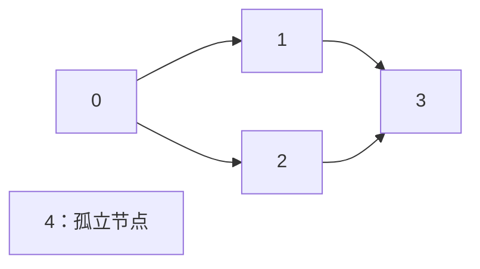

# Project 2B：WordNet 中文学习指南（CS61B Spring 2024）

拆分及分册审计日期：2026-10-20。内容来自 2026-10-14 审计修订后的综合指南；本轮核对分册、官方正文/FAQ 与当前本地接口，只维护文档，保留综合原版、代码、测试、数据和配置。

[2A 分册](../proj2a/Project2A-NGrams中文学习指南.md) · [2B 分册](Project2B-WordNet中文学习指南.md) · [2C 分册](../proj2c/Project2C-热门词与共同祖先中文学习指南.md) · [综合原版](../proj2c/Project2-Ngordnet中文学习与实现指南.md)

本册用于在当前项目目录中边读边做，不提供整个项目的完整解答。原文中的官方核对、独立计算、库行为探针属于原审计记录，本次未重新运行项目测试、网页、性能或正式评测。现有实现进度以你当前代码为准，不沿用原版“骨架尚未完成”的状态快照。

文件链接使用相对路径，方便在 IDEA 的项目中跳转。若预览没有显示 Mermaid 图，配套表格和状态推演仍包含完整关系；不需要依赖图形渲染才能继续实现。

## 阅读导航

- [1. 整体目标与 2C 的关系](#s1)

- [2. 准备：文件、模块与接口](#s2)

- [3. 编码前：2B/C 共享设计准备](#s3)

- [4. 有向图：独立验证可达关系](#s4)

- [5. WordNet：文件、词义与单词查询](#s5)

- [6. 多个词：单词集合交集](#s6)

- [7. Handler、Main 与 AutograderBuddy](#s7)

- [8. 测试、界面、性能与排查](#s8)

- [9. 交付范围与正式提交](#s9)

- [10. 本阶段完成清单](#s10)

- [11. 来源与后续学习](#s11)

<a id="s1"></a>

## 1. 整体目标与 2C 的关系

本阶段做出 k=0 的 Hyponyms 查询：输入一个或多个词，返回共同下位词的去重、字母排序列表。年份不影响结果，不因候选词缺少 NGrams 数据而删掉它。用户从网页查询，测试则通过 AutograderBuddy 创建 Handler 后直接调用 handle。

已有服务器、五参数 query 和静态网页可以复用；需要你实现自建有向图、词义索引/WordNet 辅助逻辑、HyponymsHandler 和测试工厂。Graph/WordNet 是推荐职责名，不是固定公开 API。

| 顺序 | 问题与动作 | 主要文件/对象 | 完成标志 |
| --- | --- | --- | --- |
| 设计准备 | 读完 2B/C，完成共享 Checkpoint 与设计 | 官方模板、两个阶段要求 | 考虑正反方向与 k，不只考虑眼前按钮 |
| 图 | 添加节点/边，查询可达节点 | 自定义图 | 内存小图验证 |
| 词网 | 把单词与全部词义连接，沿节点遍历 | 自定义 WordNet | 多义词、叶子、重复父行正确 |
| 多词 | 对展开后的单词集合取交集 | 词网查询 | 同名不同节点不被漏掉 |
| 接线 | 装配真实 Handler、Main、工厂 | src/main、tests | 网页和测试入口都能使用传入数据 |

写 2B 代码前要预读 2C：2C 会复用候选集合，按区间 count 选热门词，并沿反向边找祖先（祖先也可能 k>0）。设计时预留反向关系、实例传参和公共筛选流程；现在只实现 k=0 主线，不把全部 2C 功能提前塞进 2B。

<a id="s2"></a>

## 2. 准备：文件、模块与接口

### 2.1 文件与运行目录

先看本项目的 [Main](src/main/Main.java)、[模块配置](proj2b.iml)，以及 tests 中的路径常量。数据入口：[2B/C 官方数据包](https://drive.google.com/file/d/160iHOqwR4FAghGshbnSNMwd0idrjZxTR/view?usp=sharing)。2026-10-20 核对时，`proj2b` 仍没有自己的 data，`proj2a/data` 则已经存在；不能因 2A 有数据就认为 2B 的相对路径会自动找到它。本次没有下载、复制或改动数据。

| 位置 | 应有内容 |
| --- | --- |
| `proj2b/src` | 本阶段 Java 源码 |
| `proj2b/tests` | 本阶段 JUnit 测试 |
| `proj2b/static` | 已提供的网页与脚本 |
| `proj2b/data/ngrams`、`proj2b/data/wordnet` | 数据文件；与 src、tests、static 平级 |

本阶段先核对：成对的 `data/wordnet/synsets16.txt`、`data/wordnet/hyponyms16.txt`，再用完整的 `data/wordnet/synsets.txt`、`data/wordnet/hyponyms.txt`。2B 的小规模语义自检也可临时向自定义辅助类传入 2A 数据中的成对路径；提供测试仍按自身常量找 `proj2b/data`，正式目录结构按上表准备。k=0 语义查询不使用词频来过滤；已有工厂签名仍保留 word/count 路径参数。

`./data/...` 和服务器的 `static` 都按进程 working directory 解释，不按 Java 文件所在位置解释。运行本阶段 Main 或 JUnit 时，将 working directory 设为 `E:/cs61b/skeleton-sp24/proj2b`。Main class 为 `main.Main`，使用目标项目模块的 classpath；三个目录有同名类，一次只启动一个占用 4567 的服务器。

沿用综合指南的 JDK 17 或更高版本建议；本地模块引用 `E:/cs61b/library-sp24`，不要仅因 FAQ 的旧库名改成其他学期依赖。文件存在不等于 IDEA 已正确导入。数据解压后核对最终路径，避免多套一层目录；保留仓库原有 `.gitignore`，不要强行上传大数据包。

本册使用五参数 `NgordnetQuery(words,startYear,endYear,k,ngordnetQueryType)`；枚举包含 `NgordnetQueryType.HYPONYMS` 和 `ANCESTORS`。2B 必做只处理 HYPONYMS 的 k=0 主线，共同祖先属于 2C。保持本地 `browser` 包，不因接口已经预留枚举就提前增加本阶段必做功能。

### 2.2 容易与原说明混淆的地方

| 项目 | 本册采用的规则 |
| --- | --- |
| 工厂包名 | 本地测试 import `main.AutograderBuddy`；不能照正文的旧包名改成 `proj2b.src.main`、`proj2c_testing` 等 |
| EECS 文件名 | 2B 评分段写过 `synonyms-EECS.txt`；本地 2C 测试用 `synsets-EECS.txt`，下载后核对实际文件 |
| 模块依赖 | 2026-10-20 本地配置是 `proj2b → proj2c、proj2a`，`proj2c → proj2a`，已没有原版记录的 2B↔2C 循环。同名 main/browser 类仍需按目标模块核对 classpath；不能用 2C 的同名类代替本阶段实现 |
| 路由 | 注册的是 `"hyponyms"`，不是 `"hyponym"`；2C 的祖先按钮也走这个路由并携带类型 |

### 2.3 要求标签与检查边界

- **【官方必做】**：正文明确的功能、限制或交付物。
- **【本地契约】**：当前签名、方法注释和提供测试确定的行为。
- **【建议】**：便于学习、实现、排错的顺序与组织方式；不是额外评分规则。
- **【自选】**：类名、内部结构、DFS/BFS、同频裁决等允许自行设计的部分。
- **【可选】**：完成主线之后的扩展，不计入必做完成标志。

每阶段的“完成标志”是供你实施和自查的目标，不是本次已通过的测试结果。文件准备、类能编译、单元测试、网页操作、性能与正式评测分别提供不同证据。

<a id="s3"></a>

## 3. 编码前：2B/C 共享设计准备

【官方必做】**在写 2B 代码前读完 2B 和 2C**，完成 2B/C Checkpoint 与设计文档。官方将它们作为先于编码的准备；不要因 2B 不用 k 就完全不考虑 2C。设计文档约 1—2 页，可以在实现后修改。两份说明指向同一个 2B/C Checkpoint 和同一个设计模板，不是要求重复提交两份不同设计。[2B 设计要求](https://sp24.datastructur.es/projects/proj2b/#getting-started)、[官方模板](https://docs.google.com/document/d/1Vx7QAz4HFN0rEFFEt5rocY2X5AWVcIFFpRmD8vhegOM/edit?usp=sharing)

官方模板已核对，包含姓名、class id、Email，以及 Data Structures 和 Algorithms 两大部分。请按真实信息填写，不把模板里的 `sp24-s***` 当成实际账户。

### 3.1 待填写提纲：写你将采用的设计，不写实验结果

| 模板部分 | 你要说明什么 | 自查问题 |
| --- | --- | --- |
| Data Structures | 存词义、词到 ID 索引、图的邻接关系、反向关系、候选词与频次的结构；辅助类职责 | 为什么每种查询不必重新扫描文件？ |
| Hyponyms，single-word | 从单词全部词义开始遍历，再展开单词 | 多义词是否覆盖？会不会跨到结果词的其他词义？ |
| Hyponyms，multi-word | 分别求单词集合，再取交集 | 为什么不是节点 ID 交集？ |
| Common Ancestors，single-word | 用什么结构沿父方向找可达节点 | 是否包含起点？ |
| Common Ancestors，multi-word | 分别找祖先词，再取交集 | 同名祖先在不同节点时是否仍保留？ |
| k > 0 | 区间原始计数、零值过滤、前 k 筛选、最后字母排序 | 为什么不能用 weight？同频会不会覆盖另一个词？ |
| 全部算法中的复用说明 | 哪些辅助方法复用，怎样避免复制粘贴 | 正向/反向查询是否只改变邻接关系？ |

伪代码可以用中文动作写，不必提前把完整 Java 解答填进去。还应能画出一次查询经过哪些对象。本册第 4—7 节与 2C 分册就是帮助你把这份设计转化为小步骤。

Checkpoint 的 [官方入口](https://www.gradescope.com/courses/708063/assignments/4133684) 在原指南核对时要求登录，题目内容未读取；不能声称已经完成或替你重建题目。设计文档的 [提交入口](https://www.gradescope.com/courses/708063/assignments/4187810) 同样需要你自己的课程权限。自学者可以用提纲做本地设计准备，但这不等于正式课程提交。

**完成标志：** 读完两个阶段的目标；每一栏能写出你选的数据结构、操作流程和理由；有设计文档，正式在课者完成相应 Checkpoint/文档提交。本节本身不要求某个 Graph/WordNet 类已经写完。

<a id="s4"></a>

## 4. 有向图：独立验证可达关系

**本阶段解决问题：** 从给定节点出发，沿指定方向找到所有可达节点。它是 WordNet 查询的底层机制。先在内存里建几个节点、添加边；不要一开始把文件读取、词义解析、字符串输出全部挤进遍历。

【官方必做】自己实现图类/辅助类，不能导入已有图实现，包括 Princeton 提供的现成图结构；使用 Java Map、Set、List、Deque 保存关系可以。`In` 只是文件读取工具，不是被禁止的图实现。

### 4.1 一条边究竟表示什么

在本项目中，节点代表一个 **synset（词义集合）**，不代表单个字符串。一条 `parent → child` 边表示 child 更具体。图可以分叉、汇合；一个节点可有多个父节点，不能用“一棵树、每节点仅一个 parent”来表示。

【建议】用邻接表，如“节点 ID → 直接子节点 ID 集合”。为了 2C，设计时也考虑“节点 ID → 直接父节点 ID 集合”。集合避免重复边带来的重复工作。你可以选数组索引或映射，但要能给叶子返回空邻接集合，不能对 `null` 做 enhanced-for。

### 4.2 用人工图手推一次 BFS

这张**人工图**与真实 WordNet 数据无关：0→1、0→2、1→3、2→3；4 是孤立节点。



从 0 开始，队列或栈存“等待处理的节点”，visited 存“已经发现的节点”。以下用 BFS，建议发现节点时就标记：

| 时刻 | 取出/操作 | 等待队列 | visited | 关键判断 |
| --- | --- | --- | --- | --- |
| 初始 | 加入起点 0 | `[0]` | `{0}` | 本项目可达集合包含起点 |
| 第 1 步 | 处理 0，发现 1、2 | `[1,2]` | `{0,1,2}` | 两个均未访问 |
| 第 2 步 | 处理 1，发现 3 | `[2,3]` | `{0,1,2,3}` | 3 首次发现 |
| 第 3 步 | 处理 2，又看到 3 | `[3]` | `{0,1,2,3}` | 3 已发现，不再次加入 |
| 第 4 步 | 处理 3，无子节点 | `[]` | `{0,1,2,3}` | 安全结束 |

输出节点集合是 `{0,1,2,3}`，不包含 4。DFS 用栈也能得到同一集合；处理次序不同，最终输出词仍需要另外排序。这里不需要最短路径、距离或拓扑排序。

没有 visited 时，汇合节点会被重复展开；在通用图的环上还可能无法终止。真实输入是否有环不需要你靠猜测决定；【建议】图遍历本身用 visited，给人工环做终止检查，也能避免分支汇合的大量重复工作。

### 4.3 推荐拆成可独立验证的动作

1. 建立节点；包括没有边的节点。
2. 添加正向边，不覆盖旧邻接关系。
3. 查询直接邻居，叶子返回空集合。
4. 找一个起点的可达集合。
5. 支持多个起点，或让 WordNet 层合并多次结果。
6. 需要时建立反向边，复用同样的遍历过程。

这些动作的方法名由你定，不要求照抄 `createNode`、`neighbors`。Graph 层只处理 ID，不该依赖浏览器 query 或年度词频。

**完成标志与检查：** 在内存人工图上检查单链、分叉、汇合、孤立节点、叶子、多起点与重复边；正向遍历不跑到父节点。此时 Graph 测试不需要任何官方数据文件，也不需要 AutograderBuddy。

<a id="s5"></a>

## 5. WordNet：文件、词义与单词查询

先回看 [2B WordNet File Format](https://sp24.datastructur.es/projects/proj2b/#wordnet-file-format)，再设计你的 WordNet 辅助类。当前骨架没有此类，职责是读取词网、建立索引，并提供语义查询；Handler 使用它返回结果。它依赖图层，不依赖 NGramMap。

### 5.1 两份文件分别建立节点和边

| 文件行 | 如何理解 | 处理动作 |
| --- | --- | --- |
| `id,word1 word2 ...,definition` | 一个词义 ID、这个词义中的词、释义 | 建节点，保存 ID→词集合；每个词的“词→ID 集合”索引加入此 ID |
| `parentId,childId1,childId2,...` | 一个父词义指向多个直接下位词义 | 为后面的每个 ID 加边；需要反向图时同步加逆边 |

synset 的第二字段按空格拆词；词内部的下划线保留，例如 `human_action` 是一个词。释义可能包含逗号；只需要前两字段时，不要要求整行分割后恰好三个元素。限制拆分次数、先定位字段等都是可选实现方式。

官方说明 synset ID 按 0 到 S−1 连续出现。若采用数组，应按这些 ID 正确索引；若采用 Map，也应以文件 ID 为键，而不是拿行号代替某种自创 ID。

**同一个父 ID 可以出现多行。** 官方示例 `11,12` 和 `11,13` 等价于 `11,12,13`；第二行要追加 13，不能把 12 覆盖掉。没有出现在 hyponyms 文件左侧的节点仍可能是一个有效叶子。

### 5.2 三种索引解决三个不同问题

| 推荐结构 | 回答的问题 | 例子 |
| --- | --- | --- |
| `word → Set<id>` | 用户给一个词，它有哪些词义？ | 官方小词网中 change 出现在 ID 2、8 |
| `id → Set<String>` | 图遍历得到 ID，它包含哪些词？ | 一个节点可能含 alteration、modification 等多个词 |
| `id → 邻接 ID 集合` | 从这个词义继续往哪里走？ | 沿直接下位词边逐步到更具体节点 |

不能只存 `word → id`：后读到的含义会覆盖前一个含义。也不要每次查词都遍历全部 synsets；建立反向词索引后，查询可以直接取到起点集合。

### 5.3 从词到下位词，顺序必须保持

【建议的操作顺序】

1. 查输入词在所有 synsets 中的 ID；未知词得到空起点。
2. 从**这些初始 ID**沿正向边找可达节点，包含初始节点本身。
3. 将所有可达节点中的词放进结果 Set。
4. 交给上层做多词交集或排序输出。

遍历期间留在 ID 层。不要每遇到一个结果词，就反过来查这个词的所有词义并继续扩张。那会跨越语义图中本来没有的边。

### 5.4 人工例子：为什么不能“由结果词重新查所有词义”

下面是**专为演示设定的词网**，不是 `synsets11.txt` 的原始内容：

| ID | 节点中的词 | 正向直接子节点 |
| --- | --- | --- |
| 0 | descent | 1 |
| 1 | jump parachuting | 5 |
| 2 | increase | 3、4 |
| 3 | jump leap | 无 |
| 4 | augmentation | 无 |
| 5 | landing | 无 |

输入 `descent`：

- 初始 ID 只有 `{0}`。
- 沿图走 0→1→5；得到 `{0,1,5}`。
- 展开词得到 `{descent,jump,parachuting,landing}`。
- 排序显示 `[descent, jump, landing, parachuting]`。

虽然 jump 也存在于 ID 3，这次不能再从词 jump 跳到 3。否则 leap 会被错误加入；如果还沿新词不断找其他定义，会无限扩大查询含义。

输入 `jump` 则不同：它本身就是最初请求词，所以初始 ID 是 `{1,3}`；可达节点为 `{1,3,5}`，输出 `[jump, landing, leap, parachuting]`。**只有最初查询词的全部词义必须作为起点；结果词的其他词义不自动成为起点。**

官方真实例子：在 `synsets11.txt`/`hyponyms11.txt` 中，descent 的结果是 `[descent, jump, parachuting]`；在 16 节点文件中，change 的结果是 `[alteration, change, demotion, increase, jump, leap, modification, saltation, transition, variation]`。它不会额外包含 adjustment、conversion、flashback。不要将人工图新增的 landing 写进这些真实数据的期望值。[官方单词查询说明](https://sp24.datastructur.es/projects/proj2b/#hyponyms-handler-basic-case)

### 5.5 本阶段的分层验证

先用自制小词网测解析：一个节点多词、一个词多节点、父 ID 重复行、叶子、孤立节点、下划线词。再验证“单词→起点→可达 ID→词集合”各步，不着急检查字符串。

拿到官方数据后，分别使用成对的 `synsets11/hyponyms11`、`synsets16/hyponyms16`；不要把两个规模的文件混配。WordNet 辅助类的单元测试不应必须构造 NGramMap，也不应必须启动服务器。

【官方限制】解析在初始化时完成，不能每次查询重读整个文件；重要逻辑放在辅助类，不能把所有工作都塞进 HyponymsHandler。【建议】Graph 与 WordNet 至少分成两个职责；是否再拆出遍历类可自选。

**完成标志：** 输入词的所有词义都处理了；只沿真实边前进；一个节点的所有词都进入结果；重复父行未丢边；未知词与叶子安全结束。正确的结果集合已经可在不启动网页的情况下验证。

<a id="s6"></a>

## 6. 多个词：单词集合交集

先读 [TestMultiWordK0Hyponyms](tests/TestMultiWordK0Hyponyms.java)。这个阶段复用上一阶段的单词查询，加入“必须同时符合每个输入词”的条件；之后 top-k 就作用在这个交集上。

记 `H(w)` 为 w 的全部下位词字符串集合。查询 `[w1,w2,w3]` 的候选集为 `H(w1) ∩ H(w2) ∩ H(w3)`。注意是字符串集合，不是词义节点 ID 集合。

### 6.1 两个不相连的节点，也可能含同一个候选词

以下是**人工数据**：

| 路线 | 节点 | 节点中的词 |
| --- | --- | --- |
| car 的路线 | 0→1 | 0 是 car；1 是 beetle（汽车名） |
| bug 的路线 | 2→3 | 2 是 bug；3 是 beetle（昆虫） |

对 car 可达 ID 为 `{0,1}`，对 bug 为 `{2,3}`，节点交集为空。但展开之后：

| 步骤 | 结果 |
| --- | --- |
| `H(car)` | `{car,beetle}` |
| `H(bug)` | `{bug,beetle}` |
| 单词交集 | `{beetle}` |
| 排序输出 | `[beetle]` |

因此，先交集 ID 再展开词是错误的。多义词也不需要“两个查询必须经过同一含义”才能留下同名结果词。

### 6.2 按顺序缩小集合

【建议】把第一个词的结果复制成可修改的候选集，然后与后续每个词的完整结果取交集。只要交集空了，就可以提前结束。不要以空集合开始再反复 retainAll，那永远不会产生元素；不要对 `List.of` / `Set.of` 的不可修改对象直接做破坏性操作。

一个未知输入词的 `H(w)` 为空，所以整个多词查询为空。单词的结果包含它自身，但多词交集不保证包含每个输入词——该词也必须属于其他词的下位词集合。重复同一个输入词的交集应保持原集合。

### 6.3 本地测试与应该补的缺口

[TestOneWordK0Hyponyms](tests/TestOneWordK0Hyponyms.java) 检查小词网中 act 的完整排序字符串；多词测试检查 occurrence 与 change，期待：

```text
[alteration, change, increase, jump, leap, modification, saltation, transition]
```

这两个测试各只有一个 sanity check。官方测试段建议扩充各文件，并用它们作为模板再建立两个对应场景的新测试文件；没有规定必须使用哪些类名，也没有在 Deliverables 中列出单独的测试报告。建议补同名不同节点的交集、三个以上输入词、无公共词、未知词、重复输入、多义词、结果去重与排序。

测试构造列表时使用 `List.of("car", "bug")`；`List.of("car, bug")` 只有一个元素，直接调用 Handler 时不会经过网页的逗号解析，因而会查一个名为 `car, bug` 的词。

**完成标志：** 单词和多词候选集都正确；交集是在单词层完成的；结果无重复。到这里仍然只做 `k=0`，忽略起止年份，不因词频不存在而删掉 WordNet 中合法的词。

<a id="s7"></a>

## 7. Handler、Main 与 AutograderBuddy

先看 [2B HyponymsHandler](src/main/HyponymsHandler.java)、[2B Main](src/main/Main.java) 和 [2B AutograderBuddy](src/main/AutograderBuddy.java)。前面的辅助类已能返回集合，本阶段只负责装配、取得输入和输出字符串。

### 7.1 接口必须匹配，逻辑应保持薄

【本地契约】Handler 必须继承 `NgordnetQueryHandler`，覆盖 `String handle(NgordnetQuery q)`。2B/C 的 query 是：

```java
// 接口示意，不是项目解答
new NgordnetQuery(words, startYear, endYear, k, NgordnetQueryType.HYPONYMS);
```

第五个参数在本地已经存在；不要因 2B 暂时只处理下位词就复制 2A 的四参数 record。Handler 从 query 取 words，调用 WordNet 逻辑，把候选词排序成列表，再返回类似 `[act, action, ...]` 的普通字符串。使用集合保证去重、使用明确排序保证稳定输出；不能直接把 HashSet 的不定顺序打印给测试。

Main 应创建基于其 synset/hyponym 路径的对象，将真实 Handler 注册到 **`"hyponyms"`**。少一个 s 的 `"hyponym"` 不对应本地网页请求。官方提出的返回 `Hello!` 是一个临时连通性检查：它能验证注册与请求，但不能算完成语义查询。

2B 提供的 Dummy History 按钮故意说明 NGrams 与本阶段无关；2B 必做项不要求恢复 2A 历史绘图。网页上可见的其他按钮也不自动变成 2B 评分要求。

### 7.2 测试工厂为什么是必做连接点

本地签名：

```java
// 保持这个已有签名；具体装配逻辑由你实现
public static NgordnetQueryHandler getHyponymsHandler(
        String wordFile, String countFile,
        String synsetFile, String hyponymFile)
```

【官方/本地必做】它必须返回使用传入路径构造的 Handler，而不是忽略参数、返回 Main 中硬编码的完整词网。2B `k=0` 不使用 NGrams，所以 word/count 参数不应成为单词候选查询的必要数据依赖；但 WordNet 两个路径必须生效。2C 中四个参数都将参与装配。

工厂可以做创建和传参；不要启动服务器、访问静态网页或依赖某次 Main 已先运行。JUnit 本身应能直接完成“给路径→取得 Handler→handle(query)”这条链。

【建议隔离检查】构造两个使用不同小词网的 Handler，对同一词查询并得到各自的结果；先后调用不得串数据。这个检查能发现 static 全局状态与硬编码文件的问题。

**完成标志：** 两个提供测试的入口不再抛占位异常；Handler 类型匹配；浏览器按钮确实返回词表；测试和浏览器使用同样的查询逻辑；`k=0` 不读取词频来过滤。2B 建议稳定、完成正式阶段验收后再进入 2C；本文没有替你提交任何阶段。

<a id="s8"></a>

## 8. 测试、界面、性能与排查

### 8.1 提供测试与缺口

| 测试文件 | 已有检查 | 主要缺口 |
| --- | --- | --- |
| 2B `TestOneWordK0Hyponyms` | act 的单词下位词、排序字符串 | 多义词各种分支、未知词、重复边 |
| 2B `TestMultiWordK0Hyponyms` | occurrence/change 的共同下位词 | 三词交集、不同节点同名词交集 |

两个文件各只有一个 sanity check，且都先调用 AutograderBuddy；工厂未完成时，失败不等于图算法已被检查。先独立验证图和词网，再检查 Handler 装配；按官方测试建议扩充单词/多词的边界场景，测试类名由你决定。

### 8.2 连接后的检查

小数据的 Graph/WordNet 单元测试不应依赖服务器或 NGramMap。工厂完成后再运行两项提供测试；用两份不同小词网创建两个 Handler 检查是否串数据。Main 使用小词网时，访问 [2B 本机页面](http://localhost:4567/ngordnet.html)，依次检查单词、双词、三词；改变年份不应改变 k=0 结果。

网页中的 History、Hypohist、Common Ancestors 按钮不自动成为 2B 的必做功能。正式进入 2C 前，让 k=0 主线稳定；课程在课者按对应阶段完成正式验收，自学者记录本地证据并说明边界。

### 8.3 性能自查

本项目没有要求提交实验数据表或性能分析报告。下面是【建议】的工程检查，用于确认加载目标与超时风险，不增加课程交付物，也不编造结果。

计时分别包围“构造数据对象”和“已构造对象上的查询”；不要把下载数据、打开 IDE 或用户思考输入的时间算进去。相同 JDK、内存设置、文件组合与查询才适合比较。首次运行与 JVM 预热后的运行应区分，不能把缓存后的单次最快值当普遍性能。

| 项目 | 输入/操作流程 | 记录项（待填） | 主要观察 |
| --- | --- | --- | --- |
| WordNet 加载 | 给成对的完整 synsets/hyponyms，建立索引和正向边；若已为 2C 预留反向边则一并计时 | 文件：___；耗时：___ | 是否只初始化一次；反向边是预先设计的选择，不是 2B 新增必做项 |
| k=0 重复查询 | 在同一个 Handler 上多次查询同一/不同词 | 查询：___；次数：___；每次耗时：___ | 是否每次重读文件或重建图 |

图遍历约为相关可达区域的 O(Vr+Er)，词集合展开和交集另计。FAQ 提及的 60000ms 超时不能当成“单次小于一分钟即可通过”的保证；本阶段重点避免重读文件、重建图、重复展开，以及每次查词都扫描全部 synsets。

### 8.4 排查表

| 失败表现 | 优先检查 |
| --- | --- |
| 找不到 `data/...` 或静态页面 404 | 目标模块、working directory、是否套了多层解压目录 |
| `record` 语法错误 | JDK 与 IDE language level |
| 缺 spark/Gson/XChart/JUnit/Truth | `.iml` 指向的 `library-sp24` 与 IDE 实际库导入 |
| 2B register 编译类型错误 | 空 Handler 是否继承 `NgordnetQueryHandler` |
| 点击按钮没响应/连接拒绝 | 服务器是否启动，页面是否对应项目，4567 是否已有旧进程 |
| `Failed to bind ...4567`、Spark 启动失败 | 停止自己先前启动的 Main；避免并行占用同端口；必要时再重启 IDE |
| 服务日志很多但没结果 | 看是否有真正异常、对应请求是否进入 Handler；启动提示只确认连接层 |
| 下位词丢掉一个含义 | `word→id` 是否只保存一个 ID |
| 下位词多出不相关词 | 是否从输出词再次跳到所有同名 synsets |
| 重复父行的某个分支不见 | 加边是否覆盖先前邻接集合 |
| 到叶子/未知词抛 NullPointerException | 词索引或邻接 `get` 是否返回 null 后仍迭代 |
| 多词错误返回空 | 是否对 ID 取交集、以空集开始 retainAll、使用一个 `"a,b"` 列表元素 |
| 连续查询互相污染 | visited/结果是否错误地保存在共享状态而未重置 |
| 线上示例与本地预期不同 | 比较本阶段的 synsets/hyponyms 两个词网文件及输入词；k=0 不按 NGrams 筛选，不能把词频文件差异当成词网结果差异的原因 |
| 超时或内存错误 | 分开测加载与查询；检查重读/重建/重复列表；有证据后再判断平台问题 |

<a id="s9"></a>

## 9. 交付范围与正式提交

| 范围 | 必做实现/交付 | 官方评分说明 |
| --- | --- | --- |
| 2B | `HyponymsHandler` 与所有必要辅助类；有效 `main.AutograderBuddy` 工厂 | 编码 50 分：单词 k=0 占 50%，多词 k=0 占 30%，EECS 单词/多词 k=0 占 20% |
| 2B/C 共同准备 | Checkpoint；按官方模板提交约 1—2 页设计文档 | Checkpoint 5 分，设计文档 5 分；不要按 B/C 重复计算 |

Handler 是评测入口，不是只交一个孤立文件；它实际依赖的图、词网等辅助类也必须齐全。2B 的 k=0 主线不要求为了查询而复制 2A 的 NGramMap/TimeSeries；统计层用于 2C 热门筛选或可选历史整合。2B/C 共用的 Checkpoint 与设计文档不要重复计算。历史截止日为 2024-03-15（准备材料）、2024-04-01（编码），不是现在的截止日。

综合指南记录的归档评测额度为初始八个 token、每个 24 小时恢复；当前账户和作业是否仍可用，应以课程/Gradescope 实际状态为准，本次没有核对。没有新增性能报告、TA 现场演示或录像交付要求。测试和计时记录是自查证据。

实现后处理本阶段 TODO，保留既有 public API。将来正式提交时，先确认目标阶段与文件范围，再按课程要求保存、add/commit、push，并在对应作业提交；本次只写文档，未执行这些操作。

<a id="s10"></a>

## 10. 本阶段完成清单

这些框是你实现后的验收目标。本次拆分没有将任何一项标为“已通过”。

### 10.1 必做与本地接口

- [ ] 使用 Spring 2024 资料；分清 2A/B/C，未混用 Gitlet 或其他学期 API。
- [ ] 目标目录的 data 与 src/static 平级；文件组合和 working directory 正确。
- [ ] 开始 2B 前读完 2B/C；完成共享 Checkpoint 与官方模板设计文档，正式课程提交有证据。
- [ ] 自行实现图；未导入现成图实现；主要逻辑在辅助类中。
- [ ] 正确解析 synsets/hyponyms：多词节点、多义词、重复父行、叶子、下划线词。
- [ ] 图和索引仅初始化一次；查询使用相关可达节点，visited 不跨请求污染。
- [ ] 下位词从输入词全部词义出发，包含起点，不跳入结果词的其他词义。
- [ ] 多词查单词集合交集；结果去重并字母排序；未知词和无交集返回空结果。
- [ ] 2B Handler 继承正确父类，`hyponyms` 路由与测试工厂均接线。
- [ ] 2B k=0 不依赖 NGrams，不按年份筛除词。
- [ ] 文件和图仅初始化一次，重复查询不重建，遍历避免重复展开。
- [ ] 未把 data 压缩包/大文件强行纳入 Git；必要业务依赖齐全；实现后处理 TODO。
- [ ] 有正式课程提交权限时，完成每个要求的阶段与文档提交；记录真实 Gradescope 结果。

### 10.2 验证建议

- [ ] 参考官方测试段扩充提供测试，并新建对应场景的测试文件；被注释的测试实际启用后才计入证据。
- [ ] 小规模、接口装配、网页与大文件检查分别记录；不把局部通过当正式评测结论。
- [ ] 用实际计时检查完整词网初始化和重复查询；不把 2A 的词频加载目标当成 2B 的新增任务。
- [ ] 直接测试使用五参数 query 并指定 HYPONYMS；k=0 不因年份参数改变而改变结果。
- [ ] 如需容忍空白行，检查文件中间和末尾的空白，不能假设 `!isEmpty()` 会跳过全部空行。

### 10.3 可选与自选

- [ ] 【自选】Graph/WordNet 类名、邻接结构、DFS 或 BFS 由你决定；不误写为官方唯一方案。
- [ ] 【可选】2B 的 History/Hypohist 整合不影响 k=0 主线。

<a id="s11"></a>

## 11. 来源与后续学习

- [Spring 2024 Project 2B 正文](https://sp24.datastructur.es/projects/proj2b/)
- [Project 2B FAQ](https://sp24.datastructur.es/projects/proj2b/faq/)
- [关联 Project 2C 正文](https://sp24.datastructur.es/projects/proj2c/)
- [官方设计模板](https://docs.google.com/document/d/1Vx7QAz4HFN0rEFFEt5rocY2X5AWVcIFFpRmD8vhegOM/edit?usp=sharing)
- [Checkpoint 入口](https://www.gradescope.com/courses/708063/assignments/4133684)
- [设计文档提交入口](https://www.gradescope.com/courses/708063/assignments/4187810)
- [WordNet Visualizer](https://www.qxbytes.com/wordnet/)
- [Staff Solution](https://ngordnet.datastructur.es/)
- [保留的综合原版](../proj2c/Project2-Ngordnet中文学习与实现指南.md)

本册的实现步骤与人工小例子继承综合原版。本轮重新取得 2A/B/C 正文与 FAQ，其正文文本与原审计快照一致；并核对当前模块依赖、接口、提供测试、章节引用及文件链接。使用 2A 已有的 11/16 节点小词网独立复核了文中的下位词示例，没有调用你的 Handler，也没有运行项目 JUnit、网页、性能或 Gradescope。Checkpoint/设计提交需要自己的课程账户；未读取登录后的题目，也未执行线上查询。线上示例只有在数据匹配时才适合充当期望值，EECS 人工数据不由 staff 互动网页提供。综合原版保持不变。
