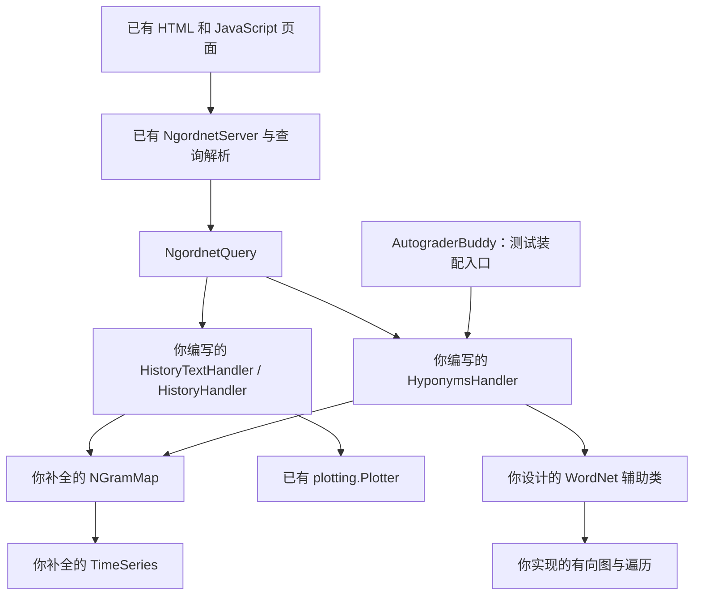
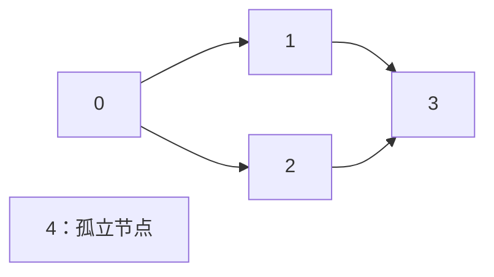

# Project 2：Ngordnet 中文学习与实现指南（CS61B Spring 2024）

核对日期：2026-10-14。范围：当前仓库的 **Project 2A、2B、2C**。这是学习与实现路线，不是完整答案；本次没有修改 Java、测试、配置或数据，也没有提交评测、commit 或 push。

## 1. 先知道你要做出什么

你要给已有网页接上 Java 后端，让它能完成下面五种操作：

| 用户的操作 | 后端接收什么 | 应返回什么 | 属于哪一部分 |
| --- | --- | --- | --- |
| 输入 `cat, dog`，设定年份，点击 History (Text) | 单词列表、起止年 | 每个词每年的相对频率，以文本表示 | 2A |
| 相同输入，点击 History | 单词列表、起止年 | 多条相对频率曲线，返回 PNG 的 Base64 字符串 | 2A |
| 输入一个或多个词，`k=0`，点击 Hyponyms | 单词列表 | 所有共同下位词，去重、按字母顺序显示 | 2B |
| 输入单词、年份、`k>0`，点击 Hyponyms | 单词列表、年份、数量上限 | 共同下位词中，区间出现总次数最高的至多 k 个词；显示时仍按字母顺序 | 2C |
| 点击 Common Ancestors | 单词列表、查询类型；必要时还有年份和 k | 所有共同祖先词，或其中最热门的至多 k 个词 | 2C |

例如，“词频历史”问的是 `dog` 在每年文本中占多少；“下位词”问的是哪些词代表更具体的事物。前者读取 NGrams 统计，后者遍历 WordNet 语义图。2C 把两种数据连接起来：先确定语义上符合条件的词，再用出现次数筛选。

测试通常不会点击网页。2A 测试直接调用 `TimeSeries`、`NGramMap` 或 Handler；2B/C 测试通过 `AutograderBuddy.getHyponymsHandler(...)` 得到 Handler，再构造查询调用 `handle(q)`。因此，“网页能显示”与“测试入口正确”是两个需要分别检查的结果。[官方 2A](https://sp24.datastructur.es/projects/proj2a/)、[官方 2B](https://sp24.datastructur.es/projects/proj2b/)、[官方 2C](https://sp24.datastructur.es/projects/proj2c/)

### 1.1 各层怎样连接



图中的 WordNet、Graph 是**推荐的职责名称**，并非本地已经有这两个文件。你可以改类名或进一步拆分。2B 的 `k=0` 查询不需要词频；图中 HyponymsHandler 到 NGramMap 的连接用于 2C 的热门筛选。

已有网页、服务器、查询解析器、绘图工具和演示类可以直接使用。你需要补全 2A 两个统计类、新建两个真实 History Handler；2B 实现下位词 Handler 和辅助类；2C 迁移这些实现并增加热门筛选、反向查询和测试装配。

### 1.2 总路线：每完成一行，再进入下一行

| 阶段 | 要解决的问题 | 先看哪些文件或材料 | 完成标志 |
| --- | --- | --- | --- |
| 0，准备 | 版本、数据、模块与运行目录是否对齐 | 本指南第 2、3 节；各 `.iml`、`Utils` | 知道每个程序实际从哪里读取文件；数据位置正确 |
| 1，2A 基础 | 一组年份数据怎样复制、相加、相除 | `TimeSeries.java`、`TimeSeriesTest` | 小例子正确，缺失年份与不修改输入的规则正确 |
| 2，2A 读入 | 如何把两种统计文件变成可查询的对象 | `FileReadDemo`、`NGramMap` 构造函数 | 一个小文件的每条记录能查回，全年总数不溢出 |
| 3，2A 查询 | 怎样取得区间计数与相对频率 | `NGramMap` 所有 API、`NGramMapTest` | 重载一致、未知词为空、防御性复制有效 |
| 4，2A 接线 | 怎样把统计结果交给文字与图像按钮 | Dummy Handler、`PlotDemo`、`Main` | 真实文本格式正确，图表对应用户输入 |
| 5，2B/C 设计 | 在写图代码前把两个阶段一起考虑 | 2B/C 全说明、Checkpoint、设计模板 | 能解释索引、正反边、交集与 k 的流程；完成设计文档 |
| 6，图 | 怎样沿父节点到子节点找可达节点 | 自拟图辅助类 | 单链、分叉、汇合、叶子都能独立验证 |
| 7，WordNet | 怎样从词定位所有词义，再沿边找下位词 | synsets/hyponyms 格式 | 多义词、多词节点、重复父行都正确 |
| 8，2B 多词 | “共同”到底在哪一层取交集 | 2B 两个测试 | 单词集合交集正确，不误取节点交集 |
| 9，2B 接口 | 浏览器与测试怎样使用同一套逻辑 | `HyponymsHandler`、`Main`、`AutograderBuddy` | 两个入口都用传入数据，k=0 不依赖 NGrams |
| 10，迁移到 2C | 把已验证的 2A/B 装进 2C | 2C `NgordnetQuery`、`Main` | 2C 自身拥有实现，旧行为回归正确 |
| 11，热门筛选 | 怎样选前 k 个但按字母显示 | `countHistory`、2C 热门测试 | 先交集再排名、零频率剔除、同频不丢词 |
| 12，共同祖先 | 怎样沿反向边回答另一种查询 | `NgordnetQueryType`、祖先测试 | 单词/多词祖先和祖先 k>0 均正确 |
| 13，交付 | 代码、设计、测试、性能与正式入口是否齐全 | 第 14—17 节 | 完成清单；每项结论都有相应证据 |

顺序按依赖组织：先有正确的年份运算，才能可靠地算频率；先有正确的单词候选集，才能可靠地做 top-k。设计 2B 时必须预先读 2C，但可以等 2B 稳定后再实现 2C。

## 2. 版本、现状与不能忽略的差异

### 2.1 本次依据与证据边界

已阅读 Spring 2024 的 2A/B/C 正文和三份 FAQ、直接关联的 2B/C 官方设计模板、Optional Features，以及本地三个目录全部 Java 源码和全部提供测试；另外检查了查询相关 HTML/JavaScript、模块配置和数据忽略规则。`jquery.min.js` 作为提供的第三方依赖，不承担你的项目业务逻辑。

当前仓库的 Project 2 目录是 `proj2a`、`proj2b`、`proj2c`。另有 `gitlet-sp21`，它是另一学期的项目，不适用于这里。官方资料的旧视频、包名写法或文字笔误，应与当前接口交叉核对。

**已确认的本地现状：**

- 三个目录当前都没有 `data` 文件夹，实际数据未能逐行核对；本文讲解官方文件格式，人工示例均另作标注。
- 2A `TimeSeries` 的空构造函数已有实现，其余待补；`NGramMap` 的查询仍返回 `null`。两个真实 History Handler 尚不存在。
- 2B `HyponymsHandler` 是空类，未继承 `NgordnetQueryHandler`；`Main` 已尝试注册它，所以目前仅从源码就能看出类型不匹配。
- 2B/C 的 `AutograderBuddy` 都仍抛出占位异常。
- 2C 尚无本地 `src/ngrams` 和下位词实现，`Main` 只注册 Dummy History Handler，未注册 `hyponyms`。
- 2A `HistoryTextHandlerTest` 的 import 与测试方法都被注释，直接运行这个类不会检查 Handler 行为。

本次没有运行学生的 Java 项目、JUnit、网页或性能测试。上述现状是目录与源码检查结果，不是运行通过结论。审计时另外运行了现有 `In` 与 XChart 的独立库行为探针，仅验证第 5、6 节指出的库边界，未调用你的待完成实现。

### 2.2 官方文字与当前文件的差异及处理

| 位置 | 具体差异 | 影响与采用的规则 |
| --- | --- | --- |
| 2A FAQ 的 `divide` 回答 | 对缺年笼统说忽略；本地 `dividedBy` 明确要求分母缺少分子年份时抛异常 | 按当前方法注释实现：分母缺年抛 `IllegalArgumentException`；仅分母多出的年才忽略。不要只取交集 |
| 2A 正文与 FAQ 的读文件提示 | 正文建议 `hasNextLine()`，FAQ 对特定问题建议 `isEmpty()`；本地演示用后者 | 不把某个循环条件当成硬性要求。确认与读取方式一致，并检查空文件、最后一行及尾部空白；第 5 节解释 |
| 2A FAQ 的库名 | 写 `library-fa23`；当前 `.iml` 和 2B/C FAQ 指向 `library-sp24` | 使用本地 `E:\cs61b\library-sp24`，不另换成其他学期的库 |
| 演示类名 | 正文部分地方写 `FileReaderDemo` | 本地实际文件叫 `main.FileReadDemo` |
| 绘图库包名 | 正文有 `ngordnet.Plotter` 写法 | 本地是 `plotting.Plotter` |
| 2A Dummy 构造方式 | 正文某处示例传了 `ngm` | 本地 Dummy 无参；真正的两个 History Handler 应按说明接收 `NGramMap` |
| 查询 record | 2A 四个参数；2B/C 五个参数 | 迁移测试时增加 `NgordnetQueryType`，不要覆盖 2C 的 `browser` 包 |
| 测试工厂包名 | 正文写过 `proj2b.src.main`、`proj2c_testing`、`proj2c.testing` | 本地 package 和测试 import 均为 `main.AutograderBuddy`；保持实际包名与四路径参数签名 |
| 大词表常量 | 2A 常量叫 `TOP_14337_WORDS_FILE`，路径实际是 `top_14377_words.csv` | 使用现有常量时注意拼写差异；不要猜一个 `top_14337_words.csv` 文件 |
| EECS 文件名 | 2B 评分段写过 `synonyms-EECS.txt` | 2C 本地测试使用 `synsets-EECS.txt`；按实际测试和下载内容核对，不自行重命名 |
| `.iml` 依赖 | 本地 2B 依赖 2C 和 2A，2C 又依赖 2B 和 2A | 存在循环模块依赖且有同名 `main`/`browser` 类。IDE 可能掩盖遗漏或产生冲突；必须按目标模块核对编译/运行 classpath，正式交付不能仅依赖跨模块可见性 |
| 正文解压路径 | 2A 文句曾写 `proj2`，但同页结构图是 `proj2a` | 以各阶段实际目录为准，`data` 与该阶段的 `src`、`static` 平级 |

差异来源：[2A FAQ](https://sp24.datastructur.es/projects/proj2a/faq/)、[2A 正文](https://sp24.datastructur.es/projects/proj2a/)、[2B 正文](https://sp24.datastructur.es/projects/proj2b/)、[2C 正文](https://sp24.datastructur.es/projects/proj2c/)与本地源码、配置。

### 2.3 本指南的要求标签

- **【官方必做】**：正文明确的功能、限制或交付物。
- **【本地契约】**：当前签名、方法注释和提供测试确定的行为。
- **【建议】**：便于学习、实现、排错的顺序与组织方式；不是额外评分规则。
- **【自选】**：类名、内部结构、DFS/BFS、同频裁决等允许自行设计的部分。
- **【可选】**：完成主线之后的扩展，不计入必做完成标志。

## 3. 阶段 0：先使文件、依赖和入口对齐

**本阶段解决问题：** 区分“逻辑写错”与“程序根本没读到指定文件”。它是所有读数据测试的前置条件；不依赖任何 TODO 已完成。

先看 [2A Utils.java](E:/cs61b/skeleton-sp24/proj2a/src/utils/Utils.java)、各阶段 `Main` 和测试开头的文件常量，再看 [2A 模块配置](E:/cs61b/skeleton-sp24/proj2a/proj2a.iml)、[2B 模块配置](E:/cs61b/skeleton-sp24/proj2b/proj2b.iml)、[2C 模块配置](E:/cs61b/skeleton-sp24/proj2c/proj2c.iml)。

### 3.1 数据应该在哪里

【官方必做】数据不随骨架发布，需从说明提供的链接取得。本次只写指南，没有替你下载、解压或建立数据。

| 阶段 | 官方数据入口 | 文件落点 |
| --- | --- | --- |
| 2A | [2A 数据包](https://drive.google.com/file/d/1xGTZqCo5maiZjA307OPocmKDOTYlJXnz/view?usp=sharing) | `E:\cs61b\skeleton-sp24\proj2a\data` |
| 2B/C | [2B/C 数据包](https://drive.google.com/file/d/160iHOqwR4FAghGshbnSNMwd0idrjZxTR/view?usp=sharing) | 各自的 `proj2b\data`、`proj2c\data` |

每个目标目录应形成这样的关系：

| 目录 | 内容 |
| --- | --- |
| `data/ngrams/` | `very_short.csv`、`total_counts.csv`、`top_14377_words.csv` 等；2C 测试还需 `frequency-EECS.csv` |
| `data/wordnet/` | `synsets16.txt`、`hyponyms16.txt`、完整词网等；2C 测试还需 EECS 文件 |
| `src/` | Java 源码 |
| `tests/` | JUnit 测试 |
| `static/` | 已有网页 |

下载包的外层名称不重要，**最终路径**重要。若得到 `ngordnetData2022/data/...`，不要让它额外套在 `proj2a/data/ngordnetData2022/data/...` 下。根目录 `.gitignore` 已忽略 Project 2 数据和压缩包；不要为了上传大数据改掉忽略规则。

### 3.2 运行目录与模块选择

`./data/...` 按进程的 working directory 解释，不按 Java 文件位置解释。运行 2A 时设置 working directory 为 `E:\cs61b\skeleton-sp24\proj2a`，2B/C 类推。JUnit 配置也需要对齐。`NgordnetServer` 把 `static` 作为外部静态目录，因此工作目录错误还会使网页找不到。

【建议】在 IntelliJ 中为三部分分别建立运行配置：Main class 为 `main.Main`，选择目标模块的 classpath，Working directory 为该项目目录。三个目录都含同名 `main.Main`，必须确认当前运行的是哪一份。一次只启动一个使用 4567 端口的服务器。

使用 JDK 17 或更高版本；查询是 Java `record`，不适用于旧版 Java。当前三个 `.iml` 均引用 `E:\cs61b\library-sp24`，本地目录中确有 Spark、Gson、XChart、JUnit 5、Truth、algs4 等 JAR；**文件存在不能证明 IDE 已正确导入它们**。

如果编译失败，先看失败的是哪个模块、哪种错误。2B 空 Handler 无法传给 `register(String, NgordnetQueryHandler)` 是待实现导致的类型问题；2C 缺少 `ngrams` 是待迁移问题。不要把所有错误都当成库故障。跨模块循环依赖问题需要在你另行处理配置时核对，本次保留原配置。

**完成标志与检查：** 能指出测试所用每个数据文件的绝对位置；IDE 使用目标模块与 JDK；运行目录正确。此阶段可以检查文件存在，也可以读小文件首尾；此时不能期待尚未完成的统计/Handler 测试通过。

## 4. 阶段 1：TimeSeries，让“每年一个数”成为可用对象

先打开 [TimeSeries.java](E:/cs61b/skeleton-sp24/proj2a/src/ngrams/TimeSeries.java) 和 [TimeSeriesTest.java](E:/cs61b/skeleton-sp24/proj2a/tests/TimeSeriesTest.java)。这一层不读文件，因此可以在没有官方数据包时先实现和验证。后面的计数、频率、绘图都使用它。

### 4.1 类型声明到底说明什么

`TimeSeries extends TreeMap<Integer, Double>` 表示它本身就是一个按年份排序的映射：键是年份，值是该年的数值。数值可能是次数，也可能是比例，由使用者赋予含义。

例如 `put(2001, 8.0)` 保存一条记录；`get(2001)` 查回 `8.0`；没有 `2002` 时，`containsKey(2002)` 为假，`get(2002)` 为 `null`。**没有记录**和**有记录且值为 0.0**不同。前者不要补成一条零值记录。

【官方必做】不添加额外 public 方法；可以加 private 辅助方法。【官方设计提示】`TimeSeries` 应不含实例变量——数据已经保存在父类映射中，不必再维护一份年份数组和数值数组。正文把这项放在 Tips 中；不要把“再维护一份数组”当成本项目的实现步骤。[TreeMap 官方 API](https://docs.oracle.com/en/java/javase/17/docs/api/java.base/java/util/TreeMap.html)

### 4.2 建议按以下四步做

| 步骤 | 具体动作 | 为什么先做它 | 此步检查 |
| --- | --- | --- | --- |
| 1 | 实现 `years()` 与 `data()`；从映射中取得列表 | 后面绘图和已有测试要把年份与数值一一对应 | 两个列表长度相等，相同下标属于同一条记录 |
| 2 | 实现区间复制构造函数 `TimeSeries(ts,start,end)` | NGramMap 区间查询与防御性复制要复用它 | 包含两端；不创造缺失年份；改副本不改原本 |
| 3 | 实现 `plus(ts)`，返回新对象 | 汇总多个词的频率需要按年合并 | 并集年份保留，只在共同年份相加 |
| 4 | 实现 `dividedBy(ts)`，返回新对象 | count 除以年度总数才能变成 weight | 分子年份都必须有分母，缺少就抛异常 |

【本地契约】`years()` 允许任意顺序，但 `data()` 必须与之对应；当前提供测试期待升序，所以利用 TreeMap 自然顺序最直接。`keySet()`、`values()` 是视图；返回类型是 List 时，要构造相应列表。区间副本也不能只是把 `subMap` 视图当成新数据。

【建议】若使用 TreeMap 的区间方法，注意两参数 `subMap(start,end)` 的右端不包含 end；四参数版本可以分别指定两端是否包含。无论选哪种写法，本项目的区间必须是闭区间，并将取得的记录复制到独立 TimeSeries，不能直接返回与原映射联动的视图。

### 4.3 手算一次相加与区间复制

下面是**人工数据**，不代表实际语料：

| 年份 | A | B | `A.plus(B)` 的判断 | 结果 |
| --- | --- | --- | --- | --- |
| 2000 | 0.0 | 无记录 | A 独有，保留已有的零值 | 0.0 |
| 2001 | 8.0 | 无记录 | A 独有，保留 | 8.0 |
| 2002 | 无记录 | 3.0 | B 独有，保留 | 3.0 |
| 2003 | 4.0 | 6.0 | 两边都有，相加 | 10.0 |
| 2004 | 无记录 | 无记录 | 两边都没有，不生成新年 | 无记录 |

操作前 A 与 B 各自不变；操作后新对象为 `{2000=0.0, 2001=8.0, 2002=3.0, 2003=10.0}`。复制区间 `[2001,2002]` 得到 `{2001=8.0, 2002=3.0}`。修改副本中的 2001 后，原结果仍为 8.0。

这里“缺失一边相当于加零”只是计算上的说法，不是要求给输入补零。如果遍历所有 1400—2100 年并填零，就会把缺数据改成有数据，破坏后续结果和测试。

### 4.4 手算一次除法：方向不能混淆

人工数据：分子 N=`{2001=8.0, 2003=4.0}`，分母 D=`{2001=40.0, 2002=50.0, 2003=20.0}`。

| 当前年份 | 判断 | 处理 |
| --- | --- | --- |
| 2001，来自 N | D 有这个年 | 写入 `8/40=0.2` |
| 2003，来自 N | D 有这个年 | 写入 `4/20=0.2` |
| 2002，仅存在于 D | N 没有这个年 | 不加入结果 |

得到 `{2001=0.2, 2003=0.2}`。若删除 D 的 2003，操作应抛 `IllegalArgumentException`，不能返回只有 2001 的部分结果。空分子可以得到空结果。官方允许假设分母不会是零，不必为本任务发明另一套零分母规则。

### 4.5 在这一层怎么验证

提供的 `testFromSpec` 检查年份并集与相加，`testEmptyBasic` 检查空列表和空加法。**它们没有测试除法，也没有测试复制隔离。**

【建议补测】单边空、共同年、双方不相交、已有零值、区间两端、区间没有记录、加法/除法不修改双方、分母缺年异常、分母多余年忽略、修改副本不影响原对象。Double 运算比较用误差范围，例如 Truth 的 `isWithin(...).of(...)`，避免把浮点表示误差当成逻辑错误。

性能上，一次遍历映射比每次调用 `years()` 生成新列表再从中查找更清楚。若在一个循环的每次迭代重新生成长度为 n 的列表，看起来只有一个循环也可能做了平方级工作。

**完成标志：** 手算表能逐项对应实际对象；已有两个测试和补充边界测试有真实运行记录；`plus`、`dividedBy`、区间复制均保持输入不变。此时无需启动服务器。

## 5. 阶段 2—3：NGramMap，把文件变成可以反复查询的数据

先看 [NGramMap.java](E:/cs61b/skeleton-sp24/proj2a/src/ngrams/NGramMap.java) 的所有方法，再看 [FileReadDemo.java](E:/cs61b/skeleton-sp24/proj2a/src/main/FileReadDemo.java) 和 [NGramMapTest.java](E:/cs61b/skeleton-sp24/proj2a/tests/NGramMapTest.java)。这一层依赖 TimeSeries；Handler 只应该使用它，不应该再负责解析原始文件。

### 5.1 两种文件，两个不同的数

| 文件 | 分隔符 | 需要使用的列 | 在程序中的含义 |
| --- | --- | --- | --- |
| words file，例如 `very_short.csv` | 制表符 `\t` | 单词、年份、出现次数 | 某词在某年的原始计数 |
| counts file，例如 `total_counts.csv` | 逗号 `,` | 年份、该年总单词数 | 全语料该年的分母 |

words file 的第四列是来源/卷数，本项目忽略；counts file 的第三、第四列也忽略。扩展名都是 `.csv`，不能据此给两种文件都用逗号分割。

以下是**人为构造的小文件**。代码块中的 `\t` 表示实际制表符，若你自行建立文件，应写入真正的 tab，不能写字面量反斜杠和 t：

```text
words file（示意）
cat\t2001\t8\t2
cat\t2003\t4\t1
dog\t2002\t3\t1
dog\t2003\t6\t2

counts file
2001,40,5,2
2002,60,7,3
2003,20,4,1
```

### 5.2 先选择能回答问题的存储形式

【建议】把它理解为一座资料库，内部有两份内容：

| 建议的表示 | 存什么 | 谁用它 |
| --- | --- | --- |
| `Map<String, TimeSeries>` | 每个单词 → 该词的年份计数 | `countHistory`、`weightHistory`、2C 热门筛选 |
| 一个 `TimeSeries` | 每个年份 → 该年全部单词总数 | `totalCountHistory` 和相对频率分母 |

`Map<String, TimeSeries>` 比 `Map<String, Map<Integer,Double>>` 更能表达“每个词有一段历史”，也可以复用已经验证的加法、除法和区间复制。你可以自选其他合理内部结构；【官方必做】`NGramMap` 不继承其他类、不添加额外 public 方法，允许 private 辅助方法。

读入人工例子后的状态应为：

| 索引入口 | 对应数据 |
| --- | --- |
| `cat` | `{2001=8.0, 2003=4.0}` |
| `dog` | `{2002=3.0, 2003=6.0}` |
| 年度总数 | `{2001=40.0, 2002=60.0, 2003=20.0}` |

构造函数逐行取字段，把同一词不同年份积累到同一个 TimeSeries 中。不要遇到同一词的新行就重建空对象，覆盖先前的年份。年份可用 int；计数与年度总数采用 Double/可容纳大数的数值解析，不要先 `Integer.parseInt` 再转 Double——若原文已经超出 int，错误发生在转换前。

### 5.3 读文件只做一次，先核对输入再写查询

【官方要求与建议】大量工作应在构造函数完成，查询复用已读入的结构。使用 `In` 时不要调用 `readAllLines` 或 `readAllStrings` 一次装入全文。文件读法可以自选；本地演示展示了 `In` 的逐行读取。

按行读取时，`hasNextLine()` 回答还有没有下一行，`isEmpty()` 的判断关注是否还有非空白 token；在普通数据行中它们常常都可工作，但对尾部空白行不完全等价。正文和 FAQ 的提示互相有差异，所以检查应落到实际结果：第一行和最后一条有效行都读到，空文件不误读，尾部空行不拿去解析数字。处理空白行是建议的健壮性措施，不需要扩展成支持所有通用 CSV 转义格式。

审计中用本地 `algs4.jar` 的 `In` 配合 `readLine()` 验证了下面的行为：

| 输入情形 | `while (in.hasNextLine())` | `while (!in.isEmpty())` |
| --- | --- | --- |
| 空输入 | 不进入循环 | 不进入循环 |
| 最后一条记录没有换行 | 仍能读到最后记录 | 仍能读到最后记录 |
| 有效记录后仅剩空白行 | 会继续读出空白行 | 会停止，不读纯尾部空白 |
| 两条有效记录之间有空行 | 会读出中间空行 | **同样会读出中间空行**，因为后面仍有有效 token |

因此换成 `!isEmpty()` 并不会自动跳过文件中所有空行。若你选择容忍空白行，应在读取后判断，再决定是否解析字段；这属于实现健壮性建议，不是新增的数据文件交付要求。

【建议动作】先用小文件确认：读入的词有哪些；指定词有几个年份；第一年与最后一年是什么；年度总数是否读对。此时只实现最简单的 `countHistory` 和 `totalCountHistory`，不要同时调试网页。

### 5.4 所有查询方法怎样逐层复用

| API | 具体动作 | 缺数据时 | 与前一步的连接 |
| --- | --- | --- | --- |
| `countHistory(word,start,end)` | 找词的内部历史，取闭区间并复制 | 新的空 TimeSeries | 复用区间复制 |
| `countHistory(word)` | 返回该词全部历史的副本 | 新的空 TimeSeries | 与区间版规则保持一致 |
| `totalCountHistory()` | 返回年度总数的防御性副本 | 按实际数据返回 | 不能把内部分母暴露出去 |
| `weightHistory(word,start,end)` | 区间计数除以对应年份的全语料总数 | 空 TimeSeries | 复用 `dividedBy` |
| `weightHistory(word)` | 返回全部有记录年份的相对频率 | 空 TimeSeries | 同上 |
| `summedWeightHistory(words,start,end)` | 各词的区间相对频率按年相加 | 未知词贡献空序列，不抛异常 | 复用 `weightHistory` 与 `plus` |
| `summedWeightHistory(words)` | 各词全部相对频率按年相加 | 同上 | 与区间版保持一致 |

`MIN_YEAR=1400`、`MAX_YEAR=2100` 是骨架给出的可用范围常量；它们可以帮助组织全范围查询，但不意味着需要填满每一个年份。

**防御性复制为什么必须做？** 假设外部拿到 `countHistory("cat")` 后执行 `clear()`。如果返回内部对象，下一次查询就丢失 cat；同样，暴露年度总数可能让一次外部修改破坏所有 weight。测试很容易用“先查询、改返回值、再查询”发现它。不要仅复制最外层 Map 而仍共享可变 TimeSeries。

### 5.5 手推一次从输入到输出

继续使用上面的人工资料：`weightHistory("cat",2001,2003)`。

1. 词索引找到 cat：`{2001=8.0,2003=4.0}`。
2. 区间过滤保留这两年；2002 没记录，不补零。
3. 同年除以年度总数：2001 是 `8/40=0.2`，2003 是 `4/20=0.2`。
4. 得到新对象 `{2001=0.2,2003=0.2}`，资料库不变。

dog 的 weight 为 `{2002=0.05,2003=0.3}`。对 `[cat,dog]` 求 summed weight 得到 `{2001=0.2,2002=0.05,2003=0.5}`；2003 是 `0.2+0.3`。未知词 `ghost` 返回 `{}`，加入 summed 查询不会增加年份。

这两个量很容易混淆：

| 名称 | 2003 的 cat | 含义 | 后面在哪里用 |
| --- | --- | --- | --- |
| count | 4.0 | 出现四次 | 2C 区间热门排名 |
| weight | 0.2 | 占该年总语料的 20% | History 文本与曲线 |

### 5.6 测试安排与完成标志

本地 `testCountHistory` 用 `very_short.csv` 检查 request 的完整年份/次数以及 `[2006,2007]` 区间；`testOnLargeFile` 用较大词表检查 fish 的计数、年度总数、weight，并检查 fish+dog 的 summed weight。它们只覆盖部分方法和数据点，不覆盖所有未知词、重载、复制隔离。

先给小文件写自检，再跑已有测试。补充：未知词、已知词但区间无记录、单年区间、两端年份、没有词的集合、多个词年份不重合、重载一致、返回值修改后再查询、两份使用不同文件的 NGramMap 相互独立。重复词是否按集合去重不是这里明确规定的额外规则，不要为了自己设想的行为改接口。

【官方性能目标】`top_14377_words.csv` 的构造应少于约 60 秒，旧电脑可能稍长；内存允许时还可尝试 `top_49887_words.csv`。这是需要实际测量的目标，不是本文已验证结果。

**完成标志：** 小文件中的字段都能查回；所有 API 返回符合语义的对象而不是 `null`；查询不重读文件；复制隔离检查正确；有本地测试记录。大文件性能在第 14 节单独记录。

## 6. 阶段 4：让 History 按钮真正使用统计结果

先看 [DummyHistoryTextHandler](E:/cs61b/skeleton-sp24/proj2a/src/main/DummyHistoryTextHandler.java)、[DummyHistoryHandler](E:/cs61b/skeleton-sp24/proj2a/src/main/DummyHistoryHandler.java)、[PlotDemo](E:/cs61b/skeleton-sp24/proj2a/src/main/PlotDemo.java)、[Plotter](E:/cs61b/skeleton-sp24/proj2a/src/plotting/Plotter.java) 和 [2A Main](E:/cs61b/skeleton-sp24/proj2a/src/main/Main.java)。这一步依赖 NGramMap 正确，否则前端会把底层数值错误伪装成显示问题。

### 6.1 Handler 与 query 分别负责什么

2A 的查询声明是 `NgordnetQuery(List<String> words, int startYear, int endYear, int k)`。它是一份请求数据，不是你要实现的资料库。用 `q.words()` 等访问 record 分量，2A 忽略 k。

两个新类都继承 `NgordnetQueryHandler`，覆盖 `String handle(NgordnetQuery q)`。构造函数分别按官方形式接收 `NGramMap map`。由 Main 构造资料库，再传给 Handler 实例保存引用；不要做 static 全局 NGramMap，也不要在每次 handle 里重新读文件。

【设计原因】这样可以让测试分别装配小数据与大数据，让多个 Handler 共享一个已读入的资料库，而不会互相覆盖全局对象。构造函数传入依赖并非语法装饰，它决定每次请求到底使用哪一份资料。

### 6.2 先完成文字输出，再接图像

【官方必做】`HistoryTextHandler` 对每个请求单词取得**区间 weightHistory**，按请求列表顺序输出，每行结构为 `word: {年份=数值, ...}\n`。最后一行也必须换行。未知词仍按行显示空序列，例如 `ghost: {}\n`。使用 TimeSeries 继承的 `toString()`，不手写映射中的逗号、空格或数字格式。

用第 5 节人工资料，查询 `[cat,dog]`、2001—2003 时，应该构成以下文本（末尾有换行）：

```text
cat: {2001=0.2, 2003=0.2}
dog: {2002=0.05, 2003=0.3}
```

不要输出原始次数，不要把两个词合成一个 summed 序列，不要把词标签自动按字母重排。这三种行为都与本按钮的目标不同。

[HistoryTextHandlerTest](E:/cs61b/skeleton-sp24/proj2a/tests/HistoryTextHandlerTest.java) 当前被注释。等你的 Handler 创建后再自行启用它；它检查 request、airport 在 2006—2007 的完整字符串，包括顺序、数字、标点、换行。**看到绿色空测试类不能证明这项通过。**

### 6.3 图像链条：数值、曲线、字符串是三个层次

`HistoryHandler` 的输入与文字 Handler 相同，但返回图像编码。建议顺序如下：

| 步骤 | 创建或使用的内容 | 必须保持的对应关系 |
| --- | --- | --- |
| 1 | 请求词的标签列表 | 第 i 个标签是第 i 个词 |
| 2 | 每词的区间 weightHistory 列表 | 第 i 个 TimeSeries 属于第 i 个标签 |
| 3 | `Plotter.generateTimeSeriesChart(labels,series)` | 两列表长度相同，否则本地工具抛异常 |
| 4 | `Plotter.encodeChartAsString(chart)` | 返回裸 Base64 字符串给浏览器 |

已有 JavaScript 会加上 `data:image/png;base64,` 前缀；Handler 不要重复添加，也不必自己把结果再 JSON 编码。`NgordnetQueryHandler` 的 HTTP 重载已经用 Gson 编码字符串，直接单元测试的 `handle(q)` 返回普通字符串。

可以先运行 `PlotDemo` 看懂“图就是一段编码”，也可以使用它展示的 `Plotter.displayChart(chart)` 在本机查看。测试图表时先选确定有数据的不同单词，再检查空数据与重复输入。

**本地库边界，已独立验证：** 当前 `xchart-3.8.2.jar` 的 `XYChart.addSeries` 不接受空的 Y 数据，会抛 `IllegalArgumentException`；同一图中的两个 series 也不能使用相同名称。`Plotter` 逐项把单词作为 series 名、把 `years()/data()` 作为数据传进去，没有自动处理这两种情形。因此“未知词的 NGramMap 查询正确返回空序列”不代表“直接把这个空序列交给 Plotter 也能成功”。

【建议的界面健壮性处理】在调用绘图工具前检查有效数据，重复的同一词可以只画一次；筛掉空序列时，要同时筛掉它的标签，使两列表仍一一对应。全部词都无区间数据时，需要明确采用空图或其他无数据展示方案；本地库可把零条 series 的图编码成图像，但本文没有验证你的 HistoryHandler 已处理此情形。正文没有明确规定空图的外观或重复词的展示规则，所以这些处理方案属于建议，不能当成官方唯一答案。也不要给 NGramMap 补伪造零记录来绕开绘图库限制。

### 6.4 两个入口如何验收

【你实现时需要的接线】在 2A Main 中创建 NGramMap，将 `historytext` 注册到真实文字 Handler，将 `history` 注册到真实图像 Handler。保留 Main 开头标注不要删除/修改的静态初始化块。

运行目标模块的 Main，打开 [2A 网页文件](E:/cs61b/skeleton-sp24/proj2a/static/ngordnet_2a.html)，或访问程序输出的 [2A 本机地址](http://localhost:4567/ngordnet_2a.html)。输入有数据的词与区间，先检查文本，再点击 History 看曲线。换一个词或区间后，结果应相应变化；若始终显示抛物线与正弦波，仍注册着 Dummy。

**完成标志：** 字符串级测试真实运行；两按钮分别返回正确类型；曲线标签与数据对应；Main 使用实例依赖。文字测试不依赖服务器，网页检查则依赖正确启动和静态目录。至此 2A 四个类的工作才算齐全。

## 7. 阶段 5：先完成 2B/C 的设计准备

【官方必做】**在写 2B 代码前读完 2B 和 2C**，完成 2B/C Checkpoint 与设计文档。官方将它们作为先于编码的准备；不要因 2B 不用 k 就完全不考虑 2C。设计文档约 1—2 页，可以在实现后修改。两份说明指向同一个 2B/C Checkpoint 和同一个设计模板，不是要求重复提交两份不同设计。[2B 设计要求](https://sp24.datastructur.es/projects/proj2b/#getting-started)、[官方模板](https://docs.google.com/document/d/1Vx7QAz4HFN0rEFFEt5rocY2X5AWVcIFFpRmD8vhegOM/edit?usp=sharing)

官方模板已核对，包含姓名、class id、Email，以及 Data Structures 和 Algorithms 两大部分。请按真实信息填写，不把模板里的 `sp24-s***` 当成实际账户。

### 7.1 待填写提纲：写你将采用的设计，不写实验结果

| 模板部分 | 你要说明什么 | 自查问题 |
| --- | --- | --- |
| Data Structures | 存词义、词到 ID 索引、图的邻接关系、反向关系、候选词与频次的结构；辅助类职责 | 为什么每种查询不必重新扫描文件？ |
| Hyponyms，single-word | 从单词全部词义开始遍历，再展开单词 | 多义词是否覆盖？会不会跨到结果词的其他词义？ |
| Hyponyms，multi-word | 分别求单词集合，再取交集 | 为什么不是节点 ID 交集？ |
| Common Ancestors，single-word | 用什么结构沿父方向找可达节点 | 是否包含起点？ |
| Common Ancestors，multi-word | 分别找祖先词，再取交集 | 同名祖先在不同节点时是否仍保留？ |
| k > 0 | 区间原始计数、零值过滤、前 k 筛选、最后字母排序 | 为什么不能用 weight？同频会不会覆盖另一个词？ |
| 全部算法中的复用说明 | 哪些辅助方法复用，怎样避免复制粘贴 | 正向/反向查询是否只改变邻接关系？ |

伪代码可以用中文动作写，不必提前把完整 Java 解答填进去。还应能画出一次查询经过哪些对象。第 8—13 节就是帮助你把这份设计转化为小步骤。

Checkpoint 的 [官方入口](https://www.gradescope.com/courses/708063/assignments/4133684) 在本次访问中要求登录，题目内容未读取；不能声称已经完成或替你重建题目。设计文档的 [提交入口](https://www.gradescope.com/courses/708063/assignments/4187810) 同样需要你自己的课程权限。自学者可以用提纲做本地设计准备，但这不等于正式课程提交。

**完成标志：** 读完两个阶段的目标；每一栏能写出你选的数据结构、操作流程和理由；有设计文档，正式在课者完成相应 Checkpoint/文档提交。第 7 节本身不要求某个 Graph/WordNet 类已经写完。

## 8. 阶段 6：先做一个与文件无关的有向图

**本阶段解决问题：** 从给定节点出发，沿指定方向找到所有可达节点。它是 WordNet 查询的底层机制。先在内存里建几个节点、添加边；不要一开始把文件读取、词义解析、字符串输出全部挤进遍历。

【官方必做】自己实现图类/辅助类，不能导入已有图实现，包括 Princeton 提供的现成图结构；使用 Java Map、Set、List、Deque 保存关系可以。`In` 只是文件读取工具，不是被禁止的图实现。

### 8.1 一条边究竟表示什么

在本项目中，节点代表一个 **synset（词义集合）**，不代表单个字符串。一条 `parent → child` 边表示 child 更具体。图可以分叉、汇合；一个节点可有多个父节点，不能用“一棵树、每节点仅一个 parent”来表示。

【建议】用邻接表，如“节点 ID → 直接子节点 ID 集合”。为了 2C，设计时也考虑“节点 ID → 直接父节点 ID 集合”。集合避免重复边带来的重复工作。你可以选数组索引或映射，但要能给叶子返回空邻接集合，不能对 `null` 做 enhanced-for。

### 8.2 用人工图手推一次 BFS

这张**人工图**与真实 WordNet 数据无关：0→1、0→2、1→3、2→3；4 是孤立节点。



从 0 开始，队列或栈存“等待处理的节点”，visited 存“已经发现的节点”。以下用 BFS，建议发现节点时就标记：

| 时刻 | 取出/操作 | 等待队列 | visited | 关键判断 |
| --- | --- | --- | --- | --- |
| 初始 | 加入起点 0 | `[0]` | `{0}` | 本项目可达集合包含起点 |
| 第 1 步 | 处理 0，发现 1、2 | `[1,2]` | `{0,1,2}` | 两个均未访问 |
| 第 2 步 | 处理 1，发现 3 | `[2,3]` | `{0,1,2,3}` | 3 首次发现 |
| 第 3 步 | 处理 2，又看到 3 | `[3]` | `{0,1,2,3}` | 3 已发现，不再次加入 |
| 第 4 步 | 处理 3，无子节点 | `[]` | `{0,1,2,3}` | 安全结束 |

输出节点集合是 `{0,1,2,3}`，不包含 4。DFS 用栈也能得到同一集合；处理次序不同，最终输出词仍需要另外排序。这里不需要最短路径、距离或拓扑排序。

没有 visited 时，汇合节点会被重复展开；在通用图的环上还可能无法终止。真实输入是否有环不需要你靠猜测决定；【建议】图遍历本身用 visited，给人工环做终止检查，也能避免分支汇合的大量重复工作。

### 8.3 推荐拆成可独立验证的动作

1. 建立节点；包括没有边的节点。
2. 添加正向边，不覆盖旧邻接关系。
3. 查询直接邻居，叶子返回空集合。
4. 找一个起点的可达集合。
5. 支持多个起点，或让 WordNet 层合并多次结果。
6. 需要时建立反向边，复用同样的遍历过程。

这些动作的方法名由你定，不要求照抄 `createNode`、`neighbors`。Graph 层只处理 ID，不该依赖浏览器 query 或年度词频。

**完成标志与检查：** 在内存人工图上检查单链、分叉、汇合、孤立节点、叶子、多起点与重复边；正向遍历不跑到父节点。此时 Graph 测试不需要任何官方数据文件，也不需要 AutograderBuddy。

## 9. 阶段 7：WordNet，把“单词”和“词义节点”连接起来

先回看 [2B WordNet File Format](https://sp24.datastructur.es/projects/proj2b/#wordnet-file-format)，再设计你的 WordNet 辅助类。当前骨架没有此类，职责是读取词网、建立索引，并提供语义查询；Handler 使用它返回结果。它依赖图层，不依赖 NGramMap。

### 9.1 两份文件分别建立节点和边

| 文件行 | 如何理解 | 处理动作 |
| --- | --- | --- |
| `id,word1 word2 ...,definition` | 一个词义 ID、这个词义中的词、释义 | 建节点，保存 ID→词集合；每个词的“词→ID 集合”索引加入此 ID |
| `parentId,childId1,childId2,...` | 一个父词义指向多个直接下位词义 | 为后面的每个 ID 加边；需要反向图时同步加逆边 |

synset 的第二字段按空格拆词；词内部的下划线保留，例如 `human_action` 是一个词。释义可能包含逗号；只需要前两字段时，不要要求整行分割后恰好三个元素。限制拆分次数、先定位字段等都是可选实现方式。

官方说明 synset ID 按 0 到 S−1 连续出现。若采用数组，应按这些 ID 正确索引；若采用 Map，也应以文件 ID 为键，而不是拿行号代替某种自创 ID。

**同一个父 ID 可以出现多行。** 官方示例 `11,12` 和 `11,13` 等价于 `11,12,13`；第二行要追加 13，不能把 12 覆盖掉。没有出现在 hyponyms 文件左侧的节点仍可能是一个有效叶子。

### 9.2 三种索引解决三个不同问题

| 推荐结构 | 回答的问题 | 例子 |
| --- | --- | --- |
| `word → Set<id>` | 用户给一个词，它有哪些词义？ | 官方小词网中 change 出现在 ID 2、8 |
| `id → Set<String>` | 图遍历得到 ID，它包含哪些词？ | 一个节点可能含 alteration、modification 等多个词 |
| `id → 邻接 ID 集合` | 从这个词义继续往哪里走？ | 沿直接下位词边逐步到更具体节点 |

不能只存 `word → id`：后读到的含义会覆盖前一个含义。也不要每次查词都遍历全部 synsets；建立反向词索引后，查询可以直接取到起点集合。

### 9.3 从词到下位词，顺序必须保持

【建议的操作顺序】

1. 查输入词在所有 synsets 中的 ID；未知词得到空起点。
2. 从**这些初始 ID**沿正向边找可达节点，包含初始节点本身。
3. 将所有可达节点中的词放进结果 Set。
4. 交给上层做多词交集或排序输出。

遍历期间留在 ID 层。不要每遇到一个结果词，就反过来查这个词的所有词义并继续扩张。那会跨越语义图中本来没有的边。

### 9.4 人工例子：为什么不能“由结果词重新查所有词义”

下面是**专为演示设定的词网**，不是 `synsets11.txt` 的原始内容：

| ID | 节点中的词 | 正向直接子节点 |
| --- | --- | --- |
| 0 | descent | 1 |
| 1 | jump parachuting | 5 |
| 2 | increase | 3、4 |
| 3 | jump leap | 无 |
| 4 | augmentation | 无 |
| 5 | landing | 无 |

输入 `descent`：

- 初始 ID 只有 `{0}`。
- 沿图走 0→1→5；得到 `{0,1,5}`。
- 展开词得到 `{descent,jump,parachuting,landing}`。
- 排序显示 `[descent, jump, landing, parachuting]`。

虽然 jump 也存在于 ID 3，这次不能再从词 jump 跳到 3。否则 leap 会被错误加入；如果还沿新词不断找其他定义，会无限扩大查询含义。

输入 `jump` 则不同：它本身就是最初请求词，所以初始 ID 是 `{1,3}`；可达节点为 `{1,3,5}`，输出 `[jump, landing, leap, parachuting]`。**只有最初查询词的全部词义必须作为起点；结果词的其他词义不自动成为起点。**

官方真实例子：在 `synsets11.txt`/`hyponyms11.txt` 中，descent 的结果是 `[descent, jump, parachuting]`；在 16 节点文件中，change 的结果是 `[alteration, change, demotion, increase, jump, leap, modification, saltation, transition, variation]`。它不会额外包含 adjustment、conversion、flashback。不要将人工图新增的 landing 写进这些真实数据的期望值。[官方单词查询说明](https://sp24.datastructur.es/projects/proj2b/#hyponyms-handler-basic-case)

### 9.5 本阶段的分层验证

先用自制小词网测解析：一个节点多词、一个词多节点、父 ID 重复行、叶子、孤立节点、下划线词。再验证“单词→起点→可达 ID→词集合”各步，不着急检查字符串。

拿到官方数据后，分别使用成对的 `synsets11/hyponyms11`、`synsets16/hyponyms16`；不要把两个规模的文件混配。WordNet 辅助类的单元测试不应必须构造 NGramMap，也不应必须启动服务器。

【官方限制】解析在初始化时完成，不能每次查询重读整个文件；重要逻辑放在辅助类，不能把所有工作都塞进 HyponymsHandler。【建议】Graph 与 WordNet 至少分成两个职责；是否再拆出遍历类可自选。

**完成标志：** 输入词的所有词义都处理了；只沿真实边前进；一个节点的所有词都进入结果；重复父行未丢边；未知词与叶子安全结束。正确的结果集合已经可在不启动网页的情况下验证。

## 10. 阶段 8：多个词要取“单词集合”的交集

先读 [TestMultiWordK0Hyponyms](E:/cs61b/skeleton-sp24/proj2b/tests/TestMultiWordK0Hyponyms.java)。这个阶段复用上一阶段的单词查询，加入“必须同时符合每个输入词”的条件；之后 top-k 就作用在这个交集上。

记 `H(w)` 为 w 的全部下位词字符串集合。查询 `[w1,w2,w3]` 的候选集为 `H(w1) ∩ H(w2) ∩ H(w3)`。注意是字符串集合，不是词义节点 ID 集合。

### 10.1 两个不相连的节点，也可能含同一个候选词

以下是**人工数据**：

| 路线 | 节点 | 节点中的词 |
| --- | --- | --- |
| car 的路线 | 0→1 | 0 是 car；1 是 beetle（汽车名） |
| bug 的路线 | 2→3 | 2 是 bug；3 是 beetle（昆虫） |

对 car 可达 ID 为 `{0,1}`，对 bug 为 `{2,3}`，节点交集为空。但展开之后：

| 步骤 | 结果 |
| --- | --- |
| `H(car)` | `{car,beetle}` |
| `H(bug)` | `{bug,beetle}` |
| 单词交集 | `{beetle}` |
| 排序输出 | `[beetle]` |

因此，先交集 ID 再展开词是错误的。多义词也不需要“两个查询必须经过同一含义”才能留下同名结果词。

### 10.2 按顺序缩小集合

【建议】把第一个词的结果复制成可修改的候选集，然后与后续每个词的完整结果取交集。只要交集空了，就可以提前结束。不要以空集合开始再反复 retainAll，那永远不会产生元素；不要对 `List.of` / `Set.of` 的不可修改对象直接做破坏性操作。

一个未知输入词的 `H(w)` 为空，所以整个多词查询为空。单词的结果包含它自身，但多词交集不保证包含每个输入词——该词也必须属于其他词的下位词集合。重复同一个输入词的交集应保持原集合。

### 10.3 本地测试与应该补的缺口

[TestOneWordK0Hyponyms](E:/cs61b/skeleton-sp24/proj2b/tests/TestOneWordK0Hyponyms.java) 检查小词网中 act 的完整排序字符串；多词测试检查 occurrence 与 change，期待：

```text
[alteration, change, increase, jump, leap, modification, saltation, transition]
```

这两个测试各只有一个 sanity check。官方测试段建议扩充各文件，并用它们作为模板再建立两个对应场景的新测试文件；没有规定必须使用哪些类名，也没有在 Deliverables 中列出单独的测试报告。建议补同名不同节点的交集、三个以上输入词、无公共词、未知词、重复输入、多义词、结果去重与排序。

测试构造列表时使用 `List.of("car", "bug")`；`List.of("car, bug")` 只有一个元素，直接调用 Handler 时不会经过网页的逗号解析，因而会查一个名为 `car, bug` 的词。

**完成标志：** 单词和多词候选集都正确；交集是在单词层完成的；结果无重复。到这里仍然只做 `k=0`，忽略起止年份，不因词频不存在而删掉 WordNet 中合法的词。

## 11. 阶段 9：2B 的 Handler、Main、测试工厂接成同一条路

先看 [2B HyponymsHandler](E:/cs61b/skeleton-sp24/proj2b/src/main/HyponymsHandler.java)、[2B Main](E:/cs61b/skeleton-sp24/proj2b/src/main/Main.java) 和 [2B AutograderBuddy](E:/cs61b/skeleton-sp24/proj2b/src/main/AutograderBuddy.java)。前面的辅助类已能返回集合，本阶段只负责装配、取得输入和输出字符串。

### 11.1 接口必须匹配，逻辑应保持薄

【本地契约】Handler 必须继承 `NgordnetQueryHandler`，覆盖 `String handle(NgordnetQuery q)`。2B/C 的 query 是：

```java
// 接口示意，不是项目解答
new NgordnetQuery(words, startYear, endYear, k, NgordnetQueryType.HYPONYMS);
```

第五个参数在本地已经存在；不要因 2B 暂时只处理下位词就复制 2A 的四参数 record。Handler 从 query 取 words，调用 WordNet 逻辑，把候选词排序成列表，再返回类似 `[act, action, ...]` 的普通字符串。使用集合保证去重、使用明确排序保证稳定输出；不能直接把 HashSet 的不定顺序打印给测试。

Main 应创建基于其 synset/hyponym 路径的对象，将真实 Handler 注册到 **`"hyponyms"`**。少一个 s 的 `"hyponym"` 不对应本地网页请求。官方提出的返回 `Hello!` 是一个临时连通性检查：它能验证注册与请求，但不能算完成语义查询。

2B 提供的 Dummy History 按钮故意说明 NGrams 与本阶段无关；2B 必做项不要求恢复 2A 历史绘图。网页上可见的其他按钮也不自动变成 2B 评分要求。

### 11.2 测试工厂为什么是必做连接点

本地签名：

```java
// 保持这个已有签名；具体装配逻辑由你实现
public static NgordnetQueryHandler getHyponymsHandler(
        String wordFile, String countFile,
        String synsetFile, String hyponymFile)
```

【官方/本地必做】它必须返回使用传入路径构造的 Handler，而不是忽略参数、返回 Main 中硬编码的完整词网。2B `k=0` 不使用 NGrams，所以 word/count 参数不应成为单词候选查询的必要数据依赖；但 WordNet 两个路径必须生效。2C 中四个参数都将参与装配。

工厂可以做创建和传参；不要启动服务器、访问静态网页或依赖某次 Main 已先运行。JUnit 本身应能直接完成“给路径→取得 Handler→handle(query)”这条链。

【建议隔离检查】构造两个使用不同小词网的 Handler，对同一词查询并得到各自的结果；先后调用不得串数据。这个检查能发现 static 全局状态与硬编码文件的问题。

**完成标志：** 两个提供测试的入口不再抛占位异常；Handler 类型匹配；浏览器按钮确实返回词表；测试和浏览器使用同样的查询逻辑；`k=0` 不读取词频来过滤。2B 建议稳定、完成正式阶段验收后再进入 2C；本文没有替你提交任何阶段。

## 12. 阶段 10：把已验证的 2A/B 迁移到 2C

先看 [2C Main](E:/cs61b/skeleton-sp24/proj2c/src/main/Main.java)、[2C AutograderBuddy](E:/cs61b/skeleton-sp24/proj2c/src/main/AutograderBuddy.java)、[2C NgordnetQuery](E:/cs61b/skeleton-sp24/proj2c/src/browser/NgordnetQuery.java)。本阶段连接两个已完成的部分，先保持旧行为正确，再加新功能。

【官方必做】2C 需要把 2A 的 `TimeSeries`、`NGramMap` 放到自己的 `src/ngrams`，并把 2B 的实现与辅助类迁入。当前 2C 没有这些本地实现；IDE 因模块依赖能够找到别处类，不等于满足了交付结构。

迁移时建议逐步做：

1. 保留 2A、2B 的原实现，复制必要业务类到 2C 对应源码包。
2. 保留 2C 已有 `browser` 包和五参数查询类型；不要整目录覆盖。
3. 给 2C 准备自己的数据目录，使四个数据路径各指向正确文件。
4. 在 2C 工厂中装配 WordNet、NGramMap 和 Handler；其参数顺序保持不变。
5. 在 2C Main 中装配相同职责的对象并注册 `hyponyms`。
6. 把 2B 单词/多词 k=0 用例带到 2C，作为回归检查；将工作目录改为 2C。

【建议】Handler 持有 WordNet 与 NGramMap 的实例引用；Main 和测试工厂负责选择文件。你可以将热门筛选放在另一个业务辅助类，让 WordNet 继续只负责语义查询。不要求把 NGramMap 塞进 Graph。

2C 骨架已有 Plotter、PlotDemo，但必做评分入口仍是 HyponymsHandler 及其依赖。把真实 History Handler 也迁入、恢复历史按钮是整合界面的选择，不要误以为 2C 要额外交一套 Hypohist 才能完成。

**完成标志：** 2C 的本地源码包含必要业务实现；目标模块使用自己的 query；工厂能装配对象；2C 中 k=0 的既有行为正确。检查 classpath 时防止碰巧载入 2A/B 的同名类，不能用跨模块成功掩盖缺文件。

## 13. 阶段 11—12：先做热门筛选，再复用到共同祖先

### 13.1 热门筛选要接在哪一层

先看 [TestOneWordKNot0Hyponyms](E:/cs61b/skeleton-sp24/proj2c/tests/TestOneWordKNot0Hyponyms.java) 与 [官方 k 说明](https://sp24.datastructur.es/projects/proj2c/#handling-k--0)。本阶段依赖已正确计算的候选集合，以及 NGramMap 的区间原始计数。

完整行为按下表分支：

| 条件 | 使用哪些数据 | 应做什么 |
| --- | --- | --- |
| `k=0` | WordNet | 返回全部共同候选词；忽略年份，不要求词有 NGrams 记录 |
| `k>0` | WordNet + NGrams | 在共同候选词中按区间原始计数和筛选，剔除总数为零的词，至多取 k 个，最后字母排序 |

`k=0` 表示“不限数量”，不是“返回零个”。正文围绕非负 k 说明行为；负数 k、倒置年份、null query 等并未给出统一必做契约。可以自行设计健壮性处理，但不要把它写成课程已规定的行为，也不要让它干扰正常输入。

### 13.2 小例子：先求交集，再统计，再选，再显示

下面全是**人工数据**。假设两个输入词的下位词集合为：

| 查询词 | 完整下位词集合 |
| --- | --- |
| food | `{food,cake,cookie,snap,wafer,bread}` |
| cake | `{cake,cookie,snap,wafer,icing}` |
| 交集 | `{cake,cookie,snap,wafer}` |

bread 即使有十万次，也不是共同候选词，不能进入排名。指定区间 `[2000,2001]`，四个候选词的计数如下：

| 词 | 2000 原始计数 | 2001 原始计数 | 区间总数 | 是否进入热门候选 |
| --- | --- | --- | --- | --- |
| cake | 20 | 30 | 50 | 是 |
| cookie | 40 | 20 | 60 | 是 |
| snap | 0 | 无记录 | 0 | 否 |
| wafer | 无记录 | 50 | 50 | 是 |

food 已在它自己的完整集合中；它不在 cake 的集合中，所以多词交集不包含 food。“无记录”在**求和**时没有可加项，不需要为 TimeSeries 补零。若 `k=2`，cookie 必选，cake 与 wafer 同频占剩余名额。可以选择 cake，最终显示 `[cake, cookie]`；也可以选择 wafer，显示 `[cookie, wafer]`。两者都选两个，最后都按字母排列。

若 `k=10`，只有三个非零词，结果为 `[cake, cookie, wafer]`；若区间里全部为零，返回 `[]`。若 `k=0`，结果包括 snap，返回 `[cake, cookie, snap, wafer]`，完全不使用上表的计数来筛除它。

**为什么不能先各自选 top-k 再交集？** 人工例子：输入 a、b，完整集合 `H(a)={a,x,c}`、`H(b)={b,y,c}`，保留了查询词自身。区间次数 x=100、y=100、c=90，a 和 b 的次数均为零，k=1。正确共同候选只有 c，结果 `[c]`；若各自取 top-1 后得到 `{x}`、`{y}`，交集反而为空。

返回数量也不能只检查“没有超过 k”：当正频候选不少于 k 时，应选满 k 个；只有候选不足时才全部返回。因此数量应为 `min(k, 正频候选数)`，不能在有可用词时任意少返回。

### 13.3 为什么必须用 count，不能用 weight

人工数据：2000 年语料总量为 100，2001 年为 10000。词 a 只在 2000 年出现 10 次，词 b 只在 2001 年出现 20 次。

| 比较量 | a | b | 哪个更大 |
| --- | --- | --- | --- |
| 区间原始计数和 | 10 | 20 | b |
| 每年相对频率的和 | 0.1 | 0.002 | a |

本项目热门度采用第一行，所以 k=1 应选 b。不要复用 History 的 weight 作为排名输入；相同底层数据用于不同功能时，指标不同。

### 13.4 同频、排序与数值类型分别处理

【官方必做】计数总和不能因 int 溢出变成负数；复用 TimeSeries 的 Double 数据，累加器用 double 等合适类型。候选词在统计之前先去重，避免同一字符串出现于多个 synset 时被重复计算。

【官方 FAQ 自选】同频裁决不限，可以按字母、随机或其他方式决定；【建议】按字母裁决能让本地测试可重复。**最终显示的字母排序是必做，不因裁决自由而变为自由。**[2C FAQ](https://sp24.datastructur.es/projects/proj2c/faq/)

不要用 `Map<Double,String>` 或让排序集合只比较频次：两个词同频可能覆盖/合并成一个词。保存“词+总数”的记录，或让比较规则在频次相同时仍区分不同词。

【自选】在每词频次已算好的前提下，可以将 M 个正频候选排序后取前 k 个，排序约 `O(M log M)`。也可以用堆保存至多 `K=min(k,M)` 个词，筛选约 `O(M log(K+1))`，最后还需对入选词做约 `O(K log K)` 的字母排序；这避免将 k=1 错写成零成本。图遍历和频次求和的成本另外计算。先用易验证的结构完成正确性，再根据实际瓶颈决定是否优化。不要比较器里每比较一次就重算整段历史；先为每个词算一次总数。

### 13.5 热门查询的测试与完成标志

已有 `testActKNot0` 的方法名虽然含 act，实际输入是 **CS61A**，2010—2020，k=4，使用 `frequency-EECS.csv`、`synsets-EECS.txt`、`hyponyms-EECS.txt`，期待 `[CS170, CS61A, CS61B, CS61C]`。不能依据方法名猜测试内容。

【建议补测】多个词、三词交集、k=1、k 大于候选数、WordNet 有但 NGrams 没有的词、区间外才出现的词、记录存在但总数为零、单年/两端年份、大计数、同频词不丢失。构造同频测试时，若你没有选择固定裁决，就允许边界同频项多种合法选择，同时检查结果数量、候选资格、频次次序边界和最终字母顺序。

EECS 是人工课程依赖资料，名称大小写要保留。官方说明它不由线上 staff 网页提供；不能输入 CS61A 查不到，就认为本地实现一定有错。官方 food/cake 在指定完整词网和 `top_14377_words.csv`、1950—1990、k=5 时给出的期望是 `[cake, cookie, kiss, snap, wafer]`，这不是任何数据包都通用的答案。

**完成标志：** 单词和多词热门查询正确；k=0 回归正确；计数求和按闭区间；零频率词剔除；同频不丢词；先按热门度选，再按字母显示。此时只扩展正向下位词查询，下一步再换方向。

### 13.6 共同祖先：沿逆向边使用同样的流程

先看 [NgordnetQueryType](E:/cs61b/skeleton-sp24/proj2c/src/browser/NgordnetQueryType.java)、[TestCommonAncestors](E:/cs61b/skeleton-sp24/proj2c/tests/TestCommonAncestors.java) 与 [官方共同祖先说明](https://sp24.datastructur.es/projects/proj2c/#finding-common-ancestors)。这个功能是 2C 必做，不是 Optional Features。

正向边 `p→c` 表示 c 是 p 的下位词。祖先查询从 c 向 p 走，读取反向邻接表。若加载时存 `children[p].add(c)`，对应就可以同时存 `parents[c].add(p)`；两个方向是否用一个图类或两个图实例可自选。

| 查询步骤 | 下位词 | 祖先 |
| --- | --- | --- |
| 找起点 | 输入词的全部词义 ID | 相同 |
| 沿邻接关系遍历 | 子节点方向 | 父节点方向 |
| 起点是否计入 | 是 | 是 |
| 将节点变成词集合 | 展开可达节点全部词 | 相同 |
| 多个输入词 | 词集合交集 | 相同 |
| k>0 | 对交集按区间 count 筛选 | 相同 |
| 最终输出 | 去重、字母排序 | 相同 |

在第 8 节人工图中，从 3 找祖先：逆向直接邻居是 `{1,2}`，它们再指向 0，得到 `{3,1,2,0}`；从 4 找祖先只有 `{4}`。如果遗漏反向边或仍用 children，3 会错误地只返回自身。

**共同祖先仍取词交集。** 人工例子：ID0 含 subject 并指向 ID1 math；ID2 也含 subject 并指向 ID3 test_subject。math 的祖先词含 subject，test_subject 的祖先词也含 subject，虽然两条分支的祖先 ID 不同，词交集仍有 subject。输出应为 `[subject]`。这正是 2B 单词层交集规则的再次应用。

也不要为了找共同祖先逐个扫描词典中每个词，再查询它是否包含所有输入词的下位词；完整词网中这种反复遍历会非常慢。逆向索引让查询只走相关可达区域。它找的是**全部共同祖先词**，不只是最近祖先，不是最短祖先路径题。

### 13.7 Handler 怎么知道用户想往哪个方向查

本地 query 提供 `q.ngordnetQueryType()`，值为 `HYPONYMS` 或 `ANCESTORS`。同一个 Handler 据此选择方向，然后复用“候选交集→可选热门筛选→排序输出”。不能靠是否填写年份、是否输入多个词或按钮文字猜类型。

本地 JavaScript 的 Common Ancestors 按钮设置类型为 `ANCESTORS`，**实际仍请求 `/hyponyms`**。虽然文件里声明过 `/ancestors` 常量，但该按钮没有使用它。将同一个完整 Handler 注册到 `hyponyms` 才与现有页面一致；无需为必做功能改 JS 或另造一个祖先路由。

这里有两层不同的默认值，运行时要分清：

| 入口或状态 | 实际年份/参数来源 |
| --- | --- |
| 当前 2B/C HTML 初次打开，年份输入框未改 | 页面已填入 `2000`、`2020`，会发送这些有效数值 |
| 年份输入框被清空，或请求参数缺失/不能解析为整数 | Java 解析器对 start/end 分别回退到 `1900`、`2020`；只替换解析失败的那一项 |
| k 为空或解析失败 | 解析器回退到 `0` |
| 查询类型缺失或无效 | 解析器回退到 `HYPONYMS` |
| 直接 JUnit `new NgordnetQuery(...)` | 使用测试传入的值，不执行网页参数解析或默认回退 |

所以“没有改页面初始年份”和“没有提供有效年份”不同。直接测试必须明确传入年份、k、类型；本地解析器也不会自动修正可以成功解析但顺序倒置的年份或负数 k。

### 13.8 祖先查询的检查

已有测试仅检查 16 节点词网中 adjustment 的单词祖先、k=0，期待：

```text
[adjustment, alteration, event, happening, modification, natural_event, occurrence, occurrent]
```

官方另给 change 的祖先和 `[change,adjustment]` 的共同祖先例子，可补成精确匹配测试；后者应为 `[alteration, event, happening, modification, natural_event, occurrence, occurrent]`。它不是简单把单词查询自身全部加入多词结果。

【建议补测】多义词、两个/三个输入词、不同节点共享同名祖先、没有共同祖先、未知词、叶子、根节点、祖先 k>0、零频率、同频、同一 Handler 交替正向/反向请求。每次请求的 visited、候选集、频次应独立，不能保留上次查询的残留状态。

**完成标志：** 正反方向均正确；类型分支有效；祖先 k=0 和 k>0 都有运行证据；测试工厂四路径生效；正向查询无回归。到这里才实现了 Spring 2024 Project 2 的全部主要功能。

## 14. 阶段 13：把局部检查连接成可靠的验收

### 14.1 当前提供测试究竟能确认什么

| 本地测试文件 | 当前可见的检查 | 明确没覆盖的重点 | 何时运行 |
| --- | --- | --- | --- |
| 2A `TimeSeriesTest` | 相加并集、已有零值、空序列 | dividedBy、区间复制、修改隔离 | 阶段 1 |
| 2A `NGramMapTest` | request 全历史/区间；大文件 fish/dog 的部分 count、total、weight、summed | 所有重载/空结果/复制行为、全部年份 | 阶段 2—3 |
| 2A `HistoryTextHandlerTest` | request/airport 的精确文本 | 图像 Handler、未知词、多种格式输入 | 创建类并自行解除注释后，阶段 4 |
| 2B `TestOneWordK0Hyponyms` | act 的单词下位词、排序字符串 | 多义词各种分支、未知词、重复边 | 阶段 7—9，工厂完成后 |
| 2B `TestMultiWordK0Hyponyms` | occurrence/change 的共同下位词 | 三词交集、不同节点同名词交集 | 阶段 8—9 |
| 2C `TestOneWordKNot0Hyponyms` | EECS 的 CS61A、2010—2020、k=4 | 多词热门、零频率、较大 k、其他同频边界 | 阶段 11 |
| 2C `TestCommonAncestors` | adjustment 的祖先、k=0 | 多词祖先与全部祖先 k>0 | 阶段 12 |

提供的测试一共是八个启用的 `@Test` 方法，加一个整段注释的 Handler 测试；2B/C 每个文件仅一项。**测试数量少不是项目要求少。** 官方测试段建议扩充每个文件，再参考模板新建两个对应场景的文件。2B 可安排单词、多词的复杂/边界 Handler 测试，另为自定义 Graph、WordNet 建独立单元测试；2C 可安排多词 k>0 和祖先 k>0 测试。这里的具体划分和类名是建议，不是官方固定 API；本次未创建或更改你的测试。

推荐验证层次：

1. 手推极小状态，写出确定期望。
2. TimeSeries 与图的纯内存单元测试。
3. 小数据文件上的 NGramMap/WordNet 测试。
4. Handler 与 AutograderBuddy 装配测试。
5. 网页的真实按钮与图像检查。
6. 大数据初始化与重复查询计时。
7. 如有正式课程账户，再按课程要求提交并查看正式结果。

不要先跑大文件等待一分钟后才发现字符串少了一个换行；也不要在只返回 `Hello!` 的阶段把连接成功理解为功能已完成。

### 14.2 一次完整的浏览器操作检查

2A 先启动对应 Main，访问 2A 页面，设定有数据的词和区间：History (Text) 对照 `weightHistory`，History 对照文字中的数据与标签。

2B 用小词网启动对应 Main，访问 [2B 本机页面](http://localhost:4567/ngordnet.html)，先单词、再双词、再三词，k 留空或填 0。改变年份不应改变 k=0 的结果。

2C 用准备好的四个文件启动对应 Main，打开 [2C 页面文件](E:/cs61b/skeleton-sp24/proj2c/static/ngordnet.html) 或同样的本机 URL：

| 顺序 | 操作 | 应观察什么 |
| --- | --- | --- |
| 1 | Hyponyms，k=0 | 与同数据的 2B 结果一致 |
| 2 | Hyponyms，k>0，固定区间 | 数量至多 k，词符合候选资格，按字母显示 |
| 3 | 改区间，保持词与 k | 用独立计数核对排名是否应变化；结果不一定必然变化 |
| 4 | Common Ancestors，k=0 | 走父方向，不继续使用上次下位词候选 |
| 5 | Common Ancestors，k>0 | 对祖先候选采用相同热门规则 |
| 6 | 交替点击两种查询 | 类型与查询状态正确切换，无残留 |

网页检查是学习路线中的手动功能验证，**当前 2A/B/C 说明没有规定必须交 TA 现场演示或录屏**。本次也没有实际操作这些按钮。

### 14.3 性能怎样测得可比较

本项目没有要求提交实验数据表或性能分析报告。下面是【建议】的工程检查，用于确认加载目标与超时风险，不增加课程交付物，也不编造结果。

计时分别包围“构造数据对象”和“已构造对象上的查询”；不要把下载数据、打开 IDE 或用户思考输入的时间算进去。相同 JDK、内存设置、文件组合与查询才适合比较。首次运行与 JVM 预热后的运行应区分，不能把缓存后的单次最快值当普遍性能。

| 项目 | 输入/操作流程 | 记录项（待填） | 主要观察 |
| --- | --- | --- | --- |
| NGramMap 加载 | 构造时给 `top_14377_words.csv` 与 `total_counts.csv`；构造结束后停止计时 | JDK：___；文件：___；耗时：___；内存设置：___ | 对照官方约 60 秒目标 |
| WordNet 加载 | 给成对的完整 synsets/hyponyms，建立索引与正反边 | 文件：___；耗时：___ | 是否只初始化一次 |
| k=0 重复查询 | 在同一个 Handler 上多次查询同一/不同词 | 查询：___；次数：___；每次耗时：___ | 是否每次重读文件或重建图 |
| k>0 查询 | 固定四文件、词、区间和 k | 参数：___；候选数：___；耗时：___ | 是否反复求同一词历史、比较器中重算 |
| 祖先查询 | 同数据先单词后多词，重复查询 | 参数：___；耗时：___ | 是否用逆向可达区域，而非全词典试探 |

【算法自查】图遍历在相应可达区域内约为 `O(Vr+Er)`；集合展开还取决于节点内词数；多词查询要分别处理起点，随后取交集。热门筛选再付出候选词计数与排序代价。这是设计分析，不是当前实现已达到的测量。

FAQ 对 2B 提到 60000ms 超时，不能将“我的一次查询小于一分钟”当成隐藏测试必过。真正需要避免的是全文件重读、图重建、重复展开、List 的大量线性去重以及祖先查询扫描全词典。

### 14.4 失败表现 → 优先检查方向

| 失败表现 | 优先检查 |
| --- | --- |
| 找不到 `data/...` 或静态页面 404 | 目标模块、working directory、是否套了多层解压目录 |
| `record` 语法错误 | JDK 与 IDE language level |
| 缺 spark/Gson/XChart/JUnit/Truth | `.iml` 指向的 `library-sp24` 与 IDE 实际库导入 |
| 2B register 编译类型错误 | 空 Handler 是否继承 `NgordnetQueryHandler` |
| 2C 缺 NGramMap 或加载错 Main | 迁移目录、同名类、循环模块依赖和实际 classpath |
| 点击按钮没响应/连接拒绝 | 服务器是否启动，页面是否对应项目，4567 是否已有旧进程 |
| `Failed to bind ...4567`、Spark 启动失败 | 停止自己先前启动的 Main；避免并行占用同端口；必要时再重启 IDE |
| 服务日志很多但没结果 | 看是否有真正异常、对应请求是否进入 Handler；启动提示只确认连接层 |
| 文字结果数值对、测试仍失败 | 单词顺序、冒号空格、标点、最后一行 `\n` |
| History 永远是抛物线/正弦波 | Main 仍注册 DummyHistoryHandler |
| History 抛 `Y-Axis data cannot be empty` | 某词在区间内无记录，空 TimeSeries 被直接传给 Plotter；不要补伪数据 |
| History 抛 series 名重复 | 重复单词作为同名曲线加入同一个图；核对你选择的重复输入处理 |
| 未改输入框却按 1900 开始统计 | 混淆页面初始的 2000 与解析器失败回退的 1900 |
| 年度总数 `NumberFormatException` 或热门计数变负 | 是否用 int 解析/累加过大计数 |
| 加法多出许多零年份 | 是否补满所有年份，混淆缺记录与真实零 |
| 除法缺年却悄悄丢年 | 是否误按 FAQ 简化说法取年份交集，未遵守本地异常契约 |
| 修改返回值后再次查询数据丢失 | 是否返回内部 TimeSeries/视图，而非防御性副本 |
| 下位词丢掉一个含义 | `word→id` 是否只保存一个 ID |
| 下位词多出不相关词 | 是否从输出词再次跳到所有同名 synsets |
| 重复父行的某个分支不见 | 加边是否覆盖先前邻接集合 |
| 到叶子/未知词抛 NullPointerException | 词索引或邻接 `get` 是否返回 null 后仍迭代 |
| 多词错误返回空 | 是否对 ID 取交集、以空集开始 retainAll、使用一个 `"a,b"` 列表元素 |
| k=0 也丢失没词频的词 | 是否无条件执行 NGrams 过滤 |
| top-k 不合理但 weight 看着正常 | 是否用 weight 排名、先各词 top-k 再交集、区间端点不含 |
| 同频词数量少于应有数量 | 是否以频次作唯一 Map 键或比较器只比较频次 |
| 排名选对但字符串顺序不对 | 是否忘了对入选词再次按字母排序 |
| 祖先永远只有输入词 | 是否仍遍历 children，或 reverse adjacency 未加载 |
| 连续查询互相污染 | visited/结果是否错误地保存在共享状态而未重置 |
| 线上示例与本地预期不同 | 四个文件是否相同；线上是否有该人工数据；不要先推断代码错 |
| 超时或内存错误 | 分开测加载与查询；检查重读/重建/重复列表；有证据后再判断平台问题 |

2A FAQ 提到某些后台内存异常可能是平台问题；这是排查选项，不能据此把所有异常都归给平台。SLF4J 提示也不能单独证明功能失败或成功，应结合启动和请求检查。

## 15. 交付物、评分范围与正式提交

### 15.1 三部分分别要交什么

| 范围 | 必做实现/交付 | 官方评分说明 |
| --- | --- | --- |
| 2A | `TimeSeries`、`NGramMap`、`HistoryTextHandler`、`HistoryHandler`，以及可用的 Main 接线 | TimeSeries 30%；count/total 20%；weight/summed 30%；文字 10%；图像 10% |
| 2B | `HyponymsHandler` 与所有必要辅助类；有效 `main.AutograderBuddy` 工厂 | 编码 50 分：单词 k=0 占 50%，多词 k=0 占 30%，EECS 单词/多词 k=0 占 20% |
| 2C | 迁入的 2A/B 业务类、增强 Handler 与辅助类；有效工厂 | 编码 25 分：固定热门 20%，随机热门 30%，共同祖先 50% |
| 2B/C 共同准备 | Checkpoint；按官方模板提交约 1—2 页设计文档 | Checkpoint 5 分，设计文档 5 分；不要按 B/C 重复计算 |

“Handler 是交付入口”并不是只交一个孤立文件：缺少它依赖的图、词网、统计类，评测入口仍无法编译/执行。辅助类不按你的内部 API 单独评分，允许合理自定义；对外装配契约却必须保持。

说明中的历史日期是 **2024-03-15**（2B/C Checkpoint 与设计文档）和 **2024-04-01**（2B/C 编码）。这是 Spring 2024 的归档时间，不是你现在的截止日。2A 本次核对页面没有给出同样的具体截止日期，因此这里不补造。

官方归档的评测额度是初始八个 token、各自每 24 小时恢复；正式账户现在是否可提交、期限或额度是否仍适用，需要当前课程/Gradescope 确认。本指南没有访问你的提交状态。

### 15.2 哪些不是这里额外要求的成果

当前说明没有要求提交性能实验报告、手工编造实验数据、现场 TA checkoff 或额外演示录像。第 14 节的性能记录与手动检查用于自查。官方建议扩充测试；这不等于新增一项测试报告提交，但提供测试通过也不代表所有必做行为已经被覆盖。

【本地注释要求】提交前处理完相应 TODO，并移除待完成的 TODO 注释；这是你未来实现后的动作，本次没有替你修改。保持既有 public API，不因调试方便给 TimeSeries/NGramMap 添加公开方法。

### 15.3 将来正式提交时的顺序

先核对目标阶段的实现、依赖与测试记录，确认设计/Checkpoint 已处理，再检查实际准备提交的文件范围。官方 2A 描述的提交流程是保存代码、add/commit、push，再在对应 Gradescope 作业提交；2B/C 还必须有正确工厂入口。三部分分别选择对应作业，不能以 2C 上传代替已经要求的 2A/B 阶段提交。

这些是**课程提交流程说明**。本次授权只写指南，所以没有执行 Git 写操作或 Gradescope 提交；仓库已有的其他作业改动也不属于 Project 2 文档任务。

## 16. 可选扩展：完成主线后再考虑

依据 [Spring 2024 Optional Features](https://sp24.datastructur.es/projects/proj2c/optional_features/)，可选内容包括整合原来的 History 功能、添加 Hypohist 图像/文字、其他查询或可视化。不要把已属必做的 Common Ancestors 混进可选清单。

Hypohist 的合理顺序是：先求共同下位词 → 按区间 **count** 选热门词 → 再用这些词的 **weightHistory** 画曲线。这两个指标各有用途，不能因为曲线是相对频率就把筛选也换成相对频率。

可选按钮涉及三层：HTML 有按钮、JavaScript 绑定点击并请求路径、Main 注册相应 Handler。只改其中一层不会自动连通。当前 2B/C 页面已有 Hypohist 按钮/JS，仍不意味着已有对应 Java 功能。官方对 Hypohist 的 k=0 留给学生自选合理行为。

其他可选想法有限制距离 d、词的排除操作、语义图展示、路径查询等。它们需要单独定义行为和检查，不应改变必做入口的既定结果。

## 17. 完整完成检查清单

下面勾选框表示**你完成实现后的验收项目**，不是本次已经运行的结论。17.1 列必做行为与实际接口；17.2 列验证建议；17.3 列可选与自选，不把自查记录当作新增的课程提交物。

### 17.1 必做与当前接口

- [ ] 使用 Spring 2024 资料；分清 2A/B/C，未混用 Gitlet 或其他学期 API。
- [ ] 目标目录的 data 与 src/static 平级；文件组合和 working directory 正确。
- [ ] TimeSeries 继承 `TreeMap<Integer,Double>`；未加额外 public API 或冗余实例存储。
- [ ] years/data 一一对应；区间包含两端；缺失年份不补记录。
- [ ] plus 返回新对象，处理年份并集；dividedBy 返回新对象，分母缺年抛异常，分母多余年忽略。
- [ ] NGramMap 不继承别的类；不加额外 public 方法；构造读取两种格式和正确列。
- [ ] 所有 count/total 返回防御性副本；未知词/无区间数据返回空序列。
- [ ] weight 与 summedWeight 的所有重载正确；无效词在 summed 中安全忽略。
- [ ] 两个 History Handler 接收实例 NGramMap，无 static 全局库。
- [ ] HistoryText 使用区间相对频率，保留请求顺序、标点与最后换行。
- [ ] History 返回 Base64 图像，标签与序列对应；Main 注册真实 Handler。
- [ ] 开始 2B 前读完 2B/C；完成共享 Checkpoint 与官方模板设计文档，正式课程提交有证据。
- [ ] 自行实现图；未导入现成图实现；主要逻辑在辅助类中。
- [ ] 正确解析 synsets/hyponyms：多词节点、多义词、重复父行、叶子、下划线词。
- [ ] 图和索引仅初始化一次；查询使用相关可达节点，visited 不跨请求污染。
- [ ] 下位词从输入词全部词义出发，包含起点，不跳入结果词的其他词义。
- [ ] 多词查单词集合交集；结果去重并字母排序；未知词和无交集返回空结果。
- [ ] 2B Handler 继承正确父类，`hyponyms` 路由与测试工厂均接线。
- [ ] 2B k=0 不依赖 NGrams，不按年份筛除词。
- [ ] 2C 有自己的必要 2A/B 实现，保留五参数 query 和本地包名。
- [ ] 2C 工厂使用四个传入路径；不同 Handler 不共享错误的全局数据。
- [ ] k>0 先交集，再按闭区间 count 求和；零频率词剔除；返回数量为 `min(k,正频候选数)`。
- [ ] 同频词不会被结构覆盖；最终显示仍按字母排序；计数不发生 int 溢出。
- [ ] ANCESTORS 走逆向边，包含起点，返回全部共同祖先词而非最近祖先。
- [ ] 单词/多词祖先、祖先 k>0 与下位词 k=0/k>0 都正确。
- [ ] 满足官方大词表加载目标；查询没有重读文件、重建图或全词典祖先扫描。
- [ ] 未把 data 压缩包/大文件强行纳入 Git；必要业务依赖齐全；实现后处理 TODO。
- [ ] 有正式课程提交权限时，完成每个要求的阶段与文档提交；记录真实 Gradescope 结果。

### 17.2 验证与健壮性建议

- [ ] 参考官方测试段扩充提供测试，并新建对应场景的测试文件；被注释的测试实际启用后才计入证据。
- [ ] 小规模、接口装配、网页与大文件检查分别记录；不把局部通过当正式评测结论。
- [ ] 用实际计时核对大词表加载目标；将性能自查记录与课程交付物区分。
- [ ] 检查空序列与重复词的绘图行为；选定展示方案，不用补伪造零值规避库限制。
- [ ] 分清页面初始年份、解析器失败回退和直接构造 query 的参数。
- [ ] 如需容忍空白行，检查文件中间和末尾的空白，不能假设 `!isEmpty()` 会跳过全部空行。

### 17.3 可选与自选

- [ ] 【自选】说明同频裁决与内部结构选择；不误写为官方唯一答案。
- [ ] 【可选】整合历史按钮或 Hypohist；三层接线与 count/weight 分工正确。
- [ ] 【可选】距离限制、排除操作、路径或额外可视化有独立行为定义与测试。

## 18. 来源、文件导航与覆盖对照

### 18.1 官方来源

| 来源 | 本指南使用的位置 |
| --- | --- |
| [2A 正文](https://sp24.datastructur.es/projects/proj2a/) | 第 1—6、14—17 节：统计 API、文件、Handler、性能、评分和提交 |
| [2A FAQ](https://sp24.datastructur.es/projects/proj2a/faq/) | 第 2、4—6、14 节：缺年差异、循环、数值范围、格式、读文件 |
| [2B 正文](https://sp24.datastructur.es/projects/proj2b/) | 第 7—11、15 节：前置设计、词网、图限制、交集、工厂与交付 |
| [2B FAQ](https://sp24.datastructur.es/projects/proj2b/faq/) | 第 3、8—11、14 节：依赖、端口、null、索引、去重和超时 |
| [2C 正文](https://sp24.datastructur.es/projects/proj2c/) | 第 7、12—17 节：迁移、热门、共同祖先、类型和交付 |
| [2C FAQ](https://sp24.datastructur.es/projects/proj2c/faq/) | 第 13—14 节：同频自由、计数类型、启动与依赖 |
| [官方设计模板](https://docs.google.com/document/d/1Vx7QAz4HFN0rEFFEt5rocY2X5AWVcIFFpRmD8vhegOM/edit?usp=sharing) | 第 7 节：实际模板字段及五种算法类别 |
| [Optional Features](https://sp24.datastructur.es/projects/proj2c/optional_features/) | 第 16 节：与主线明确分开的扩展 |
| [TreeMap，Java 17 API](https://docs.oracle.com/en/java/javase/17/docs/api/java.base/java/util/TreeMap.html) | 第 4—5 节：有序映射、集合视图与区间视图 |
| [官方说明关联的 In API](https://introcs.cs.princeton.edu/java/stdlib/javadoc/In.html) | 初次编写时网页工具返回 403；本次审计以本地演示、algs4 公开 API 与独立行为探针核对读取边界 |

数据包链接已在第 3 节给出，本次未下载和核对实际数据。Checkpoint 登录页已核对访问限制，未读取题目；设计模板正文则已通过其文本导出读取，不能把两者的访问情况混淆。

[WordNet Visualizer](https://www.qxbytes.com/wordnet/) 可辅助观察节点与边；[Staff Solution](https://ngordnet.datastructur.es/) 可辅助产生匹配数据的期望输出。当前 staff 网页声明它使用自己的指定文件，正式评测会换文件；本次未执行互动查询。两者是辅助工具，独立的小数据与测试仍是必要验证途径。

### 18.2 主要本地文件导航

| 内容 | 本地链接 |
| --- | --- |
| 年份与统计接口 | [TimeSeries](E:/cs61b/skeleton-sp24/proj2a/src/ngrams/TimeSeries.java)、[NGramMap](E:/cs61b/skeleton-sp24/proj2a/src/ngrams/NGramMap.java) |
| 2A 演示与入口 | [FileReadDemo](E:/cs61b/skeleton-sp24/proj2a/src/main/FileReadDemo.java)、[PlotDemo](E:/cs61b/skeleton-sp24/proj2a/src/main/PlotDemo.java)、[Main](E:/cs61b/skeleton-sp24/proj2a/src/main/Main.java) |
| 2A 请求与已有服务器 | [query](E:/cs61b/skeleton-sp24/proj2a/src/browser/NgordnetQuery.java)、[Handler 基类](E:/cs61b/skeleton-sp24/proj2a/src/browser/NgordnetQueryHandler.java)、[Server](E:/cs61b/skeleton-sp24/proj2a/src/browser/NgordnetServer.java) |
| 2B 装配 | [Main](E:/cs61b/skeleton-sp24/proj2b/src/main/Main.java)、[Handler 骨架](E:/cs61b/skeleton-sp24/proj2b/src/main/HyponymsHandler.java)、[AutograderBuddy](E:/cs61b/skeleton-sp24/proj2b/src/main/AutograderBuddy.java) |
| 2C 装配与分支 | [Main](E:/cs61b/skeleton-sp24/proj2c/src/main/Main.java)、[AutograderBuddy](E:/cs61b/skeleton-sp24/proj2c/src/main/AutograderBuddy.java)、[query](E:/cs61b/skeleton-sp24/proj2c/src/browser/NgordnetQuery.java)、[type](E:/cs61b/skeleton-sp24/proj2c/src/browser/NgordnetQueryType.java) |
| 祖先按钮的实际请求 | [2C JavaScript](E:/cs61b/skeleton-sp24/proj2c/static/ngordnet.js) |
| 数据忽略规则 | [.gitignore](E:/cs61b/skeleton-sp24/.gitignore) |

### 18.3 官方必做覆盖核对

| 要求组 | 对应正文 | 应留存的证据 |
| --- | --- | --- |
| 数据位置、版本和依赖 | 第 2—3 节 | 文件位置/配置确认 |
| TimeSeries 全 API 与限制 | 第 4 节 | 运算、复制、边界测试 |
| NGramMap 全 API、空结果、复制、性能 | 第 5 节、第 14.3 节 | 小文件对照、测试、真实计时 |
| 文本/图像 Handler、实例依赖、接线 | 第 6 节 | 精确文本测试、图像与按钮检查 |
| 2B/C 全说明预读、Checkpoint、设计文档 | 第 7、15 节 | 设计文件；正式提交证据另存 |
| 自建图、辅助职责、一次解析 | 第 8—9 节 | 图/解析/索引单元测试 |
| 单词、多词 k=0 下位词 | 第 9—11 节 | WordNet 与 Handler 测试 |
| 测试工厂与任意传入文件 | 第 11—12 节 | 两份数据隔离与入口测试 |
| 2C 迁移结构 | 第 12 节 | 目标阶段本地文件与编译范围 |
| k>0：次数、区间、零值、数量、同频、输出 | 第 13.1—13.5 节 | 人工例子及边界测试 |
| 祖先查询、词交集、类型、k>0、效率 | 第 13.6—13.8 节 | 正反切换、祖先热门及大数据检查 |
| 扩充测试、手动检查与性能 | 第 14 节 | 分层记录；未运行项明确标注 |
| 评分、阶段交付与正式提交 | 第 15、17 节 | 每项实际完成状态 |
| 可选扩展 | 第 16 节 | 独立于必做清单 |

本次交付的检查范围是文档与来源的一致性、文件/签名/测试对应、链接、覆盖关系，以及原文件保留。实现是否正确、网页是否工作、运行性能与隐藏评测结果，要等你沿路线实现并实际验证后再填写。

### 18.4 本次审计修订记录（2026-10-14）

重新读取三份官方正文、三份 FAQ、设计模板和可选扩展说明；核对本地 40 个 Java 文件（包括七个测试文件）、三份模块配置，以及相关网页请求逻辑。

修正了人工下位词集合漏掉查询词自身的问题，补全了页面初始年份与解析器回退年份的区别；说明了空/重名曲线的实际库限制、`In` 对中间与尾部空行的不同处理、区间视图的右端点和复制关系。热门筛选明确选满 `min(k,正频候选数)`，复杂度区分了筛选、频次求和与最终字母排序；验证建议从必做交付清单中单独列出。

用独立计算核对了人工数据的加法、除法、频率、可达集合、单词交集、热门度和修订后的文档内容，共 25 项检查。另用 JDK 17 和本地 `algs4.jar`、`xchart-3.8.2.jar` 验证读取/绘图边界：空序列与重名 series 会抛异常，零条 series 的图能经过 PNG 编码与解码。它们验证的是示例和既有库行为，不是学生项目测试通过。

检查所有本地文件链接、已引用的官方小节锚点、Markdown 结构，以及原有 59 个项目文件的 SHA-256。数据目录仍缺失；没有运行项目 JUnit、完整网页、性能实验或 Gradescope，也没有 commit 或 push。
