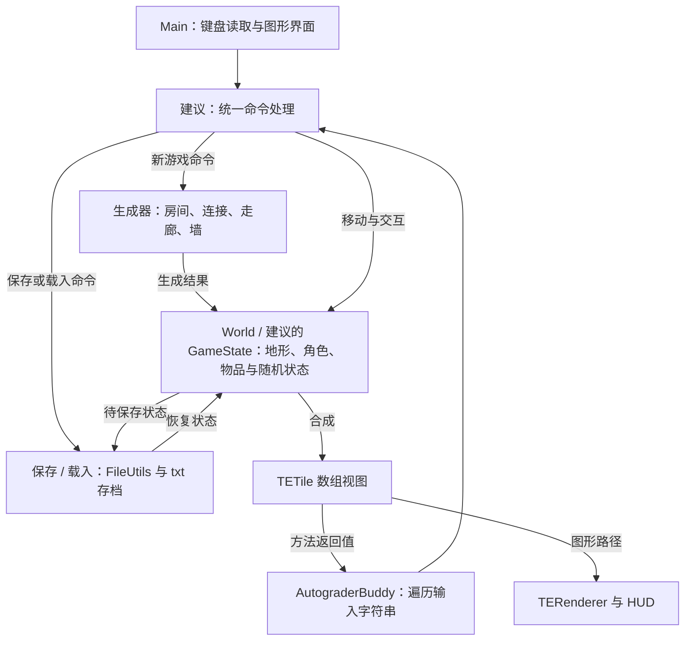
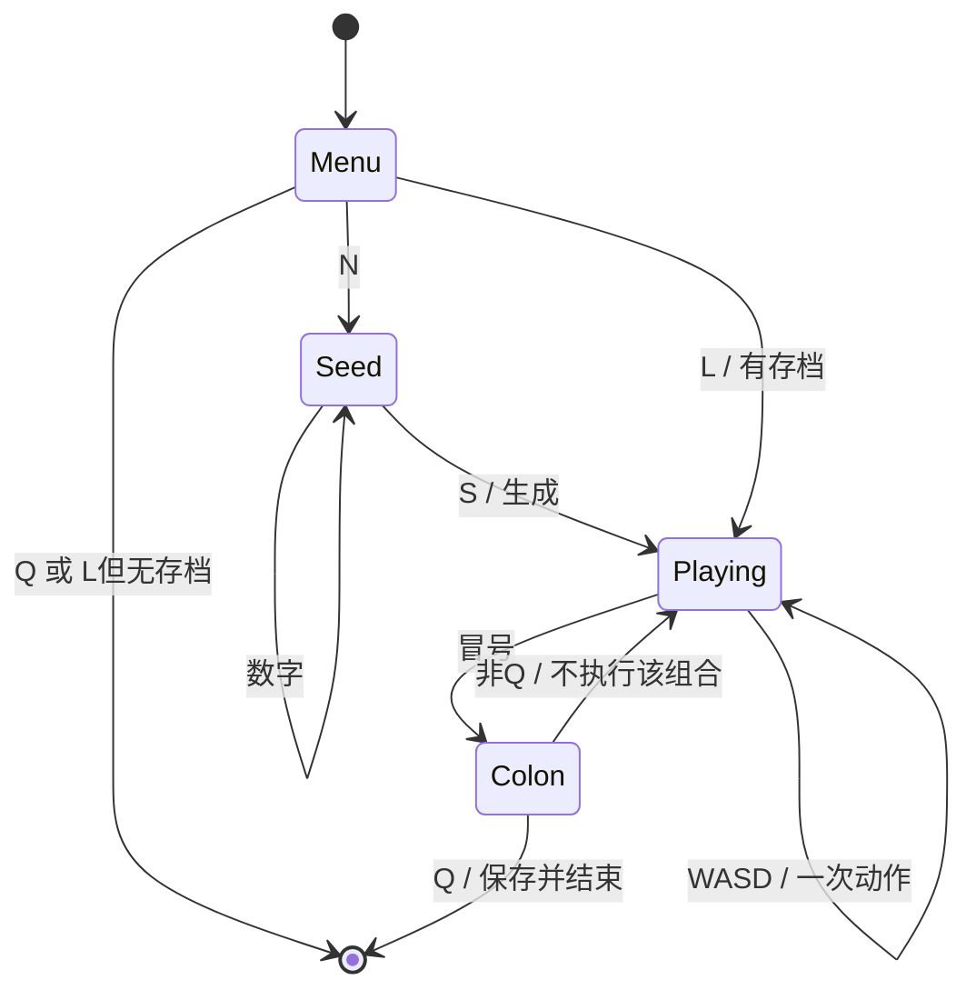

# CS61B Spring 2024 Project 3：BYOW 中文学习与实现指南

核对及审计日期：2026-10-14。适用范围：Spring 2024 Project 3 全部阶段（3A、3B、3C），以及当前 `E:/cs61b/skeleton-sp24/proj3` 骨架。

这份指南带你把一个种子变成可以探索、保存和恢复的二维世界。阅读时按阶段推进：先做能用小数据检查的部件，再把部件连接起来。本文给出设计思路、操作推演和验收方法，不提供完整项目答案。

## 0. 版本、来源与当前起点

### 0.1 阅读依据

核心依据是以下 **Spring 2024** 页面；正文的官方要求均指这一版本：

| 材料 | 用途 |
| --- | --- |
| [Project 3 官方说明](https://sp24.datastructur.es/projects/proj3/) | 世界生成、交互、保存载入、Ambition、设计与交付要求 |
| [Project 3 FAQ](https://sp24.datastructur.es/projects/proj3/faq/) | 世界合法性例外、无图形评测、种子与保存常见问题 |
| [3C Checkoff Script](https://sp24.datastructur.es/projects/proj3/proj3checkoff/) | 演示的实际操作顺序、评分项目与现场准备 |
| [Common UI Bugs](https://sp24.datastructur.es/projects/proj3/ui_bugs/) | 字体、文本消失、HUD 闪烁及一帧显示流程 |
| [Project 3 Partnerships](https://sp24.datastructur.es/resources/guides/partnerships/) | 正式修课时的搭档安排、协作规则 |
| [Lab 09](https://sp24.datastructur.es/labs/lab09/) | 图块坐标、伪随机、文件保存；尤其 Part I 与 Project 3 Saving and Loading |
| [Lab 10](https://sp24.datastructur.es/labs/lab10/) | 输入读取、状态更新与绘图分工；不照搬 Tetris 的游戏规则 |

已阅读 `proj3` 内全部 9 个 Java 文件、模块配置和原有提示。与当前任务直接有关的入口：

| 本地材料 | 当前实际内容 | 在学习路线中的作用 |
| --- | --- | --- |
| [Main.java](E:/cs61b/skeleton-sp24/proj3/src/core/Main.java) | `main(String[] args)` 内只有提示 | 需要你建立图形入口与菜单 |
| [World.java](E:/cs61b/skeleton-sp24/proj3/src/core/World.java) | 空类，没有指定构造器或生成方法 | 世界状态与生成算法由你设计 |
| [AutograderBuddy.java](E:/cs61b/skeleton-sp24/proj3/src/core/AutograderBuddy.java) | 字符串入口目前抛异常；已有图块分类方法 | 自动评测的固定连接点 |
| [TETile.java](E:/cs61b/skeleton-sp24/proj3/src/tileengine/TETile.java) | 图块属性、绘制、文本输出、复制、按 ID 比较 | 世界里的一个格子是什么 |
| [Tileset.java](E:/cs61b/skeleton-sp24/proj3/src/tileengine/Tileset.java) | 已有地面、墙、角色等常量 | 可以直接使用的图块库 |
| [TERenderer.java](E:/cs61b/skeleton-sp24/proj3/src/tileengine/TERenderer.java) | 初始化、整帧绘制、只画图块、字体恢复 | 可以直接使用的显示工具 |
| [RandomUtils.java](E:/cs61b/skeleton-sp24/proj3/src/utils/RandomUtils.java) | 接收 `Random` 的随机分布与打乱工具 | 生成中的随机选择 |
| [FileUtils.java](E:/cs61b/skeleton-sp24/proj3/src/utils/FileUtils.java) | `writeFile`、`readFile`、`fileExists` | 文本存档的底层工具 |
| [WorldGenTests.java](E:/cs61b/skeleton-sp24/proj3/tests/WorldGenTests.java) | 一个渲染演示，两个空 TODO 测试 | 检查起点，尚不是完整测试集 |
| [proj3.iml](E:/cs61b/skeleton-sp24/proj3/proj3.iml) | `src`、`tests`、`library-sp24`，并依赖 lab09/lab10 模块 | IntelliJ 编译与依赖配置 |

辅助阅读包括本地 [BoringWorldDemo](E:/cs61b/skeleton-sp24/lab09/src/gameoflife/BoringWorldDemo.java)、[RandomWorldDemo](E:/cs61b/skeleton-sp24/lab09/src/gameoflife/RandomWorldDemo.java)、[GameOfLife](E:/cs61b/skeleton-sp24/lab09/src/gameoflife/GameOfLife.java) 的保存接口和 [Tetris](E:/cs61b/skeleton-sp24/lab10/src/tetris/Tetris.java) 的显示组织。

官方关联的 `StdDraw` 文档是 [Princeton StdDraw API](https://introcs.cs.princeton.edu/java/stdlib/javadoc/StdDraw.html)。此次访问该页及 algs4 对应文档返回 403，因此没有声称完整读到它们；已用 `javap` 检查 `E:/cs61b/library-sp24/algs4.jar` 的 `edu.princeton.cs.algs4.StdDraw` 方法签名，并结合本地渲染器核对本文使用的调用。官方还关联 [File API](https://docs.oracle.com/javase/8/docs/api/java/io/File.html) 与 [Files API](https://docs.oracle.com/javase/8/docs/api/java/nio/file/Files.html)；本地 `FileUtils` 使用的是较新 JDK 的 `readString/writeString`，相关行为以本地代码和 [Java 17 Files API](https://docs.oracle.com/en/java/javase/17/docs/api/java.base/java/nio/file/Files.html) 为准。

不把官方关联的 Spring 2018 视频当作 Spring 2024 接口依据。本文也没有使用其他学期的实现或解答。

### 0.2 必须先看清的差异

| 材料之间的差异 | 影响与处理方式 |
| --- | --- |
| 原有 [中文提示.md](E:/cs61b/skeleton-sp24/proj3/中文提示.md) 把保存、载入列在 3C | 官方将它们列为 **3B**，3B 自动评测会检查；不能等做 Ambition 时才开始。保留原提示，按本指南的阶段关系学习 |
| 官方描述 `Main` 已负责读取参数和委托；本地 `Main` 只有空入口 | 目前运行 `Main` 不会自动生成菜单或世界；这部分需要自己建立。不能假设命令行种子已经支持 |
| 官方叙述中写 `Core/TileEngine/Utils`，本地声明为 `core/tileengine/utils` | Java 导入与包名按本地小写声明；字符串入口是 `core.AutograderBuddy.getWorldFromInput` |
| 官方用专用小组仓库 `sp24-proj3-g***`；当前是个人 `skeleton-sp24` 工作区 | 自学可以在此学习；正式修课须依官方准备独立小组仓库，不能把本地目录名称等同于已有课程小组仓库。本次不迁移仓库 |
| 本地图块构造器需要 `id`；官方图片说明只强调第 5 个参数是路径 | 完整签名为 `TETile(char, Color, Color, String, String, int)`，无图片版本为 `TETile(char, Color, Color, String, int)` |
| 本地 `CELL` 和 `LOCKED_DOOR` 都使用字符 `█`，但 ID 分别是 12、7 | 当前 `isBoundaryTile(Tileset.CELL)` 实际返回 true，因为分类按字符判断。不要把 Lab 9 的 CELL 直接当项目地面；选用需要的图块，新增语义类型时检查字符与 ID |
| UI Bugs 页面旧示例提到 `renderTiles`；本地方法是 `renderFrame` 与 `drawTiles` | 调用本地存在的方法；本地已经提供 `drawTiles`，不用再照旧文重复增加它 |
| 说明偶尔提到 lab12；当前 Spring 2024 的直接准备材料是 Lab 9、Lab 10 | 伪随机、渲染和文件操作从 Lab 9 看起，不据此假定还有必做的本地 lab12 |

FAQ 对 2 格宽走廊、重叠房间等作了补充，后文会单独标明。官网自身的宽泛总结与具体条款也有细微差别，例如“28 分 Ambition”不等于必须恰好选一个主项和一个次项，详见阶段 10。

### 0.3 如何辨认要求的性质

- **官方必做**：基础功能、接口行为、世界条件和正式交付项。
- **本地约定**：当前方法签名、辅助类行为、现有测试真正做了什么。
- **实现建议**：本文安排的顺序、建议类名、生成方案、测试方法。可以换成自己的方案。
- **自行选择**：尺寸、主题、房间生成算法、存档内容格式、扩展组合。
- **额外可选**：满足所选 Ambition 后再做的更多功能，以及没有官方要求的研究或测量。

后文提到 `Room`、`GameState`、`InputProcessor`、`SaveManager` 等名称时，均为**建议你自行设计的职责**，本地不存在这些类，也没有要求必须使用这些名字。

## 1. 先理解最终要交付的程序

完成后，用户运行 `core.Main`，看见菜单，按 `N` 输入一个种子，再按 `S`。程序用该种子构建房间和走廊，显示角色。用户用 WASD 探索；撞到墙会停下；鼠标指向图块时，HUD 告诉用户这里是什么。用户输入 `:Q`，程序保存并退出。下次重新运行，按 `L`，恢复原来的世界、角色及其他状态，还能继续探索。3C 再增加你选择的扩展功能并演示它们。

测试不会替你点击窗口。它调用：

```java
TETile[][] getWorldFromInput(String input)
```

例如 `"n2468sddw"` 表示：新建种子 2468 的世界，尝试向右两次、向上一次，返回最终图块数组。这里的“尝试”很重要：路径上若有墙，位置不一定真的变化。这个方法必须完成与键盘方式相同的逻辑，但不打开窗口、不绘图、不播放声音，也不结束测试进程。

| 路径 | 输入 | 输出或副作用 |
| --- | --- | --- |
| 真实键盘 | 菜单命令、种子数字、移动和扩展命令 | 窗口及 HUD，世界状态变化，必要时写存档 |
| 字符串入口 | 一串按键字符，通常以 `N数字S` 或 `L` 开始 | 最后时刻的 `TETile[][]`；末尾 `:Q` 还会写存档 |
| 世界生成器 | 一个 `long` 种子和你的尺寸/规则 | 合法且可重现的地形及初始化状态 |
| 存档管理 | 当前完整状态或能重建它的记录 | 当前工作目录里的 `.txt` 文件；载入时还原完整状态 |

已有图块引擎负责“把数组画出来”。它不负责替你生成房间、判断移动、保存角色或设计菜单。已有 `FileUtils` 负责读写字符串，也不替你定义存档格式。



箭头上的标签分别说明命令、状态或返回值的传递。统一处理器不必是单独一个类，但它必须可以脱离窗口执行；显示器读取状态，不替游戏执行一次移动或消耗影响游戏的随机数。无图形入口沿共享逻辑取得数组后就返回，不经过 `TERenderer` 和 HUD。

来源：[官方 Overview、Skeleton Code、Requirements Summary](https://sp24.datastructur.es/projects/proj3/)。

## 2. 总路线：先接通最小行为，再扩大功能

| 阶段 | 要解决的问题 | 先看的文件 / 后续主要工作位置 | 完成标志 |
| --- | --- | --- | --- |
| 0：结构与设计 | 谁保存什么，哪些职责能独立验证 | `World`、`Main`、`AutograderBuddy`；自己的设计文档 | 写清状态、生成流程、输入共用关系 |
| 1：图块与坐标 | 数组怎样代表和显示世界 | `TETile`、`Tileset`、`TERenderer`、Lab 9 示例 | 小棋盘方向正确、无 null，模型不依赖显示 |
| 2：种子与最小字符串入口 | `N数字S` 怎样触发一次生成 | `AutograderBuddy.getWorldFromInput`、`RandomUtils` | 大种子能解析；同种子重复调用一致且不弹窗 |
| 3：房间 | 怎样先得到明确的可走区域 | `World`；建议的房间记录和绘制助手 | 一个房间及多个候选房间的边界可手算 |
| 4：连接与墙 | 房间怎样连通且封闭 | `World`；建议的连接、挖走廊、补墙助手 | 所有房间可达，转弯正确，无尽头走廊和缺墙 |
| 5：3A 审计 | 合法性、随机性是否真的符合要求 | `WorldGenTests`；自己的结构检查 | 多种子检查与重复性检查分别记录，准备 3A 交付 |
| 6：角色与动作 | 每次按键怎样改变状态 | `World`；建议的角色/动作助手 | WASD 正确，撞墙不动，字符串结果含角色 |
| 7：命令状态 | 同一个 S 在种子与游戏中含义不同 | `Main`、`AutograderBuddy`；建议的输入处理器 | 大小写一致，`:Q` 原子完成，`:非Q` 无作用 |
| 8：存取 | 重启后怎样继续同一段探索 | `FileUtils`；建议的存档管理 | 连续执行与分段保存载入完全等价 |
| 9：菜单与 HUD | 把已验证的状态展示给用户 | `Main`、`TERenderer.drawTiles`、`TETile.description` | N/L/Q 菜单、显示种子、鼠标描述、无闪烁 |
| 10：3C 扩展 | 在基础行为上加入完整功能 | 自选功能涉及的状态、动作和视图 | 满足 Ambition 组合，各功能有明确演示步骤 |
| 11：整体验收 | 如何把代码、文档、表单和演示对齐 | 官方 Checkoff、自己的验收记录 | 3A/3B/3C 各类交付不遗漏，版本可复现 |

阶段 2 只接通最小入口，暂时不处理移动。阶段 6 先验证动作，再由阶段 7 接入完整命令流。阶段 9 才把已经可靠的逻辑包装成界面。这样可以判断错误到底来自生成、动作、存档还是显示。

3A 用阶段 0—5 的成果；3B 增加阶段 6—9；3C 依赖可靠的 3B 并完成阶段 10—11。3B 与 3C 是同一项目上的两种验收，不是两份互不相关的程序。

## 3. 阶段 0：先写状态和职责，避免所有代码挤进 Main

**本阶段解决的问题**：如果每个类都直接改所有数据，保存、测试和扩展很快会互相影响。先明确状态由谁拥有，后续房间、移动和载入才有稳定的连接点。

**先看**：三个 `core` 文件，确认唯一已经固定的主要接口是 `AutograderBuddy.getWorldFromInput(String)`。`World` 的内部 API 由你确定。

建议先在草稿中回答这些问题：

| 需要的数据 | 它代表什么 | 谁读写 | 为什么以后会用到 |
| --- | --- | --- | --- |
| 宽高与地形 | 每个坐标的基础地面、墙、空白 | 生成器写，动作和显示读 | 越界检查、碰撞、HUD |
| 房间记录 | 房间范围或中心等元数据 | 生成器和连接过程 | 不必反复从图块猜房间位置 |
| 角色位置 | 当前 `(x,y)` | 动作写，视图读 | 移动、存档、返回数组 |
| 种子与 `Random` | 随机过程的起点与当前位置 | 生成和后续随机事件 | 重现同样的行为与继续游戏 |
| 物品/敌人等 | 当前对象位置及属性 | 相应动作写 | 3C、交互与持久化 |
| 输入阶段 | 现在是菜单、读种子还是探索 | 命令处理器 | 判断 `S`、`Q` 的语义 |
| 显示配置 | HUD 高度、主题、视野开关 | 界面/扩展 | 哪些只影响视图，哪些必须存档 |

“房间的中心坐标”和“角色的当前位置”虽然都是两个整数，却表示不同对象。不要为了方便把角色位置借存在房间元数据里，否则载入和移动会破坏生成信息。

推荐的分工是：`Main` 负责启动和键盘/绘图，`World` 或自己的模型对象管理状态，若干助手负责生成、动作、输入解析、存取。A*、MST、并查集都不是基础生成的强制要求；简单的房间连接方案也可以，只要结果达标。来源：[官方 Introduction 与 Starting Your Program](https://sp24.datastructur.es/projects/proj3/)。

### 设计文档应该写什么

官方设计文档不计分，但获得线上或 office hours 帮助需要完成它；官方建议动手前先规划并持续修订。它不是要求你写逐行解释。可以自己选择文件名与格式，下面是待填写提纲：

```text
1. 类与数据
   每个类的职责；实例字段表示什么；哪个对象拥有真实状态。
2. 算法
   房间怎样接受或拒绝；怎样选连接；怎样挖走廊和补墙。
   动作怎样检查边界和目标；哪些操作会消费随机数。
3. 持久化（完成 3A 后补全）
   文件名、字段或历史格式；恢复过程；随机状态怎样恢复。
   与哪些类、方法、文件交互；无存档时怎样结束。
```

正式搭档协作时，双方应约定一个共用模型与接口，而不是各写一套世界再在最后合并。官方允许分工，也要求双方都有实质贡献；结对编程是建议而非强制。参考[搭档指南](https://sp24.datastructur.es/resources/guides/partnerships/)。

**完成标志与检查**：你能在不写实现的情况下讲清“`N37S` 从哪个入口进入，谁解析 37，谁产生图块，谁显示”；能指出保存时需要哪些状态。持久化的细节允许等 3A 完成后再补充。

跨阶段都要遵守的技术限制：不要使用非 `final` 的静态变量保存可变游戏状态，不改评测依赖的 `TETile.character` / `character()`，字符串入口及其可达路径不绘图、不播音、不 `System.exit`，使用标准或课程提供的依赖。这里的“同一套逻辑”是行为一致的要求；单独命名一个统一处理器类是实现建议。

## 4. 阶段 1：把数组、图块和画面对应起来

**问题与依赖**：后面的房间、走廊、移动都在改数组坐标。先把坐标方向和空格状态弄清楚，才能相信后面的推演。

**先看**：`BoringWorldDemo` 的填充过程，再看 `TETile`、`Tileset`、`TERenderer.drawTiles`。

### 4.1 `TETile[][]` 存什么

`new TETile[width][height]` 创建的是“有 width 个列数组，每列 height 个格子”的结构。`world[x][y]` 表示坐标 `(x,y)` 的一个图块引用。左下角是 `(0,0)`，x 向右，y 向上。它与通常按“行、列”访问的表格顺序不同。

创建二维数组后，每个格子起初是 `null`。`null` 是没填值，`Tileset.NOTHING` 是已经定义好的空白图块，两者不能混用。`drawTiles` 和 `TETile.toString` 遇到 null 都会报错。

下面是**人工设定的 4×3 教学棋盘**，格内显示 `(x,y)`；不是你的实际世界尺寸：

| y / x | 0 | 1 | 2 | 3 |
| --- | --- | --- | --- | --- |
| 2（上方） | (0,2) | (1,2) | (2,2) | (3,2) |
| 1 | (0,1) | (1,1) | (2,1) | (3,1) |
| 0（下方） | (0,0) | (1,0) | (2,0) | (3,0) |

只需手动设置三个易分辨的图块：左下角 `(0,0)`、右下角 `(3,0)`、左上角 `(0,2)`，检查文字输出及画面是否一致。`TETile.toString(world)` 先输出 y=2，最后输出 y=0，因此文本最上面一行也是世界上方。

### 4.2 一个图块的属性分别做什么

| 属性/方法 | 当前项目中的用途 |
| --- | --- |
| `character()` | 字符表示，自动评测与图块分类的重要依据；不要修改它的接口或 `character` 字段 |
| `description()` | HUD 的“wall / floor / you”等文字，不是坐标或角色状态 |
| 文字色、背景色 | 显示；同一类地面的色调可以变化 |
| `filepath` | 可选 16×16 图片；路径不可用时回退到字符与颜色 |
| `id()` 与 `equals` | 本地相等性按 ID 判断，忽略颜色、描述等差别 |

`Tileset` 的常量图块可放到很多格子中。当前 `TETile` 不可变，因此你通常是把 `world[x][y]` 换成另一个图块，不去修改这个图块对象内部的字符。

注意三种比较的区别：

- `a == b`：是不是同一个对象；只用常量时看似方便，但颜色变体可能是另一个对象。
- `a.equals(b)`：当前骨架只比较 ID。两块同类地面的不同颜色变体可能仍然相等。
- `a.character() == b.character()`：是不是同一字符；当前 `CELL` 与锁门的字符相同，但语义不同。

本地 `TETile` 没有配套覆盖 `hashCode`。不要拿“按 ID 相等的不同 TETile 对象”直接当 HashMap/HashSet 中可靠的语义键。自己设计的坐标/房间类型若作为集合键，则应定义配套的 `equals` 和 `hashCode`。不要把 FAQ 的一般提醒理解成必须给项目里的每个类都添加相等比较。

还有一个本地构造器陷阱：`new TETile(Tileset.FLOOR, '!')` 只替换字符，仍保留 FLOOR 的 ID，所以它与 FLOOR 的 `equals` 结果仍是 true；但现有 `isGroundTile` 不会把字符 `!` 识别为地面。这个复制构造器适合你明确了解语义时使用，不能自动替你注册一个全新的物品类型。新语义类型应明确分配字符、ID、描述，并更新分类。

`TETile.copyOf` 复制二维数组及列数组，但各格子仍引用原图块对象。对当前不可变图块而言，可以用它保留棋盘快照；若你以后把图块改成可变对象，这种复制不再隔离内部属性修改。

### 4.3 显示是数组的使用者

先创建和填好数组，再在图形入口调用渲染器。`initialize(w,h)` 会打开并配置 `StdDraw` 窗口，`renderFrame` 会清屏、画图块、显示。它们都不能从无图形字符串入口间接调用。

**建议动作**：先做一个全 `NOTHING` 的小数组，再画上述三个位置；理解 `width=world.length`、`height=world[0].length`。可以只用 `TETile.toString` 检查，无须先写菜单。

**完成标志**：数组尺寸、上下左右和输出一致，每格非 null；构造模型本身不会开窗口。这个小棋盘仅验证引擎使用方式，还不满足 3A 的房间和走廊要求。

来源：[官方 Tileset and Tile Rendering](https://sp24.datastructur.es/projects/proj3/#tileset-and-tile-rendering)、[Lab 9 Part I](https://sp24.datastructur.es/labs/lab09/#part-i-meet-the-tile-rendering-engine)，并对照本地引擎。

## 5. 阶段 2：让一个种子稳定地启动生成

**本阶段的问题**：不是“每次都生成某种随机图”，而是“同一输入能反复得到同一结果”。这让失败能重现，也为保存回放打基础。

**先看**：`AutograderBuddy.getWorldFromInput` 的注释，以及 `RandomUtils.uniform` 的参数和范围。

### 5.1 先接通最小输入

3A 需要处理 `N数字S`，大小写都接受。种子是 `long`，官方要求支持正数直到 `9223372036854775807`；超过此值不规定行为。不能用 `Integer.parseInt`。当前测试里的 `1234567890123456789` 已超过 int 范围。

少量机制示例，`digits` 指你在种子阶段已经收集的数字：

```java
long seed = Long.parseLong(digits);
Random random = new Random(seed);
```

这还不是完整解析器。先识别 N，再收集数字，到 S 才解析并调用你设计的生成器，最后返回非空数组。不要一读到第一个数字就生成世界，也不要把末尾 S 放进 `digits`。

**人工输入推演**：

| 操作前 | 字符 | 判断 | 操作后 |
| --- | --- | --- | --- |
| 等待起始命令 | `n` | 新世界开始 | 进入种子阶段，数字缓冲为空 |
| 种子阶段，缓冲为空 | `2` | 数字 | 缓冲变成 `2` |
| 种子阶段，缓冲 `2` | `4` | 数字 | 缓冲变成 `24` |
| 种子阶段，缓冲 `24` | `s` | 结束种子 | 解析为 long 24，初始化一次生成过程 |

阶段 2 可以暂时返回阶段 1 的简单教学数组来验证入口，之后必须替换为阶段 3—4 的真实生成结果。3A 并不要求此时已有主菜单；最终 3B/3C 才要把完整菜单做好。

### 5.2 伪随机是有状态的数列

相同种子只在**调用顺序与参数相同**时产生相同结果。下面是概念推演，不声称这些是 Java 实际输出：

| 调用次序 | 原计划 | 如果提前多调用一次随机数 |
| --- | --- | --- |
| 1 | 决定房间数量 | 决定装饰颜色 |
| 2 | 决定房间宽度 | 决定房间数量 |
| 3 | 决定房间高度 | 决定房间宽度 |

多一次调用后，后续每个决策都取到了不同位置的数。尤其不要让“是否绘图”“鼠标在哪”“每秒重画几次”决定随机调用次数。

建议一次新游戏创建一个由种子初始化的实例 `Random`，生成阶段按稳定顺序消费它；后续随机事件也要有确定的命令驱动顺序。若你自行拆成多个随机流，必须设计种子派生和恢复规则。不要随处 `new Random()`、使用当前时间或 `Math.random()` 来决定世界。

`RandomUtils` 的静态方法只是接收一个 `Random` 来工作，没有替你保存游戏随机状态。最常用的几个工具：

| 方法 | 范围 / 用途 | 常见错误 |
| --- | --- | --- |
| `uniform(r,n)` | 整数 `[0,n)` | n 必须大于 0；n 是范围上限，不是新种子 |
| `uniform(r,a,b)` | 整数 `[a,b)` | b 不包含；b 必须大于 a |
| `bernoulli(r,p)` | 以概率 p 返回 true | 不等于每 10 次必有固定次数 true |
| `shuffle(r,array)` | 用指定 r 打乱数组 | 使用同一数列，别调用不受 seed 控制的打乱方式 |

其余高斯、几何等分布是可用工具，当前基础生成没有要求全部用到。

### 5.3 此时的检查

对同一程序进程分别调用同种子的生成，再调用另一个种子，最后重复第一个种子。第一次与最后一次应一致，不能因为上一次游戏遗留状态而变化。用 `TETile.toString` 比较尺寸与字符布局；还应按需要检查其他真实状态。

确保调用字符串入口时没有窗体、绘图、声音和 `System.exit`。它的静态方法可以每次创建一个独立游戏对象；**静态方法不等于必须用静态字段保存世界**。官方禁止非 `final` 的静态变量；世界、角色、Random 等可变状态放在实例里。即使把一个可变对象声明为 `static final`，也不应把它当所有新游戏共享的随机状态。

**完成标志**：大种子及混合大小写被正确处理；返回数组无 null；同种子在多次独立调用中一致。不同种子的明显布局差异要在生成算法完成后再验收。

来源：[官方 Starting Your Program](https://sp24.datastructur.es/projects/proj3/#starting-your-program)、[FAQ 的 long 种子与 StdDraw 错误](https://sp24.datastructur.es/projects/proj3/faq/)。

## 6. 阶段 3：先生成房间，建立可检查的几何约定

**问题与关系**：房间提供明确的可走区域，走廊负责连接这些区域。若还没有可靠的房间范围，连接和补墙很难判断自己改了什么。

**先看**：`World`，然后回看 `BoringWorldDemo` 如何用两个循环填一个矩形。建议先设计房间记录；不要求必须创建 `Room` 类。

### 6.1 先约定尺寸表示地板还是含墙外框

下面统一采用**本文的教学约定**：`Room(x,y,w,h)` 表示地板矩形的左下角和宽高，范围是：

```text
x <= 地板横坐标 < x+w
y <= 地板纵坐标 < y+h
```

这不是骨架已规定的构造器。你可以用含墙尺寸，但必须把对应公式一起改清楚。

**人工例子**：在 12×9 世界中，房间 A 的地板范围为 `x=2..4`、`y=2..3`，因此地板数是 `3×2=6`。外侧可在 `x=1/5` 和 `y=1/4` 补墙。保留四个角墙是否绘制，可以自己选择。

若使用这个地板尺寸约定并预留一格墙带，候选应满足 `w>0`、`h>0`、`x>=1`、`y>=1`、`x+w<=worldWidth-1`、`y+h<=worldHeight-1`。例如 12 格宽的世界索引为 0..11，地板最右坐标是 `x+w-1`，墙带最右坐标是 `x+w`；后者最多为 11。先保证尺寸能放进地图，再抽起点，避免向 `uniform` 传入空范围。这些公式针对本文约定，不应直接套到“宽高包含墙”的另一种定义上。

| 操作前 | 操作 | 判断 | 状态变化 | 结果 |
| --- | --- | --- | --- | --- |
| 全部 `NOTHING` | 接受 `(2,2,3,2)` | 地板与预留墙带在界内 | 六格改为 `FLOOR` | 一个明确矩形房间 |
| 已有 A | 尝试地板起点 `(0,2)` | x=0 会让地板落到边缘 | 拒绝，不改数组 | A 保留，无半个候选房间 |
| 已有 A | 尝试一个不合你间距策略的房间 | 检查整个候选范围失败 | 拒绝，不写部分地板 | 之后仍可继续尝试 |

先完整验证候选，再真正写入；边检查边写、发现失败才返回，容易留下残破房间。

### 6.2 生成多个房间的推荐顺序

1. 用固定的人工房间检查绘制助手：最小房间、靠近边界的合法房间、超界房间。
2. 接入随机宽高和起点，记录接受的房间，不记录被拒绝的候选。
3. 明确碰撞策略。为了初次实现容易检查，可以拒绝重叠、保留一定间隔；这只是建议。
4. 随机决定目标数量，同时限制候选尝试次数，防止满图时无限循环。若接受数太少，要有确定的重试/重新生成策略，不能带着不合格结果直接结束。
5. 检查最终接受数和尺寸分布。随机“目标数量”不保证最终数量变化；例如每次只能放下 3 个房间，最后还是固定 3 个。

重试也要有终止策略：如果每次失败后都重新 `new Random(同一个 seed)`，再执行完全一样的生成流程，就会无限重复同一张失败图。推荐先选合理尺寸与可容纳数量，设置有限的候选/重试预算；重试时继续有序消费该游戏的随机流，或者用明确、可重现的尝试规则改变候选过程。若预算仍不够，应调整生成方案，例如保留可放房间的分区；不要临时改用系统时间，也不要直接返回缺房间、缺走廊的图。

采用下一阶段的“每个新房间连接一个已有房间”方案时，R 个房间先得到 R−1 条连接记录。若想稳妥形成至少两条走廊，至少应有三个可辨房间及相应连接；这只是该方案下的建议。记录数不等于画面上的走廊数，过短、重叠或被房间吞并的连接仍要在实际地图中检查。

FAQ 允许重叠房间，只要其他合法性仍满足。允许不等于重叠必然好：过度重叠可能融合成大空腔，让房间和走廊失去辨识度。两个结构可以共用墙，仍要满足其余条件。

### 6.3 `Room` 元数据怎样被下一阶段使用

房间记录可以保存左下角、宽高、中心。连接算法只需从记录中选择代表点，不必扫描画面寻找“这里似乎是房间”。例如 A 中心取一个实际地板格，连接目标也取另一个房间内地板格；走廊端点落在房间里，才不会在墙外停一格。

需要定义偶数宽高时中心取哪一格，并保持确定性。任何一致且位于内部的规则都可以；不要因为 HashSet 的遍历顺序变化而在同一种子下改换中心或连接次序。

**完成标志与检查**：每个接受的房间坐标都符合界限；文字输出与记录范围一致；失败候选不留下图块；所有格子仍非 null。此时多个房间不连通是临时状态，下一阶段必须解决。

来源：[官方 3A](https://sp24.datastructur.es/projects/proj3/#3a-world-generation)、[FAQ 的重叠/共墙说明](https://sp24.datastructur.es/projects/proj3/faq/)。

## 7. 阶段 4：先连通地板，再统一补墙

**问题与依赖**：房间数量再多，若被墙堵住，就不能探索。连接算法决定“哪些房间相连”，挖走廊把这种关系落实到坐标，补墙最后把所有可走区域封闭起来。这三件事建议分开检查。

**先看**：阶段 3 的房间记录，再回看 `World` 与 `Tileset.FLOOR/WALL/NOTHING`。以下是一种建议路线，可以换成自己的生成算法。

### 7.1 房间关系与地图上的格子关系不同

把房间看作点，把连接看作边，可以先计划一张连通关系图：


只要每个新房间与已连通集合中的一个房间建立连接，房间关系图就能保持连通。这不要求使用 MST。可以随机打乱房间次序再连接，也可随机选已有房间作为父节点；额外连接形成环路是可选设计。

但“记录了 A—B”还不代表地图可走。若走廊挖到 B 的墙外一格，元数据是连通的，地板仍然断开。因此最后要从**实际格子**验证连通性。

### 7.2 手推一条 L 形走廊

**人工简化例子**：A 中的端点 `(3,2)`，B 中的端点 `(8,6)`，中间暂时为空白。选先横后竖，拐点为 `(8,2)`。

| 步骤 | 写入的坐标 | 操作后 |
| --- | --- | --- |
| 1 | `(3,2)` 至 `(8,2)` 的地板 | 从 A 向右延伸到拐点 |
| 2 | `(8,2)` 至 `(8,6)` 的地板 | 向上连到 B 的内部 |
| 3 | 检查两个端点和拐点 | 拐点只算一格，两段连续，没有缺口 |

该折线共 `6+5-1=10` 个不同坐标，包括房间里的端点；不等于 10 个都在房间外的走廊格。若先竖后横，拐点是 `(3,6)`，得到的是另一条路径。两种顺序可以由种子控制，进一步增加布局变化。

挖一条宽 1 格的折线，不保证最终整张地图的走廊都宽 1 格：两条平行相邻的折线会合成宽 2 格的通路，路径穿过其他房间也可能使转弯部分被房间覆盖。若两端 x 或 y 相同，这次连接本身还是直线。应在完成地板合并后检查实际走廊的宽度、长度和转弯，不只给每次挖掘记录打上“L 形”的标签。

转弯走廊也可以来自两条直走廊的交叉。不要把几段孤立的窄线画出来就当走廊完成：末端应进入房间或已有通路，不能留下没有目标的尽头。

**“叶子房间”与“尽头走廊”不同**：只接一条走廊的房间仍然是有入口的房间；官方禁止的是没有通到另一处有效区域的尽头走廊。验证时看通路是否连接实际区域，而不是简单禁止整个图里出现度数为 1 的房间。

### 7.3 为什么推荐最后补墙

先画房间墙，再连走廊，容易出现“地板已连到墙边，入口仍被墙挡住”。先形成完整地板区域，再在其外侧补墙，可以集中处理房间入口、走廊转弯和交叉处。

推荐采用下面的概念流程，具体助手名称由你决定：


补墙应只把合适的 `NOTHING` 换成墙，不覆盖已有地板。四邻格是 `(x±1,y)`、`(x,y±1)`；八邻格再加四个对角。这两种邻域有不同用途：玩家基础移动与连通性用四邻格；补角墙和检查墙是否贴近地板可以使用八邻格。

**人工局部例子**：`(4,4)` 是地板，`(5,4)` 是空白。该空白应成为地板右侧边界墙。如果 `(5,4)` 已经是另一条走廊的地板，就保留地板，不能因为它靠近房间边界而覆盖它。若补角墙，对角空白也可变成墙，但角墙本身是可选的。

官方 FAQ 允许双层墙，但每一块墙都应属于相关结构并在直接或对角邻域中贴近地板；不能有离地板很远的孤立墙块。没有角墙与地板侧面直接接触空白也不是一回事：FAQ 禁止地板邻接 void，应至少确保可走区域四个方向都被地板或边界封闭；使用八邻格补墙是较容易保持一致的建议。

### 7.4 用实际地板检查连通

把每个地板格看作一个节点，相邻四格之间有连接。选一个地板起点，用 BFS 或 DFS，遇到地板就继续访问并标记。最后比较：

```text
从起点访问到的地板格数 == 全部地板格数
```

这里 BFS/DFS 是本文推荐的自查，不是官方指定生成算法。它可以发现房间图没发现的问题：入口没挖开、转弯漏格、两段走廊只对角相碰。

**人工反例**：只有 `(2,2)` 和 `(3,3)` 两格地板，视觉上挨着角，四方向移动却无法互达。用八方向遍历会误报连通；正式可走性检查要与你的 WASD 规则一致。

基础阶段先按 `FLOOR` 检查；加入角色或地面物品后，相应格子仍属于地面区域。评测分类方法的“地面”概念不一定等于“玩家此刻能进入”的判断，例如锁门可能是边界，地面上的敌人可能阻挡移动。分别定义语义。

**完成标志**：房间与走廊形成实际连续地板；有清晰可辨的窄走廊和转弯；没有无目标尽头；入口未被补墙堵住；地图边缘没有地板；地板四邻没有裸露空白。完整地图的其他 3A 指标放到下一阶段检查。

来源：[官方 3A 合法性与随机性](https://sp24.datastructur.es/projects/proj3/#3a-world-generation)、[FAQ 的 void 与墙条件](https://sp24.datastructur.es/projects/proj3/faq/)。

## 8. 阶段 5：把 3A 的合法性与随机性分别验收

**本阶段的问题**：一张看起来不错的图不足以说明生成器达标。每个生成结果要合法，同一种子要可重现，不同种子还要有实质变化。三种检查不能互相代替。

**先看**：`WorldGenTests.basicTest`，然后对照[官方 3A](https://sp24.datastructur.es/projects/proj3/#3a-world-generation)、[异步人工检查要求](https://sp24.datastructur.es/projects/proj3/#3a-asynchronous-manual-review)与[FAQ](https://sp24.datastructur.es/projects/proj3/faq/)。

### 8.1 3A 条件转换成可以检查的行为

| 官方条件 | 怎样具体检查 | 边界或说明 |
| --- | --- | --- |
| 二维图块世界，用提供的引擎显示 | 确认数组非空、矩形且每格非 null，再用独立图形入口查看 | 字符串入口依然不绘图 |
| 房间与走廊可辨，至少部分房间矩形 | 截图能识别房间内部与细长通路；与房间记录对照 | 随机地板噪声图不满足 |
| 支持转弯，官方频率要求为 20% 或更多的世界出现转弯 | 对预先确定的一批种子统计是否出现转弯 | 本地比例是观察值，不是对所有种子的数学保证；不要把官方下限理解为可随意低于 20% |
| 不允许尽头走廊 | 每段通路接入有效区域，没有伸入空白后停止的支路 | 别把有单一入口的房间误删 |
| 地板、墙、空白视觉不同 | 比较三类显示及字符 | 只变颜色而字符冲突会误导评测 |
| 连通且房间可达 | 从地板起点四方向遍历全部可走区域，人工走到每间房 | 不仅看房间连接记录 |
| 房间不能被地图边缘截断 | 四条数组边缘没有地板；预留墙带也在界内 | 靠边房间生成前就应检查 |
| 不应有过多空白 | 官方建议房间/走廊填充超过约 50%；用全图观察和占用比例辅助检查 | 这是主观标准，不要伪造精确评分公式；“地板比例”也不自动等于官方占用指标 |
| 房间/走廊数量、位置、尺寸/长度随机 | 比较最终接受的房间数、连接数、房间范围、路径 | 固定布局换颜色不算结构随机 |
| 走廊通常 1 格宽、长度随机 | 看真正房间外的细长部分 | FAQ 允许偶尔 2 格宽且明确可辨；初次实现建议坚持 1 格宽 |

角墙可选，重叠房间可选，画布尺寸不必随机。FAQ 允许外部环境扩展，但如果做室外/洞穴，仍应提供满足房间与走廊要求的起始区域，特殊 void 情况先向课程人员确认。纯洞穴地图不能替代基础要求。

主说明中的转弯概率要求，与异步人工检查和 Checkoff 的具体期待都要看到：异步检查会用 5 个种子比较数量、位置、大小与整体变化，并列出至少两条走廊、其中有转弯的要求；现场也要看到至少两条窄走廊和一个转弯，必要时会让你另生成一张带转弯的图。**建议让每张图都具备至少两条走廊和一个转弯**，这是为了稳妥满足各检查的实现选择，不把它误写成只有 20% 的世界需要其他合法性。

### 8.2 本地提供的测试实际上检查什么

| 方法 | 当前行为 | 能说明什么 / 不能说明什么 |
| --- | --- | --- |
| `basicTest` | 调用 `"n1234567890123456789s"`，初始化渲染器，画世界，暂停 5 秒 | 能作为大种子和画面烟雾检查；没有断言，不自动证明连通、随机、墙条件 |
| `basicInteractivityTest` | 只有 TODO，建议使用类似 `"n123swasdwasd"` | 当前不检查移动；空方法可能显示通过，不能当成功证据 |
| `basicSaveTest` | 只有 TODO，建议先 `"n123swasd:q"` 再 `"lwasd"` | 当前不检查保存；建议输入只是起点，必须补等价结果断言 |

`basicTest` **是在取得数组之后由测试代码绘图**，不是许可你在 `getWorldFromInput` 中绘图。它需要图形环境；无图形服务器运行它可能失败。结构测试应另用不依赖 `StdDraw` 的断言。

### 8.3 把检查安排成能定位问题的顺序

1. 固定小例子检查房间、折线、边界助手；不要每次都随机换图来找越界。
2. 对一个种子重复独立生成，逐格检查尺寸与字符，必要时比较房间元数据。
3. 预先选一批种子检查不变量，例如无 null、边缘无地板、四邻连通、墙贴地板。
4. 从这批结果中看不同图的结构，记录房间数、位置、宽高、转弯、明显空白。可以保存自己的记录，但不能把检查样本当作正式评分。
5. 图形演示时能说明哪里由 seed 决定、哪些因素固定，按照官方人工检查操作生成多张图。

结构检查先验证尺寸与非 null，再调用图块分类方法。当前 `isGroundTile` 和 `isBoundaryTile` 都直接访问 `t.character()`，传入 null 会抛异常；它们不是用来帮你判断空引用的工具。

推荐包含本地测试的大种子、`Long.MAX_VALUE`、几个小正数和一批事先选好的种子；具体种子数量不是课程硬性要求。

可使用这个**待填写**的自查表，不要凭想象填写结果：

| seed | 接受房间数 | 走廊记录与转弯 | 全地板连通？ | 边缘/缺墙异常 | 占用观察 | 与其他图的结构差异 |
| --- | --- | --- | --- | --- | --- | --- |
| 待填 | 待填 | 待填 | 待填 | 待填 | 待填 | 待填 |

本项目没有官方要求的性能实验报告、测量数据文件或 `results.txt`。这张表是推荐的开发记录。若自行测生成时间，固定 JDK、尺寸、种子列表及是否关闭绘图，分别记录生成与渲染，避免把 5 秒暂停当算法耗时；这些都不是新增的必交项目。

### 8.4 3A 完成标志

字符串入口对合法种子返回世界；同种子一致；不同种子有显著结构差异；世界满足合法条件和人工查看要求。正式修课时，还需完成 3A Gradescope、异步检查表单和搭档反思，详见阶段 11；自动评测 3A 不测移动，也不替代人工地图审查。

参考外部生成算法时，官方允许学习思路，但不允许把现成游戏或图形演示的代码直接复制粘贴进项目；需要使用 `@source` 标签标注参考来源。示意格式可以是 Java 注释中的 `@source 实际参考URL`，不要把本指南里未采用的候选算法也填成自己的实现来源。这与 3B/3C 的 AI 代码标注是两项不同的引用要求。

## 9. 阶段 6：先实现一次动作，再接长命令流

**问题与关系**：生成阶段得到“地形”，交互阶段增加“当前角色在哪里、此次动作能否发生”。先独立验证一次移动，再接完整输入状态机，错误更容易定位。

**先看**：`Tileset.AVATAR`，`AutograderBuddy.isGroundTile`，再回到自己的模型状态。

### 9.1 先分清地形与角色的呈现

两种常见设计都允许：

| 设计 | 一次移动做什么 | 需要注意什么 |
| --- | --- | --- |
| 在图块数组中直接放角色 | 恢复旧位置图块，再在新位置写 `AVATAR`，更新坐标 | 旧格若是草地、灯或其他地形，不能一律恢复为 FLOOR；应保留底层信息 |
| 地形与角色位置独立，输出时合成 | 地形不动，只改角色坐标；生成返回/显示数组时覆盖角色格 | 传给测试的数组必须含角色，不能只返回裸地形；合成不能破坏真实地形 |

第二种更方便做物品、敌人与视野，但不是强制。无论选哪种，模型位置与返回数组里的角色都应一致。

角色应放在可走地面中。选定稳定的地板格或者用 seeded Random 选择均可；不要放在墙或 `NOTHING`。角色应能与世界交互，例如阻挡、拾取或其他有明确反馈的动作；胜负机制可选。建议预先写清自己采用的交互，不额外假设官方规定了某种物品系统。

### 9.2 一次移动的判断顺序

| 键 | 位移 |
| --- | --- |
| W/w | `(0,+1)` |
| A/a | `(-1,0)` |
| S/s | `(0,-1)` |
| D/d | `(+1,0)` |

先求目标坐标，再检查 `0 <= nx < width`、`0 <= ny < height`，最后读取目标格判断能否进入。不能先访问 `world[nx][ny]`，再补越界判断。撞墙必须不移动、不报错。

建议把动作看作一次状态转换：

```text
计算目标 → 检查边界 → 判断地形/对象 → 决定是否移动
       → 完成相关交互 → 保持角色与其他状态一致
```

是否把撞墙算一个回合、敌人是否因此行动，是你的扩展设计；但相同命令下必须一致，并且保存能恢复这一规则。不能由重画次数决定。

### 9.3 手推移动与阻挡

下面是**人工设定的 5×4 小房间**；表格最上面是 y=3，`#` 墙、`.` 教学地板记号、`@` 角色。这里的 `.` 仅用于表格，实际 `Tileset.FLOOR` 字符是 `·`。

| y / x | 0 | 1 | 2 | 3 | 4 |
| --- | --- | --- | --- | --- | --- |
| 3 | # | # | # | # | # |
| 2 | # | . | . | . | # |
| 1 | # | @ | . | . | # |
| 0 | # | # | # | # | # |

| 操作 | 前位置 | 目标 | 判断 | 后位置 / 图块变化 |
| --- | --- | --- | --- | --- |
| D | (1,1) | (2,1) | 地板 | (2,1)；旧格恢复地板 |
| W | (2,1) | (2,2) | 地板 | (2,2) |
| W | (2,2) | (2,3) | 墙 | 仍在 (2,2)，图块不变 |
| A | (2,2) | (1,2) | 地板 | (1,2) |
| S | (1,2) | (1,1) | 地板 | (1,1)，回到起点 |

动作串 `DWWAS` 的最终位置和初始相同，是因为第二次 W 被阻挡。只按字符串中 W/D 的数量加坐标会得到错误结果。

**检查与完成标志**：在人工地图里分别验证四方向、撞墙、边界、恢复旧地形、唯一角色。还要检查重建返回数组不会修改模型。完成后才把动作交给统一命令处理器；此时还不宣称存取与菜单完成。

来源：[官方 3B 与 UI Behavior](https://sp24.datastructur.es/projects/proj3/#3b-interactivity)。

## 10. 阶段 7：把输入当作有阶段的状态机

**本阶段的问题**：同一个字符不能在所有时候做同一件事。种子阶段的 S 结束输入，游戏阶段的 S 向下移动；菜单 Q 退出，游戏里的单独 Q 不退出。

**先看**：`AutograderBuddy` 注释、`Main`，再看本地 JAR 中有的 `hasNextKeyTyped()` / `nextKeyTyped()`。建议让两个入口都把字符交给同一逻辑。

### 10.1 推荐的命令阶段

| 当前阶段 | 输入 | 具体动作 | 下一阶段 |
| --- | --- | --- | --- |
| 菜单 | N/n | 清空种子缓冲，准备新游戏 | 读种子 |
| 菜单 | L/l | 从默认存档恢复；无存档则无错误退出 UI | 探索或结束 |
| 菜单 | Q/q | 关闭 UI，不要求保存尚不存在的新游戏 | 结束 |
| 读种子 | 数字 | 加入缓冲，UI 显示目前数字 | 读种子 |
| 读种子 | S/s | 解析 long，生成世界，初始化角色 | 探索 |
| 探索 | W/A/S/D | 调用阶段 6 的动作 | 探索 |
| 探索 | `:` | 只记下正在等组合命令的后半部分 | 等待冒号后的字符 |
| 等待冒号后字符 | Q/q | 保存，然后立即结束本次运行或返回数组 | 结束 |
| 等待冒号后字符 | 其他字母 | 该组合不做任何动作，清除等待状态 | 探索 |
| 探索 | 单独 Q/q | 不退出 | 探索 |

`:` 后其他字母不能被重新当移动键消费。例如在 `:W` 中，W 是一个无效组合命令的后半部分，不是向上移动。之后的正常字母再按探索状态处理。

**人工推演**：在阶段 6 的地图、角色 `(1,1)` 上执行 `D:WA`：D 到 `(2,1)`；冒号不动；W 使 `:W` 无作用；A 回到 `(1,1)`。如果最后停在 `(1,2)`，通常是错误地把 `:W` 中的 W 也执行了。



状态名是建议，用枚举、字段或多个方法都可以；不要为这张图硬套类。

### 10.2 两个入口共享什么、各自负责什么

字符串入口逐字符同步处理，字符串结束就返回当前数组。图形入口在有新字符时读一个字符并处理，再根据当前状态画菜单、种子或世界。**输入等待和绘图可以不同，游戏状态转换必须相同**。

图形路径先检查 `StdDraw.hasNextKeyTyped()` 再调用 `nextKeyTyped()`。不要为了基础移动改用按键按住时的持续轮询，让同一个字符在一条路径产生多次移动。`StdDraw` 这里读取字符，不靠方向键、Esc 或同时按键组合实现必做功能。`:Q` 是先冒号、再 Q。

统一逻辑可返回“结束”的状态，由最外层处理：图形入口关闭程序；字符串入口保存后返回数组。`getWorldFromInput` 以及它可达的公共逻辑中不能调用 `System.exit`。也不要新增必须处理的受检异常到这个固定签名上。

评测字符串可假定以合法 `N数字S` 或 `L` 起始。多次保存通常是**多次方法调用**，不是在一串字符里执行两次退出。例如 `N5SDD:QD` 不属于官方要求支持的合法回放串。你可以自行增加非法输入提示，但不要把它当新增的必做功能。

### 10.3 “不随真实时间变化”怎样做到

生成、移动、敌人动作、消耗品和随机事件都由命令推进。界面没有按键时可以刷新鼠标描述，但模型不要因此移动角色或敌人。`StdDraw.pause` 只是控制显示节奏，不能决定模型中的回合。

Lab 9 动画、Lab 10 Tetris 的定时逻辑可帮助理解显示循环，却不能直接照搬为 BYOW 自动评测行为。官方允许 3C 另做依赖真实时间的功能，但用于自动评测的路径必须确定性一致；初次实现建议两条路径都按回合运行，减少分歧。

**检查与完成标志**：大小写输入一致；种子阶段 S 与探索 S 不混淆；单独 Q 不退出；`:非Q` 无作用；`:Q` 不再请求确认或其他按键。用相同种子和命令分别走两条路径，状态对应。保存副作用要在下一阶段验收。

来源：[官方 UI Behavior、Interacting With Input Strings](https://sp24.datastructur.es/projects/proj3/#ui-behavior)、[FAQ 的退出与回放规则](https://sp24.datastructur.es/projects/proj3/faq/)。

## 11. 阶段 8：保存的是可以继续运行的状态

**问题与依赖**：程序退出后变量消失，所以需要落盘。但只保存画面通常不够：恢复后角色、对象与下一次随机事件都必须继续到正确状态。

**先看**：`FileUtils` 的三个方法，`AutograderBuddy` 关于 `:q` 的注释，以及自己模型中的所有可变字段。此阶段属于 **3B 必做**。

### 11.1 文件位置与工具约定

运行程序时，将工作目录设为 `E:/cs61b/skeleton-sp24/proj3`。正式课程的小组仓库中则是它对应的 `proj3`。只在工作目录中创建 `.txt` 文件，例如自行选择的 `save.txt`；不要创建存档子目录，不要把桌面或个人机器的绝对路径写死进代码。

该后缀限制针对运行游戏/评测时创建的存档文件，不是要求学习文档或源代码也改成 `.txt`。

| 工具 | 实际行为 | 你还要负责什么 |
| --- | --- | --- |
| `FileUtils.writeFile(name,contents)` | 使用 `Files.writeString`，创建文件或覆盖已有内容 | 文件内容是否完整、文件名合法、父目录是否已有 |
| `FileUtils.readFile(name)` | 读取整个文件为 String | 解析、字段完整性、还原对象与方向 |
| `FileUtils.fileExists(name)` | 调用 `File.exists` 检查路径存在 | 无存档时的 UI 行为；不把目录存在误当合法存档 |

工具遇到 IOException 会包装为 RuntimeException，不会替你修复缺失父目录或生成正确格式。若没有保存过，UI 按 L 应无错误退出并关闭界面。官方没有指定“无存档调用字符串入口”应返回哪一种哨兵数组，不要在指南或自测中编造固定评测期待；合法载入测试应先建立存档。串入口无论怎样处理都不能退出整个测试进程。

### 11.2 两种存档设计可以怎样选择

| 方式 | 文件记录什么 | 载入怎样恢复 | 主要风险 |
| --- | --- | --- | --- |
| 状态快照 | 地形、角色、物品/敌人、回合、必要开关、可恢复的随机状态等 | 逐项解析并重建 | 漏状态；只存初始 seed 无法恢复已经推进的 Random |
| 种子加动作历史 | 起始 seed 与从新游戏以来影响状态的命令 | 重新生成并按相同次序执行全部历史 | 漏记失败动作或扩展键；回放错误触发保存、递归载入、绘图 |

没有指定必须使用 Java 序列化或某种文件格式。当前 `TETile` 未实现 Serializable，也没有提供 Random 的状态导出；不要以为把对象交给 `FileUtils` 就自动保存了。

**初次实现推荐考虑动作历史**：它可以自然恢复随机数消费过程，也能支持以后视觉回放。历史应包括所有会影响状态的命令；若撞墙仍触发一个回合或敌人动作，也必须记录。`L` 是读取历史的控制操作，不应简单写回历史造成“历史中又出现 L”的递归；`:Q` 是保存控制，不作为重建时的再次写文件动作。载入后，旧历史与新动作要连接起来，再次保存不能只存这次 L 后的片段。

若采用快照，列出模型每个字段及恢复方法。仅记录“已经调用随机数几次”也不当然足够：`nextInt(bound)`、不同随机 API、内部拒绝采样等使“调用次数”无法随便替换为重复 `nextInt()`。应使用你能说明并验证的完整恢复方案。

### 11.3 一个可以手算的跨保存例子

仍用阶段 6 的**人工地图**，假定教学 seed 24 对应这个固定小图，仅用来展示存取；不表示真实生成器会输出它。

| 执行方式 | 过程 | 最终角色 |
| --- | --- | --- |
| 一次连续调用 | `N24SDWWAS`：D、W、W 撞墙、A、S | (1,1) |
| 两次调用 | 第一次 `N24SDW:Q` 保存 (2,2)；第二次 `LWAS`：W 撞墙、A、S | (1,1) |
| 三次调用 | `N24SD:Q`；`LW:Q`；`LWAS` | (1,1) |
| 中间只载入再保存 | `N24SDW:Q`；`L:Q`；`LWAS` | (1,1) |

四种方式应产生相同最终地图、角色与相关状态。比较时先保留连续执行的快照，再按每种分段方案**重新建立初始存档**，不要让上一个测试结束的文件污染下一个测试。

另外，`N24SDW` 与 `N24SDW:Q` 返回数组应一致；区别是后一种写存档。保存本身不应该移动角色、推进一回合或额外消耗随机数。

### 11.4 为什么必须恢复随机状态

假设某个扩展每个有效回合产生一次随机敌人方向；下面的 r1、r2、r3 是**数列位置符号**，不是实验数值：

| 时刻 | 正确随机流 | 错误：载入后只 `new Random(seed)` |
| --- | --- | --- |
| 生成 | 已消费生成所需的一段数 | 重新从序列开头开始 |
| 保存前两个事件 | 消费 r1、r2 | 快照中也许还原了敌人当前坐标 |
| 载入后下一事件 | 应消费 r3 | 却使用生成阶段或较早的数，下一步就分歧 |

“刚载入的截图一样”只能证明当前画面恢复了，不能证明继续运行相同。需要在载入后再执行会触发随机事件的命令，与不中断的方案比较。

### 11.5 检查顺序与完成标志

先检查生成→保存→原样载入，再加移动，再加多次载入/保存，最后加有随机事件的扩展。除了同进程调用，还要真正关闭程序并重新启动，排除只靠内存中的静态变量“假保存”。

若快照保存棋盘文本，记住文本按从上到下的行写入，读到文件行号 r 时对应 `y=height-1-r`；字符/ID 与地形、角色的对应要明确。若用历史格式则不需保存每个图块，但应标记格式与完整历史范围。

**完成标志**：`:Q` 立即保存并退出 UI；串入口保存后返回；L 不要求重输 seed；两次甚至多次保存载入后继续行动仍与连续输入等价；无存档的 UI 退出无错误；游戏运行时只创建 CWD 下 `.txt` 文件。

来源：[官方 Saving and Loading、Interacting With Input Strings](https://sp24.datastructur.es/projects/proj3/#saving-and-loading)、[FAQ 文件权限与 lwsd 检查](https://sp24.datastructur.es/projects/proj3/faq/)。

## 12. 阶段 9：把可靠的逻辑接到菜单和 HUD

**问题与依赖**：此时生成、动作和存档已有明确行为，界面负责把它们展示和传递给用户。不要把“屏幕刚才画过什么”当作世界的真实状态。

**先看**：`Main`、`TERenderer.initialize/drawTiles/resetFont`、`TETile.description()`，再看[官方 UI Bugs](https://sp24.datastructur.es/projects/proj3/ui_bugs/)。

### 12.1 先接菜单，再显示种子，再显示世界

1. `Main.main` 创建图形入口所需对象，显示至少 N 新世界、L 载入、Q 退出。菜单必须能用键盘操作，大小写一致。
2. N 进入种子界面，每输入一个数字，都能看到当前已输入内容；S 后才生成并显示世界。不要再要求额外确认键。
3. L 调用阶段 8 的载入，再显示恢复后的世界。不能要求重输 seed 或重新选主题才能载入默认存档。
4. 探索状态的字符交给统一逻辑，显示当前结果；`:Q` 的 UI 路径立即退出。

官方对 3A 有“提供字符串让 Main 生成并显示”的调试要求，而本地 Main 尚未实现参数处理。建议先让自己的 `Main` 调试模式接受一个 `N数字S` 参数并显示生成结果，再建立最终菜单入口。参数支持的具体写法由你决定；不能在当前空 `Main` 下声称已有这项功能。

“用命令行参数接收这个字符串”是本文建议的调试方式，官方没有在当前骨架中给出固定的参数开关或 `Main` 参数解析 API。最终默认运行 `Main` 仍应进入菜单。不要为了看图把 `TERenderer` 临时塞进共享字符串入口后忘记移除；让调试调用者取得数组再绘图更稳妥。

### 12.2 HUD 需要地图之外的空间

最低要求是显示鼠标所指图块的描述，并且不闪烁。血量、回合数、背包等是自选内容。官方把 HUD 放在显示世界的区域之外。

**人工尺寸示例**：世界 60×30，窗口 60×33，偏移 `(0,0)`。世界的 y 索引是 **0..29**，每格绘制占据 `[y,y+1]`，整个地图占据连续画面坐标的 0 到 30；鼠标命中地图的检查区间为 **`0<=mouseY<30`**，y=30 已在地图上边界之外。顶部 30 到 33 预留给 HUD，可以把文字放在例如 y=31.5。用 `initialize(60,33)` 时，数组仍是 60×30；HUD 空间不需要塞进世界图块数组。

`initialize(w,h,xOff,yOff)` 中 w/h 是**窗口**的格数，偏移决定地图从哪开始画。鼠标坐标是窗口逻辑坐标，必须扣除偏移再映射到数组：

```text
tx = floor(mouseX - xOffset)
ty = floor(mouseY - yOffset)
若 0 <= tx < worldWidth 且 0 <= ty < worldHeight：读取该格描述
否则：鼠标在 HUD、边缘或地图外，不访问数组
```

**人工偏移推演**：地图偏移 `(2,1)`，鼠标在 `(5.7,3.2)`；扣偏移得 `(3.7,2.2)`，取 floor 后访问 `world[3][2]`。如果鼠标在 `(1.8,3.2)`，扣偏移后的 x 是 -0.2，floor 为 -1，所以不读数组。直接用 `(int)` 会截断到 0，错误地指向第一列。

用 `description()` 生成文字，而不是在 HUD 里再维护一套不一致的“# 代表什么”规则。空白也有描述；鼠标在界外时显示空文本或提示由你选择。

### 12.3 为什么 HUD 会闪烁

本地 `renderFrame` 顺序是：清屏→画图块→`show()`。如果之后再画 HUD 并 `show()`，一次循环展示了两个画面：一个只有地图，一个有 HUD。用户看到哪一个取决于显示时机。

推荐整个 UI 一帧只统一显示一次。以下是**显示机制片段**，不是游戏完整循环：

```java
StdDraw.clear(Color.BLACK);
ter.resetFont();
ter.drawTiles(tiles);   // 本地方法既不清屏，也不 show
// 在这里设置 HUD 的字体和颜色，画好 HUD 文本。
StdDraw.show();
```

`TETile.draw` 会改画笔颜色，因此 HUD 绘制前要设清晰可见的颜色。HUD 若用较大字体，下一帧画图块前要 `resetFont()`，否则角色和墙字符也会变大。文字要在窗口范围内，不能在画完后被再次 `clear` 或覆盖。

如果只做简单地图调试，`renderFrame` 很方便；加入 HUD 后，使用已经提供的 `drawTiles` 更容易控制整帧。初期不需要改渲染器或调整它设定的坐标缩放。

### 12.4 图形检查怎么做

从菜单启动一个新世界，记录 seed；移动并撞墙；把鼠标分别放在地板、墙和角色等至少三类图块上，检查描述意义和字体。鼠标进入 HUD/边缘不能越界。然后保存退出，重启 L，继续移动，再保存载入一次，最后确认游戏中的单独 Q 不退出。

官方 Checkoff 接受鼠标描述需要一次按键才更新，但无闪烁必须满足；本文建议空闲时也检查鼠标位置，使反馈更直接。仅鼠标移动可以更新显示，不能触发游戏回合。

IntelliJ 的运行配置应选择 `core.Main`、`proj3` 模块和 `proj3` 工作目录。该模块引用 `E:/cs61b/library-sp24`，本地该目录已有 algs4 与 JUnit Jupiter 等 JAR。Lab 9/10 也有同名 `tileengine`、`utils` 包，配置错误或复制源码容易导致读到错误模块的类；检查 import 和运行 classpath，不要把所有同名辅助文件重复编译到一起。

本地 `.idea/misc.xml` 指向 JDK 25；这只是你当前 IDE 配置，不代表课程评测采用 JDK 25。不要因本地可用而引入评测版本不支持的新语法/API。当前骨架已有 Java 模式匹配及 `Files.readString/writeString`，也不适合直接拿 Java 8 去编译。

**完成标志**：完整菜单、数字可见、S 立即显示、L 恢复、WASD 与字符串一致、HUD 在地图外且不闪烁、字体正常、边界鼠标不报错。图形链路成功不替代无图形链路检查。

来源：[官方 UI Appearance、Requirements Summary](https://sp24.datastructur.es/projects/proj3/#ui-user-interface-appearance)、[UI Bugs](https://sp24.datastructur.es/projects/proj3/ui_bugs/)、[Checkoff](https://sp24.datastructur.es/projects/proj3/proj3checkoff/)。

## 13. 阶段 10：在基础行为上完成 3C Ambition

**问题与关系**：3C 要一个实际能展示的扩展，而不是把一些开关或类名加进代码。每个所选功能都应说明输入、状态变化、显示结果与恢复行为，再分成小步骤验证。

**先看**：[官方 3C Ambition](https://sp24.datastructur.es/projects/proj3/#3c-ambition--demos)，回到自己的模型、命令和绘图分工，判断功能影响哪几层。

### 13.1 必须完成的分值与可以选择的组合

Ambition 最多计 28 分，要求至少一个主项。官网主项每项 21 分、次项每项 7 分。**扩展类别是项目必做的一部分，具体功能可以选择**。

- 一主项＋一次项是最直接的 28 分组合。
- 两个主项也可以覆盖目标分数，最多仍计 28；官方明确不强制一定做次项。
- 四个次项虽然相加 28，却缺少主项，不满足满分条件。
- 超过 28 的功能没有额外加分。新想法可以向课程人员确认归类，不能自行把任意小功能宣布为 21 分主项。

以下表格用于选题和理解连接点，不要求把所有候选做完。每个正式功能的评分以官方描述和演示判断为准。

### 13.2 官方主项候选

| 主项 | 功能边界 | 推荐拆分与检查 |
| --- | --- | --- |
| 角色视野 | 只显示角色视线内图块；必须能按键开关，避免影响基础验收 | 先算可见集合，再合成显示数组，再接开关；用墙前/墙后的小例子验证；关掉后能查看完整地图 |
| 光源 | 至少一个按键可开关的光源；强度随距离有梯度衰减，不能穿墙 | 先检查距离→亮度，再检查遮挡，再接渲染和开关；等距离无遮挡点可比，墙后不受穿透照亮 |
| 搜索追踪实体 | 用课程搜索算法追踪角色/其他实体；能切换显示预计路径 | 先找路径，再按动作步进，再叠加路线；路线不能穿墙；显示开关不改变敌人真实行动 |
| 遭遇界面 | 接触实体时进入新交互界面，结束后回到原世界 | 先识别触发，再保存主世界状态，进入子状态，最后返回；返回坐标和对象变化有明确规则 |
| 视角切换 | 用户可切换视角，例如第一人称、等距或其他视图 | 保留同一模型，新增投影与切换；切换不能重生成地图或丢角色 |
| 战斗系统 | 玩家生命、治疗收集物、随机移动敌人/对象，以及双方伤害互动 | 先做单次伤害/治疗，再接敌人行动、移动障碍和整体战斗；生命、对象与随机事件可恢复 |

追踪和鼠标寻路会直接用到路径搜索；阶段 4 的地板连通自查也可以用 BFS/DFS。根据实际功能选择算法，基础世界生成并不强制使用 A* 或 MST。做视角切换时，建议保留便于查看完整地图的基础视图入口；无论采用哪种显示方式，仍需满足基础操作和评测接口约定。

### 13.3 官方次项候选

| 次项 | 应怎样让它成为可验收的功能 | 对基础系统的连接点 |
| --- | --- | --- |
| 最近存档的视觉回放 | 从最近一次新世界开始逐步显示历史动作；最后与载入状态相同，仍可继续玩 | 存档历史、无副作用重放与显示节奏 |
| 多存档槽 | 新菜单与新保存快捷键能选其他槽，默认保存/载入仍支持 | 默认 `:Q` 与 L 不被破坏，所有存档仍是 CWD 下 txt |
| 不重启程序的新世界 | 探索或 game over 后能进入新世界 | 重置模型与历史，不遗留旧角色/对象 |
| 角色自定义图片 | 菜单可以选择角色的自定义外观 | 默认 N 不增加必填输入，资源可用 |
| 世界主题/环境 | 菜单选择或由种子随机决定主题 | 主题不等同于基础结构随机性，默认输入保持确定性 |
| UI 语言切换 | 菜单切换全部界面文字，默认英文且能切回英文 | 菜单、HUD、提示等均覆盖 |
| 菜单鼠标支持 | 菜单中所有可按键完成的操作也能点击完成 | 键盘入口仍保留，点击区域与显示对应 |
| 图片图块 | 世界以图片而非仅 Unicode 呈现 | 16×16 图块资源、回退、唯一字符与 ID |
| 音乐及音效 | 菜单或探索有音乐，世界交互有相应音效 | 无图形入口不播放声音，资源与依赖合规 |
| 小地图 | 展示全地图和当前角色位置 | 从真实模型生成，小地图角色位置随动作更新 |
| 旋转世界 | 支持 90° 旋转并相应调整移动键 | 非正方形尺寸交换、坐标映射、鼠标映射 |
| 鼠标寻路移动 | 点击可见格后通过路径算法移动 | 不直接穿墙跳到目标；WASD 仍可使用 |
| 双人同时控制 | 两个可移动角色、独立控制方案 | 角色位置与碰撞规则，存档恢复二者 |
| 撤销 | 能撤销最近动作，包括载入前保存的动作 | 撤销命令追加到回放历史，不能简单删掉原按键；状态应完整回退 |

### 13.4 以“视野＋回放”为例规划连接顺序

这是**推荐示范组合，不是固定解答**。它说明怎样把大功能拆开；若你选别的组合，也按类似层次检查。

**视野主项**：

1. 在很小的人工地图上定义能见范围与墙遮挡算法。先输出哪些坐标可见，不绘图；几何边界规则写清。
2. 保留完整地形作为模型，生成专门的显示数组，把不可见格遮住。别把真实地形改成 `NOTHING`，否则关视野、移动、存档都无法恢复。
3. 移动后根据新位置重算视野，再接开关键。开关视野不应消费影响世界的随机数。
4. 明确字符串入口返回规则。**实现建议**：在普通单层、不滚屏的设计中，让视野遮罩只影响绘图，字符串入口返回含角色和地形的完整状态数组，避免用遮罩把真实地面/边界替换为空白。官方主说明要求返回最终世界，FAQ 对滚屏/多层明确允许返回最后时刻屏幕可见部分；但没有单独规定视野遮罩必须采用哪个返回 API。这里的模型/视图分离是推荐方案，不能写成官方新增的硬性条款。若采用滚屏或多层，再按 FAQ 的可见部分规则独立检查窗口映射。
5. 演示开/关、角色移动、墙后遮挡及重新载入。视线算法可自行选，不能把仅画一个无视墙体的圆形范围自动当作完整视线遮挡。

**人工遮挡例子**：只沿同一水平线讨论，角色 `(2,2)`，墙 `(4,2)`，地板 `(5,2)`；一个会被墙阻挡的视线规则能看向 `(3,2)`，可以显示阻挡墙本身，但不穿墙看到 `(5,2)`。这里只说明一条射线，不替代完整二维可见性算法。

**回放次项**：

1. 先保证阶段 8 的存档历史能无图形地重建最终状态。
2. 增加独立菜单选项，不改变默认 L 的立即载入行为。
3. 从新游戏起点逐个执行记录命令，每步显示；显示延时不参与游戏随机和回合。
4. 回放结束后退出回放模式，继续接真实输入，而不是停在不能操作的展示画面。
5. 比较直接 L 和回放后的地图、角色、回合及下一次随机事件。这里完整存档历史是输入，逐帧画面和最终可玩状态是输出。

### 13.5 自定义图块与功能的验收接口

新增地面、物品或光照图块后，核对 `AutograderBuddy.isGroundTile`；新增墙或边界后核对 `isBoundaryTile`。当前地面分类包含 FLOOR、AVATAR、FLOWER；边界包含 WALL、LOCKED_DOOR、UNLOCKED_DOOR。这些分类是告诉评测“它属于什么结构”，不是自动为你实现拾取、开门或碰撞。

自定义图块的不同语义类型需要不同字符，并为当前 `equals` 选择不冲突的 ID。色彩变体如果只是同一类型，保留原字符和 ID 正常；但不同玩法类型不能只靠颜色差异区分。不要改 `TETile.character` 字段名或 `character()` 行为来迁就自己的设计。

正式提交只使用 Java 标准/提供的库和 `library-sp24`，不能因为电脑上额外装了音频或图形依赖就把它带入项目。图片、音频等自选资源应能在他人的环境中找到；不得依赖私人绝对路径。现有图块引擎使用 `java.awt.Color/Font` 属于骨架提供的 Java 标准设施。

**完成标志**：所选主项与其他功能达到目标分数；每个功能有输入、状态/视图变化、边界验证和演示流程；基础 N/L/Q/WASD、字符串入口和存取回归仍可靠。不要把“写了一个类”“能打开开关”当作完成整项功能。

来源：[官方主/次项列表及分值](https://sp24.datastructur.es/projects/proj3/#3c-ambition--demos)、[FAQ 自定义与多层世界](https://sp24.datastructur.es/projects/proj3/faq/)。

## 14. 阶段 11：从局部检查走到完整验收

### 14.1 测试放在各功能完成之后

| 检查层次 | 适合在哪时做 | 输入与判断 | 能确认的范围 |
| --- | --- | --- | --- |
| 手动几何推演 | 房间、走廊、补墙、移动阶段 | 固定小坐标与地图 | 公式和局部规则是否自洽 |
| 无图形单元检查 | 阶段 2 以后逐步补充 | 解析、非 null、边界、连通、动作、状态快照 | 被覆盖输入上的逻辑行为；不能证明 HUD/主题外观 |
| 重复性与随机性 | 3A 完整生成后 | 同 seed 重复 vs 多 seed 差异 | 确定性与结构变化要分开判断 |
| 存取集成检查 | 阶段 8 后 | 连续命令与分段调用；跨进程重启 | 真正持久化及继续运行的等价性 |
| GUI 操作 | 阶段 9 后 | 菜单、数字、WASD、悬停、退出恢复 | 实际输入与画面，含无闪烁表现 |
| 扩展回归 | 每完成一个 Ambition | 本功能小例子及基础命令 | 扩展没有破坏原契约 |
| 正式自动评测 | 按官方阶段提交时 | 官方隐藏输入 | 3A/3B 的接口与确定性；不替代人工验收 |
| 现场演示 | 3C 最后准备 | 官方 Checkoff 操作与所选扩展 | 世界外观、操作与功能完成度 |

当前没有完善的断言测试，建议你在自己实现后逐步补充。本文没有修改这三个测试方法，也没有替你运行它们。

**比较数组时要比较内容**：Java 二维数组的 `==` 或默认 `.equals` 比较的是引用，不是逐格内容。可先比较宽高，再逐格字符/语义；`TETile.toString` 适合检查字符布局。若检查扩展，另比较角色、敌人、物品、回合与下一次事件；本地 TETile 的按 ID 比较无法证明两张图的颜色/HUD 完全一致。

还应避免测试互相篡改返回数组：保留独立快照，别让后续调用共享同一可变棋盘导致“两个结果都被改成最新图，所以比较通过”。对当前不可变图块可使用 `TETile.copyOf`。

### 14.2 失败表现 → 优先检查方向

| 失败表现 | 优先检查方向 |
| --- | --- |
| 当前入口直接抛 `Please fill out AutograderBuddy!` | 本地入口仍是骨架抛异常；需要以后自行实现，不是测试配置问题 |
| 大 seed 的 NumberFormatException | 是否用了 int；是否把 N/S 混进数字；是否超过 long 上限 |
| 同 seed 第二次结果不同 | Random/世界是否共享上次状态；时间随机；无序遍历；显示是否消费随机数 |
| 图上能看出颜色差异，评测仍说世界没有区别 | 图块字符冲突；不同 seed 只改变颜色而没有结构变化 |
| 图块 null 或数组越界 | 全图初始化、width/height 颠倒、半开区间、补墙越界、先读目标再检查边界 |
| 房间看似相连却走不过去 | 入口还留着墙；折线末端漏格；只对角相碰；补墙覆盖地板 |
| 图太空、数量固定 | 房间接受策略过严、尝试上限、随机目标与最终数量脱节、固定布局模板 |
| 字符串入口触发 StdDraw / Headless 错误 | 构造器、initialize、绘图、声音是否藏在共享逻辑里；与测试自身的绘图区分 |
| S 生成后又立刻移动或不能移动 | 读种子与探索阶段是否明确区分；同字符是否被处理两次 |
| 单独 Q 退出、`:W` 也移动 | 命令阶段混淆，冒号后字符未消费为完整组合 |
| 跨调用 `lwasd` 失败 | 上一次有没有落盘；CWD/文件名是否一致；只靠内存；历史是否丢失旧动作 |
| 刚载入画面一样，再走一步不同 | Random、回合、敌人/物品状态没恢复；回放漏记录影响状态的命令 |
| FileUtils 权限或路径异常 | 是否写了子目录或非 txt；是否硬编码个人路径；工作目录与运行配置 |
| HUD 文字闪烁或消失 | 一帧是否多次 show；画文字后又 clear；颜色和坐标是否正确 |
| 图块突然变巨大 | HUD 改字体后没有在画图块前 resetFont |
| 鼠标碰边缘崩溃 | 没减偏移；地图外仍访问数组；用了截断而非 floor |
| 自定义物品被评测认为空白/墙 | unique character、ID、isGroundTile/isBoundaryTile 分类与语义 |
| 切视野后地图真的消失 | 遮罩写回了真实模型，而不是生成单独显示视图 |
| 本地可用，别人的机器缺图片或无法运行 | 私人资源路径、未交资源、非提供库、错误包名/JDK 新特性 |

### 14.3 按官方现场脚本演练一次

演练应使用最终打算展示的代码版本。顺序为：菜单→N→可见 seed 数字→S→世界结构→WASD→三种图块悬停→HUD 稳定→撞墙→`:Q`→重启 L→原布局和角色→继续操作→再次保存载入→单独 Q 不退出→3—5 个不同 seed 的结构变化→全部所选扩展。

正式现场双方应在场并准时；指定一人主讲。准备 IntelliJ、已运行的菜单、同一项目目录中的终端、要展示的提交版本与干净 Git 状态。官方脚本会检查课程 ID、路径及版本。若自己当前工作区有未保存改动，应另行准备可复现演示版本，不要为了指南或演练随意清理已有代码。

扩展演示说明用“进入哪个界面→按哪个键→应看到什么→怎样退出/恢复”，而不是只写“实现了照明”。可填写：

| 功能 | 演示 seed/前提 | 启动按键或菜单 | 操作与预期结果 | 退出/复原方式 | 已知限制 |
| --- | --- | --- | --- | --- | --- |
| 待填 | 待填 | 待填 | 待填 | 待填 | 待填 |

如最终实际得分或扩展归类仍有疑问，应依据课程人员的反馈；本文不承诺某个推荐算法、图形效果或本地测试必定获得满分。

来源：[官方 Checkoff Script](https://sp24.datastructur.es/projects/proj3/proj3checkoff/)。

## 15. 正式交付项与时间：按 2024 档案核对

这里记录的是 **Spring 2024 当年的课程安排**，不是 2026 年的新截止时间。日期与“11:59 PM”保留官网原写法，不推算为你当前时区的提交期限；存档表单和课程平台今天是否仍可提交也未验证。自学时据此检查成果组成即可。

| 阶段 | 官网日期 | 分值 | 正式交付内容 |
| --- | --- | --- | --- |
| 组队 | 2024-04-03 11:59 PM | 2 | Partnership Preferences Form；接受小组仓库邀请，邀请一周后过期 |
| 3A | 2024-04-15 11:59 PM | 19 | 世界生成 Gradescope 3 分；异步人工检查表单 6 分；3A 搭档反思 10 分 |
| 3B | 2024-04-22 11:59 PM | 9 | 交互与存取自动评测；提交中也应包含供 3C 展示的 Ambition |
| 3C | 2024-04-22 11:59 PM | 95 | Checkoff 表单与现场演示 85 分；3BC 搭档反思 10 分 |
| 合计 | — | 125 | 各渠道分别完成，不是一次上传代码代替所有交付 |

表单入口在[官方 Deliverables](https://sp24.datastructur.es/projects/proj3/#deliverables)中分别列出；提交说明在[Submission and Grading](https://sp24.datastructur.es/projects/proj3/#submission-and-grading)。Checkoff 分为基础功能 37、随机性 20、Ambition 28，总计 85。

3A 自动评测检查返回世界、同 seed 一致、不同 seed 不同，不测移动。3B 检查同 seed 同动作重现、不同输入变化，以及多次保存载入后的等价性。两套自动评测当年没有 token 次数限制，但通过它们不能替代人工的地图合法性、HUD、Ambition 和演示。

正式提交时须注意：

- Gradescope 添加搭档为小组成员。3A 异步检查还要填写对应表单；不能以自动评测提交代替。
- 3A 和 3BC 分别有搭档反思表，不是只做一次反思。
- 3C Checkoff 表单不可漏；官方说明不交表单会使该部分为 0。一位搭档可以提交，但应共同撰写。
- 3C 表单涉及 3B Gradescope submission ID、指定 Git commit SHA 和扩展操作说明，三者要对应你确实想展示的版本。
- 官网先强调使用与自动评测相同的 commit，也允许为评测/演示需要作少量相应差异；推荐同一提交，若不同，明确记录区别并验证两种运行方式。
- 演示前用选定的提交实际运行，确认表单中的 SHA 正确、提交在截止前、现场 HEAD 对应该版本。官网特别提醒：无效 SHA 会导致按 `origin/HEAD` 评分，填错有效 SHA 则可能评分到错误版本。文档不代替这一验证。
- 当年的 3BC 延期政策不沿用此前作业的常规延期规则，只有特殊情况例外；迟到现场会有组内 20% 处罚，主说明还列出截止后 commit 的 50% 处罚。这里仅保留档案政策，不替你申请延期或判断资格。
- 3A 异步评审通常在截止后 3—5 天进行，之后不再审这一部分；可以按官网说明在 3C 修正问题回补 3A 人工检查失分。仍不能据此省略原阶段表单。

**代码之外的交付边界**：官方没有要求 Project 3 的实验报告、性能数据集、指定 `results.txt` 或 Lab 10 那样的 `magic_word.txt`。设计文档不计分但为求助所需；自选存档与资源按你的方案组织，游戏运行创建文件遵守 CWD/txt 规则。若选图片、音频，资源应随可运行项目提供。

官方对 AI 的政策也按阶段不同：3A 保留课程的一般限制，不用工具生成非平凡方法；3B/3C 放宽，但 AI 生成代码仍须明确引用标注。参考[官方 LLM 条款](https://sp24.datastructur.es/projects/proj3/#large-language-models-llms)。本文本次仅整理指南，后续正式修课时遵循适用政策与引用要求。

## 16. 完成检查清单

下面的框用于你以后实现时逐项核对，**不是本次已经完成或测试通过的声明**。

### 16.1 基础必做：3A

- [ ] `core.AutograderBuddy.getWorldFromInput(String)` 支持大小写 `N数字S`，种子使用 long 并支持官方上限。
- [ ] 返回矩形二维图块数组，每格非 null；坐标是 `[x][y]`，左下角原点。
- [ ] 同 seed 独立重复执行一致；换 seed 的结构明显变化。
- [ ] 有可辨房间与走廊，至少部分房间为矩形；走廊通常宽 1 格，数量、位置、长度有随机变化。
- [ ] 房间数量、位置、宽高有随机变化，最终接受结果没有退化成固定模板。
- [ ] 可生成转弯走廊/交叉转弯，符合官方“20% 或更多”的频率要求；能满足人工检查的至少两条走廊与转弯展示。
- [ ] 不存在尽头走廊；所有房间可进入；实际地板四方向连通。
- [ ] 墙、地板、空白视觉可辨；地板不裸露连向 void；墙满足邻地板条件；边缘无地板。
- [ ] 没有过多未用区域，结合官方约 50% 填充建议做人工观察。
- [ ] 可用图形入口显示世界；3A 不强求完整菜单；串入口无绘图、窗口和声音。

### 16.2 基础必做：3B

- [ ] `Main` 有键盘 N/L/Q 菜单；大小写一致；数字输入过程可见；S 后立即生成显示。
- [ ] 角色放在可走位置，WASD 与上下左右一致；撞墙不移动、不报错。
- [ ] 角色有明确的世界交互行为；最终返回数组反映角色等状态。
- [ ] 菜单 Q 退出，探索中单独 Q 不退出；`:Q` 立即保存退出，`:其他字母` 无作用。
- [ ] 字符串与键盘共用可靠状态变化；没有依赖真实时间、重画次数或鼠标刷新触发游戏事件。
- [ ] 字符串入口返回最后时刻状态；`:Q` 保存后返回，绝不调用 `System.exit`。
- [ ] 没有用非 `final` 静态变量保存世界、角色或随机状态；不同调用不共享上次新游戏的可变状态。
- [ ] N 新游戏不额外要求主题/角色选择；自定义选择通过新增菜单选项提供。
- [ ] 保存文件在 CWD 下且后缀为 `.txt`，无新建存档子目录或私人绝对路径。
- [ ] L 恢复地图、角色、对象、回合及随机状态；不要求重输 seed；无存档 UI 无错误退出。
- [ ] 连续输入与两次/多次存取调用等价；跨进程重启仍可恢复并继续。
- [ ] HUD 在地图之外，悬停描述正确，无闪烁；鼠标边界安全，字体恢复正确。

### 16.3 项目必做、内容可选择：3C

- [ ] Ambition 至少有一个主项，组合覆盖 28 分目标；不是只做一堆次项。
- [ ] 所选每项都满足完整功能条件，有可操作的启动、结果和退出说明。
- [ ] 扩展完成后基础菜单、移动、保存载入和无图形接口仍满足要求。
- [ ] 新地面/边界图块已更新分类；语义类型字符唯一，ID 与当前 equals 语义一致。
- [ ] 资源在他人环境可用；只用标准/提供的库；不更改评测依赖的 character 接口。

### 16.4 正式修课交付与文档

- [ ] 按官方组队要求准备小组仓库与双方实质贡献；不是将个人工作区误当正式组库。
- [ ] 设计文档描述当前状态、算法、边界和存取，满足求助所需；没有把它误当计分实验报告。
- [ ] 3A Gradescope、异步检查表单、3A 反思分别完成。
- [ ] 3B Gradescope 包含最终需要的功能，并添加搭档。
- [ ] 3C Checkoff 表单、submission ID、commit SHA、扩展说明与实际版本对应，3BC 反思完成。
- [ ] 双方按时参加现场验收；菜单、IDE、终端目录与干净 Git 状态准备好。
- [ ] 实际按官方脚本演练选定版本，并明确区分本地结果、自动评测反馈和现场得分。
- [ ] 外部算法/代码思路按官方要求用 `@source` 标注，未复制现成游戏或图形演示代码；AI 生成代码另按该阶段政策明确标注。

### 16.5 可选与建议，不增加官方交付

- [ ] 用独立无图形断言补充当前演示/空测试，保留种子和失败案例。
- [ ] 记录自查种子、结构变化、转弯与占用观察；这是开发记录，不是必交实验。
- [ ] 如有需要，测量生成性能，固定输入与环境并剔除显示暂停；不编造测量结果。
- [ ] 重叠房间、角墙、环路、更多主题、胜负条件按设计选择，仍满足基础合法性。
- [ ] 超出 28 分组合的额外功能只在时间充足时实现，不预期额外加分。

## 17. 本指南交付时的验证边界

本次完成的是官方材料与本地源码/测试的阅读、依赖路线组织、示例推演和文档核对。没有实现 `World`、`Main` 或 `getWorldFromInput`；没有填写测试 TODO；没有运行 JUnit、游戏界面、性能实验、Gradescope 或现场 Checkoff；没有提交表单、commit 或 push。

当前骨架中的 `getWorldFromInput` 仍抛占位异常，`Main` 和 `World` 仍待实现。因此上文所有“完成标志”都是你以后实现时的验收目标，不是现有程序已经满足的结果。官方必做事实已按 Spring 2024 页面核对，本地文件语义按当前版本核对；课堂账号、表单可提交性与正式得分没有验证。

审计时在临时目录中使用本地 JDK 17 编译了 `proj3/src` 的 8 个原有源文件与独立探针，未把编译产物写入项目。无图形探针实际核对了 `TETile.toString` 方向、`copyOf` 复制层次、按 ID 的相等性、字符分类冲突、long 上限、同种子随机序列、鼠标负边界取整和 `FileUtils` 文本覆盖。它们支持文中关于现有辅助设施的说明，不等于生成、移动、存取整体功能已实现或评测通过。

另外独立复算了人工小地图的 `DWWAS` 移动、`DW` 保存点、两段/三段继续移动以及 L 形折线的 10 个不同坐标。这只是检查示例推演，使用的是本文明确设定的小地图，没有调用尚未实现的世界生成或字符串模拟入口。

交付静态检查：文中的本地链接目标均存在，表格列数一致，代码/图示块围栏闭合，未发现 Unicode 替换字符。`proj3` 除本指南外的 11 个原有文件的 SHA-256 与审计前相同；已有其他 Git 改动保留。这些检查确认文档结构与修改范围，不证明项目实现通过测试。官方链接保留至具体页面/小节；没有把所有网页锚点或课程表单的可访问性算作已通过的本地检查。

## 18. 官方要求在指南中的覆盖位置

这个索引用于复查有无漏项；完整行为解释仍在对应阶段中。按 Spring 2024 官方说明、FAQ 和现场脚本逐项核对后，主要要求对应如下：

| 官方要求组 | 主要讲解位置 | 完成清单 |
| --- | --- | --- |
| 组队、小组仓库、合作与反思 | 0.2、阶段 0、第 15 节 | 16.4 |
| 三阶段关系、固定入口、设计文档 | 第 1—3 节、阶段 2 | 16.1、16.4 |
| 图块坐标、非 null、构造器、字符与分类 | 阶段 1、阶段 5、13.5 | 16.1、16.3 |
| 房间、走廊、转弯、宽度、连通、封闭、边缘、占用与随机性 | 阶段 3—5 | 16.1 |
| long 种子、大小写、同输入确定性、无图形模拟 | 阶段 2、6—7 | 16.1、16.2 |
| WASD、撞墙、角色交互、冒号命令与单独 Q | 阶段 6—7 | 16.2 |
| txt/CWD 存档、无存档退出、跨进程恢复与随机状态 | 阶段 8 | 16.2 |
| 菜单、种子显示、世界画面、鼠标描述、HUD 稳定 | 阶段 9 | 16.2 |
| 真实时间限制、标准/提供库、静态变量、评测字段与方法保护 | 阶段 0、2、7、9、13.5 | 16.2、16.3 |
| 28 分组合、主项、各候选完整边界、演示兼容性 | 阶段 10 | 16.3 |
| 3A/3B 自动评测、异步检查、现场演示、表单、版本与当年期限 | 阶段 5、11、第 15 节 | 16.4 |
| 外部来源引用、禁止复制现成游戏代码、分阶段 AI 政策 | 8.4、第 15 节 | 16.4 |

这些材料未列出必交的性能实验或测量报告，故自查记录、性能测量与额外功能仍放在 16.5 的可选/建议范围。
